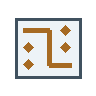
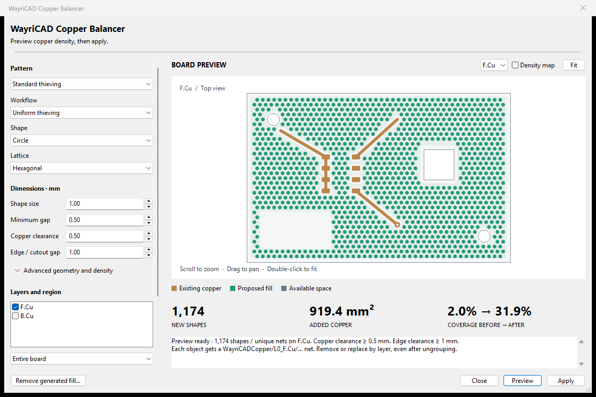

# WayriCAD Copper Balancer



| Start here | Link |
|---|---|
| Download and install | [Latest release](https://github.com/wayri/WayriCAD/releases/latest) · [Installation guide](../docs/INSTALLATION.md) |
| First use | [Getting started](#workflow) |
| Help | [Offline help](help.html) · [Compatibility](../docs/COMPATIBILITY.md) |
| Command line | `wayricad tools run copper-balancer -- --help` |

CLI scope: Copper balancing preview and separate candidate output. The unified command requires the [suite CLI installation](../docs/TOOL_CLI_CATALOGUE.md); installing this PCM plugin alone does not install the complete CLI suite.

## Capabilities

- Creates nonmutating previews for uniform thieving, local density balancing, and edge bands.
- Offers eight fill shapes with square or hexagonal lattices.
- Plans whole-board or manual-rectangle scopes on saved board copies.
- Shows per-layer density maps, tile coverage, deficits, and rejected-site diagnostics.
- Regenerates recognized CopperBalancer/WayriCADCopper fill without duplicating it.
- Saves validated geometry only to a new output board and exposes the same planning workflow through CLI JSON.

## Limitations

- The PCM workflow requires a saved board, omits unsaved editor changes, and does not alter the open editor board.
- The native geometry backend requires KiCad 10.x; KiCad 11 acceptance is unverified.
- Density targets are ceilings, not guaranteed coverage, plating, or thermal-performance predictions.
- Existing output files cannot be replaced; users must refill zones and run KiCad DRC on the copy.
- Selection-bounds scope is available only through the native editor action.

## Overview

Local copper thieving and density balancing, integrated from CopperBalancer 0.2.0. Uses KiCad 10 native integer polygon booleans; no geometry server or remote UI assets.



## Install and open

Install this tool's WayriCAD PCM ZIP using KiCad 10's Plugin and Content Manager **Install from File**. Open **WayriCAD Copper Balancer**, then choose a saved PCB. This package's IPC menu action launches a separate native KiCad 10 process; it does not change the open editor board. Unsaved editor changes are not included. KiCad 10 must remain installed. If automatic discovery fails, set `WAYRICAD_KICAD_PYTHON` to its Python executable.

The source package also exposes a native ActionPlugin for KiCad 10's legacy scripting host. That path edits the live board and relies on the host's action-plugin undo boundary; live editor undo has not been independently verified for this imported tool. The PCM saved-copy workflow is the default.

## Workflow

1. Save the source PCB, finish its closed Edge.Cuts outline and fill its zones.
2. Choose a preset, shape, workflow and enabled copper layers. Basic size/gap controls stay visible; advanced geometry and density controls expand when needed.
3. Preview actual board outlines, holes, existing copper and proposed fill on a neutral canvas. Scroll to zoom, drag to pan, double-click to fit. Switch layers and enable the density map to inspect per-tile coverage.
4. Choose **Save balanced copy** and a new output filename. Cancelling the picker leaves the preview untouched. Existing files cannot be replaced.
5. Open the copy in KiCad, refill zones and run DRC. Custom pair-specific DRC rules still require KiCad's checks.

Eight shapes (circle, square, diamond, hexagon, octagon, rounded square, organic blob, bar), square/hexagonal lattices, uniform thieving, local density balancing and edge bands are retained. Whole-board and manual-rectangle scope work on saved copies; selection bounds are available only in the native editor action. Each generated shape gets a unique floating net and no solder-mask opening. Replacement/removal acts only on selected layers and recognized generated ownership. Existing CopperBalancer nets/groups remain recognized so imported boards can be regenerated without duplicate fill; new ownership uses `WayriCADCopper`.

Previews are nonmutating. Settings and actual board geometry invalidate stale plans. Application restores objects, nets and group membership on failure. The output writer checks that the source file is unchanged and exclusively creates a new destination. Candidate/shape limits and cancellation keep generation bounded. Density targets are ceilings, not guaranteed final coverage or plating simulation.

## Density diagnostics


Synthetic fixture, limited to 50 proposed shapes; no board modification.

Each preview explains rejected sites by region boundary, per-tile density ceiling and geometry/clearance. The summary reports minimum/maximum tile coverage, tiles below target, the remaining target-area deficit, and tiles already above target before generation. The latter cannot be repaired by adding copper. CLI JSON exposes the same `diagnostics` object per layer. Geometry/clearance is one combined conservative rejection category, not a guessed obstacle diagnosis.

Settings reject booleans disguised as dimensions, nonfinite coordinates and noninteger shape limits/seeds. Impossible geometry-adapter areas fail the preview instead of producing misleading density. Tiny polygon-rounding deviations are clamped within a numerical tolerance. These diagnostics quantify copper coverage, not electroplating or thermal performance.

## Implemented methods and research basis

Planning is implemented in [engine.py](copper_balancer/engine.py); the KiCad
polygon adapter and guarded mutation are in
[kicad_backend.py](copper_balancer/kicad_backend.py).

| Method | Implementation | Assumptions and unsupported cases | Validation evidence |
|---|---|---|---|
| Shape construction and lattice | Size is an outer diameter except square-derived shapes (side length) and bars (`size × size/3`). Circles and rounded/organic shapes are deterministic polygonal approximations. Candidate centres use a square grid or alternate-row hexagonal lattice with `pitch = 2r + gap + 0.002 mm`; the extra 2 µm guards native-unit rounding. A seeded shuffle distributes a truncated plan reproducibly. | The circumradius spacing is conservative for noncircular shapes. “Organic” is a fixed trigonometric template, not an optimization or manufacturing model. | every-shape, both-lattice, deterministic-gap and limit/cancellation cases in [test_engine.py](tests/test_engine.py) |
| Per-tile density accounting | Each tile measures `density = 100(existing area + accepted added area) / board area`. Candidate area is apportioned to every crossed tile by sequential half-plane clipping against the tile rectangle, the Sutherland–Hodgman method described in [Sutherland and Hodgman (1974)](https://doi.org/10.1145/360767.360802). Local-balance mode rejects a shape if any crossed tile would exceed the requested ceiling. | The target is a local ceiling, not a guaranteed minimum or a plating/thermal prediction. Existing over-target tiles cannot be repaired by adding copper. At most 10,000 tiles and 500,000 candidate sites are examined. | cross-tile, dense-tile, rectangle-clipping and diagnostic-accounting cases in [test_engine.py](tests/test_engine.py) and [test_diagnostics.py](tests/test_diagnostics.py) |
| Native allowed region | KiCad `SHAPE_POLY_SET` booleans form the closed board outline minus holes, edge inset, rule/keepout zones and clearance-inflated pads, vias, tracks, graphics and zone boundaries. Filled zone polygons measure existing copper; unfilled zones are still reserved and warned. Broad bounding boxes only cull remote objects; acceptance remains a native polygon containment test. | Density uses current filled-zone geometry, so stale/unfilled zones reduce evidence quality. Composite custom clearance rules not exposed by KiCad 10 SWIG fall back conservatively and still require DRC. | holes, slots, keepouts, edge bands, scoped/full equivalence and invalid-outline cases in [test_kicad.py](tests/test_kicad.py) |
| Modes and rejection order | Uniform mode accepts every geometrically legal site; local balance also enforces each crossed tile's ceiling; edge-band mode subtracts the inset board interior. Rejections are counted as region boundary, density ceiling, or combined native geometry/clearance. | A combined geometry reason is intentionally not presented as a diagnosis of one obstacle. No global objective redistributes copper between tiles. | edge-band, rejection and density-budget cases in [test_engine.py](tests/test_engine.py) and [test_kicad.py](tests/test_kicad.py) |
| Ownership and save transaction | Every accepted polygon receives a distinct floating layer-labelled net and a managed group; mask openings are not added. Replacement recognizes only explicit current/legacy ownership. Mutation is journalled and rolled back on failures; saved-copy export rechecks the source hash and exclusively creates a new destination. | Generated isolated copper may still produce native DRC warnings and has no guaranteed electrical or thermal function. | idempotence, ownership, net-collision, rollback and exclusive-output races in [test_kicad.py](tests/test_kicad.py) and [test_workflow.py](tests/test_workflow.py) |

Only the rectangular clipping primitive has a cited published algorithm. The
pattern templates, seeded ordering and density-ceiling workflow are
project-specific heuristics and do not claim a research-derived plating model.

## Command line

The suite console command discovers KiCad's native interpreter automatically. `--help` needs no KiCad installation.

```text
wayricad-copper board.kicad_pcb --layer F.Cu --layer B.Cu
wayricad-copper board.kicad_pcb --settings settings.json --layer F.Cu --output board-balanced.kicad_pcb
```

The first command prints a JSON plan summary without writing a board. `--output` builds the same validated geometry and writes a new copy. Settings JSON accepts `shape`, `mode`, `lattice`, `size`, `gap`, `clearance`, `edge_clearance`, `rotation`, `target`, `tile_size`, `band_width`, `seed`, `max_shapes`, `replace` and optional `[x0,y0,x1,y1]` region. All distances are millimetres; e.g. `{"mode":"Local density balance","target":30,"size":1.2}`.

From a source checkout: `python copper_balancer_plugin/desktop_entrypoint.py board.kicad_pcb --layer F.Cu`. The native backend requires KiCad 10.x. **Live IPC copper editing and KiCad 11 native geometry are not claimed.** Other operating systems' interpreter discovery is best effort and unverified.

## Development

From this folder run `python -m unittest discover -s tests -v`; native tests skip without pcbnew. Repeat with KiCad 10's bundled Python for polygon/serialization tests. `tools/ui_smoke.py` opens and captures only a disposable fixture dialog. The upstream MIT license is preserved in `LICENSE`; the distributed suite runtime is GPL-3.0-only. See `PROVENANCE.md`.

## Search and select copper layers

Use **Find…** beside the copper-layer checklist to search layer names and check multiple layers. **Check visible** or **Uncheck visible** changes only the filtered rows; hidden checks remain selected and are included in the count. **OK** applies the complete checked selection; **Cancel** preserves the current layers. This changes only the analysis configuration; preview and apply remain separate actions.


## Resize the workspace and find help

Drag the divider to balance the scrolling settings area against the board/density preview. Expand advanced geometry or density only when needed; resizing the workspace does not change the saved-copy workflow.

Open [offline help](help.html) for the workflow and troubleshooting. See [readable windows, panels and tables](../docs/UI_ACCESSIBILITY.md) for resizing, complete-row reading and keyboard controls.
