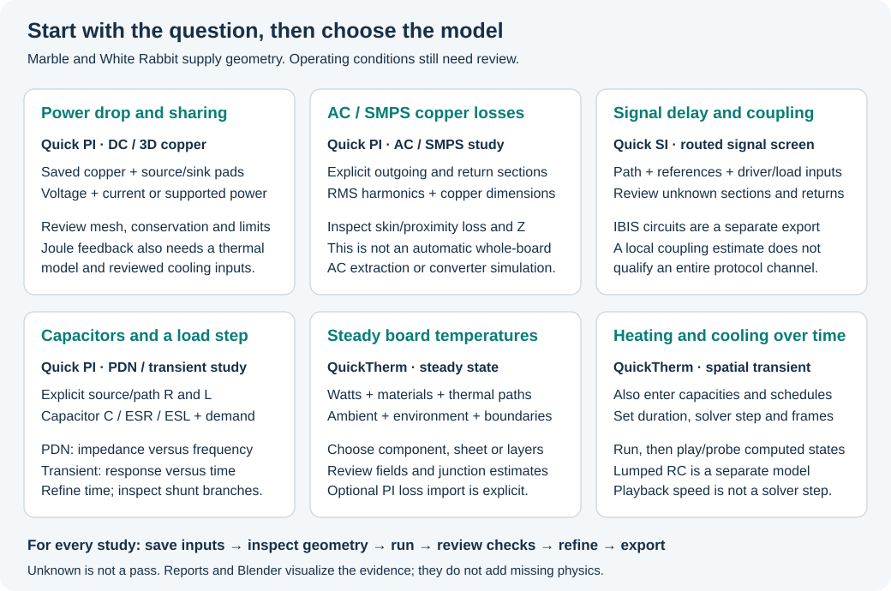

# Marble and White Rabbit tutorial boards

Use these public boards to follow the Quick PI, Quick SI and QuickTherm guides.
The tutorials distinguish real routed geometry from assumed operating inputs.
A public design does not supply a measured workload, vendor thermal data,
regulator model or complete SI channel qualification.



| Tool | Marble walkthrough | White Rabbit walkthrough | All controls |
|---|---|---|---|
| Quick PI | [Worked example](../quick_pi_plugin/USER_GUIDE.md#marble-worked-example) | [Worked example](../quick_pi_plugin/USER_GUIDE.md#white-rabbit-worked-example) | [Control reference](../quick_pi_plugin/USER_GUIDE.md#control-reference) |
| Quick SI | [Worked example](../signal_integrity_advisor_plugin/USER_GUIDE.md#marble-worked-example) | [Worked example](../signal_integrity_advisor_plugin/USER_GUIDE.md#white-rabbit-worked-example) | [Control reference](../signal_integrity_advisor_plugin/USER_GUIDE.md#control-reference) |
| QuickTherm | [Worked example](../quick_therm_plugin/QUICK_THERM_USER_GUIDE.md#marble-worked-example) | [Worked example](../quick_therm_plugin/QUICK_THERM_USER_GUIDE.md#white-rabbit-worked-example) | [Control reference](../quick_therm_plugin/QUICK_THERM_USER_GUIDE.md#control-reference) |

## Get the matching source

| Board | Pinned upstream source | Tutorial input |
|---|---|---|
| Berkeley Lab Marble | [Design folder at a426777d92c0f22a546d4740b419a3937e0c1f90](https://github.com/BerkeleyLab/Marble/tree/a426777d92c0f22a546d4740b419a3937e0c1f90/design) · [PCB](https://github.com/BerkeleyLab/Marble/blob/a426777d92c0f22a546d4740b419a3937e0c1f90/design/Marble.kicad_pcb) | Existing native KiCad working copy, 1,006 footprints and 12 copper layers |
| White Rabbit Switch v3 SCB | [OHWR source at 54f8a604978bdc65bbde5b1f4c7ec9bee3505a44](https://gitlab.com/ohwr/project/wr-switch-hw/-/blob/54f8a604978bdc65bbde5b1f4c7ec9bee3505a44/circuit_board/wrs_v3/SCB_SAM9G45/uTCA_MCH_PCB3.pcbdoc) | Native KiCad 10 Altium import of the SCB board; 774 footprints |

Keep upstream notices and matching project/library files. Start in a tutorial
folder such as `C:/Projects/QuickToolExamples/`, retain the download unchanged,
and work with a separate native KiCad project. Do not run experiments on a
production project. Existing local reference boards were read-only throughout
the recorded tutorials.

For White Rabbit, use KiCad's native Altium board importer and save its result
as a separate `.kicad_pcb` before launching the tools. The screenshots and
examples use KiCad 10.0.6. Importer behavior and native serialization can differ
between versions; an import is not proof of equivalence to the Altium design.
The recorded White Rabbit native import has 12 enabled copper layers but no
explicit physical stackup (`m_HasStackup=False`). Layer names alone do not supply
dielectric thicknesses or material properties. Follow the guide's explicit-input
screen where physical stackup extraction is unavailable.

## Identify the exact board revision

| File state | SHA-256 |
|---|---|
| Upstream Marble PCB download used in the earlier reference study | `3304ba37c2bd891849fc36b500cd940934aaf1f2013a95639c03564fb925c512` |
| Native Marble working copy used for the analysis tutorials | `482850dbaaef9157e2e98af765a3c0d4d9c9f800daae224a54bf10e0621f52b0` |
| Marble matching native project | `e6f28cc276ea7b2dda702cd2daaf7a2b4fc97e06916971c9b127acbd465bf55c` |
| Downloaded White Rabbit Altium PCB | `f74bcabd7d073327e4236173cea4d2490bf661333d93c88d9bc052d482e82673` |
| Native White Rabbit import used for the tutorials | `44b1f5d7da960c3e474ba1010413b9b5b90a7096610effb15dd55d3d3fda54a1` |

The downloaded Marble file and native working copy are different byte states.
Do not claim a matching hash just because the filename is the same. A new native
save or zone refill also changes bytes. Match the guide's net/pad assignments,
inspect the geometry and retain the hash of **your** input with its output. The
tools bind results to that revision; they do not silently substitute a tutorial
board for the open project.

On Windows, record your inputs with:

```powershell
Get-FileHash C:/Projects/QuickToolExamples/Marble/Marble.kicad_pcb -Algorithm SHA256
Get-FileHash C:/Projects/QuickToolExamples/WhiteRabbit/white-rabbit.kicad_pcb -Algorithm SHA256
```

## Prepare the example for analysis

1. Open the separate tutorial copy. Confirm the saved copper layers, board
   outline, drills and net names. For an imported board, review the stackup and
   import diagnostics before trusting any material or connectivity inference.
2. Decide whether to preserve the recorded saved fill or deliberately refill
   your copy. Save after a refill and treat it as a new study revision.
3. Use the exact source and receiver/load pads named in the selected walkthrough.
   Start with its bounded scope, rather than every power net or whole-board
   volume meshing. A visually adjacent track does not establish connectivity.
4. Enter the walkthrough's explicit assumptions. They are illustrative values
   for reproducing a workflow, not recommended operating points for the board.
5. Run, inspect coverage and unknowns, then compare mesh/time settings as the
   model requires. Export HTML/JSON and retain the input configuration.
6. Use PDF or Blender for presentation after reviewing the numerical evidence.
   A smoother plot or animation does not supply missing physical inputs.

## Recognize what each example proves


The White Rabbit SI example follows `EBI1_NBS3`, `IC33.J34` to `IC6.A9`, with
62.554862 mm of routed geometry in the recorded native import. Driver, receiver,
permittivity and uniform-impedance inputs are declared in the SI guide; they are
not measured channel parameters. Other imported nets may contain unresolved
centerline junctions or missing reference evidence. The diagnostic walkthrough
keeps those failures visible instead of modifying a board to force success.

| Example | Read it as | Do not infer |
|---|---|---|
| PI DC / 3D | Conductivity of supported extracted copper under declared terminals and loads | Converter behavior, arbitrary package resistance or AC effects |
| PI Joule feedback | A coupled temperature/resistance iteration under entered cooling assumptions | Automatic thermal characterization of the assembly |
| PI AC / PDN / transients | The explicit cross-section or lumped circuit entered for the study | Complete distributed R/L/C automatically extracted from the PCB |
| SI | Route and reference evidence plus the stated response model | Whole-channel protocol compliance or measured eye quality |
| Thermal | A solution under declared watts, thermal paths, materials and environment | Measured temperatures, known component dissipation or solved airflow |
| Animation | Stored computed states at their stated physical times | Extra integration accuracy or missing intermediate solutions |

A capacitor proximity check does not move components or optimize the PDN.
The guides document that capability as a review workflow. They separately
explain the capacitor-bank impedance and shunt-capacitor transient models.

Source provenance and the earlier native conversion study are recorded in
[the reference-board audit](audits/SILKSCREEN_REFERENCE_BOARD_STUDY.md).
