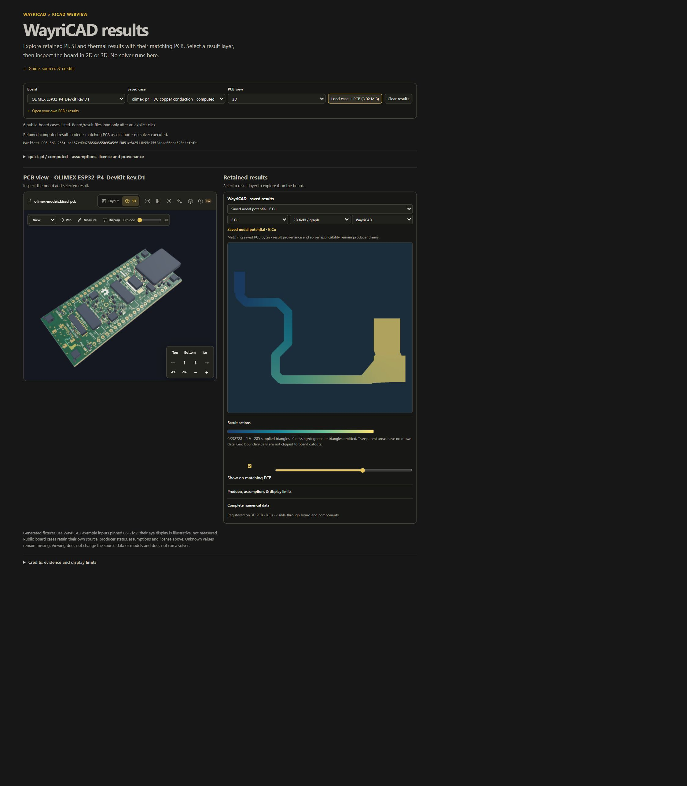
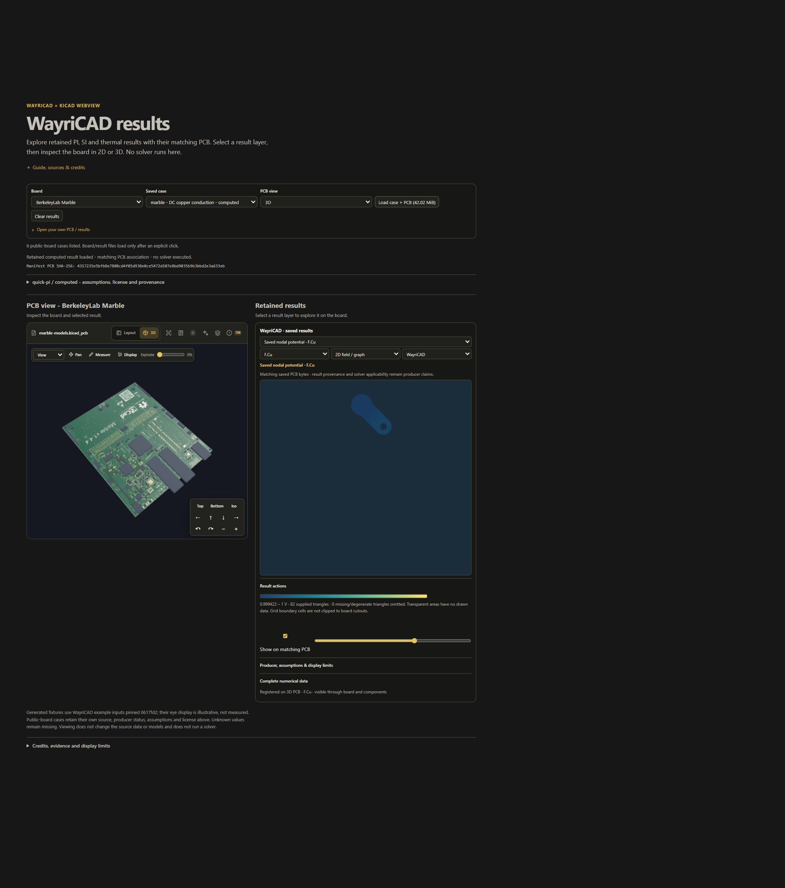
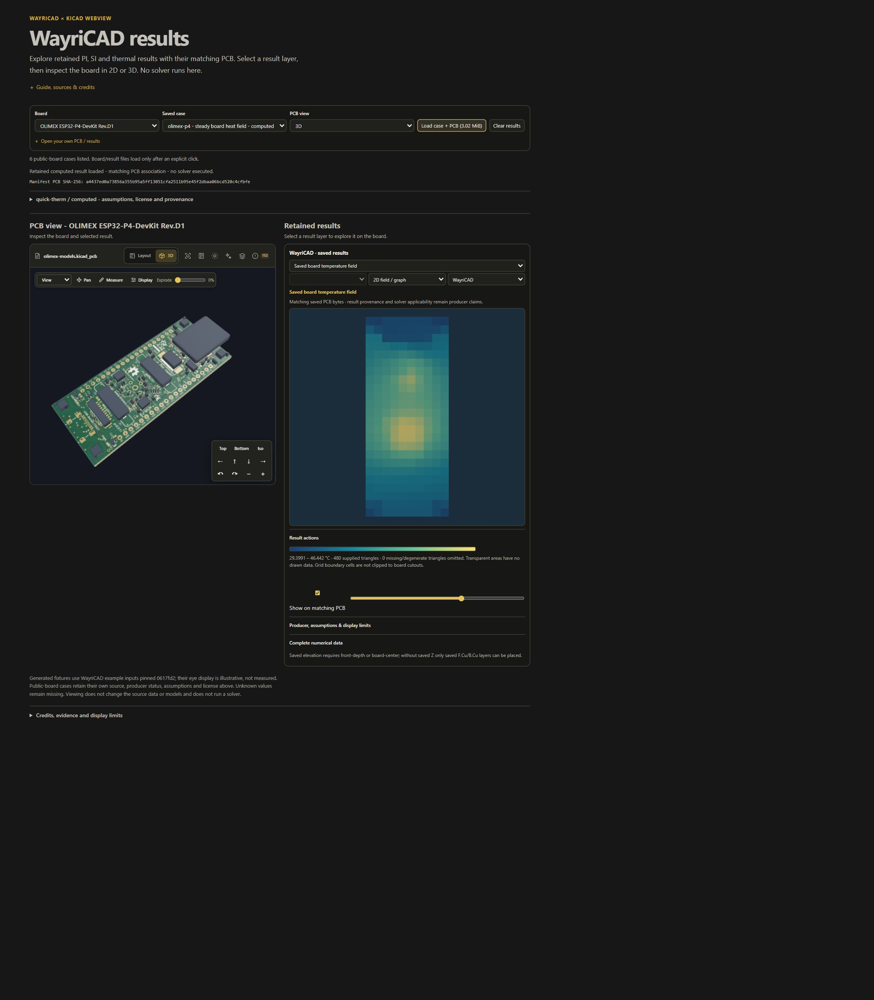

# Public-board cross-integration studies

These examples connect **WayriCAD computation**, **KiCad WebView presentation**
and **KiCad Online saved-result review**. They use real public board geometry,
not measured operating data. The complete numerical outputs, requests, source
hashes and generation receipts are retained here.

## Retained studies

| Board / case | Exact scope and imposed inputs | Computed output |
|---|---|---|
| Olimex P4 PI | `/SD1_VDD`, L1.2 to MICRO_SD1.4; normalized 1 V, 0.1 A | 12.7218 milliohm, 1.27218 mV drop |
| Marble PI | `/FPGA/FPGA_PWR&MISC/VCCADC`, L27.2 to U1.M12; normalized 1 V, 0.1 A | 5.77962 milliohm, 0.577962 mV drop |
| Olimex P4 thermal | U1 0.5 W + U2 0.25 W, 25 degC ambient | Top-layer sampled range 29.3991 to 46.4420 degC |
| Marble thermal | U1 0.5 W + U4 0.25 W, 25 degC ambient | Top-layer sampled range 25.3719 to 28.2173 degC |
| Olimex P4 SI | `/USB_DP`, U1.50 to EXT2.19; effective Er 3.2 | 0.182179 ns screened delay; eye unavailable |
| Marble SI | `/ETH_PHY/MII_MDC`, U6.8 to U54.16; effective Er 3.2 | 1.51364 ns screened delay; eye unavailable |

The PI voltages are normalized test conditions, **not the actual rail ratings**.
The thermal runs use a coarse 24-cell-long-axis grid, assumed dielectric
conductivity 0.3 W/(m K), copper 385 W/(m K), 25 micrometre via plating,
convection 9 W/(m2 K) and emissivity 0.8. The full JSON retains all layer fields
and energy-balance residuals. SI uses an assumed uniform 50 ohm line and does not
complete missing reference, branch or via/stub models. None of these figures is
a hardware measurement or a mesh-convergence claim.

## Actual Viewer Captures







These are unmodified browser captures from the local source preview using the
published WebView 0.7.0 SDK. PI source association and 3D registration were
observed; the thermal capture also records the adapter's placement limitation.
They contain no private projects or local filesystem paths. Screenshots are
presentation evidence, not numerical validation or proof of live deployment.

## Open the interactive examples

1. Open the [public-board result gallery](https://wayri.github.io/assets/demos/wayricad-results.html?gallery=public).
2. Choose a board and study, review its assumptions, then click **Load**. Large
   boards are deliberately not loaded automatically.
3. Use the result's plot selector and hover probe. For supported spatial fields,
   enable the board overlay and inspect the registration/source status.
4. Compare the numerical values with the request and limitations, not just the
   colour map. Pan, zoom and inspect the saved board without changing it.

The gallery's manifest is data, not executable instructions. Only its validated
local assets are loaded. A JSON report's arbitrary `source_path` is never fetched.

**Current viewer limit:** WebView 0.7.0 registers the PI fields on the matching
PCB. Its steady-thermal adapter displays independent 2D temperature maps but does
not carry their layer/Z declarations into a registered board overlay or standalone
3D field. The saved JSON retains these declarations; a matching PCB hash alone
does not establish successful spatial placement. The SI examples show route
impedance screening and explicit unavailable eyes, not invented waveforms.

## What is saved

- `studies.json`: exact input board hashes, requests and declared assumptions.
- `manifest.json`: computed case catalogue, output hashes and gallery paths.
- `*.pocket-kivi.json`: complete portable numerical results, not plot screenshots.
- `*.provenance.json`: producer version, source commit, timestamp, runtime,
  unchanged-source checks and reproduction inputs.

The matching PCB files are already hosted in the website's
[`public-hardware` collection](https://wayri.github.io/assets/demos/public-hardware/PROVENANCE.json).
The Olimex case here is **ESP32-P4-DevKit Rev.D1**, not the different ESP32-PoE M2
shown in some KiCad Online examples; reports must not be exchanged between them.
They are display derivatives with model-path remapping and legacy identity
keyword normalization. Their hashes are **not** the raw upstream hashes. Marble
also inherits a prior native KiCad working copy; its uniform saved stackup must
not be represented as verified fabrication data. Each study records that limit.
Never resave a source file and then attach its old result to the new bytes.

## Reproduce with WayriCAD

Use the source commit recorded in a receipt and KiCad 10's Python, plus the
scientific dependencies from the relevant tool's runtime guide. Download the
matching hosted PCB files into one dedicated public-example directory. Do not
substitute a similarly named raw upstream download or a locally refilled board.

```powershell
& '<KiCad Python>' -B tools/generate_public_board_results.py `
  --board-root C:/Projects/PublicBoards `
  --output C:/Projects/PublicBoardResults
```

Run one case with `--case <case-id>`. The generator checks pinned bytes before
native loading and checks the board and saved rule sidecars again after solving.
It never changes board geometry, fills zones, rewrites stackups or installs
dependencies. It stops on an unsupported input instead of producing a fake pass.
Use a fresh output directory for retained reproduction runs.

Explicit loads, power dissipation, convection, plating and material values are
study assumptions. Preserve them when reproducing, then vary mesh resolution or
physical inputs in a separate study. Numerical convergence, physical validity
and correct viewer registration are three separate questions.

## Reopen in KiCad Online

1. Download a case's portable JSON and its exact matching hosted PCB.
2. Open the PCB in [KiCad Online](https://wayri.github.io/kicad-online/), then use
   the saved analysis/results import for the JSON.
3. Confirm that the source hash matches before using a spatial overlay. Do not
   bypass a mismatch: the raw upstream PCB and display derivative are different
   byte states, even when their copper looks identical.
4. Inspect the same saved fields/curves. Importing is read-only: the browser does
   not rerun WayriCAD or imply support for arbitrary unsupported solver output.

The [KiCad WebView guide](https://wayri.github.io/kicad-webview/docs/wayricad-results/)
documents the embedding API. The [portable export guide](../../POCKET_KIVI_EXPORT.md)
documents custody and CLI conversion of existing results.

## Attribution and limits

OLIMEX ESP32-P4-DevKit hardware is CERN-OHL-S-2.0, credited to OLIMEX Ltd and
upstream contributors. BerkeleyLab Marble hardware is CERN-OHL-1.2, credited to
the Regents of the University of California/LBNL and upstream contributors.
Pinned revisions, source URLs and derivative identities are retained in the
study specification and the website's existing provenance ledgers. The projects
do not endorse these example workloads or calculated results.

These are bounded DC copper, route-screening and thermal studies. They are not
full-board qualification, measured temperatures, measured signal integrity,
fabrication stackup approval, converter simulation, CFD or protocol compliance.
Unknown or unsupported geometry remains unknown, rather than being deleted to
make a calculation succeed.
