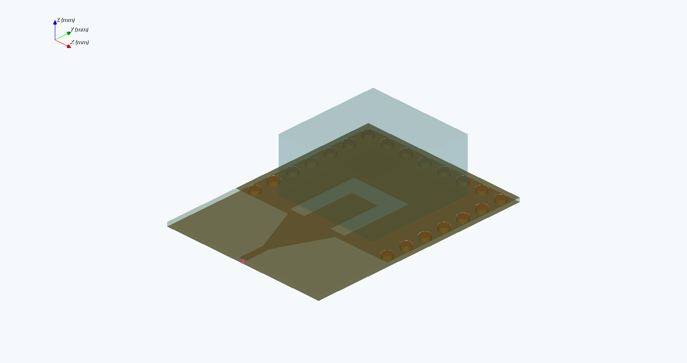
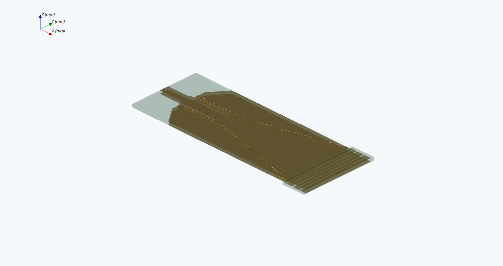
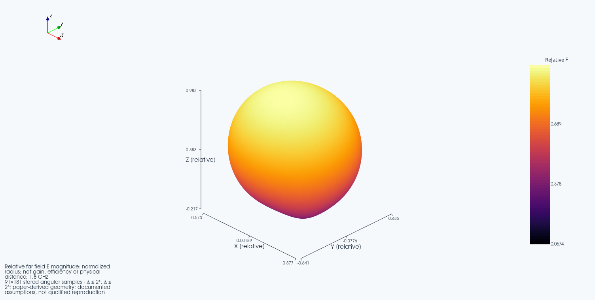
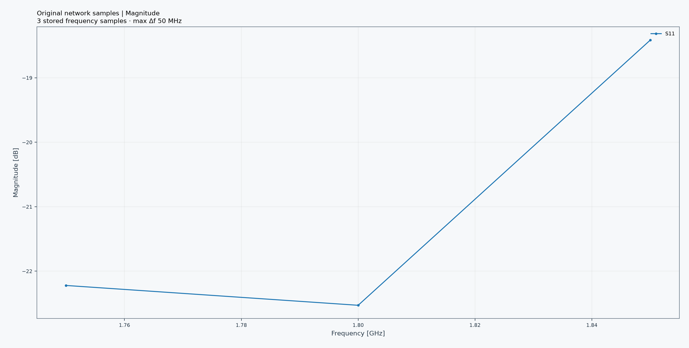
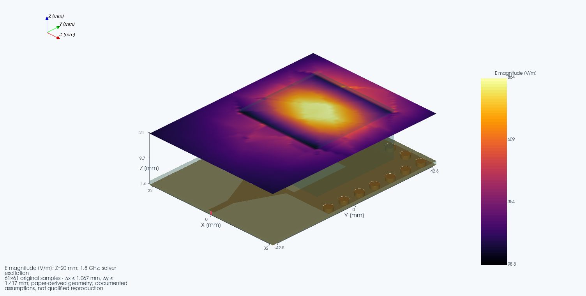

# Paper-derived SIW, resonator and PCB-horn studies

These are executable reconstructions with documented assumptions, not author
CAD or qualified reproductions. Their geometry builders passed real EMerge
3.0.0b9 geometry commits. FEM screening and comparison are separate gates.

| Setup | Research source | Model |
|---|---|---|
| [cheh-lin-2023-siw-dra.json](cheh-lin-2023-siw-dra.json) | [Cheh Lin et al. (2023), DOI 10.3390/mi14071284](https://doi.org/10.3390/mi14071284) | FR4 SIW, U-slot, 20 cylindrical PEC posts and elevated dielectric resonator |
| [ma-2024-siw-horn.json](ma-2024-siw-horn.json) | [Ma et al. (2024), DOI 10.3390/mi15060728](https://doi.org/10.3390/mi15060728) | Flared SIW with 82 cylindrical posts, slotted metal, transition and radiation belts |

The [geometry audit](REPLICATION_QUEUE.md) identifies published and inferred
dimensions. Both models deliberately reject finite-sheet conductor settings:
their solid PEC posts are not a copper-plating-loss model. SMA/probe bodies,
fabrication tolerances and adhesive gaps are omitted. A matching-band result
does not remove those differences or establish mesh convergence.

## Native workflow

1. Use the in-development source version of Quick EMerge with a qualified
   EMerge 3 solver runtime. These additions are not in the immutable 4.7.0 ZIPs.
2. Choose **Files > Open setup** and select one of the JSONs above. The saved
   PCB supplies context only; these setups reconstruct the paper's geometry.
3. Select **3D**, turn off **Show results**, and choose **Preview**. Inspect the
   source geometry, via rows, apertures, feed and dielectric. Review the recorded
   assumptions before treating any shape as an author-specified dimension.
4. For a first screening run, reduce the sweep to three frequencies around one
   target band. Keep a new run directory for every mesh or domain variant.
5. Run the solver. A completed geometry preview is not a completed FEM solve;
   retain failures and read the reported matching/comparison status.
6. Select **Show results > 3D radiation** for solved angular lobes. They show
   relative E, not realized gain or efficiency. Orbit/pan/zoom and probe original
   angles, not values estimated from a screenshot.
   To inspect an existing raw `result.json`, choose **Files > Inspect solver
   results**. Canonical saved simulations use **Load archived simulation** and
   open on an **Antenna 3D** page. Both are read-only and do not attach results
   to the current board.
7. Select **3D fields** and a solved Z slice. For the horn the default sampling
   planes lie inside the substrate, from -0.488 to -0.02 mm. For the SIW/DRA,
   the example samples 0.8 to 20 mm inside the elevated resonator region.
8. Choose **Phase vectors**, select E or H, and move the phase slider or enable
   **Animate phase**. Arrows reconstruct `Re{phasor exp(j phase)}` at original
   coordinates. Arrow lengths are visually scaled; this is a single-frequency
   phasor animation, not a time-domain transient computation.
9. Export the actual view and report. Retain the config, source hash, solver
   version, mesh, frequency, slice, phase, inference notes and failed checks.





These two images are geometry previews only. They do not contain computed
fields or radiation. Their provenance is stored next to each image.

## Reproducible CLI

From the source repository, with the qualified solver interpreter:

```text
python -m quick_emerge_plugin --write-research-setup cheh-lin-2023-siw-dra siw-dra.json
python -m quick_emerge_plugin --write-research-setup ma-2024-siw-horn siw-horn.json

python tools/run_paper_antenna_screening.py cheh-lin-2023-siw-dra --run-dir .validation/siw-dra-run1 --start-ghz 1.75 --stop-ghz 1.85 --points 3 --mesh-edge-mm 2.5 --resolution 0.35
python tools/run_paper_antenna_screening.py ma-2024-siw-horn --run-dir .validation/siw-horn-run1 --start-ghz 59 --stop-ghz 61 --points 3
```

The helper refuses nonempty evidence directories and volumes below the
100 GiB operating reserve. Windows system and pagefile volumes are checked too:
putting TEMP/TMP and output on D: does not prevent system paging on C:.
This is a preflight check, not an OS quota or a cross-process reservation.
Set TEMP/TMP to a volume retaining that reserve.
It records failed status when a solve raises an error. `--prepare-only` writes
the reviewed request without starting the solver. A three-point sweep cannot
resolve a matching bandwidth or prove agreement across the published band.

With a complete native wx/VTK desktop interpreter, capture an actual result:

```text
python tools/capture_antenna_native_views.py .validation/siw-dra-run1/result.json --output .validation/siw-dra-captures
```

This captures only available data. It will not generate lobes from geometry,
turn magnitude-only fields into complex waves, or copy paper figures into a
solver-results gallery. The capture receipt includes result/config/image
hashes, UTC capture time and viewer source hashes.

## Comparison and limitations

### Recorded SIW/DRA screening

The retained EMerge 3.0.0b9/SuperLU run used 30,011 tetrahedra and only three
frequencies. These are computed results from the reconstruction, not digitized
paper curves:

| Frequency (GHz) | S11 (dB) |
|---|---:|
| 1.75 | -22.2223 |
| 1.80 | -22.5298 |
| 1.85 | -18.4155 |

The sampled 1.8 GHz matching check passes, but the publication comparison is
**insufficient**: the higher bands were not sampled, inferred geometry remains,
and mesh/domain convergence has not been established. This is not a bandwidth,
gain, efficiency or full-paper reproduction claim. At 1.8 GHz the stored
polarization estimate is nearly linear (axial ratio 48.75 dB); it must not be
described as circular polarization.

[Open the offline, hover-probe results viewer](images/paper-vnext/cheh-lin-2023-siw-dra/interactive-results.html).
It includes network scales, original field coordinates, angular radiation
samples and numerical provenance. The adjacent `solved-samples.json.gz` can be
opened using **Files > Inspect solver results** in the source-update plugin.
Its source path is redacted to a generic context file; source identity is
explicitly unverified and inspection remains read-only.







These are actual native viewport exports, not full-window screenshots. Capture
time, viewer code hashes and result hashes are in the adjacent provenance file.

### Horn screening audit

Two preliminary runs were rejected before accepting numerical results: one
omitted explicit solid-post exclusions from the air domain, and the next used
an incorrectly oriented feed plane. Their requests, logs and rejected status
are retained locally. The corrected model subtracts the posts from dielectric
and air domains, assigns PEC shells, and uses a YZ port normal to the horn's
X-directed feed. Geometry tests check these boundaries and the port orientation.
Do not use either rejected run as scientific evidence.

The corrected third run completed meshing with **136,242 tetrahedra** and
entered SuperLU factorization. Gmsh reported one remaining ill-shaped
tetrahedron; this warning has not been cleared or qualified. The run was
deliberately stopped before any result
was accepted: solver private memory reached approximately 15.7 GB, Windows
expanded its system pagefile, and C: free space fell to 3.81 GB. No completed
horn S-parameters, fields or lobes are available from that run. This is a
resource-safety stop, not proof that the corrected model converges or matches
the paper. Retain the request and log; repeat only with sufficient system
memory and operating-disk reserve. Do not substitute a geometry rendering for
a computed horn radiation result.

- SIW/DRA: compare separate sweeps around the source's 1.8, 2.6 and 3.7 GHz
  resonances. The guide-width equation and dimension table conflict; the model
  follows the declared table/lattice interpretation. Check the tilted 2.6 GHz
  radiation cut rather than assuming a broadside maximum.
- PCB horn: compare the published 54.06-69.02 GHz simulated matching interval
  only after a sufficiently dense sweep. The inferred slot/belt placement and
  idealized transition can shift matching substantially. Relative fields do not
  reproduce the paper's realized-gain measurement.
- Refine mesh and air boundaries independently, compare complex S11 and
  normalized cuts at fixed frequencies, and report numerical changes. Do not
  call a finite sampled difference "converged" without a stated criterion.
- Empty or unknown field cells remain unknown. Do not smooth away missing data
  or present a single Z plane as a volume. Samples below copper use signed Z
  coordinates; changing the display height is not a new physical simulation.
