# Published antenna benchmarks

These portable Quick EMerge setups reproduce dimensioned antenna geometries
from open academic papers. They are examples and regression benchmarks, not
pre-qualified flight hardware. Open a setup from **Files > Open setup**, review
the geometry and assumptions, then run it in an isolated EMerge runtime.

| Setup | Source | Intended check |
|---|---|---|
| `rezaeipour-2021-dual-feed-patch.json` | Rezaeipour and Sadeghzadeh (2021) | Linear/RHCP/LHCP coherent feeds and boresight axial ratio |
| `yang-2016-wlan-monopole.json` | Yang et al. (2016) | Printed 2.4/5 GHz WLAN return-loss bands |
| `liu-2020-cubesat-yagi.json` | Liu et al. (2020) | Planar CubeSat printed Yagi and balanced coplanar feed |
| `verho-2023-aesa-4x4.json` | Verho et al. (2023) | 3 GHz 4x4 scan law and steering error |
| `kabir-2023-cubesat-sx.json` | Kabir et al. (2023) | Stacked S/X-band CubeSat shared aperture, isolation and circular polarization |

## Evidence boundaries

The `research` block in every result records the title, DOI, source dimensions,
published targets and the implemented model scope. `publication_comparison`
checks only observables present in both the run and the paper. A passing sampled
comparison is not convergence evidence.

The AESA setup evaluates the published rectangular-array phase law. It does not
invent varactor, PIN-diode or feed-network losses. The Yagi setup omits the
CubeSat body and deployment angle, so its 10°, 50° and 90° measured states are
retained as evidence but are not claimed as planar-model predictions. The
dual-feed patch excludes the reconfigurable feed network. The S/X setup includes
the two RT/duroid 5880 layers, 16.2 mm air cavity, RT/duroid 6010 superstrate,
two probe feeds and the dimensioned radiators; bolts and SMA bodies are omitted.
The patch's `auto` state is the paper's equal-amplitude, equal-phase linear
excitation. Circular-state handedness is retained as signed Stokes S3 until the
solver and paper propagation conventions are independently reconciled.

## Setup and installation

1. Install Quick EMerge through WayriCAD's KiCad PCM repository and restart
   KiCad. Source users should follow the [plugin setup guide](../../../quick_emerge_plugin/README.md#setup-and-launch)
   and [desktop runtime guide](../../../wayricad_runtime/RUNTIME_SETUP.md).
2. Open a disposable, saved PCB in KiCad 10's PCB Editor. These research
   templates generate their own geometry; the board supplies traceable project
   context, not the simulated copper. Do not edit/save it during a solve.
3. Launch Quick EMerge through the plugin picker. From a source checkout,
   run `python -m quick_emerge_plugin --board C:/Projects/Example/board.kicad_pcb`
   from the repository root using the configured desktop interpreter.
4. Allow first-open dependency setup to complete. It provisions and qualifies
   an isolated solver environment; do not install EMerge into KiCad's Python.
   In Run settings select the qualified solver interpreter and a verified
   linear solver. SuperLU is a valid fallback when PARDISO is unavailable.
5. Choose a dedicated run-output directory with sufficient disk and RAM.
   Observe the repository's 100 GiB per-drive operating reserve where applicable.
   Avoid concurrent full-wave runs until resource use has been measured.

## Step-by-step plugin workflow

1. Choose **Files > Open setup** and load a JSON file listed above. Alternatively
   open **Setup**, choose **Published antenna benchmark**, then its template.
   Select/load the template before customizing a sweep: template selection
   reapplies its defaults.
2. Review sweep, excitation, mesh, air boundary and sampling-plane settings.
   GUI frequencies use GHz; JSON uses Hz. Registry geometry/material values are
   authoritative; inactive generic patch dimensions do not resize these models.
3. Choose **Preview**. Rotate/zoom the native geometry view and inspect radiator,
   ground, dielectric layers and numbered ports. Preview is not a solved field.
4. Choose **Run simulation** and monitor progress/logs. Begin with a screening
   mesh. A successful solve establishes execution, not numerical convergence.
5. Inspect network, radiation and field views after completion. The analytical
   AESA case uses **Array factor** instead of network/field results.
6. Choose **Export… > Preview report**, then export HTML/PDF. Preserve the
   setup, request, `result.json`, solver log and report together.
7. Change one setting at a time, choose **Preview** again, then run a new case.
   Input changes invalidate previous previews/results; never mix runs silently.

## Actual WLAN screening results (2026-11-10)

These are **native Quick EMerge 4.7.0 captures from a new Yang WLAN full-wave
solve**, not mockups or the historical synthetic fixture below. The 2D images
are window captures; the 3D images are direct native-framebuffer exports,
avoiding window-compositor text artifacts without retouching the image/data.
EMerge 3.0.0b9 / SuperLU solved 2.35, 2.45 and 2.55 GHz on a 4,429-tetrahedron
screening mesh. Field samples are a 41 x 41 grid at Z = 2 mm, at 2.45 GHz.
Only one Z plane was solved; the 3D field image does not imply a volume solve.

**This screening run fails the paper matching target.** It is execution and
visualization evidence, not paper agreement, mesh convergence, gain/efficiency
validation or antenna qualification. Do not infer a resonance or bandwidth
from the lines connecting three frequency samples.

### Actual antenna design in the plugin

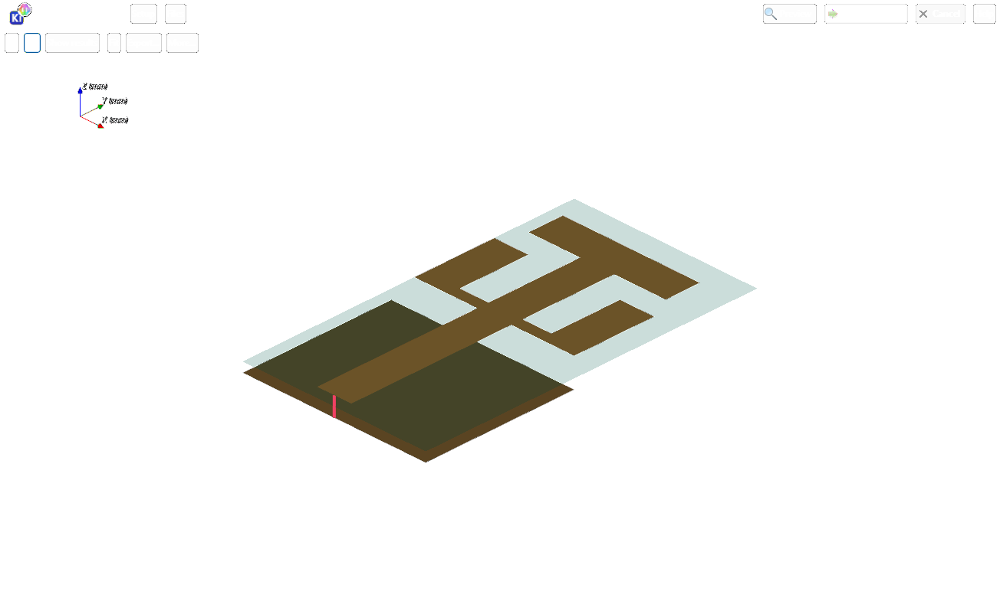

This is the real registry-backed preview open in the plugin, not the unrelated
saved context board. The simulated geometry includes the feed, branched printed
radiator and partial bottom ground on the 16 x 29 mm FR4 substrate.

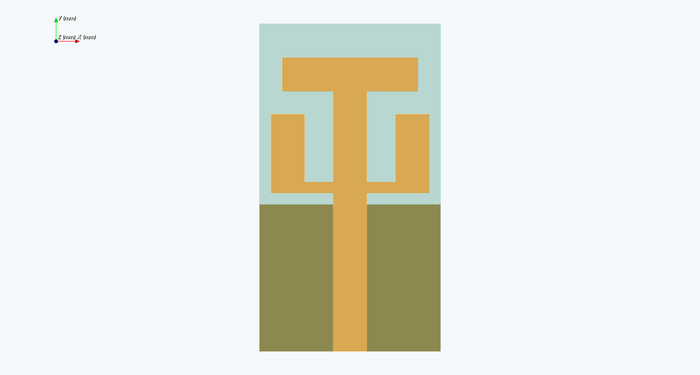

Top/orthographic camera projection of the native 3D model. This uses the native
3D viewport because the current software 2D research fallback shows only the
substrate. It is not evidence that that fallback has been fixed.

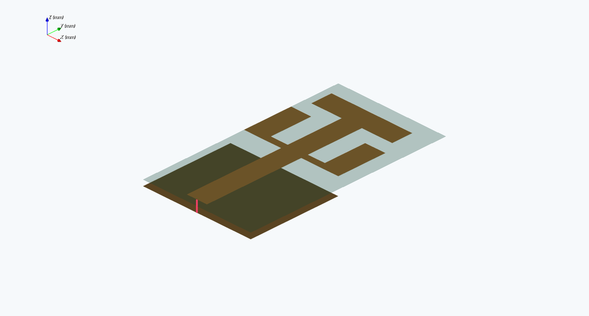

Isometric geometry-only view separates the radiator and lower ground visually.
This is the simulated geometry, not a photograph of manufactured hardware.

### S-parameters

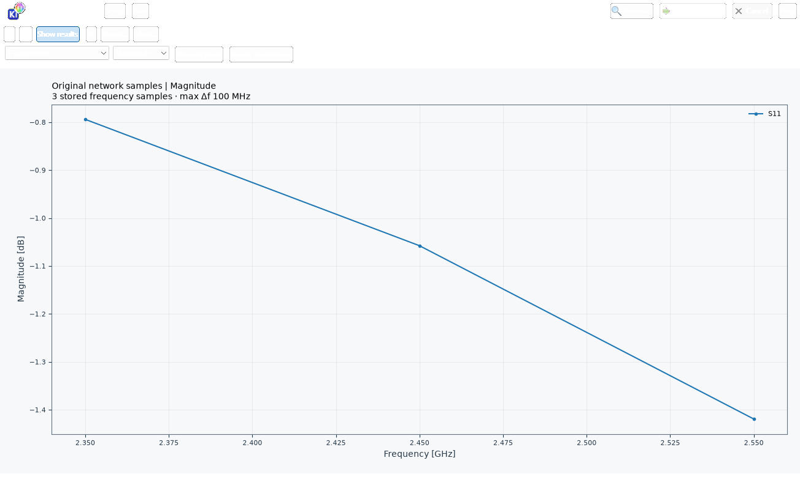

Original S11 samples in dB versus GHz. Values remain well above -10 dB;
the failed comparison is retained rather than replaced with an ideal curve.

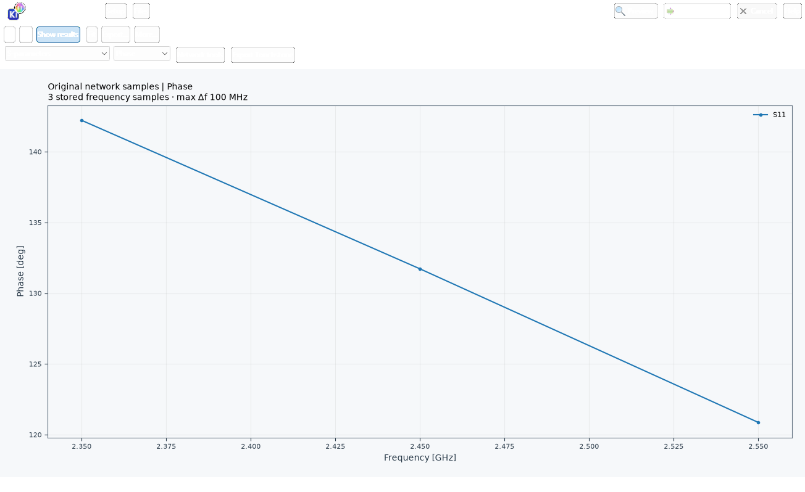

Native phase analysis of the same three complex S11 samples. Connecting lines
do not add frequency resolution or establish a group-delay/phase-band response.

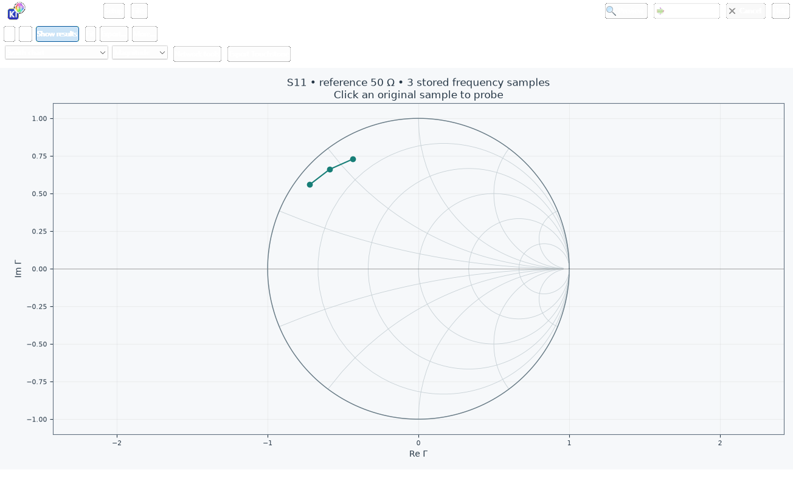

The Smith chart uses the original complex reflection samples referenced to
50 ohm. The large distance from the center is consistent with the poor match;
it is not a tuned or optimized design result.

### Solved field slice

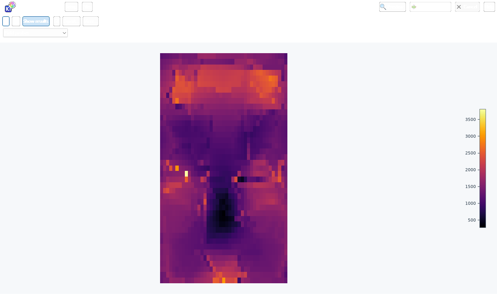

E magnitude in V/m from the original solved grid. The visible pixel structure
is sampling resolution, not manufactured spatial detail.

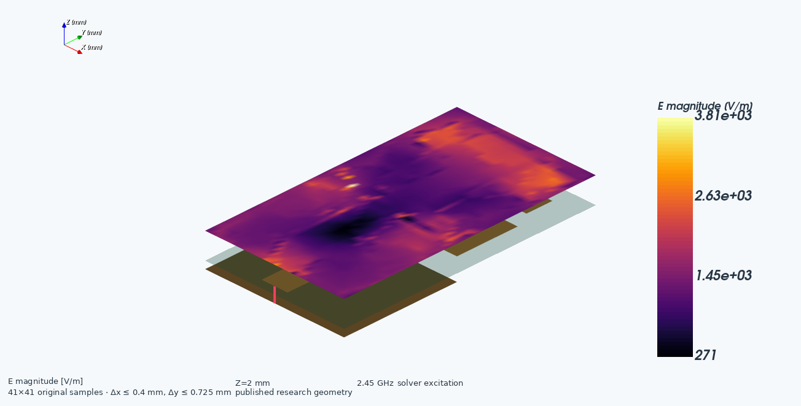

Native 3D display of the same solved-plane samples; inspect the legend/readout
for quantity and units. It is not a set of independently solved depth slices.

### Radiation pattern

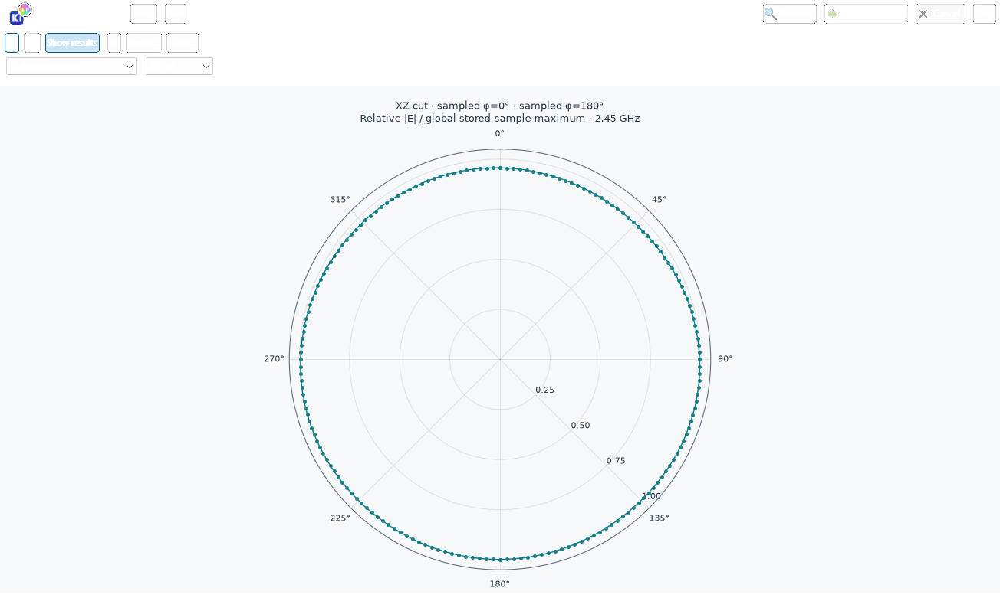

XZ cut at 2.45 GHz, using the sampled opposite azimuth planes. Radius is
relative E magnitude normalized to the global stored-sample maximum, not dBi.

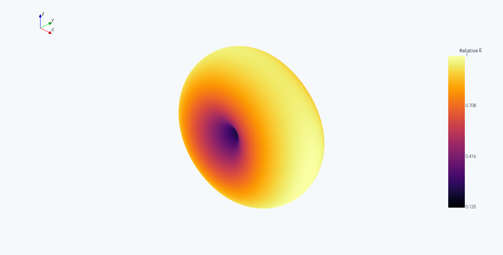

The 3D surface uses the actual stored angular samples and the same relative-E
normalization. A smooth-looking surface does not establish mesh convergence.

### Boresight polarization analysis

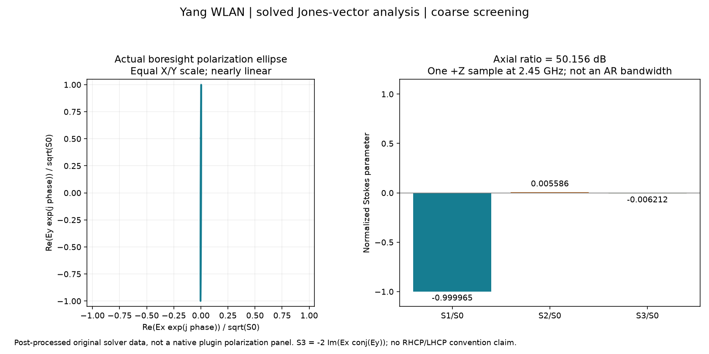

This figure is **post-processed from the saved solver Ex/Ey**, not a screenshot
of a native polarization panel that the plugin does not currently expose.
At +Z and 2.45 GHz, axial ratio is **50.156 dB**, indicating nearly linear
polarization, not circular polarization. The equal-axis ellipse deliberately
looks almost like a line; its tiny minor axis is not exaggerated.

Normalized Stokes values are approximately S1/S0 = -0.999965,
S2/S0 = 0.005586 and S3/S0 = -0.006212. The sign convention is
`S3 = -2 Im(Ex conj(Ey))`; no RHCP/LHCP mapping is claimed. This is one direction
at one frequency, not polarization bandwidth, cross-polarization discrimination
over a hemisphere or a flight polarization requirement check. The provenance
contains the original complex components and the calculated values.

### Evidence and reproduction

- [Numerical samples](images/wlan-screening-samples.json) retain the actual
  config, S-parameters, fields, radiation, research metadata and failed checks.
  The original local source-path block is omitted for privacy; this is portable
  numerical evidence, not a custody-complete GUI load/export file.
- [Capture provenance](images/provenance.json) records result/sample/image
  hashes, backend, plugin, Python, wx and VTK versions. Images contain only a
  generic context filename; no numerical/image data were redacted or retouched.
- From the repository root, run
  `python tools/capture_research_antenna_results.py solve`, then run
  `python tools/capture_research_antenna_results.py capture` with a complete
  desktop wx/Matplotlib/VTK interpreter. Use a qualified EMerge interpreter for
  `solve`. Default run/evidence paths are on the checkout's drive; select D: or
  another drive with adequate reserves using `--run-dir` and `--output`.
  Existing run evidence is protected: use a new `--run-dir` for another solve,
  and pass that same directory to `capture`.
  Run `python tools/capture_research_antenna_results.py verify` to check the
  numerical-evidence digest, angular data and all eleven image hashes.
- See the [Yang paper](https://doi.org/10.3390/s16070983), the
  [dated validation record](VALIDATION.md), and the individual recipe below.
  These screenshots cover WLAN only; no paper-specific screenshots for the
  other four templates are claimed here.

## Historical UI reference captures

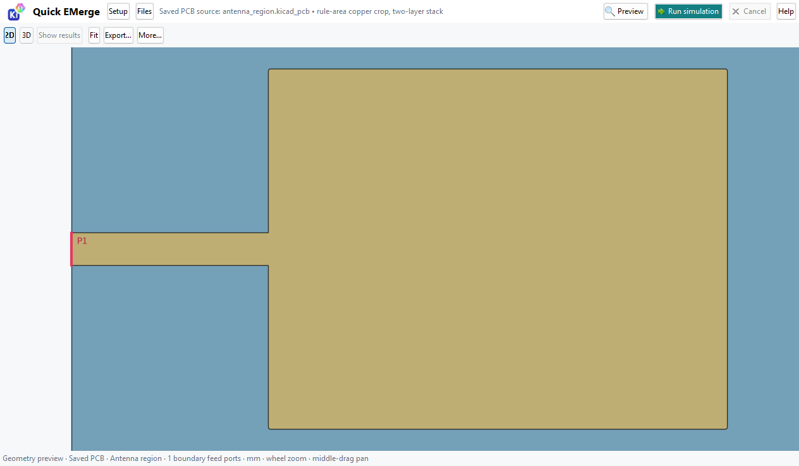

**Preview geometry:** use Setup to configure the study, Preview to review its
geometry/ports, and Fit plus the 2D/3D controls to inspect the model before Run.

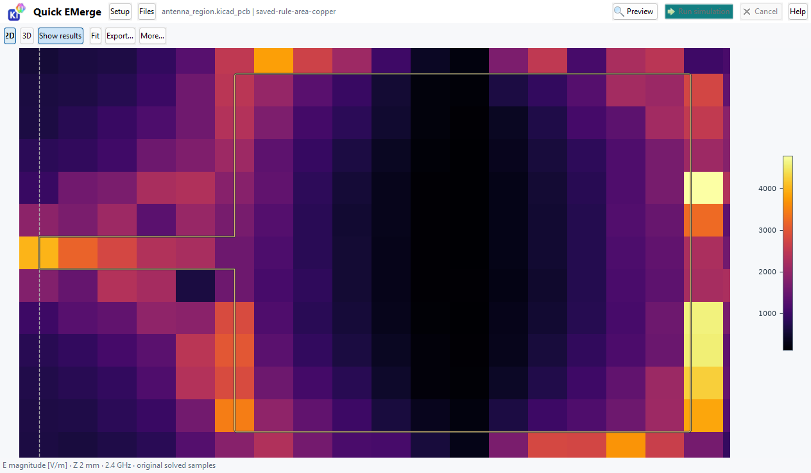

**Inspect solved fields:** read the selected quantity, units, frequency and Z
before interpreting colors. This capture shows coarse original samples, not a
smoothed reconstruction or a convergence-qualified field.

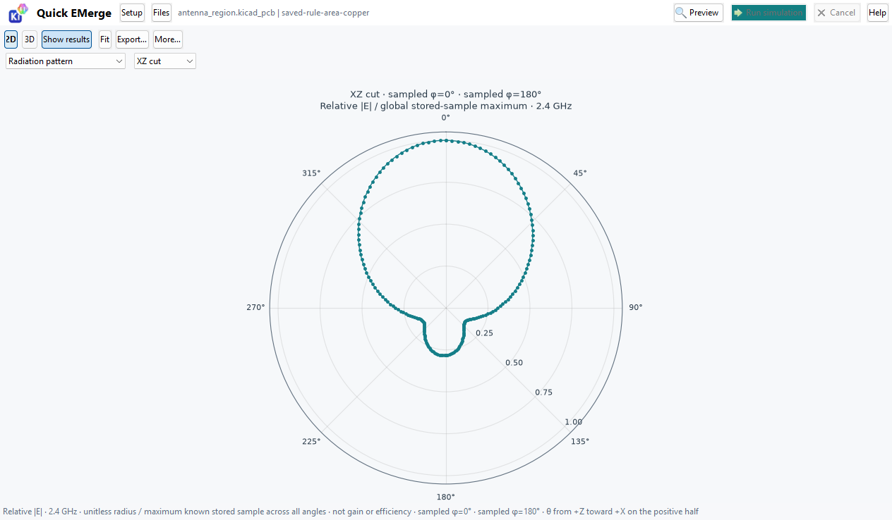

**Inspect radiation:** check the angular cut and frequency, then use the original
sample readout and report export. Normalized pattern shape is not realized gain.

Screenshot provenance: native Windows captures from 2026-11-01, Python 3.11.5,
wxPython 4.3.2 and VTK 9.7.1, recorded in the
[plugin guide](../../../quick_emerge_plugin/README.md#visual-workflow) and
[validation log](../../../quick_emerge_plugin/VALIDATION.md). They show the public
synthetic saved-copper antenna-region fixture, **not the five paper geometries
or their results**. The labels above describe the controls to use when running
these examples. They are retained historical UI references; they do not establish
a new native-window acceptance test of release 4.7.0. No private paths or project
data were present in the original captures.

## Individual reproduction recipes

The following are suggested follow-up sweeps, not convergence-qualified presets.
Radiation and polarization are evaluated at the sweep's middle sample: use an
odd point count and deliberately center the sweep on the comparison frequency.

### Dual-feed polarized patch

1. Load `rezaeipour-2021-dual-feed-patch.json`; inspect both orthogonal feeds.
2. Run `auto` or `linear` for equal-amplitude, equal-phase excitation. Save it.
3. Repeat with `rhcp` and `lhcp`, keeping all other settings identical. Use
   2.40-2.50 GHz with 21 points to sample polarization at 2.45 GHz.
4. Compare boresight axial ratio and signed Stokes S3. RHCP/LHCP naming requires
   checking propagation conventions. The switched feeding network is omitted:
   a raw port's S11 is not the paper's common-input S11. The report therefore
   marks that common-input matching comparison insufficient.

### Dual-band WLAN monopole

1. Load `yang-2016-wlan-monopole.json`; inspect radiator and partial ground.
2. Run the broad preset to find candidate minima. Follow with separate
   2.30-2.65 GHz / 71-point and 4.40-7.60 GHz / 161-point sweeps.
3. Find contiguous samples below -10 dB in S11, not just the deepest dip.
   Do not extrapolate crossings outside the solved band. Compare with the
   source targets embedded in the report.
4. The recorded coarse run failed the matching target. Reproduce and retain
   that outcome before a controlled mesh-refinement study.

### Printed CubeSat Yagi

1. Load `liu-2020-cubesat-yagi.json`; confirm the 100 x 98 mm board, four
   elements and 0.6 mm FR4 in the research metadata.
2. Run its 2.2-3.2 GHz preset. For a 2.4 GHz radiation sample, separately run
   2.30-2.50 GHz with 21 points.
3. Inspect S11 and radiation maximum/cuts, checking coordinate axes first.
4. The CubeSat body and deployment angles are omitted; taper coordinates are
   digitized screening assumptions. The paper's tilted measured bands and gains
   are reference context, not predictions this planar model can establish.

### 4 x 4 AESA steering

1. Load `verho-2023-aesa-4x4.json`; retain 3 GHz and the paper's 40 mm pitch.
2. Run with scan theta = 0 degrees and inspect **Array factor** at broadside.
3. Repeat at theta = 35 degrees, phi = 0 degrees. Compare requested and sampled
   peak direction; the deterministic scan-law test allows <0.26 degree grid error.
4. This is an ideal array-factor model, not a full-wave 16-port AESA. There is
   no Touchstone, mutual coupling, phase-shifter loss or active calibration.
   Normalized array-factor dB is not realized gain in dBi.

### Satellite S/X shared aperture

1. Load `kabir-2023-cubesat-sx.json`. Preview both feeds, two lower dielectric
   layers, air cavity and elevated PRS. Retain clearance above the full stack;
   the preset field plane is 24 mm. Invalid smaller enclosures are rejected.
2. Select `s-band`; run 2.006-2.026 GHz / 21 points for polarization at
   2.016 GHz. Separately run 1.99-2.06 GHz / 71 points for matching inspection.
3. Save that result. Select `x-band`; run 8.43-8.49 GHz / 61 points for
   polarization at 8.460 GHz, and 8.25-8.60 GHz / 141 points for matching.
4. Confirm port numbering; inspect S11 for port 1, S22 for port 2, and S21/S12
   separately for coupling. Automatic comparison does not certify isolation.
5. The source simulated AR <3 dB bands are 2.013-2.020 and 8.433-8.500 GHz.
   A single boresight sample does not establish bandwidth. Recorded coarse S/X
   results failed those checks; refinement is required before paper agreement.

## CLI discovery and phase inspection

Run these commands from the repository root with this package importable:

```text
python -m quick_emerge_plugin --list-research-antennas "*satellite*"
python -m quick_emerge_plugin --show-research-antenna kabir-2023-cubesat-sx-shared-aperture
python -m quick_emerge_plugin --write-research-setup kabir-2023-cubesat-sx-shared-aperture sx.json
python -m quick_emerge_plugin --array-scan verho-2023-aesa-4x4 35 --array-phi 0
```

For the shared-aperture antenna, run narrow S-band and X-band sweeps separately
and select the matching excitation. The broad generated setup is for discovery,
not an efficient final solve.

`--array-scan` prints element phases only; it does not execute a simulation.
`--write-research-setup` creates a portable setup, not a worker request.

## Headless solver execution

For automation, use the same reviewed-session contract as the GUI. The following
source-checkout example runs the S/X preset with a narrow S-band sweep. Replace
the generic paths with an existing saved board, a **qualified** solver Python,
and a new output location. Save this as a local script and run it from an
environment where the checkout is importable; it does not require a wx window.

```python
import time
from pathlib import Path
from quick_emerge_plugin.research_antennas import example_config
from quick_emerge_plugin.session import StudySession

config = example_config("kabir-2023-cubesat-sx-shared-aperture")
config.update(f_start_hz=2.006e9, f_stop_hz=2.026e9, points=21)
config["advanced"]["research_excitation"] = "s-band"
session = StudySession(Path("C:/Projects/Example/board.kicad_pcb"))
session.preview(config)  # validates setup and binds exact saved source bytes
session.start(config, Path("C:/Tools/EMerge/Scripts/python.exe"),
              Path("C:/Projects/Example/runs"))
try:
    while session.process.poll() is None:
        time.sleep(1)
    result = session.collect()  # rejects failed/stale/mismatched results
    print(session.run_dir)
    print(result["publication_comparison"])
except BaseException:
    session.cancel()
    raise
```

`session.preview()` is a validated custody step, not a visual inspection or
physical approval. Review geometry in the GUI first. Do not reuse a previous
review after changing inputs or board bytes. The low-level `--worker` entrypoint
requires a dedicated directory containing a valid `request.json`; a portable
setup file cannot be passed directly to it.

## Reading and preserving results

| Evidence | How to use it |
|---|---|
| `request.json` | Exact reviewed configuration, saved-board identity and configuration digest |
| `status.json`, `solver.log` | Completion/failure state and actual solver diagnostics; a partial run is not a result |
| `result.json` | Original samples, runtime, assumptions, citation, `research_sha256` and `publication_comparison` |
| `network.s1p` / `network.s2p` | Complex network data for one/two-port full-wave cases; frequency units and reference impedance are in the header |
| HTML/PDF report | Human-readable settings, available plots and traceability; retain JSON as the numerical evidence |

S-parameter JSON entries are `[real, imaginary]`, not dB. Convert with
`20*log10(abs(complex(real, imaginary)))`; zero magnitude is a limit, not a
finite measured dB value. Lower reflection alone does not establish radiation
efficiency. Read the frequency and port/excitation for every plotted quantity.
Axial ratio near 0 dB indicates near-circular polarization; larger values are
more elliptical/linear. Check field-plane position and radiation coordinates
before interpreting polarization or a beam direction.

Publication checks report **pass**, **fail** or **insufficient**. Insufficient
means missing/inapplicable sampling or an omitted model feature, not a pass.
The reported gain targets are source facts; the implementation does not certify
accepted-power-normalized gain, efficiency or flight hardware.

For a defensible comparison, repeat a fixed geometry/excitation with progressively
finer meshes, then larger air boundaries, changing one variable at a time. Record
mesh counts, sampled resonance, band crossings and axial ratio per run. Resolve
narrow bands with finer frequency spacing. Define tolerances before comparing;
retain failures and do not tune dimensions solely to force a published minimum.
Material, connector, feed-network and chassis omissions remain separate limits.

## Troubleshooting

| Symptom | Resolution |
|---|---|
| Run disabled or stale-preview warning | Finish dependency setup, choose a verified solver, then Preview the current inputs again |
| Source changed during run | Save/close editing, reopen the project context and start a new reviewed run; do not change recorded hashes |
| Missing EMerge, DLL or solver error | Use setup/retry or the previous qualified runtime; inspect `solver.log`; do not modify KiCad's Python packages |
| Memory/mesh budget exceeded | Run one case at a time and reduce screening mesh cost; then plan measured refinement rather than removing safety limits |
| Empty radiation/polarization comparison | Check excitation, middle frequency and whether the case actually computes radiation; phase-only CLI/AESA output is not a FEM radiation result |
| Failed narrow S/X AR check | Check coordinates/material assumptions and run mesh/boundary/frequency refinement; the coarse failure is a known finding, not a reason to lower the target |
| Report preview unavailable | Export HTML and open it in a browser; retain numerical JSON and inspect the reported preview error |

## Sources

Use each paper's dimensioned geometry and results sections alongside the source
registry, rather than scaling a screenshot. The implementation records explicit
omissions and inferred dimensions in
[`research_antennas.py`](../../../quick_emerge_plugin/research_antennas.py).
The [dated validation record](VALIDATION.md) records what actually ran and what
failed; [release 4.7.0](https://github.com/wayri/WayriCAD/releases/tag/v4.7.0)
contains the installable implementation. These are distinct forms of evidence.

| Work | What to compare | Important boundary |
|---|---|---|
| Rezaeipour and Sadeghzadeh | Patch dimensions, equal-phase/phase-quadrature feed states, boresight AR | Reconfigurable feeding network omitted |
| Yang et al. | Printed radiator/partial-ground dimensions and WLAN reflection bands | Screening mesh did not reproduce matching |
| Liu et al. | Dimensioned four-element geometry; Section 3.1 specifies 0.6 mm FR4 | CubeSat chassis/deployment omitted; taper digitized |
| Verho et al. | 4 x 4 aperture, 40 mm pitch and progressive-phase steering law | Ideal array factor, not an active-array FEM reproduction |
| Kabir et al. | Figures 1-2 and Table 1 geometry; S/X reflection and boresight AR bands | Nominal laminate Dk assumptions; coarse AR comparisons failed |

- Rezaeipour and Sadeghzadeh, *A Multi Polarization Square Patch Antenna with a Reconfigurable Feeding Network*, 2021. <https://arxiv.org/abs/2106.07291>
- Yang et al., *Design of Miniaturized Dual-Band Microstrip Antenna for WLAN Application*, 2016. <https://doi.org/10.3390/s16070983>
- Liu et al., *A Printed Yagi Antenna for CubeSat with Multi-Frequency Tilt Operation*, 2020. <https://doi.org/10.3390/electronics9060986>
- Verho, Nguyen and Chung, *A 4 x 4 Active Antenna Array with Adjustable Beam Steering*, 2023. <https://doi.org/10.3390/s23031324>
- Kabir, Khan and Latif, *A Multi-Band Circularly Polarized-Shared Aperture Antenna for Space Applications at S and X Bands*, 2023. <https://doi.org/10.3390/electronics12214439>

See [VALIDATION.md](VALIDATION.md) for completed screening runs and unresolved
paper-agreement work.
