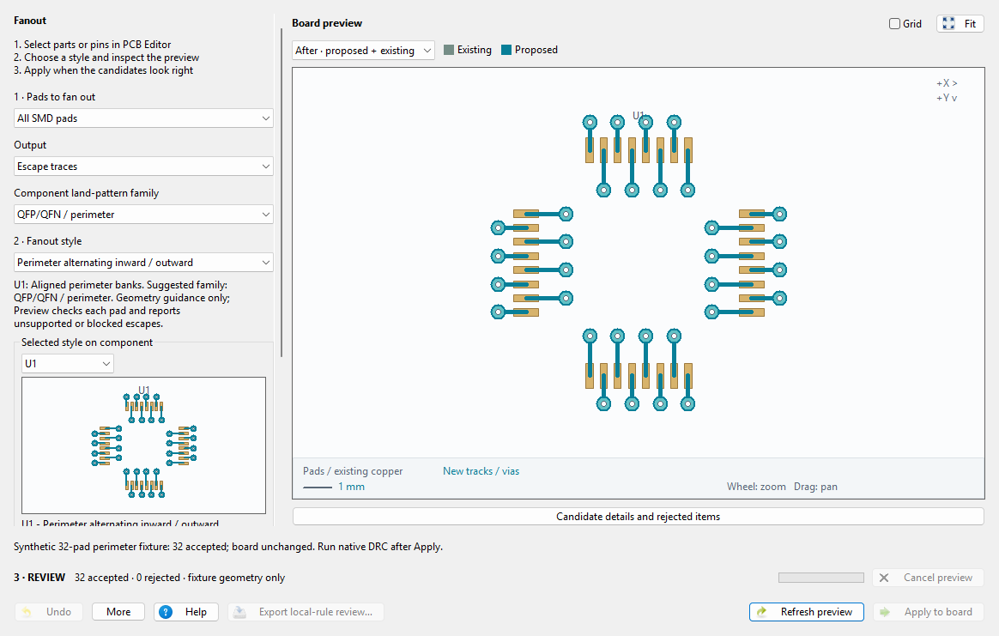
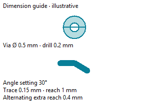

# WayriCAD Fanout Generator


Generate reviewed escapes from selected pads, footprints or filtered nets.
Start with a small scope, choose a style, inspect the proposal, then apply.

| Start here | Reference |
|---|---|
| [Latest release](https://github.com/wayri/WayriCAD/releases/latest) | [Install](../docs/INSTALLATION.md) · [Suite CLI](../docs/TOOL_CLI_CATALOGUE.md) |
| [Choose, style, review](#choose-style-review) | [Command line](#command-line) |
| [Connector-edge breakout](#connector-edge-breakout) | [Per-pin/net rules](#different-rules-for-different-pins) |
| [Adaptive escapes](#adaptive-escapes-around-existing-routing) | [Limitations](#limitations) · [Offline help](help.html) |

## Choose, style, review

Choose **Component land-pattern family** to browse related styles. **All styles**
shows the full list. Filtering keeps the current style available even when it is
outside the selected family; it never changes geometry or selects a route for you.
The note below the style reports the inspected component's observed pad layout,
using actual pad positions, rotation and SMT/plated-THT attributes. It updates
with PCB/component selection. Reference and footprint names are not classifiers.

| Land-pattern family | Styles | Applicability |
|---|---|---|
| QFP/QFN / perimeter | Perimeter pitch expansion; Staggered rows; Perimeter alternating inward / outward; Perimeter outward | Aligned single banks on package edges; center/exposed pads need separate rules. |
| BGA/LGA / grid | BGA/LGA grid outward; Dogbone outward/inward; Quadrant outward/inward; Four-corner outward/inward | Array breakouts and directional seeds; real pad/via spacing still determines acceptance. |
| Connector / SMT or plated THT | Connector edge | Body/edge breakout for SMT or plated through-hole pins. |
| General / custom direction | Radial outward; 45-degree spread; Custom-angle spread; Straight + angled escape | Explicit directional geometry; review actual pad access and direction. |

A fully populated grid of at least 3 × 3 pads is identified as a grid; aligned
perimeter banks and plated THT pads get their corresponding suggestions. Sparse
arrays, SMT connector rows and unusual/mixed shapes can be ambiguous. The note
then requests manual family review; it does not infer a connector's function.
The family note is advisory, not a compatibility certificate: styles outside the
observed family remain explicit choices and Preview reports unsupported/blocked
pads. Via-in-pad remains a separate output mode. Loading profile defaults
explicitly returns the filter to All styles before applying the suggested style.



Windows / KiCad 10.0.6 source-window capture on a disposable 32-pad fixture,
2026-10-29. It shows actual accepted local escapes, not onward routing or DRC
signoff. No personal paths, private designs or redactions are present.


For QFP/QFN and other aligned perimeter banks, **Staggered rows** alternates
short/long straight outward escapes on every side. **Perimeter alternating
inward / outward** alternates short outward and longer inward escapes. The
sequence follows the complete bank's pad positions, preserving parity across
pad/net filters and groups. Set **Escape length** and **Row stagger** under
advanced settings; these styles require Fixed routing, Independent pins and
Pattern direction with zero rotation/endpoint overrides. Exposed pads, keepouts
and copper can block inward candidates; rejected routes remain untouched.
Center pads and grids need separate rules. See the [geometry and safety details](advanced-fanout.md#styles-and-angles).

Advanced settings include a live dimension guide for via diameter/drill and
trace width/reach/angle. Expanding or collapsing controls keeps the window size
and scrolls the settings pane. The guide is illustrative; the two component/board
canvases show actual accepted geometry. Refill zones and run native DRC after Apply.



Windows / KiCad 10.0.6 source-window capture from a disposable 32-pad fixture;
0.5 mm via / 0.2 mm drill, 0.15 mm track, 1 mm reach, 0.4 mm extra reach.
The angle setting guide is illustrative and separate from package-normal staggered
geometry. No personal paths or design data are present; no redactions were needed.

1. Select footprints or pads, or enter a reference wildcard. Expand **Limit pins
   or nets** to restrict pin numbers and net names with comma-separated wildcards.
2. Choose a style. The small component preview shows its actual accepted routes.
   Dimensions and routing options remain under advanced settings.
3. Review the accepted/rejected counts and **Before / After** comparison, then
   apply separately. **Cancel** stops an isolated preview; changing inputs
   immediately disables Apply and discards outdated results.

**Saved board · fast** plans in a separate native process from a private copy,
leaving the window responsive during planning. Save editor changes first.
**Live snapshot · slower** captures unsaved geometry explicitly; native capture
can pause the window and therefore requires manual Refresh rather than automatic
style refresh. Unsaved project rules must match the snapshot's effective
netclass dimensions; mismatches are rejected. IPC previews use a fresh connection
to the originating editor; uninspectable live netclass dimensions require explicit
reviewed dimensions. Neither path bypasses Apply's source/rule checks or native DRC.

Select parts or pins in PCB Editor, then choose a **Fanout style**. **Live
preview** is on by default: selection changes and edits update the candidates
after a short pause. **Selected style on component** shows the actual accepted
fanouts in a small preview; use its component list when several parts are
selected. The main canvas keeps the complete plan. A blocked component still
shows its pads with zero accepted escapes; rejection details remain available.

### Connector comparison


**Before:** the main canvas shows only the existing six plated pads and connector
courtyard. The small style thumbnail continues to show the accepted proposal.


**After:** the same disposable connector has six accepted teal escapes and zero
rejections. These are actual Windows / KiCad 10.0.6 native windows, using a saved
snapshot and explicit `J1` scope. The capture run applied 12 track segments to the
in-memory fixture, then Undo restored its empty routing; the saved source file
was unchanged. Example dimensions are not manufacturing recommendations.
See [capture provenance and checks](../docs/audits/ROUTING_README_SCREENSHOTS_2026-10-23.md).

### Perimeter package and board context


Actual native window on a disposable 32-pin QFP fixture: all 32 perimeter
escapes accepted. Dimensions are illustrative. Existing screenshots below are
retained. This is a source-window check, not installed-editor qualification.

| Action | Behaviour |
|---|---|
| Change selection or style | Immediately disables Apply, then refreshes after 300 ms without further edits. PCB selection is checked every 500 ms. |
| Inspect another selected part | Choose it in the small preview's component list; no board copper changes. |
| Work on the whole board | Choose the broad scope and click **Refresh preview**. Unrestricted reference wildcards also need explicit refresh. |
| Turn off Live preview | Edit freely, then use **Refresh preview** when ready. |
| Apply | Remains a separate action, with source/rule/settings checks and recoverable groups. |

Detailed dimensions, signal-family defaults and netclass filters are under
**Dimensions and advanced settings**. Connector exit controls appear for the
connector style. Both preview panes support pan/zoom; hovering and dragging use
cached pixels, followed by an exact redraw after a drag. Settings changes reuse
display context only for the same snapshot mode, source path and saved file stamp;
Apply always performs fresh geometry and rule checks.

### Measured responsiveness and its limits

Earlier 3.6.27 measurement: fresh fixed-style planning on Marble U35 fell from **21.94 s to 0.29 s**, with
identical full plans and rejection reasons. The complete new native preview
pipeline took 3.54 s initially and 2.86 s on refresh; source checks remain a
significant cost. See the [benchmark and limits](../docs/audits/FANOUT_LIVE_PERFORMANCE_2026-10-23.md).
That earlier measurement predates the richer source guards and isolated source workflow.

Current source validation on public Marble U35 produced the same 103 accepted
escapes and 258 rejections. Preview submission took 22–55 ms and the largest
20 ms timer gap was 323–376 ms. Full completion was 13.72 s initially and
9.17–10.11 s on refresh, versus 8.24–9.14 s for the old synchronous UI call.
Isolation improves responsiveness and adds startup overhead; it is not an
end-to-end solver speedup. These changes are included in release 3.6.28.
An additional instrumented capture completed in 13.08 s with a 0.695 s largest
timer gap. See the [current suite validation](../docs/audits/SUITE_RESPONSIVENESS_2026-10-23.md)
for source checks and remaining limits.


Actual Windows / KiCad 10.0.6 source window using the public Marble board;
103 accepted escapes, 258 rejected. No source board was modified or private
path displayed. This does not qualify an installed or connected-editor workflow.

## Capabilities

- Generate perimeter pitch expansion, BGA/grid dogbones, 45-degree/custom-angle spreads, staggered escapes and via-in-pad placements.
- Assign different styles, dimensions and copper layers by ordered pad, reference, net or netclass groups.
- Use optional adaptive routing to avoid existing copper or continue a supported simple open stub.
- Review named differential-pair escapes, shared parallel sections, escape lengths and configured gap/skew checks.
- Preview actual board context and rejection reasons before applying recoverable groups; use CLI plan/apply with JSON and SVG.

## Limitations

The [initial Marble trials](../docs/audits/FANOUT_REAL_BOARD_TRIALS_2026-10-23.md)
exposed false collision rejections and connector search delays. The
[dense-board fixes and native checks](../docs/audits/FANOUT_DENSE_BOARD_FIXES_2026-10-23.md)
now demonstrate working escapes on deliberately unrouted BGA and partly routed
connector copies. These are fanout seeds; they do not finish the rest of a net.
Read the measured scope, rejected pads and native checks before adopting a plan.

- This generates fanout seeds, not complete autorouting or guaranteed impedance, timing or protocol compliance.
- Adaptive routing searches a bounded candidate family; branches, loops, arcs, existing-via endpoints and same-net zone topology require manual review. Coupled pairs use fixed routing.
- Via-in-pad needs fabricator review; through vias span F.Cu to B.Cu. Plated through-hole pins are supported by Connector edge; other styles exclude them. Non-plated holes and pads without nets are excluded.
- Conservative obstacle checks can reject feasible layouts; native KiCad DRC remains required. KiCad 11 live behavior is unverified.

## Overview

A fully local routing tool for PCB Editor. No hosted UI or remote preview assets are required.


Actual 3.1.1 window on a disposable SOIC fixture: pads 2–3 use via-in-pad, corner pads use 45° escapes, and pads 6–7 use 30° escapes. Existing copper is muted; new copper is teal. These example dimensions are not manufacturing recommendations.

## Connector-edge breakout

1. Select a connector footprint or individual pins in PCB Editor. Choose **Selected footprints** or **Selected pads**. For every connector on the board choose **All connector pads** and narrow the pin/net filters as needed. Alternatively choose **Reference wildcard** and enter the connector reference under advanced settings.
2. Choose **Connector edge**. This enables plated through-hole and SMD pins, independent pin routing and a bounded obstacle search. Endpoint vias default off for this style.
3. Select **Nearest edge**, **Top**, **Bottom**, **Left** or **Right** in footprint-local coordinates. Set **Beyond connector body** (initially 0.5 mm) and the trace layer. The target uses the courtyard when available, otherwise the body/pad hull. PTH pins already span copper layers, so routing on B.Cu does not add an unnecessary source via.
4. Under advanced settings, filter **Pin numbers** and **Net names** with comma-separated wildcards, for example `1,2,5` and `/Interface/*`. Both filters combine with PCB selection and netclass. Use per-pin/net groups for different layers or dimensions.
5. Click **Preview**. Inspect routes and rejected pins, then **Apply to board**. Existing copper is retained. Connected pins are rejected rather than given duplicate escapes; non-plated mounting holes, other copper, zones and board edges remain obstacles. Run native KiCad DRC.


Actual KiCad 10 wxPython window on a disposable six-pin plated connector fixture. All six independent escapes were accepted. This is an illustrative fixture, not validation of a particular connector or manufacturing process. No personal paths appear in the capture.

**Local clearance:** leave the field blank to preserve normal clearance. For a reviewed local exception, enter the requested clearance (at least the board fabrication minimum), preview, and use **Export local-rule review…**. Choose a new project name: a new directory of that name contains the board, project and scoped custom rules. Live Apply is disabled for these candidates. The source stays unchanged. The rule covers only enclosed copper pairs on the chosen layer, with at least one selected net, inside a named connector rule area. Hole and board-edge constraints remain unchanged; existing custom rules retain higher priority. Open the exported project and run DRC before adopting it.

The search is bounded to 4,096 visited grid positions and three seconds per pin. It may reject dense or blocked connectors; narrow the scope, change the exit side/layer, or use a finer **Adaptive search step**. Differential-pair/skew constraints require the existing paired styles; Connector edge does not certify protocol performance.

CLI settings use `pattern: "Connector edge"`, `pad_filter`, `net_filter`, `connector_exit`, `connector_edge_margin` and optional `connector_clearance` (millimetres; blank keeps normal clearance). Use the existing `fanout plan` / `fanout apply` commands. With local clearance, apply creates a new review directory named after the output board stem, containing all three project files. A changed board or saved custom-rule/netclass input invalidates the plan.

Local rules use KiCad's [enclosedByArea condition](https://docs.kicad.org/10.0/en/pcbnew/pcbnew.html#custom_design_rules): the whole item must be inside the area, not just its center.

## Fine-pitch perimeter packages

**Perimeter pitch expansion** is the default for SOIC, QFP and aligned perimeter-pad packages. Tracks launch straight beyond the pad ends, use staggered 45° bends, then finish parallel at a wider pitch. Outer tracks bend first; inner tracks remain straight longer, avoiding a compressed diagonal bundle.


This disposable 32-pin fixture expands 0.5 mm pad pitch to 0.8 mm outer pitch. All 32 escapes were accepted; native DRC found no clearance or unconnected-item violations. Its 32 dangling-via warnings are expected because this fixture stops at escape vias rather than complete routed connections.

Under **Dimensions and advanced settings**, set **Straight launch** and **Outer pitch**. Zero outer pitch automatically accommodates the existing pad pitch and configured track/via clearance. Escape length is the minimum outward reach; the planner extends it when needed to fit the expansion and final straight section. An explicit pitch must not compress the pin bank. Direction/endpoint overrides are rejected for this style so the bends stay package-aligned.

Choose a BGA/grid style for array pads; center exposed pads need a separate via-in-pad group. Independent perimeter escapes do not promise differential coupling, length matching or impedance. Other-net obstacles and neighboring groups still undergo clearance checks. Non-perimeter and custom-angle styles remain explicit alternatives.

## Workflow

1. Select parts or pads and choose a style. The live preview follows selected components.
2. Inspect the main canvas and small component preview; expand candidate details for rejection reasons. Use **Refresh preview** for broad scopes or after board geometry edits. Preview creates no PCB copper.
3. Inspect the result, then **Apply to board**. A named WayriCAD group contains the committed geometry. Run KiCad DRC before saving or manufacturing.

The optional **More → Review placement again** command rechecks the board snapshot and prepares the same geometry; it is not required before Apply. **More → Clear preview** discards unattached candidates. Settings changes invalidate the preview. Board changes require a new preview. Plugin Undo/Redo preserves a recoverable group; reopen the tool to find its existing named groups.

## Controls and checks

Choose selected SMD pads, selected footprints, reference wildcards, or all SMD pads. Through-hole pads and pads without a net are excluded. Choose **Output → Via-in-pad** to place vias directly in selected pads, or **Escape traces** with radial, eight-direction dogbone, diagonal quadrant, perimeter, corner, or BGA/LGA diagonal style. Configure track width, escape length, angle, X/Y offsets, via diameter/drill, and copper clearance. **Netclass** filters pads using live board classes plus saved project explicit assignments and wildcard patterns. **Trace layer** lists actual enabled copper layers. Choosing a different layer creates a source via at the pad, then routes on that layer; this keeps the trace connected. Through vias span F.Cu to B.Cu.

The planner checks existing other-net pad/track envelopes, zones and routing keepouts, board edges/cutouts, and collisions between generated copper. Checks are conservative, so valid arrangements can be rejected. This is a fanout seed generator; it does not autoroute an entire BGA or guarantee manufacturing clearance.

## Advanced styles and high-speed selection

Choose **45-degree spread**, **Custom-angle spread**, **Straight + angled escape** or **Staggered rows**. The primary angle field supports footprint-aware spread, a board-absolute heading, or a footprint-relative heading. Advanced controls expose straight-launch length, stagger distance, net-name wildcards, pair gap, breakout skew and saved netclass dimensions.

Signal families include **DDR, GDDR, SERDES, PCIe, PCI, PXI, PXIe and LVDS**. Choosing a family leaves manual settings intact; **Load defaults** explicitly loads its suggested geometry and naming filter. Inspect the matched nets before applying. DDR/GDDR bus signals use independent escapes; narrow the filter to a clock/strobe pair before selecting paired mode. Profiles contain no assumed impedance or stackup-derived width.

**Auto differential pairs** reviews named mates together, routes a shared parallel section, reports actual escape lengths and rejects both members when a path, spacing or skew check fails. Every path segment appears in the canvas and exported SVG. See the bundled [advanced guide](advanced-fanout.md), [high-speed settings example](high-speed-settings.json) and [custom-angle example](custom-angle-settings.json). Example dimensions are illustrative and must be adapted to your board constraints.


## Implemented methods and research basis

The shared planner is [routing.py](../wayricad_runtime/routing.py), with bounded
adaptive search in [adaptive_fanout.py](../wayricad_runtime/adaptive_fanout.py),
perimeter geometry in
[perimeter_escape.py](../wayricad_runtime/perimeter_escape.py), and ordered
rule matching in [fanout_groups.py](../wayricad_runtime/fanout_groups.py).

| Method | Implemented geometry/workflow | Assumptions and limits | Validation evidence |
|---|---|---|---|
| Pad scope and ordered groups | Native selection, exact/reference/pad/net wildcards and saved-project netclass membership filter eligible pads. Per-pin/net groups use first match, override only named settings, and reject unmatched/split-pair ambiguity according to policy. Saved netclass mode imports width, via, drill, clearance and pair gap without silently filling missing fields. | Naming filters express user intent; they do not identify protocols or electrical requirements. Profiles are suggestions only. | [test_fanout_groups.py](../tests/test_fanout_groups.py), [test_advanced_fanout.py](../tests/test_advanced_fanout.py) |
| Fixed escape construction | Footprint rotation transforms each pad into local coordinates. Radial/eight-direction/quadrant/corner/BGA/perimeter/custom-angle styles form one- or two-segment paths in integer board units. Perimeter pitch expansion identifies the dominant local edge normal, keeps a straight launch, orders pins along the tangent and fans them to a noncompressing outer pitch. Staggered rows alternate added reach. | These are project-specific dogbone/breakout templates, not complete routing or an IPC-qualified escape calculation. Center/exposed pads need an explicit compatible style. | rotated-corner, angles, stagger, perimeter and segment-export cases in [test_advanced_fanout.py](../tests/test_advanced_fanout.py) and [test_adaptive_fanout.py](../tests/test_adaptive_fanout.py) |
| Coupled named pairs | Strict case-sensitive P/N, +/− or delimited T/C suffixes form exactly two pads on one footprint. The average outward direction defines parallel lanes separated centreline-to-centreline by `track_width + pair_gap`; an optional terminal flare makes room for vias. Both members are accepted or rejected atomically and actual polyline lengths enforce `max_pair_skew`. | This is geometric breakout coupling only. It does not calculate impedance, delay, layer transitions or uncoupled-length constraints; fixed routing is required. | pair gap, flare, skew, atomic failure and netclass tests in [test_advanced_fanout.py](../tests/test_advanced_fanout.py) |
| Adaptive enumeration | A supported open straight-track stub is followed from the pad endpoint, refusing branches, loops, arcs, vias, interior contacts or same-net-zone ambiguity. A finite lattice enumerates axis/45° paths with at most two bends inside the radius, adds BGA pitch-centre candidates, ranks added length then bend count/alignment, and returns the first exact-clearance legal route. Limits are 4,096 candidates, 3 seconds, 20 mm radius and radius/step ≤ 20. | “Shortest” means shortest in the enumerated candidate family, not globally optimal. Existing copper is never rewritten. | [test_adaptive_fanout.py](../tests/test_adaptive_fanout.py), including stub continuation, pitch centres, budget and obstacle changes |
| Connector-edge search and local-rule export | The target begins beyond the selected footprint-local courtyard/body edge. A bounded grid search preserves the chosen exit direction while checking board/native copper. A requested reduced local clearance must remain above manufacturing floors and is exported only to a new review project with a named rule area and scoped custom rule; live Apply is disabled. | The search can fail on dense connectors. `enclosedByArea` requires the complete item inside the area. Custom rule precedence and final acceptance remain KiCad responsibilities. | pad filters, local rotations, PTH/NPTH and existing-route cases in [test_connector_escape.py](../tests/test_connector_escape.py); scoped-rule/export custody in [test_connector_review.py](../tests/test_connector_review.py) |
| Native obstacle and acceptance checks | A cell index is broad phase only. Native effective pad polygons, holes, tracks/arcs, vias, rule areas/zones, board outline/cutouts and generated candidates undergo layer-aware copper-distance/containment tests with the larger applicable clearance. Plans are source/rule/settings fingerprinted; Apply recomputes geometry and uses recoverable groups. KiCad's [PCB Editor manual](https://docs.kicad.org/10.0/en/pcbnew/pcbnew.html#design_rules_checking) remains the authority for final DRC/custom-rule evaluation. | Conservative native envelopes can reject feasible routes; ordinary pours are refilled only after materialization. Preview is not DRC, SI or manufacturing approval. | native-shape/index tests in [test_fanout_native_shapes.py](../tests/test_fanout_native_shapes.py) and [test_fanout_obstacle_index.py](../tests/test_fanout_obstacle_index.py); rollback/staleness in [test_routing_behavior.py](../tests/test_routing_behavior.py) |

No published autorouter is implemented. The fixed templates, perimeter
expansion and bounded adaptive family are explicit WayriCAD heuristics; KiCad
documentation is cited for native rule semantics, not as evidence that a
generated breakout is electrically qualified.

## Local preview

Primary choices remain visible; detailed dimensions and rejection tables are collapsed until needed. The clean, neutral canvas shows footprint outlines and references, real native pad polygons/rotation, existing copper, and generated geometry. A visible legend, millimetre scale, and coordinate orientation support review; the grid is optional and off by default. The resizable canvas supports wheel zoom at the cursor, drag to pan, double-click to fit, and via picking for coordinates. Pads, existing tracks/vias, zone outlines, and board edges provide context. Candidate copper and drill sizes use board units. Arc tracks currently appear as conservative bounding envelopes; native pads use their effective polygons; the IPC fallback uses supported padstack shapes. The canvas is a review aid, not a replacement for PCB Editor or DRC.

## Command line

Use KiCad 10's bundled Python so `pcbnew` is available. List JSON option names and actual project choices with `python -m wayricad_runtime.cli fanout settings --board source.kicad_pcb` (or `stitching settings`). Settings are a JSON object, for example:

```json
{"scope":"Reference wildcard","ref":"U1","pattern":"Dogbone outward","length":1.2,"width":0.2,"via_diameter":0.6,"via_drill":0.3,"clearance":0.2}
```

```text
python -m wayricad_runtime.cli fanout plan --board source.kicad_pcb --settings settings.json --output plan.json --svg preview.svg
python -m wayricad_runtime.cli fanout apply --board source.kicad_pcb --plan plan.json --output routed.kicad_pcb
```

Plan is read-only and produces reviewable JSON plus an optional standalone local SVG. Apply recomputes and checks the reviewed geometry and board fingerprint, then writes a **new** `.kicad_pcb` file. It refuses source overwrites, existing destinations, empty plans, and stale or altered candidate geometry. The source remains unchanged.

## Compatibility

Native in-memory board tests, file round-trips, and hidden wx frame smoke checks run against KiCad 10. The suite also packages an IPC entry point for forward compatibility; supported geometry depends on the live IPC API. Unsupported capabilities fail explicitly. Live KiCad 11 behavior must be validated against its released runtime.

Use **Per-pin / net groups** to combine different styles, layers, dimensions and
via-in-pad rules in one reviewed plan. Rules match net names, netclass, references
and pad numbers in order; unmatched pads can use defaults, be skipped, or stop the
preview. See [group workflow and JSON example](advanced-fanout.md#different-styles-for-different-pins-and-nets).


## Different rules for different pins

Expand **Per-pin / net groups** and open the rule list. Add a named rule, match its nets/netclass/references/pads, then override only the geometry you need. Put specific rules above broad rules: the first match wins. Preview again after changing rules and inspect the **Group** column under candidate details.


The example separates via-in-pad and two escape angles. Each group can also select a different enabled copper layer. Group names describe user intent; the selectors determine which pads actually match.


## Adaptive escapes around existing routing

Current source rejects Fixed escape proposals from pads already touching
same-net tracks or vias on their copper layers, including interior track
contacts. It reports the affected pad instead of duplicating its launch.
This guard and support for nullable saved-project netclass assignments were
included in release 3.6.29. Earlier 3.6.28 downloads do not contain them.
Use Adaptive for a supported simple open-stub continuation. Via-in-pad keeps
its separate fixed-location checks. Native planning uses KiCad padstack, arc
and track shapes instead of treating their whole bounding rectangles as copper.
A rejected pad is not proof that its complete net is routed.


Four selected signals on a disposable SOIC fixture. Muted copper already exists; teal is the proposed addition. The right-hand upper escape continues the existing two-segment stub.

Set **Routing → Adaptive**, choose a narrow pad/net scope and preview. This is a separate option from the fanout style. It searches nearby simple paths with up to two 45° bends, ranks shorter added copper before extra bends, and checks existing/generated copper and the board edge. Perimeter pads retain a straight outward launch before the search expands; BGA/grid styles can search all directions.

A simple existing straight-track stub is continued from its open endpoint, including a short launch wholly inside its pad. Existing tracks are never moved, removed or rewritten. Already connected pads, branches, loops, arcs, existing via endpoints and same-net zone topology are reported for manual review rather than guessed. **Via-in-pad** remains a fixed placement; coupled differential pairs use Fixed routing.

**Adaptive radius** limits endpoint distance from the pad or continued stub, and **Adaptive search step** sets the candidate lattice. Defaults are 3 mm and 0.25 mm. Search is limited to 4,096 checked candidates and three seconds per pad, with a maximum 20 mm radius and radius/step ratio of 20. This is the shortest valid result in the examined candidate family, not proof of a globally optimal route. Narrow the scope when reviewing dense designs. Failed searches retain an explicit rejection reason.

CLI settings use `"routing_mode":"Adaptive"`, `"adaptive_radius":3`, `"adaptive_step":0.25`; they also work as per-group overrides. Preview/apply uses the same search and stale-board checks.


## Resize the workspace and find help

Drag the settings/board-preview divider to inspect source pads, escape controls or connector-edge settings at a readable width. Expanded settings scroll inside their own pane; preview and Apply remain separate actions.

Open [offline help](help.html) for the workflow and troubleshooting. See [readable windows, panels and tables](../docs/UI_ACCESSIBILITY.md) for resizing, complete-row reading and keyboard controls.

## Dense-board geometry and pours

Native previews use KiCad copper shapes and actual keepout polygons. Ordinary
pours refill around added tracks and vias. After Apply or opening an exported
CLI candidate, **refill zones (B), then run native DRC**. Existing copper is
retained. Adaptive BGA search includes package-pitch centers even when they fall
between the chosen search-grid points. See the [Marble validation](../docs/audits/FANOUT_DENSE_BOARD_FIXES_2026-10-23.md)
for working cases, timing boundaries and remaining rejected pads.
