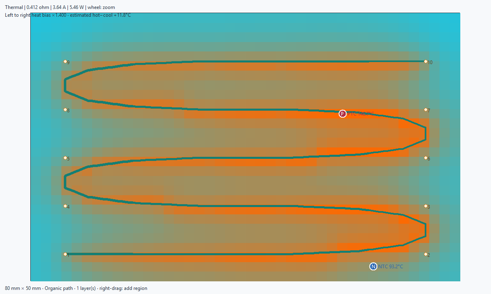

# WayriCAD PCB / Foil Heater Designer

| Start here | Link |
|---|---|
| Download and install | [Latest release](https://github.com/wayri/WayriCAD/releases/latest) · [Installation guide](../docs/INSTALLATION.md) |
| First use | [Getting started](#getting-started) |
| Help | [Offline help](help.html) · [Compatibility](../docs/COMPATIBILITY.md) |
| Command line | `wayricad tools run heater-designer -- --help` |

CLI scope: JSON heater analysis; PCB placement remains in the GUI. The unified command requires the [suite CLI installation](../docs/TOOL_CLI_CATALOGUE.md); installing this PCM plugin alone does not install the complete CLI suite.

## Getting started

1. Save the PCB and open the Heater Designer PCM plugin. Choose a clear placement area and the intended copper layer and net.
2. Choose a pattern, dimensions, spacing and material. Enter the electrical loading and actual material properties where required.
3. Preview the conductor, then inspect the thermal estimate with its stated boundary assumptions. Changing inputs requires a fresh preview.
4. Review placement before applying copper, or export foil SVG for an external process. Connect terminals afterward and run KiCad DRC; validate thermal behaviour on a prototype.

## Capabilities

- Designs series-connected serpentine, zoned-raster, and concentric-spiral copper heaters.
- Generates circular rasters, wide circular foil strips, annular arc meanders
  with two bottom terminals, split circular foil with adjacent side terminals,
  and seeded rectangular or circular maze fills.
- Calculates loading for copper, Nikrothal 80, INCONEL 600, MANGANIN,
  ISOTAN constantan, custom bulk alloys, and custom sheet-resistance films.
- Exports positive conductor SVG artwork in millimetres for foil workflows.
- Designs organic series paths from ordered control points entered as percentages or placed by clicking the preview.
- Adjusts regional trace resistance to bias local Joule heating.
- Provides directional width bias and a model-based search for a requested hot-to-cool temperature difference.
- Continues multilayer heater paths through transition vias.
- Previews geometry and runs a steady-state 2D conduction/convection thermal model.
- Marks PTC hotspot/safety and NTC representative-control locations on the thermal preview and exports their coordinates.
- Draws heating regions on the preview with a right drag, then shows their
  boundaries and resulting width-coded copper before applying anything.
- Reviews existing copper, zones, and keepouts before applying a recoverable named group.
- Supports persistent heater-group undo after reopening the plugin.

## Limitations

- The thermal model is reduced-order and steady-state; it does not establish thermal performance or safety acceptance.
- Sensor markers are heuristic sampling positions, not placed footprints or proof of optimal control response.
- Organic-path spacing screening does not replace KiCad DRC or fabrication review.
- It does not solve enclosure airflow, radiation, anisotropic laminate, adhesive interfaces, attached masses, or closed-loop control dynamics.
- Generated terminals must be connected afterward, and KiCad DRC remains the final geometry check.
- Fabrication requires coupled-solver and physical-prototype validation of temperature, current density, materials, airflow, and control stability.

## Overview

### Circular, annular and maze layouts

Use **Pattern setup** to load an annular, circular foil or maze preset, then
adjust the Geometry dimensions, trace width and spacing. Spacing is the cut
gap between conductor strips. Circular foil uses wide strips with narrow gaps;
circular serpentine uses the same clipped series raster with user-selected
width. Annular arc meanders alternate around a bottom slot, with one series
path ending at the two bottom leads. Configure its inner diameter, slot angle
and lead length. Width and height describe the complete envelope, including
leads; the circle is inscribed in the available space.
**Split circular foil** fills two half-disks with vertical strips, joins them
at the opposite midline, and brings both terminals to the left. Its lead length
reserves space on the left instead of the bottom.

**Seeded maze** and **Circular maze** produce one connected, nonbranching series
route. Changing the seed changes its turns; repeating a seed reproduces it.
Circular maze coverage follows complete grid cells, so its edge is stepped.
These six patterns currently use a single conductor layer. Heating regions
may narrow their strips (resistance factor at least 1); widening is rejected
because it would consume the specified gap. Directional heat bias remains
available. The existing organic path supports manually drawn routes.

### Materials and foil export

Select the exact material on **Material**. Presets use nominal reference
resistivity for annealed copper, Kanthal Nikrothal 80, Special Metals INCONEL
alloy 600, Isabellenhuette MANGANIN and ISOTAN CuNi44. They are grade-specific
bulk/wire data, not measurements of a deposited film. Enter actual supplier
or measured resistivity and optional TCR using **Custom bulk alloy**.
**Custom sheet / film** uses resistance in ohms per square directly:
`R = sheet resistance × length / width`. Conductor thickness is used for bulk
materials; sheet mode already includes thickness in its measured property.

Reference resistance, current and power use the chosen material. Temperature
correction uses the published table or coefficient where available and rejects
extrapolation. MANGANIN and ISOTAN publish coefficient ranges; the tool leaves
their unique TCR unknown. A blank custom TCR also remains unknown; enter zero
only when an explicitly constant-resistance model is intended. Thermal previews
continue with reference-temperature power and identify missing corrections.
They do not iterate electrical/thermal feedback. Circular edges, slots and holes
are geometry boundaries, while this thermal model still uses a rectangular
substrate envelope. It is not a circular-film or cutout thermal solver.

Use **More → Export foil SVG** for positive conductor artwork in physical
millimetres, or CSV for ordered strip coordinates and widths. SVG records the
material and design properties as metadata. It contains round-ended strips,
not kerf-compensated cutting paths. Non-copper artwork is exported for an
external foil process; **Apply to PCB** accepts the copper preset because KiCad
PCB layers represent copper. No alloy assignment is written into a KiCad file.
Nominal strip resistance omits contact resistance, bend current crowding,
thermal expansion and process tolerances. Review those effects and measure
the actual film before fabrication.

Material data sources: [Copper Development Association](https://help.copper.fyi/hc/en-us/article_attachments/14627231747484),
[Kanthal Nikrothal 80](https://www.kanthal.com/products/datasheets/material-datasheets/wire/resistance-heating-wire-and-resistance-wire/nikrothal-80/),
[Special Metals INCONEL 600](https://www.specialmetals.com/documents/technical-bulletins/inconel/inconel-alloy-600.pdf),
[Isabellenhuette MANGANIN](https://www.isabellenhuette.com/de/fileadmin/Daten/Praezisionslegierungen/Datenblaetter_Widerstand/MANGANIN.pdf),
[Isabellenhuette ISOTAN](https://www.isabellenhuette.com/hubfs/Files/Data-sheets/LE/Resistor/ISOTAN.pdf).

Design series-connected serpentine, zoned-raster, or concentric-spiral copper
heaters. Regional resistance factors narrow or widen the trace to bias local
Joule heating, while multilayer mode continues the path through transition
vias. The generated geometry can be inspected in the window, simulated, reviewed for placement, and applied to the PCB only after review.

Heating regions are visible on the Geometry tab. Enter one region per line as
`name,X%,Y%,radius%,resistance factor`, or right-drag on the preview to add a
region with an initial factor of 1.5. Edit the generated row to fine-tune its
position, size, and heating bias, then select **Preview** again. The region
outlines, copper widths, and board dimensions are shown in the preview.

For an organic route, choose **Organic path** and enter at least three ordered
`X%,Y%` control points. The generator rounds corners, samples one continuous
series path, checks board-edge and nonlocal copper spacing, and reverses
alternate layers so transition vias join consecutive paths. **Draw path on
preview** clears the preset path and lets you click to add points. Draft points
appear immediately; **Preview** shows the width-coded copper.

Choose a heat-bias direction and ratio from 0.5 to 4. A ratio above 1 narrows
copper toward the nominated hot end; a ratio below 1 narrows copper toward the
opposite end. Fixed-voltage current and total power also change. On **Thermal**,
optionally enter a positive target hot-to-cool
difference and select **Simulate / tune**. The tool samples candidate ratios,
refines a crossing when present, then reports the achieved model difference or
warns when the target is not reached. This is model feedback, not temperature
regulation.

The thermal preview marks a PTC candidate near the hottest accessible grid
cell and an NTC candidate near the model's average temperature, separated from
the PTC where possible. The copper keepaway applies to each marker's center;
it does not account for a particular footprint, pad, solder or neighboring
part. The results and JSON export include PCB coordinates based on the chosen
origin. Place actual sensors manually, check isolation and KiCad DRC, and
validate control and over-temperature behavior on a prototype.

This is an offscreen rendering of a synthetic 80 × 50 mm example at 1.5 V,
not a board measurement or qualified sensor placement.

The thermal preview is a reduced-order steady-state 2D conduction/convection
model. Validate maximum temperature, copper current density, laminate limits,
adhesive behavior, airflow, attached masses, and control stability using an
appropriate coupled solver and physical prototype before fabrication.

Window previews do not create board geometry. Apply writes the reviewed geometry as a recoverable group. Committed heaters
use persistent named groups, and the latest WayriCAD heater commit can be undone
after reopening the plugin.

Placement review now checks existing copper, zones and keepouts before creating a group, including copper on the selected net that would short around the designed conductor. Pad, text and zone bounding boxes are reserved conservatively. Choose a clear area and connect the generated terminals afterwards; KiCad DRC remains the final geometry check. Redo repeats the placement check.

Native operational validation uses `python tools/validate_marble_operations.py` from the suite root. It exercises review, apply, undo/redo, preserved net assignment, native saved-board reload and full DRC on explicit isolated test coupons in copies of Marble. These coupons are validation fixtures, not proposed Marble modifications.

## Native interface

Generated serpentine preview from the documentation fixture. Geometry preview alone does not establish thermal performance or placement acceptance.

The installed package includes [offline help](help.html) with its workflow and limitations.

## Resize the workspace and find help

Drag the settings/preview divider to make room for pattern and material controls. When results are open, drag the preview/results divider to enlarge the metrics; settings scroll independently.

Open [offline help](help.html) for the workflow and troubleshooting. See [readable windows, panels and tables](../docs/UI_ACCESSIBILITY.md) for resizing, complete-row reading and keyboard controls.

## Implemented methods and research basis

| Method | Inputs and outputs | Implementation, validation and applicability |
|---|---|---|
| Legacy series patterns | Heater envelope, trace width and isolating spacing produce one ordered rectangular serpentine or inward rectangular spiral centerline. | [`_serpentine` and `_spiral`](analysis.py) connect consecutive points into one electrical path. Multilayer copper reverses alternate copies and adds one transition via at each layer boundary. These are geometric constructors, not autorouters. Series continuity and layer transitions are checked in [`test_material_patterns.py`](tests/test_material_patterns.py) and [`test_organic_gradient.py`](tests/test_organic_gradient.py). |
| Circular raster and wide foil | A disk inscribed in the requested envelope is filled by alternating clipped chords; trace width distinguishes ordinary circular serpentine from wide-strip foil. | [`_circular_raster`](patterns.py) offsets the usable radius by half the trace width, centers rows and alternates chord direction. It returns a polyline centerline, not an area-fill solver or compensated cutting path. Envelope, pitch and containment cases are exercised in [`test_patterns.py`](tests/test_patterns.py). |
| Annular arc meander | Outer envelope, inner diameter, trace/cut gap, bottom lead space and slot angle produce alternating concentric arc lanes and two bottom terminals. | [`_annular`](patterns.py) includes half-width and chord-sag tolerance at the inner opening, requires an odd lane count, bounds angular sampling error, reserves a slot corridor and rejects insufficient clearance/detail. This establishes the implemented centerline clearances only; fabrication and current crowding still need review. |
| Split circular foil | A disk with left-side lead reservation becomes two vertical-strip half-disks joined at the opposite midline, with adjacent left terminals. | [`_split_circular_foil`](patterns.py) uses identical even-count columns for both banks and omits short edge stubs. [`test_patterns.py`](tests/test_patterns.py) checks terminal orientation, disk containment and invalid lead reservations. |
| Seeded rectangular/circular maze | Width, height, pitch and seed define complete grid cells, a seeded spanning tree and one branch-free route through every retained cell. | [`_maze`](patterns.py) begins with a four-edge cycle per cell, merges cycles along the tree, opens one edge for terminals and verifies that the final path visits every vertex exactly once. Circular coverage retains only complete cells, so its boundary is stepped. Seed repeatability, unique coverage, spacing and complexity rejection are in [`test_patterns.py`](tests/test_patterns.py). This topology is a project construction, not a claim of optimal heat uniformity. |
| Organic path smoothing and clearance | Three to 100 ordered percentage control points become a sampled series route. | [`_organic`](analysis.py) applies two 25/75-percent corner-cutting passes, samples by width-plus-spacing scale and checks nonlocal segment crossings/endpoint distances. Width-biased paths are rechecked against the envelope and clearance. The corner-cutting background is Chaikin's 1974 paper cited below; the sampling and clearance policy are project-specific. Rejection cases are in [`test_organic_gradient.py`](tests/test_organic_gradient.py). |
| Regional and directional resistance bias | Circular heat regions and an axis/ratio scale the local resistance factor, implemented by changing segment width between one quarter and four times the base-resistance factor. | [`_apply_zone`](analysis.py) classifies each segment by midpoint; the last overlapping region wins, and the directional factor varies linearly over the selected axis. Narrower width raises resistance per length. For circular/maze fills, widening is refused because it would consume the declared cut gap. This is geometry-based Joule-power shaping, not closed-loop temperature control. |
| Material resistance and temperature correction | Bulk resistivity, length, width and thickness use `R = ρL/(wt)`; sheet/film input uses `R = R_s L/w`. Validated table interpolation or a bounded linear TCR produces `R(T)/R_ref`. | [`segment_resistance_ohm` and `resistance_factor`](materials.py) keep bulk and sheet models mutually exclusive, reject non-finite/non-positive inputs and refuse table/TCR extrapolation or an unknown coefficient. Presets retain grade, reference temperature, source URL and applicability text. Equation/table cases are covered by [`test_materials.py`](tests/test_materials.py). Manufacturer datasheets above are property sources, not validation of an actual deposited or fabricated heater. |
| Fixed-voltage loading and zone accounting | The generated series resistance gives `I = V/R`, total `P = VI`, areal loading over the rectangular envelope and per-zone `I²R` sums. | [`HeaterEngine.generate`](analysis.py) sums every segment at the material reference temperature. It omits contacts, bend crowding, conductor tolerances and electrical/thermal feedback. [`test_material_patterns.py`](tests/test_material_patterns.py) checks series power accounting across patterns/material modes; [`test_heater_magnetics.py`](../tests/test_heater_magnetics.py) checks multilayer/zone identities and Ohm's-law consistency. |
| Reduced steady-state thermal grid | Declared ambient, in-plane conductivity, board thickness, two-sided convection, grid and iteration count produce a rectangular temperature array and min/max/average/uniformity metrics. | [`simulate`](analysis.py) samples each segment's `I²R` onto cells and repeatedly balances four-neighbour in-plane conductance, uniform two-sided convection and heat input. It uses fixed iterations without a residual/convergence criterion, rectangular substrate boundaries, isotropic constant properties and reference-temperature power. It is neither CFD nor a coupled electrothermal solution. A nonuniform-result regression is in [`test_heater_magnetics.py`](../tests/test_heater_magnetics.py); it does not validate temperatures against measurement. |
| Directional target search | A positive requested hot-to-cool difference triggers coarse-grid trials over ratios 0.5–4, refines a bracket when present, then evaluates/refines candidates on the requested grid. | [`tune_gradient`](analysis.py) selects the closest model result because fixed-voltage power makes monotonic response unsafe to assume. It reports an unmet target rather than extrapolating outside the allowed range. Search direction and opposite-bias cases are in [`test_organic_gradient.py`](tests/test_organic_gradient.py). |
| Sensor-marker suggestions | Accessible thermal cells are screened by board edge and center-to-copper keepaway; the hottest becomes a PTC candidate and a separated cell nearest average temperature becomes an NTC candidate. | [`_sensor_markers`](analysis.py) reports estimated coordinates, temperature and center clearance. It does not model a footprint, pads, sensor self-heating or control dynamics. Marker/grid behavior is covered in [`test_organic_gradient.py`](tests/test_organic_gradient.py) and [`test_preview.py`](tests/test_preview.py). |
| Placement preflight | Proposed PCB segments/vias are compared on shared copper layers with existing tracks, drawings, zones, pads, footprint graphics/fields and owned rule areas. | [`validate_placement`](placement.py) uses the maximum saved global/netclass/local clearance and conservative existing-item bounding boxes before the exact proposed segment capsule check. Same-net copper is intentionally not exempt because it could bypass a series heater. Supported collision/refusal cases are in [`test_placement.py`](tests/test_placement.py). This guard does not replace KiCad DRC. |
| Review, apply and recovery | Preview records settings and a board fingerprint. Apply regenerates items, rechecks both, runs placement validation and adds the copper/vias to a named PCB group. | The shared [`ReviewedGeometry`](../wayricad_runtime/generated.py) lifecycle makes changed settings/board state stale, clears review after Apply and supports group-based undo/redo, including discovery of persistent heater groups. [`test_heater_magnetics.py`](../tests/test_heater_magnetics.py) checks use of that guarded lifecycle. Native copy/apply/reload/DRC exercises live in [`validate_marble_operations.py`](../tools/validate_marble_operations.py); they are operational evidence, not heater thermal qualification. |
| Foil and data export | The reviewed segments become CSV/JSON or an SVG with millimetre view box, per-layer groups, round strokes and embedded design/material/electrical metadata. | [`export_svg`](foil_export.py) emits positive conductor artwork and terminal coordinates without kerf/tool compensation. [`test_material_patterns.py`](tests/test_material_patterns.py) checks the explicit convention and metadata. Non-copper output is not written to KiCad copper layers. |

### Research, standards and property provenance

- G. M. Chaikin, [“An algorithm for high-speed curve generation”](https://doi.org/10.1016/0146-664X(74)90028-8), *Computer Graphics and Image Processing* 3(4), 1974, is the primary background for the organic route's repeated 25/75-percent corner cutting. The implementation uses only two passes and adds its own bounded sampling and copper-clearance checks.
- [IPC-2152](https://www.ipc.org/TOC/IPC-2152.pdf) is PCB current-capacity/thermal-background material. The tool does not implement IPC-2152 charts as its temperature solver, and citing the standard does not establish compliance.
- KiCad's official [board file format](https://dev-docs.kicad.org/en/file-formats/sexpr-pcb/) describes the tracks, vias, layers, zones and groups consumed or created by placement/apply. Native DRC remains the authoritative KiCad geometry backend for the saved candidate, not a validation of heater temperature or safety.
- Copper, Nikrothal 80, INCONEL 600, MANGANIN and ISOTAN links in [Materials and foil export](#materials-and-foil-export) are dependency/property sources. Preset tests verify transcription/interpolation behavior; only supplier or measured properties for the fabricated conductor establish applicable input data.
