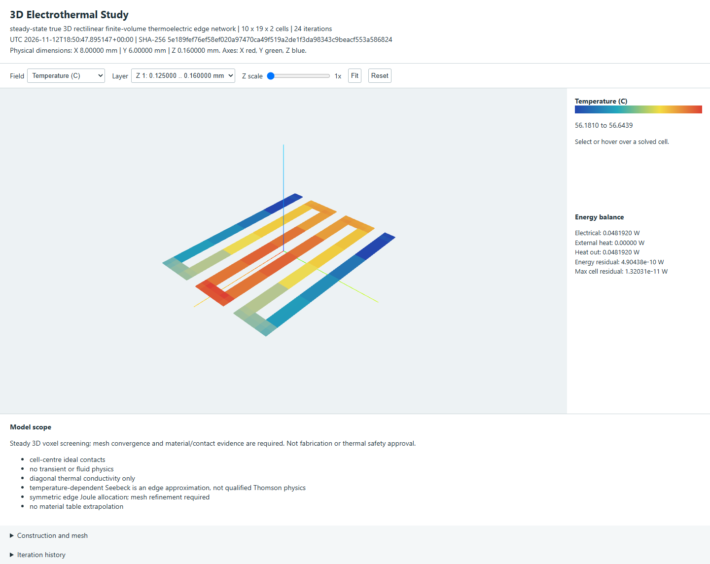

# 3D Heater and Thermoelectric Studies

Introduced in the 4.8.3 source scope. Running studies does
not edit a PCB, install a plugin or publish a release.



Actual browser capture of computed results, not a native-window mockup or
measured hardware. This 8 x 6 mm, 35 um copper heater uses 0.05 V above a
0.125 mm illustrative flexible substrate. The captured solve produced about
0.04819 W with a global energy residual of 4.90e-10 W. Construction and cooling
are explicit assumptions, not a thermal safety or prototype-validation claim.

## Workflow

1. Preview the heater, material, width, gaps and drive voltage. Select **3D study**.
2. Choose rigid, flex, rigid-flex or free-foil construction. Review the physical
   layer list, conductivities, thicknesses and local stiffener regions. A form
   name does not infer an actual polymer, adhesive, coverlay or stackup.
3. Set the maximum XY cell size. Manhattan paths use geometry-aligned edges;
   diagonal/curved paths need finer uniform staircase cells. Unresolved gaps
   and excessive grids are rejected instead of silently shorting strips.
4. Review conductor conductivity and temperature correction. Bulk resistance
   uses resistivity and thickness. A printed film requires measured ohms/square
   **and physical film thickness**. INCONEL 600 and Nikrothal 80 retain their
   R(T) tables; a constant resistivity needs explicit review when TCR is unknown.
5. Enter ambient, exposed-face convection and emissivity. Leave Seebeck blank
   for Joule-only heating; otherwise supply V/K and reference/lead evidence.
   No thermocouple coefficient is inferred from a metal name.
6. Review the generated region/contact cells, then **Solve 3D**. Inspect physical
   dimensions, original-cell probes, temperature/current/voltage and energy
   balance. Refine the mesh and compare resistance, power and hotspot values.
7. Export offline interactive HTML and complete JSON. Exports bind input/result
   SHA-256, solver source hash, UTC time, construction and convergence history.

## Reproduce

For standalone CLI studies, install the Python distribution with
`python -m pip install "wayricad[electrothermal]==4.8.3"`. Native KiCad plugin
launches prepare their own scientific runtime; no sibling plugin is required.

Use the suite scientific runtime with NumPy/SciPy. KiCad is not required for
these explicit numerical inputs:

```sh
python -m heater_designer_plugin.thermal3d heater_designer_plugin/examples/3d-copper-flex-study.json --output copper-flex-result.json --html copper-flex-report.html
python -m heater_designer_plugin.thermal3d heater_designer_plugin/examples/3d-inconel-rigid-flex-study.json --output inconel-result.json --html inconel-report.html
python -m heater_designer_plugin.thermal3d heater_designer_plugin/examples/3d-custom-thick-film-study.json --output film-result.json --html film-report.html
```

The same request runs through `wayricad-pi --thermoelectric-3d`,
`wayricad-therm --thermoelectric-3d` and `wayricad-si thermal-3d`.

| Example | Explicit assumptions | Recorded execution only |
|---|---|---|
| Copper flex | 380 cells; generic substrate k=0.3 W/m K; copper TCR | 51.91 to 56.64 C; residual 4.90e-10 W |
| INCONEL rigid-flex | 570 cells; local right-half stiffener; grade-600 R(T), constant reference k | 53.27 to 76.56 C; residual 7.97e-10 W |
| Custom thick film | 380 cells; 10 ohm/square, 10 um, TCR 0.0002/K, k=1 W/m K | 25.45 to 25.75 C; residual 1.27e-10 W |

Regenerate the heater at smaller maximum XY cells for refinement. Do not just
duplicate cell arrays while retaining obsolete electrode indices.

## Limits

True 3D solid current, Joule heat, conduction, ambient convection/radiation and
explicit Kelvin thermoelectric coupling are solved at steady state. Prescribed
electrodes and thermal clamps are **cell centres**, not boundary faces. The
automatic heater adapter supports one foil layer and rejects unmodelled via
barrels. Generic 3D JSON may contain explicit vertical conductors.

Local thickness regions do not model bending strain, adhesive/contact resistance,
delamination or mechanical safety. There is no 3D transient, fluid/enclosure CFD,
surface-to-surface radiation, phase-change or stress solver. Diagonal anisotropic
conductivity is supported, not a rotated full tensor. Temperature-dependent
Seebeck is a conservative edge approximation, not qualified continuum Thomson
physics. Constant thermal properties at 20 C are not high-temperature guarantees.

Floating conductors, missing thermal anchors, invalid material ranges,
extrapolation, nonconvergence and cell budgets stop the run. A small residual
proves numerical conservation, not material accuracy or safety. See the
[shared offline help](../wayricad_runtime/THERMOELECTRIC_3D.html) for equations,
units, primary references and cross-tool feedback.
