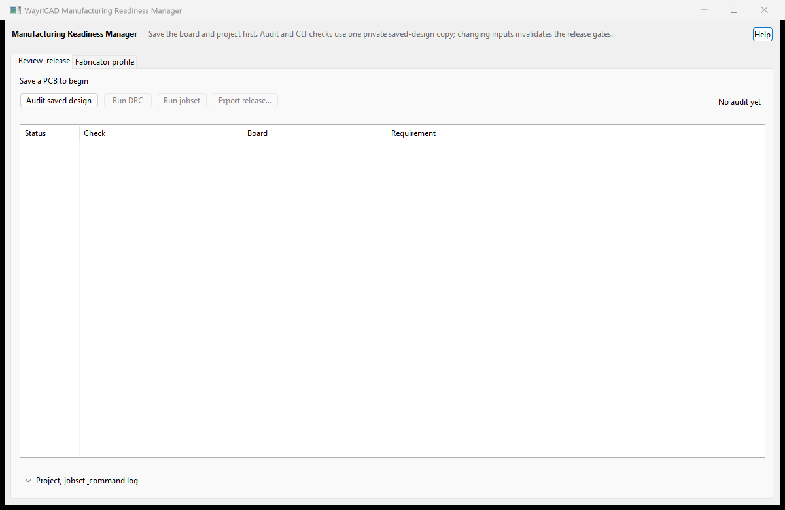

# WayriCAD Manufacturing Readiness Manager

DFM/DFA Studio previews newer saved boards through the
[shared read-only analysis adapter](../docs/SAVED_BOARD_ANALYSIS.md). Native DRC
uses the original saved board and originating newer host's CLI. Conversion does
not qualify editing, DRC equivalence or the Manufacturing Manager release workflow.

| Start here | Link |
|---|---|
| Download and install | [Latest release](https://github.com/wayri/WayriCAD/releases/latest) · [Installation guide](../docs/INSTALLATION.md) |
| First use | [Getting started](#overview) |
| Help | [Offline help](help.html) · [Compatibility](../docs/COMPATIBILITY.md) |
| Command line | `wayricad tools run manufacturing-readiness -- --help` |

CLI scope: JSON manufacturing audit; native DRC remains a separate release gate. The unified command requires the [suite CLI installation](../docs/TOOL_CLI_CATALOGUE.md); installing this PCM plugin alone does not install the complete CLI suite.

## Capabilities

### Fabrication Net Comparison (Introduced In 4.8.3)

See
[4.8.3 source scope and local validation](../docs/RELEASE_NOTES_4.8.3.md).

**Fab net compare...** in DFM/DFA Studio and **Fabrication net compare...** in
the release manager open a read-only shorts/opens workspace. Compare a design
reference with an independently CAM-extracted IPC-D-356 netlist or the documented
JSON connectivity format. Net numbers may differ: exact component/pin membership
defines the correspondence. One merged CAM group is one short finding, with all
affected original nets and pins retained; split design groups identify opens.

Native KiCad reference export includes source/output hashes and a UTC receipt.
It exports intended design assignments, not Gerber copper connectivity. Missing
pins, unsupported records, potentially truncated identities and self-comparison
cannot establish a match. `MATCH` is an imported partition match, not fabrication
approval. This separate evidence does not silently replace native DRC, manual
checklist requirements or the release manager's existing DRC/jobset gates.

See [workflow, formats and examples](FAB_NET_COMPARE.md),
[offline help](fab_compare_help.html) and [CLI commands](DFM_CLI.md#fabrication-net-comparison).

### New in 4.8.2

- Searchable **Vendor process library**: 24 process presets and 28 supplier
  directory entries. Filter by the current board's layer count, inspect exact
  service/copper/material scope and source dates, and import/export custom JSON
  profiles without replacing bundled IDs. Listing a supplier is not approval
  for its whole capability range.
- The release manager opens the same library through **DFM / DFA and vendors**.
- Process fields have supported-value dropdowns. Incompatible layer counts are
  rejected before native DRC, including headless runs.
- Failed or cancelled reruns clear previous results. Native board loading and
  preview extraction stay on the GUI thread. A preview failure retains completed
  CLI evidence and is disclosed separately in the UI and exported report.
- Native courtyard, solder-mask, silkscreen and routing-end findings link to
  engineering review items, object identities and suggested corrections. These
  are **partial negative evidence**, not complete DFA automation.
- Sort finding columns without losing row-to-object identity. Double-click a
  finding to cross-probe its saved objects; live source-hash guards still apply.
- [Dedicated offline DFM/DFA help](dfm_help.html) and headless
  `python -m manufacturing_readiness_plugin.dfm_cli` commands.

The added OSH Park 4-layer, 6-layer and 2 oz/0.8 mm presets were checked against
official service pages on 2026-11-11. Other presets retain their original source
dates and must be reconfirmed against the current quotation.

- Open the separate **DFM / DFA Studio** action for persistent checklists,
  process-scoped vendor presets, optional checks after saved changes, linked
  native findings and HTML/PDF evidence. See the [workflow and coverage](DFM_DFA.md).

- Audit saved track, via, pad-drill, slot and supported annular-ring geometry against a fabricator profile.
- Check routed copper-to-board-edge clearance for straight tracks and ordinary vias against a configurable profile limit.
- Capture project inputs and run local KiCad JSON DRC and a selected jobset against that snapshot.
- Block release on failed or unknown checks and invalidate evidence when inputs or verified artifacts change.
- Build a release ZIP with stable archive metadata and SHA-256 hashes of the verified files.

## Limitations

- Focused geometry/profile checks are not a complete fabrication-process, assembly or electrical qualification.
- Copper-clearance rules and the focused routed-edge check do not replace native geometric DRC. Unsupported annular or outline/routing geometry remains UNKNOWN and blocks release.
- Via aspect ratio uses full board thickness conservatively; actual fabrication stack/process details need separate review.
- Only jobset outputs inside the captured project copy enter the archive. Live IPC transport and KiCad 11 acceptance remain unverified.

## Overview

Audit a saved PCB against a fabricator profile, run local KiCad checks, and package the exact verified files with a SHA-256 manifest. The UI stays responsive while DRC and jobsets run.

1. Save the PCB and its matching project in KiCad. Select its own project directory and, optionally, a jobset saved inside that directory.
2. Set the fabricator limits and choose **Audit Saved Design**. WayriCAD verifies that the editor matches the saved PCB, then captures a private copy of the project inputs. KiCad 10 IPC adds transient version/generator headers to each live footprint; these headers are ignored in the comparison. Every other design token must match, and the exact saved file bytes remain hashed for release.
3. Run **JSON DRC**, then the selected **Jobset**. Both commands operate on the captured copy. Only outputs generated inside that copy enter the release; jobsets that use absolute external output paths must be adjusted if those outputs belong in the archive.
4. Choose **Build Release ZIP**. Any board, project, profile, jobset or verified artifact change blocks the old evidence. Repeat the audit and checks after changes. Rerunning DRC also invalidates the previous jobset result.

Archive members use stable names, ordering and timestamps. The manifest hashes the same bytes that are written to the archive; an interrupted or rejected build preserves an existing destination ZIP.

The audit reads saved track widths, ordinary via sizes/drills, full board thickness, copper-layer count and the project minimum-clearance rule. Via aspect ratio conservatively uses the full thickness. Copper clearance is a rule check; KiCad DRC provides the full geometry check. The routed-edge check measures the outer copper of straight track segments and ordinary vias against a single closed Edge.Cuts outline made of straight `gr_line` or `gr_rect` items. Routed arcs, via padstacks, multiple loops, incomplete/self-intersecting outlines and unsupported edge shapes produce UNKNOWN unless another exact routed violation proves FAIL. This check does not cover pads, copper zones or fabrication tolerances; run KiCad DRC and review those with the fabricator. Footprint PTH/NPTH drills and slots are included. Custom plated through-hole pads with a declared circle or rectangular anchor and pads with offset drills use conservative annular-ring lower bounds. A bound at or above the profile proves PASS; a smaller bound is UNKNOWN unless an independently exact pad or via proves FAIL. Explicit per-layer padstacks are included only when every saved layer has a supported shape and size. Other custom or per-layer geometry also makes the annular-ring check UNKNOWN unless an exact violation is present. Independent checks remain available, and UNKNOWN blocks release. Missing routed tracks or plated holes are explicitly N/A, rather than an infinite passing measurement.

All parsing, UI, CLI execution and release files stay local. The CLI is located beside the runtime, on PATH, or in standard KiCad 10/11 Windows installations. Closing the window terminates the active CLI process.

Native saved/live serialization and the DRC command/report contract were exercised on KiCad 10.0.5 with a synthetic saved PCB. Its intentional DRC violation returned exit code 5 and was not treated as passing. KiCad 10.0.6 IPC serialization can retain transient footprint headers even after saving; the comparison ignores only those headers. KiCad 11 remains unverified; see [compatibility](../docs/COMPATIBILITY.md).

Native operation validation now also covers Marble: its full DRC returned 464 findings and correctly blocked release. A separate clean outlined fixture passed DRC, generated three Gerbers through a native jobset, and produced a hashed release ZIP. Exit-code-5 reports retain their finding counts and types in verification evidence and the local command log. Run `python tools/validate_marble_operations.py --kinds manufacturing` from the suite root to reproduce without modifying the source project.

## Native interface

Native release-gate workspace before an audit. Empty findings do not mean the board passed DRC or fabrication checks.

The installed package includes [offline help](help.html) with its workflow and limitations.

## Implemented methods, release evidence and limits

| Method | Inputs and result | Implementation and evidence boundary |
|---|---|---|
| Saved geometry extraction | Saved `.kicad_pcb` and `.kicad_pro` bytes yield minimum routed width, project clearance, drilled-pad/via dimensions, annular-ring bounds, via aspect ratio and copper-layer count. | [`saved_metrics`](analysis.py) parses bounded S-expressions. Exact ordinary via/pad results and conservative custom-pad lower bounds remain distinguished; malformed or ambiguous geometry is rejected. Drill/slot cases are covered by [`test_pad_drills.py`](tests/test_pad_drills.py). |
| Routed copper-to-edge distance | Straight segment capsules and ordinary via circles are measured against one closed, non-self-intersecting straight-line/rectangle outline. | [`_routed_edge_metric`](analysis.py) computes point/segment and crossing relationships. Arcs, padstacks, multiple outlines and other unsupported geometry set `UNKNOWN`; [`test_routed_edge.py`](tests/test_routed_edge.py) covers supported and rejected cases. |
| Profile gate | Each extracted metric is compared with an explicit fabricator minimum/maximum, producing `PASS`, `FAIL`, `UNKNOWN` or `N/A`. | [`audit_metrics`](analysis.py). The configured profile is user/vendor evidence, not a built-in manufacturing standard, and the focused comparisons are not process qualification. |
| Saved/live equivalence and immutable snapshot | Project source bytes, profile, jobset and normalized live-board tokens form a SHA-256 gate key; a private captured copy is the command input. | [`comparable_board_tokens`, `gate_key`](analysis.py) and [`capture_inputs`](verification.py). Only known transient footprint serialization headers are ignored; source bytes remain hashed separately. IPC serialization coverage is in [`test_ipc_serialization.py`](tests/test_ipc_serialization.py). |
| Native DRC/jobset evidence | KiCad JSON DRC structure, finding counts/types and process exit code are evaluated together; a selected jobset must pass after the most recent DRC. | [`drc_evidence` and `VerificationSnapshot`](verification.py), with failure-contract tests in [`test_drc_evidence.py`](tests/test_drc_evidence.py). A clean result proves only those commands on that snapshot, not general manufacturability. |
| Reproducible release archive | Verified snapshot files and generated artifacts are written in stable order with fixed ZIP metadata and a manifest of sizes/SHA-256 hashes. | [`build_release`](analysis.py) rechecks the bytes against expected hashes. Hashes provide integrity/freshness, not identity signatures, certification or long-term archival authenticity. |

### Technical references

- KiCad's [board file format](https://dev-docs.kicad.org/en/file-formats/sexpr-pcb/) defines the tracks, vias, pads, layers and outline records inspected here.
- The official [KiCad command-line interface](https://docs.kicad.org/10.0/en/cli/cli.html) defines `pcb drc` and `jobset run`; those native commands are validation backends, not research invented by this project.
- Python's [`hashlib`](https://docs.python.org/3/library/hashlib.html) and [`zipfile`](https://docs.python.org/3/library/zipfile.html) document the integrity and archive primitives. Neither turns a release ZIP into a signed certification package.
