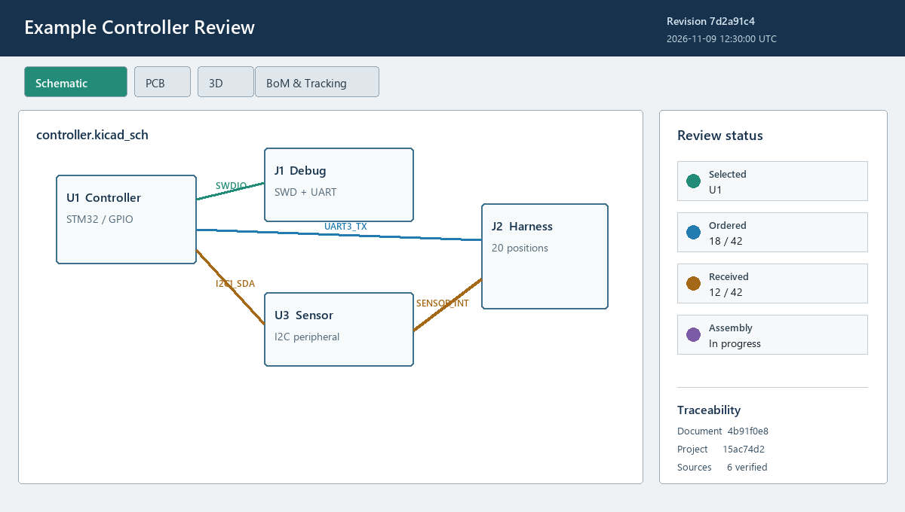
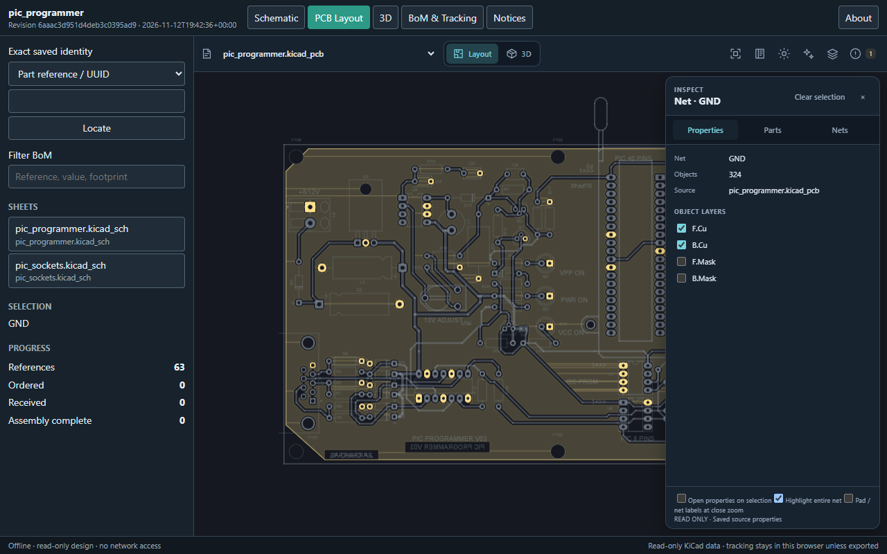
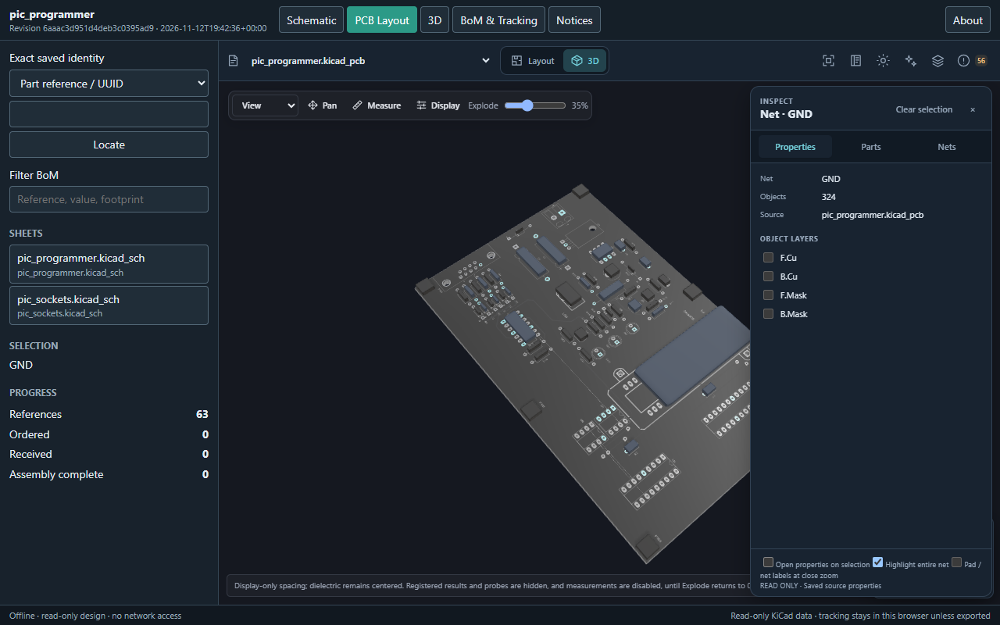
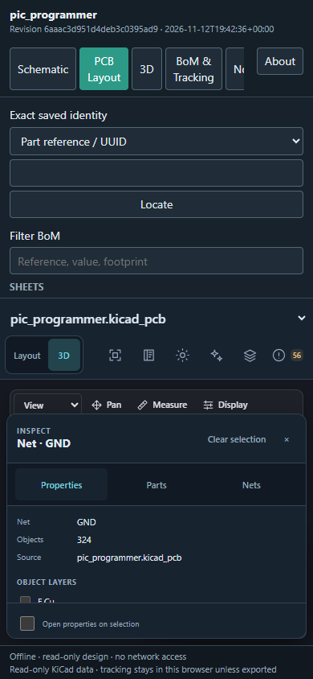

# WayriCAD Portable Web Export

Portable Web Export creates one self-contained, read-only HTML review and
assembly-tracking page from selected saved KiCad project content. It uses the
maintained [KiCad WebView](https://github.com/wayri/kicad-webview) renderer
rather than a second KiCad parser or drawing engine. The export works directly
from disk without a server, CDN, npm installation, or recipient-side WayriCAD
installation.

**Introduced in 4.8.3:** the official WebView 0.6.0 pin,
exact part/net inspection, ambiguity rejection, inert saved labels, separate
source/bundled hashes and guarded atomic export. See
[release scope and validation limits](../docs/RELEASE_NOTES_4.8.3.md).

| Native selection and preflight | Exported offline review page |
|---|---|
| <a href="help-workflow.png"></a> | <a href="help-page-preview.png"></a> |

These source-aligned illustrations use generic example data. They document the
intended controls and output structure; they are not evidence of a live editor
session or a particular project's successful export.

### Actual Offline Browser Checks





These are actual browser captures of an exported public KiCad 10 PIC programmer
demo, not native KiCad windows. The coordinating browser check reported 63 parts,
111 nets, GND inspection, 3D explode 35, a 390-pixel layout without page overflow,
zero HTTP attempts and zero JavaScript errors. No external 3D model assets were
bundled; unresolved models are stand-ins, not validated model geometry. Capture
inputs, hashes, exclusions and the forced-software-GPU timeout are recorded in
[screenshot provenance](SCREENSHOT_PROVENANCE.md).

## What it exports

- Selected saved schematic sheets, the complete saved PCB, BoM/tracking data,
  and selected supported 3D models.
- One portable HTML file containing the viewer, styling, legal notices, design
  bytes, and a machine-readable traceability manifest.
- Linked schematic, PCB, 3D, and BoM views using stable component UUIDs where
  available and exact references only as a bounded fallback.
- Browser-local ordering, receiving, assembly, DNP, and note fields with
  project/revision-bound JSON backup and controlled migration.

The plugin does not modify the KiCad project. It reads saved files, so save the
project before previewing and exporting.

## Guided KiCad workflow

1. Open and save the PCB in KiCad, then launch **WayriCAD Portable Web Export**.
2. Independently enable **Schematic**, **PCB Layout**, **BoM and tracking**, and
   **3D and models**. Select the exact schematic sheets and supported models.
3. Review every preflight finding and the estimated output size. Missing assets,
   unsupported model formats, and a missing viewer distribution remain visible.
4. Click **Build Exact Web Preview**. The embedded `wx.html2.WebView` displays
   the same generated document bytes that the export action will write.
5. Inspect navigation, component selection, BoM grouping, About metadata, and
   the selected design views. Any selection change invalidates the preview.
6. Click **Export Offline HTML**, choose a new `.html` path, and open that file
   directly in a supported desktop browser before distributing it.

The export gate preserves the preview's document ID and UTC timestamp. It does
not silently rebuild a different document at export time.

## Recipient workflow

Use the page tabs to inspect schematic sheets, PCB views, supported 3D models,
and the BoM. Selecting a BoM row focuses the corresponding component in the
active viewer; viewer selections highlight their BoM rows. BoM rows can be
grouped by value/footprint or shown as individual references.

The pinned viewer is the official **KiCad WebView 0.6.0** release. The sidebar's
**Exact saved identity** control locates a part by exact case-sensitive reference,
UUID or saved ID, or a net by exact name/ID in the currently loaded drawing.
Substring filtering remains separate in **Filter BoM**. Duplicate names/UUIDs
are rejected visibly instead of picking the first match; a saved identity that
conflicts never falls back to an unrelated reference. Select the correct sheet
before looking up a sheet-local part or net.

Selection opens the viewer's own property inspector, retaining saved original
fields as read-only text. Use the viewer's existing Layers, fit, highlight,
appearance and 3D camera/explode controls; the host does not maintain a duplicate
layer/camera implementation. PCB/3D tabs reopen the saved board; schematic tabs
open an included schematic rather than applying a schematic view to PCB bytes.

Individual reference edits save immediately in browser storage. Group edits are
staged and update every group member only after **Apply group** and confirmation.
Ordering and receiving quantities are separate from assembly status. Browser
state never rewrites the downloaded HTML file: use **Export progress JSON** and
**Import progress JSON** to transfer or recover review state.

## Command line

The headless exporter uses the same pinned viewer, selection rules, HTML builder,
and traceability manifest as the native workflow. It reads saved files and never
launches KiCad.

```text
wayricad-portable-export BOARD.kicad_pcb OUTPUT.html [OPTIONS]
python -m portable_web_export_plugin.cli BOARD.kicad_pcb OUTPUT.html [OPTIONS]
wayricad tools run portable-web-export -- BOARD.kicad_pcb OUTPUT.html [OPTIONS]
wayricad-tools run portable-web-export -- BOARD.kicad_pcb OUTPUT.html [OPTIONS]
```

### Options

| Option | Behavior |
|---|---|
| `--sheet GLOB` | Include matching project-relative schematic sheets; repeat to combine patterns. |
| `--model GLOB` | Include matching saved model paths; repeat to combine patterns. |
| `--no-schematic` | Omit schematic data and its viewer tab. |
| `--no-pcb` | Omit PCB data and its viewer tab. |
| `--no-bom` | Omit BoM and tracking data. |
| `--no-3d` | Omit model data and the 3D viewer. |
| `--manifest PATH` | Also write the traceability manifest as a separate JSON file. |
| `-h`, `--help` | Print current command help without exporting. |

`--sheet` and `--model` are repeatable, case-insensitive glob filters. A supplied
pattern that matches nothing is an error, which prevents an accidentally
incomplete export. With no filter, all discovered items of that type are
selected. The output and optional manifest must be new non-source paths and
must not alias one another.

### Examples

Export every discovered view and model:

```text
wayricad-portable-export C:/Projects/Example/controller.kicad_pcb C:/Projects/Example/review/controller-review.html
```

Select two sheet families, omit 3D, and retain a separate manifest for CI:

```text
wayricad tools run portable-web-export -- \
  C:/Projects/Example/controller.kicad_pcb \
  C:/Projects/Example/review/controller-review.html \
  --sheet "controller*.kicad_sch" --sheet "power/*.kicad_sch" \
  --no-3d --manifest C:/Projects/Example/review/controller-review.json
```

PowerShell uses the same arguments on one line, or a backtick for line
continuation. Quote paths containing spaces.

### Automation contract

- Success returns exit code `0` and prints JSON containing the absolute output
  path plus the complete manifest.
- Invalid selections, unsafe output aliases, malformed saved data, missing
  assets, and I/O failures return argparse exit code `2` with a diagnostic on
  stderr. Partial temporary manifest files are not retained.
- The CLI has no embedded human-review gate. Treat the generated page and JSON
  as candidate artifacts, archive stdout/stderr, and inspect the HTML before
  release or distribution.
- In CI or a KiCad jobset **Special: Execute Command** job, call a fixed prepared
  interpreter or installed executable, write to a new artifact directory, and
  leave **Ignore exit code** disabled. See the repository
  [CLI guide](../docs/CLI_USER_GUIDE.md) and [jobset guide](../wayricad_runtime/JOBSETS.md).

Example CI verification after export:

```text
wayricad-portable-export board.kicad_pcb artifacts/review.html --manifest artifacts/review.json
python -c "import json,pathlib; p=json.loads(pathlib.Path('artifacts/review.json').read_text()); assert p['sourceFiles']"
```

## Traceability and versioning

Every page contains standard HTML metadata and a JSON traceability block. The
page header and **About** dialog expose the human-reviewable identifiers.

| Field | Meaning |
|---|---|
| `generatedAt` | UTC generation timestamp for this exact document. |
| `exporter` / `viewer` | WayriCAD exporter and pinned KiCad WebView versions. |
| `projectId` | Stable identity derived from the selected saved project. |
| `revisionId` | Identity of the selected source bytes; changes when those bytes change. |
| `documentId` | Identity of this separately generated HTML document. |
| `sourceFiles[].sha256` / `bytes` | Hash and byte count of the original saved source. |
| `sourceFiles[].bundledSha256` / `bundledBytes` | Hash and byte count of the copy embedded for rendering. |
| `sourceFiles[].transformed` | True when a bundled copy differs, for example after model-path rewriting. |

Keep the HTML and optional JSON manifest together with the reviewed source
revision. The metadata proves which bytes were bundled; it does not certify
electrical correctness or manufacturing readiness.

Build rejects a source changed since the native scan, including a supported
model. Native export also rechecks that snapshot before writing the exact
preview document. Rescan and rebuild the preview after saved-source changes.
Source and bundled hashes are intentionally distinct; model-path rewriting
never rewrites the saved PCB. Writes use unique same-directory temporary files
and atomic replacement, reject source aliases, and clean up only their own temp
file on failure. CLI destinations must be new files.

## 3D support

WRL, GLB, and GLTF models that resolve from the saved board are selectable. The
exporter rewrites only the bundled PCB copy so external model paths point at
safe in-document paths. STEP and IGES decoding is not provided by the current
portable WebView build; these models are reported before export and remain
labelled proxies.

## Troubleshooting

| Symptom | Resolution |
|---|---|
| Viewer distribution is missing | Reinstall the PCM package. Source developers may set `WAYRICAD_KICAD_WEBVIEW_DIST` to a reviewed prebuilt distribution. |
| A sheet/model pattern matches nothing | Check the project-relative name shown in the native selection list and correct the glob. |
| A model is missing | Fix its saved KiCad path, provide an authorized supported alternative, or disable 3D. |
| STEP/IGES appears as a proxy | Supply a WRL/GLB/GLTF alternative; native STEP/IGES decoding is not bundled. |
| Export exceeds 64 MiB | Exclude optional model assets or reduce the selected content. |
| Browser progress is absent on another machine | Export progress JSON on the first machine and import it on the second. |
| A backup is rejected | Confirm project identity. For a different revision, explicitly enable migration; only matching stable identities are copied. |
| Export is disabled after a selection change | Rebuild and review the exact web preview. |

## Viewer distribution and licensing

The plugin package contains a reviewed KiCad WebView distribution in
`vendor/kicad-webview/`. Development checkouts may set
`WAYRICAD_KICAD_WEBVIEW_DIST` to a reviewed prebuilt distribution. Preserve
`LICENSE`, `LICENSING.md`, `THIRD-PARTY-NOTICES.md`, dependency notices, and
source provenance alongside `kicad-webview.min.js`.

The integration-authored `PINNED-DISTRIBUTION.json` records the official 0.6.0
archive URL/SHA-256 and hashes of all retained files; upstream does not provide a
`RELEASE.json`. The classic script, legal/provenance files and public API
references are retained; optional bundles, fixtures and private designs are not.
See [the vendor pin and refresh procedure](vendor/kicad-webview/README.md).

KiCad WebView is MPL-2.0. WayriCAD host code remains GPL-3.0-only. See
[THIRD-PARTY-NOTICES.md](THIRD-PARTY-NOTICES.md).

## Security, privacy, and limits

- The HTML has a restrictive content-security policy and makes no network
  requests, but it contains the selected design and model bytes. Share it only
  with authorized recipients.
- Input design/model bytes are limited to 64 MiB by the pinned portable viewer
  contract.
- The export is a saved-data review, not KiCad, ERC/DRC, a manufacturing
  release, or an editable CAD document.
- Unsaved editor changes are not included.
- Hierarchical connectivity and unsupported saved constructs retain the
  limitations documented by KiCad WebView.
- Cross-selection never guesses an unrelated reference when a stable saved
  identity conflicts.
- Nets are per-drawing saved connectivity, not a native KiCad netlist/ERC result;
  hidden power pins, buses and repeated-sheet instances retain the public
  viewer's documented limitations. Hidden layers remain hidden when selected.
- Saved labels, original fields and progress notes are untrusted text, not HTML.
  Progress imports are bounded to 8 MiB and validate known stable identities,
  nonnegative integer quantities, assembly states, DNP booleans and bounded notes.
- 3D rendering performance depends on GPU/driver/browser. Software-emulated GPU
  configurations may stall captures even when a normal GPU context renders;
  a successful renderer call alone is not a visual qualification.
- Browser `file:` storage policy varies. JSON backup/import is the portable
  recovery path.

## Focused verification

```text
python -m unittest discover -s portable_web_export_plugin/tests -v
node --test portable_web_export_plugin/tests/review_controls.test.cjs
```

Tests cover source/bundled hashes, stale scan rejection, exact reviewed bytes,
concurrent atomic output, source aliases, pinned legal/runtime integrity,
duplicate identities/references, malicious labels and tracking validation.
They do not replace real-browser rendering checks or establish full KiCad parity.

Browser QA selectors: `#inspect-kind` (`part`/`net`), `#inspect-query`,
`#inspect-find`, `#lookup-status`, `#selection`, `#tabs`, and
`body[data-viewer-ready="true"]`. The page-scoped `viewer` is the public 0.6.0
Viewer instance; use `getParts()`, `getNets()`, `getSelection()`, `getLayerState()`
and `getRenderStats()` as test diagnostics. Do not depend on renderer internals.
