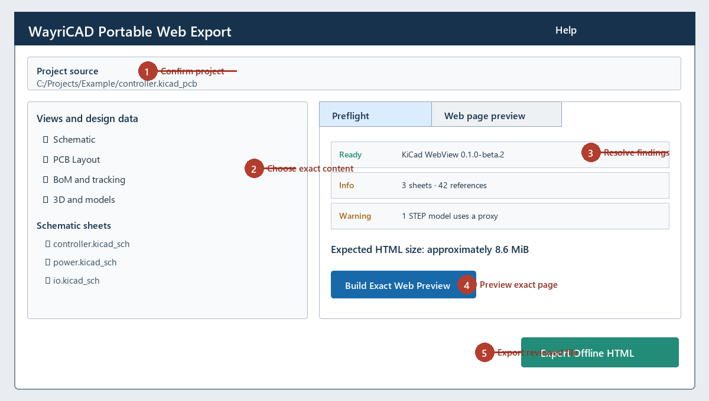

# WayriCAD Portable Web Export

Portable Web Export creates one self-contained, read-only HTML review page from selected KiCad project content. It uses the maintained [KiCad WebView](https://github.com/wayri/kicad-webview) renderer rather than a second KiCad parser or drawing engine.

## Workflow

1. Open and save the PCB in KiCad, then launch **WayriCAD Portable Web Export**.
2. Independently enable schematic, PCB layout, BoM tracking and 3D.
3. Select schematic sheets and supported 3D models. Review every missing or unsupported asset and the estimated file size.
4. Build the embedded **Web page preview**. It renders the exact current HTML document in the plugin before export.
5. Export the reviewed HTML. The exporter writes the same document bytes, including its document ID and UTC generation timestamp; changing a selection invalidates the preview and gates export until it is rebuilt.
6. Open the HTML directly from disk and inspect all selected tabs before sharing it.

The HTML contains the selected design bytes, viewer JavaScript, styling and legal notices. It has a restrictive content-security policy and makes no network requests. No npm install, local server or CDN is required by the recipient.

Every document embeds standard HTML metadata plus a machine-readable JSON traceability manifest with UTC generation time, exporter and viewer versions, project/revision/document IDs, and SHA-256 plus byte count for each bundled source. The same identifiers are visible in the page header and About dialog.

## Linked review and tracking

- The schematic, PCB, 3D and BoM tabs use saved component UUIDs where available and exact references as a bounded fallback.
- Selecting a BoM row focuses the corresponding component in the active viewer. Viewer selections highlight their BoM rows.
- BoM rows can be grouped by value/footprint or shown as individual references.
- Individual reference edits save immediately. Group edits are staged and only update every group member after **Apply group** and confirmation.
- Ordering, receiving, assembly state, DNP and notes are separate fields.
- Browser storage is keyed by project identity and exact exported revision. A backup from another project is rejected. A different revision requires the explicit migration checkbox and only matching stable identities are imported.
- Local browser progress does not rewrite the downloaded HTML. Use **Export progress JSON** to move or recover state.

## 3D support

WRL, GLB and GLTF models that resolve from the saved board are selectable. The exporter rewrites only the bundled copy of the PCB so external model paths point at safe in-document paths. STEP and IGES decoding is not provided by the current portable WebView build; these models are reported before export and remain labelled proxies.

## Viewer distribution

The plugin package must contain a reviewed KiCad WebView distribution in `vendor/kicad-webview/`. Development checkouts may set `WAYRICAD_KICAD_WEBVIEW_DIST` to a reviewed prebuilt distribution. Preserve `LICENSE`, `LICENSING.md`, `THIRD-PARTY-NOTICES.md`, dependency notices and source provenance alongside `kicad-webview.min.js`.

KiCad WebView is MPL-2.0. WayriCAD host code remains GPL-3.0-only. See [THIRD-PARTY-NOTICES.md](THIRD-PARTY-NOTICES.md).

## Limits

- Input design/model bytes are limited to 64 MiB by the pinned portable viewer contract.
- The export is a saved-data review, not KiCad, ERC/DRC, a manufacturing release, or an editable CAD document.
- Hierarchical connectivity and unsupported saved constructs retain the limitations documented by KiCad WebView.
- Cross-selection never guesses an unrelated reference when a stable saved identity conflicts.
- Browser `file:` storage policy varies. JSON backup/import is the portable recovery path.
