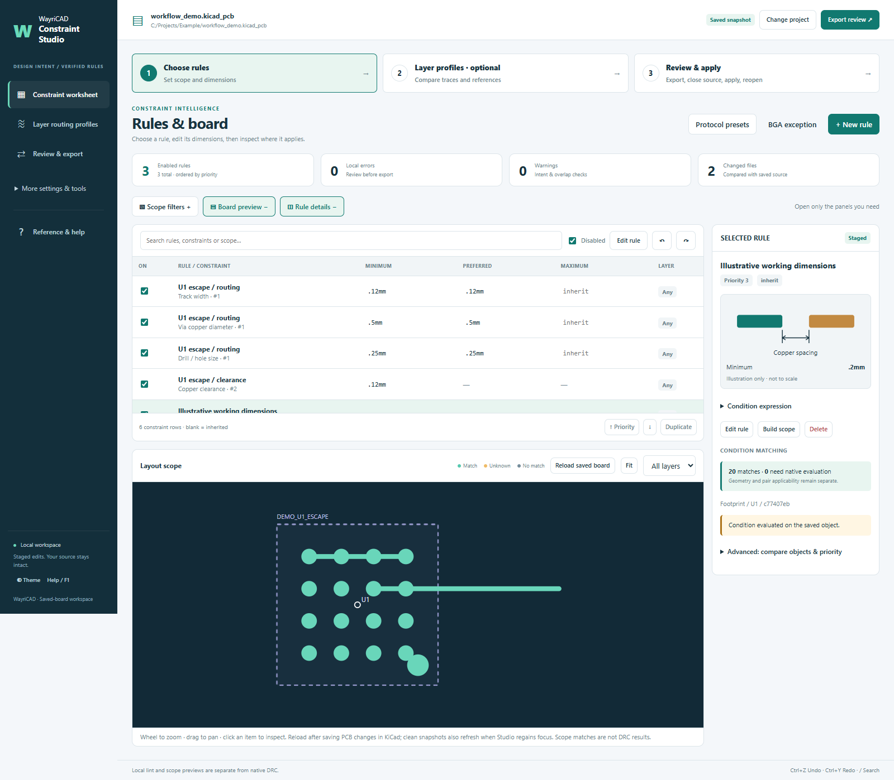

# WayriCAD Constraint Studio


| Start here | Link |
|---|---|
| Download and install | [Latest release](https://github.com/wayri/WayriCAD/releases/latest) · [Installation guide](../docs/INSTALLATION.md) |
| First use | [Getting started](#getting-started) |
| Help | [Offline help](help.html) · [Compatibility](../docs/COMPATIBILITY.md) |
| Command line | `wayricad tools run protocol-constraints -- --help` |

CLI scope: JSON constraint composition; reviewed project apply remains separate. The unified command requires the [suite CLI installation](../docs/TOOL_CLI_CATALOGUE.md); installing this PCM plugin alone does not install the complete CLI suite.

Create and review KiCad design rules in a saved-project workspace. Studio supports
custom constraints, netclasses, clearance matrices and per-layer routing profiles.
Edits stay staged until you export and apply a reviewed copy.

## Getting started

1. Save the PCB and Board Setup in KiCad, then open **WayriCAD Constraint Studio**.
2. Select a rule in the worksheet. Edit its dimensions directly, use **Edit rule**,
   or create one with **New rule**. **Protocol presets** helps prepare common buses.
3. Open **Scope filters**, **Board preview** or **Rule details** when needed.
   The worksheet starts at full width, with these panels closed.
4. Go to **Review & export**. Resolve local errors, inspect the changes, and export
   to a separate empty folder. Run native KiCad syntax checks and DRC on that copy.
5. Click **Open Apply Review**. Close every source-project editor before confirming
   the helper's write. Reopen the project in KiCad afterward.

Apply Review checks source fingerprints and makes backups. Scope colours and local
lint help review your intent; they do not replace native DRC.

## The workspace

| Where | What to do |
|---|---|
| Constraint worksheet | Edit minimum, preferred and maximum values; set scope and priority. |
| Scope filters | Narrow the table by component, net, netclass, area or constraint family. |
| Board preview | Zoom, pan and select saved objects to inspect a rule's scope. |
| Rule details | Read dimension illustrations, matching feedback and expanded expressions/priority traces. |
| Layer routing profiles | Configure a named protocol/net group for each permitted routing layer. |
| Review & export | Inspect findings, native rules and file differences before applying. |
| More settings & tools | Open matrices, netclasses, reusable sets, BGA and other specialist editors. |

A **Clear filter** button remains visible when a scope filter is active, even if its
panel is closed. Undo/redo works across staged edits. **Help / F1** opens the bundled
reference inside the application.




These images render the shipped interface with the public demonstration snapshot.
[Capture and validation notes](docs/UI_SIMPLIFICATION.md).

## Set up layer routing

1. Open **Layer routing profiles**. Create one instance for each bus or group,
   such as CAN1, CAN2 or DDR Data. Select exact nets or an existing netclass.
2. Add each signal layer, its reference plane(s), trace width and differential gap.
   Expand **Compare layer geometry** to compare the diagrams at a common scale.
3. Optionally define a via type, diameter, drill and layer span. Review the saved
   stackup, reference continuity and fabrication limits.
4. Review and stage the profile, then export/apply it using the workflow above.
5. In KiCad, use netclass/rule sizing and turn **Auto track width** off. At a via,
   finish the route and start a new route on the destination layer to use its profile.

KiCad 10 keeps one width during an active route. Studio does not resize existing
copper or automatically choose a via type. Differential nets must use names KiCad
recognizes as a pair. Recheck profiles after changing the stackup or net membership.

[Detailed layer-routing guide](docs/LAYER_ROUTING.md) · [Offline help](help.html)

## Save, refresh and recover

Studio reads saved geometry, not unsaved editor changes. A clean workspace refreshes
when Studio regains focus; **Reload saved board** refreshes it explicitly. Export or
undo staged changes before reloading.

If the visual page stops responding, use **Open native worksheet · recover workspace**
above it. The same staged work stays available in the native editor. Missing replies
time out without replaying edits. If WebView cannot start, Studio falls back to the
native worksheet and displays the error.

## Supported scope and limits

- All 34 custom-constraint forms can be authored; unfamiliar native expressions
  may need advanced text entry.
- Presets and width estimates need review against the actual stackup, devices and
  fabricator. A named reference layer alone does not prove plane continuity.
- Condition matching is a conservative subset. Unknown matches stay unknown;
  illustrations are not effective-rule or impedance certification.
- Windows/KiCad 10 native WebView checks are recorded in the UI validation notes.
  Other hosts, DPI settings and KiCad 11 still need acceptance checks.

## Installation and source development

Install the WayriCAD **protocol-constraints** PCM package. Its ID stays
`com.github.wayri.wayricad.protocol-constraints`. Do not install the original
standalone Constraint Studio package beside it.

Source launch with KiCad's Python and wxPython:

```powershell
& 'C:/Program Files/KiCad/10.0/bin/python.exe' -m protocol_constraint_composer_plugin.studio_ui C:/Projects/Example/board.kicad_pcb
```

[Integration details](docs/INTEGRATION.md) · [Full development guide](docs/USER_GUIDE.md) ·
[Feature status](docs/FEATURE_STATUS.md)

Constraint Studio 0.3.1 is included with the source owner's GPL-3.0 authorization.
[Source provenance](SOURCE_PROVENANCE.json) retains archive hashes; original notices
remain in the bundled license files. Optional signing needs `cryptography`, and
NumPy accelerates the optional solver; these are not installed automatically.
