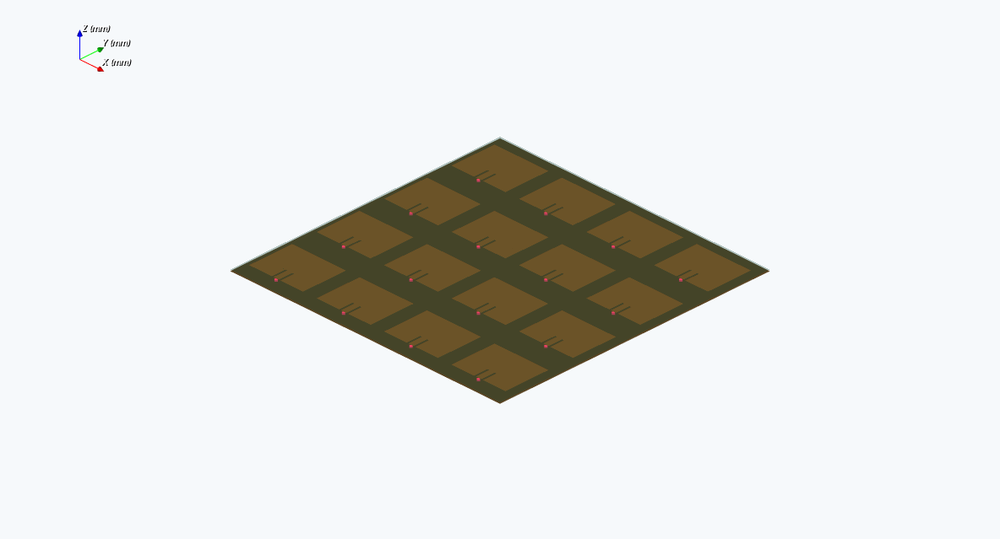
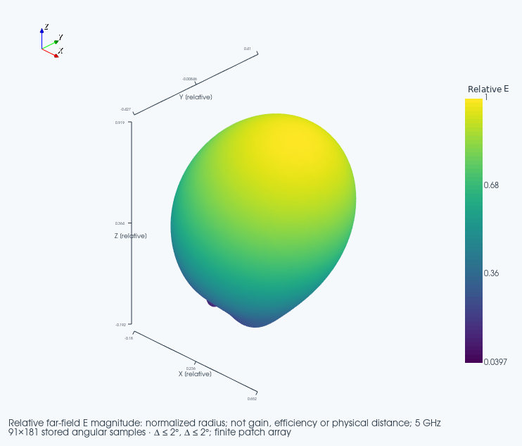
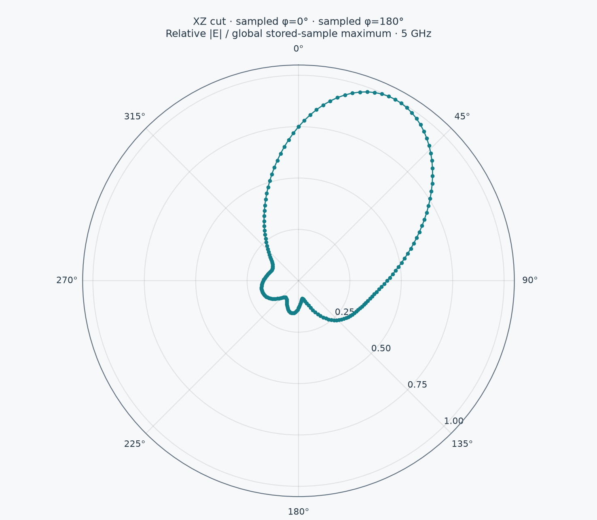

# FEM Phased Arrays and AESA

Version 4.8.1 adds **FEM phased array / AESA**. It solves the complete
passive array with EMerge's finite-element backend, not an array-factor surface
substituted for a solve. Published 4.8.0 binaries predate this extension.

## Select a Model

| Mode | Calculated physics | Boundary |
|---|---|---|
| FEM phased array / AESA | 2–16 inset-fed patches, common substrate/ground, one physical lumped port per patch, full coupled S matrix, coherent fields and radiation | Generic passive geometry, not the paper's active feed network or author CAD |
| Published Verho AESA | Ideal isotropic 4×4 array factor and published phase law | No element patterns, coupling, active hardware or full-wave solve |
| Periodic / Floquet | Bounded repeated unit cell | No finite-array edge effects; not the same finite multiport problem |

MoM is not implemented by this adapter. EMerge is the integrated FEM backend.
The originating saved board provides context; its copper is not imported into
the array template. Active T/R modules, calibration, phase-shifter loss and
arbitrary imported element geometries are not inferred.

## Open to Run

1. Prepare the normal Quick EMerge runtime; current checks use EMerge 3.0.4 /
   emsutil 1.1.6. Launch from a saved KiCad PCB.
2. In **Setup**, select **FEM phased array / AESA**. This loads a generic 3 GHz
   2×2 starting geometry, three frequency samples and a 300,000-tetrahedron guard.
3. Review patch/inset/feed dimensions, material, conductor, mesh and boundaries.
   The starting geometry is not an automatically matched antenna.
4. In **Array**, choose counts, pitch, incident power and uniform/binomial taper.
   Up to 4×4 / 16 ports are supported. Increasing counts also requires a larger
   substrate; use 160×160 mm for the supplied 4×4 geometry. Overlapping or
   out-of-board patches are rejected.
5. Choose **scan_angle** and set theta/phi under **Excitation**, or choose
   **progressive_phase** for explicit adjacent-port phases. Theta is measured
   from +Z; phi is azimuth. X changes fastest in the port ordering.
6. **Preview** actual inset patches, shared ground and feed ports, then **Run
   simulation**. Review diagnostics; Cancel or a size-limit rejection is not a
   completed solution. More than nine ports are limited to 81 sweep samples.
7. Enable **Show results**. Inspect the coupled network, sampled fields,
   **3D radiation**, supported boresight polarization and **Charts > Array ports**.
   **3D + 2D radiation** shows the interactive lobe and an XZ/YZ/azimuth polar
   cut together inside the window, with the same global normalization and
   original-sample probes. Views stack when the window is narrow. Array runs
   open this overview automatically when suitable radiation data is present.
8. Save setups/results and export reports/Touchstone. Rerun after changing
   steering, taper or geometry. Archives do not cache all embedded fields for
   instant arbitrary re-steering. Input changes invalidate previous results.

## Excitation and Power

EMerge's default lumped-port basis is 1 W with peak voltage `sqrt(2 Z0)`.
Weighting coefficients have units sqrt(W). For amplitude taper `t_n`, element
positions `r_n` and the target unit direction `u`:

```text
u = (sin(theta) cos(phi), sin(theta) sin(phi), cos(theta))
k0 = 2 pi f_reference / c
a_n = sqrt(Pincident) t_n exp(-j k0 r_n . u) / sqrt(sum(t_n^2))
b(f) = S(f) a
Pincident = sum(|a_n|^2)
Poutgoing(f) = sum(|b_n(f)|^2)
Paccepted(f) = Pincident - Poutgoing(f)
Gamma_active,n(f) = b_n(f) / a_n, for a_n != 0
```

The phase reference is the sweep midpoint. Phases stay fixed over frequency,
modelling ideal phase shifters, **not true time delay**; beam squint is not
compensated. Uniform and separable binomial tapers use the same total incident
power, not equal per-element power.

Complex embedded port fields come from the **complete coupled structure**.
No extra position phase is added to them. The combined far field is checked
against the weighted sum of per-port Cartesian fields. This checks coherent
superposition, not independent physical accuracy.

Active reflection is not isolated `Snn`: other driven ports contribute.
Individual active reflection can exceed one and individual net port power can
be negative through coupling. Zero-driven ports have undefined active
reflection, but their outgoing power still counts. Negative **total** accepted
power is flagged as numerical/passivity trouble, not clamped.

Array runs disable and record EMerge's S-entry/column caps and reciprocity
correction. The uncorrected network stays visible. Accepted power includes
radiation **and material loss**; it is not radiated power or efficiency.
Relative radiation surfaces do not supply gain in dBi.

## CLI

Create a portable FEM setup without wxPython or a solver import:

```powershell
python -m quick_emerge_plugin --write-fem-aesa-setup aesa-4x4.json --array-x 4 --array-y 4 --array-theta 30 --array-phi 0 --array-taper binomial
```

Launch with `--board C:/Projects/Example/board.kicad_pcb`, use **Files > Load
setup**, review, Preview and Run. Existing isolated worker requests accept the
same normalized `study: array` configuration/source-hash contract. Writing a
setup is not a solve.

All 256 ordered entries are retained at 16 ports. Historical names like `S11`
remain; multi-digit indices are delimited (`S1_11` versus `S11_1`). Touchstone
keeps numeric ordering. Above nine ports, response plots show diagonals to avoid
256 overlapping curves; full off-diagonal values remain in report tables,
original JSON, network transforms and Touchstone. Fitting keeps its separate
nine-port limit.
The specialist Optycal far-field export retains its separate eight-port limit
and rejects larger selections before solving; native/HTML/Touchstone remain
available for larger arrays.

## Verification and Limits



This direct native viewport capture is geometry only, not a 16-port solve.
[Preview provenance](help-fem-aesa-preview.provenance.json).

| Coupled FEM 3D radiation | The same result's 2D cut |
|---|---|
|  |  |

These are direct exports from the two live native overview viewports. The
demonstration is a small two-port array, 8,094 tetrahedra, solved at 4 and 5 GHz
with 30-degree requested steering at the 4.5 GHz phase reference. It is not a
converged 4×4 AESA result. [Numerical/capture provenance](help-fem-aesa-radiation.provenance.json).

Unit tests cover steering sign, taper/power normalization, 256-entry round trips,
Touchstone ordering, active coupling, negative-power diagnostics, legacy hashes,
CLI generation and report tamper rejection. Synthetic matrices are not FEM
evidence. Opt-in tests separately exercise a small coupled solve and 16-port
physical geometry construction. See [validation](VALIDATION.md) for actual runs.

A successful coarse solve does not establish convergence. Vary mesh,
air-domain/boundary, sweep and materials before trusting matching, null depths,
scan error, polarization or sidelobes. Do not claim measured gain, paper
agreement, active-array replication, flight or regulatory qualification.

## References

- [EMerge upstream](https://github.com/FennisRobert/EMerge): full-wave FEM and
  complex field post-processing.
- [Upstream patch example](https://github.com/FennisRobert/EMerge/blob/main/examples/demo4_patch_antenna.py):
  inset-patch/port workflow; our starting dimensions are explicitly separate.
- [Pinned 3.0.4 source](https://github.com/FennisRobert/EMerge/tree/4b17fb0648b29ab0bdc19090eb7bf82e7b4cb1cd):
  `microwave_data.py` excitation/per-port fields, `port_bcs.py` power convention
  and `settings.py` S corrections.
