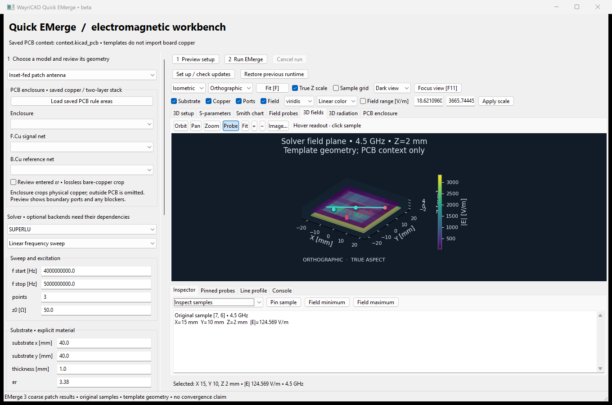
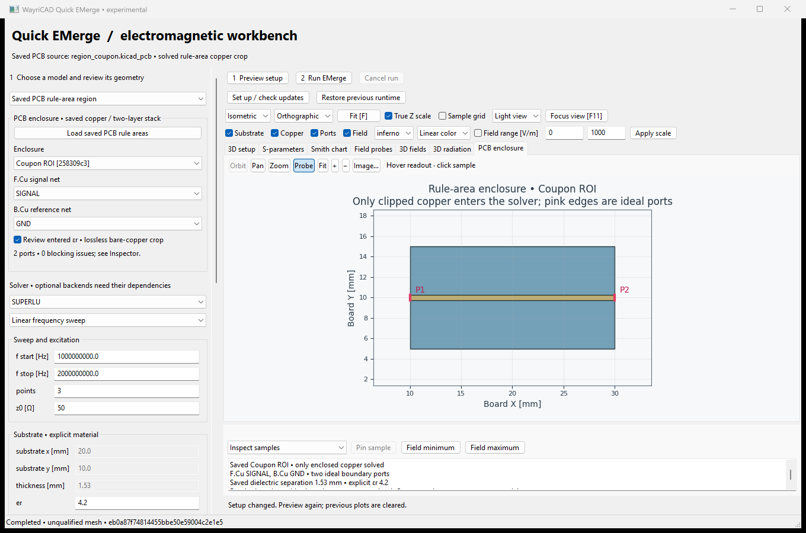
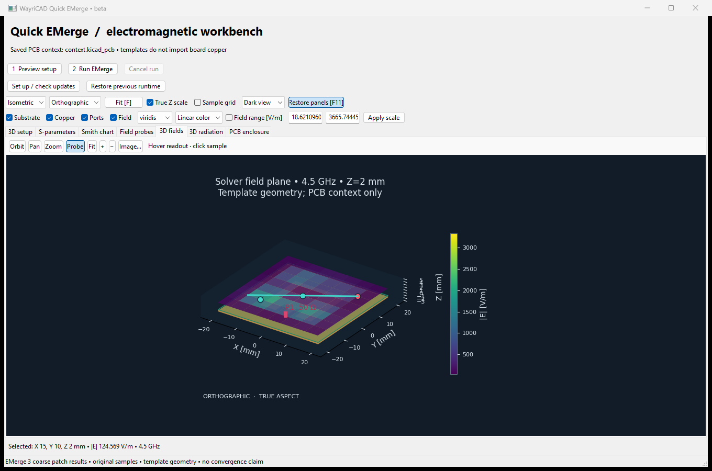

# Quick EMerge

Read-only electromagnetic studies for KiCad: antenna and PCB templates, plus
polygon-clipped **saved-PCB rule-area** simulations. Templates use the saved
board as context; region mode imports actual enclosed copper. Components and
board geometry outside the enclosure are omitted.

This guide describes the **current development source**. The published
[3.6.43 beta package](https://github.com/wayri/WayriCAD/releases/tag/v3.6.43-beta.1)
contains the earlier workbench and a smaller integration scope. Installing that
immutable release does not install the development features below. See
[capability coverage](CAPABILITIES.md) and [validation evidence](VALIDATION.md).

## Setup and launch

The desktop environment needs Python, complete wxPython/Matplotlib, NumPy,
VTK and ReportLab; use `requirements-desktop.txt` and the shared
[runtime setup guide](../wayricad_runtime/RUNTIME_SETUP.md). The desktop and
EMerge solver run in separate processes. A tiny complex-system check detects
working SuperLU/PARDISO backends. New studies prefer verified PARDISO when
available; loaded setups and explicit solver choices are preserved. KiCad-native saved-board extraction
uses the installed KiCad Python bindings.

```powershell
python -m quick_emerge_plugin --board C:/Projects/Example/board.kicad_pcb
```

First-open setup discovers Python 3.10-3.13 and installs the latest non-yanked
EMerge 3+ candidate, including prereleases, into its own environment. Candidate
installation requires **3 GiB free** and internet access. CAD import and bounded
DXF/MsgPack export dependencies are included. `pip check` and **22 real
compatibility checks** must pass before atomic activation. The full gate can
take several minutes; its timeout is 20 minutes. Existing working environments
are never upgraded in place. Failed updates retain the working version; a first
installation can fall back to the tested EMerge 3.0.0b9 baseline.

Update checks occur at most daily. The Run settings offer setup/retry and
restore-previous-runtime controls. Stale adapter certificates trigger
requalification of the existing owned runtime without changing its packages.
Set `WAYRICAD_QUICK_EMERGE_HOME` to move managed environments to another drive,
`WAYRICAD_QUICK_EMERGE_PYTHON` for a base interpreter, or select an existing
solver Python in the workbench. Retained runtimes support rollback; they are
not silently deleted. This manager never upgrades KiCad's packages.

## Visual workflow

1. Use **1 Geometry** for the geometry source and dimensions, **2 Physics** for
   study/material/boundary controls, and **3 Solve** for sweep, mesh and runtime
   settings. **Open** and **Save** retain reusable study setups. First open
   loads saved board/rule-area outlines while dependency preparation runs.
   Copper is extracted by Preview. Dimensions are **mm**, frequency entries are **GHz**, impedance is
   **ohm**. Setup JSON and solver requests retain canonical Hz.
2. Select **Preview** and inspect geometry and numbered ports. Review any
   blocking diagnostics before **Run simulation**. Editing the setup clears
   stale results, probes and report state and requires another preview.
3. Switch between **3D**, **2D**, **Charts**, **Results** and **Report**. The
   3D selector exposes solved field/radiation views only when those data exist.
   Use **Inspector**, **View options** and **Focus** when needed.
4. Inspect original samples, export results, or generate a report. Mesh and
   solver work run outside the UI process; Cancel stops the worker and retains
   its diagnostic files. Reviewed 2D/3D geometry stays visible during a run.
   Report previews use native load/error events; new results clear the previous
   report and offer Generate preview, Export HTML and Export PDF.

### Simulate a PCB rule-area enclosure

Save a board with closed Edge.Cuts, filled zones and an explicit two-layer
stackup. Draw/name a polygonal **board rule area** around the subsection.
Choose **Saved PCB rule-area region**, load saved rule areas, select the
F.Cu signal and B.Cu reference nets, and review the material/bare-copper model.
Unsaved editor changes are excluded. Preview displays the clipped copper,
substrate and ideal boundary ports; the inspector lists unsupported inputs.

The XY enclosure crops the full two-layer column. Concavity and holes are
preserved; it is not replaced by a bounding rectangle. Tracks/arcs and SMT
pads use a recorded 0.005 mm polygonization tolerance; zones use saved fills.
A port must cross an actual rule-area cut with reference copper across its
whole span. Natural board edges and existing holes do not create ports.

This path supports **1-8 ideal vertical boundary ports**. Inside drilled
features, unfilled intersecting zones, unsupported copper graphics, unselected
cut conductors, incomplete returns, ambiguous corner ports and curved rule-area
contours block simulation. General multilayer/via-barrel/component extraction,
interior feeds and footprint-local rule areas remain unsupported. The separate
internal stripline/via template does not remove these extraction limits.
Polygon validation is bounded to 20,000 total / 2,000 per-contour vertices.
Saved dielectric separation, explicit material assumptions, source UUIDs,
ports and source/geometry hashes accompany the study. Source/configuration
changes reject stale results. PCB and adjacent project files are not written.

### Viewports, probing and charts

Native VTK supplies the 3D scenes; Matplotlib supplies 2D plots and charts.
Compact **Orbit / Pan / Zoom / Probe**, **Fit**, zoom and image-export buttons
sit beside the viewer. Choose camera presets and projection in View options;
physical Z aspect and explicitly labeled exaggeration affect display only.
Visibility and linear/log color scales preserve the original solver samples.
A sample grid is not the FEM mesh; missing values remain unknown.

Select E magnitude [V/m], H magnitude [A/m], power-flow magnitude [W/m2] or
thermal temperature [K] when available. EM fields use a recorded solved
frequency/excitation; clicking another S-parameter frequency does not recompute
them. Optional volume sampling supplies at most 17 Z layers / 100,000 original
samples, displayed as a point cloud or selected XY slice. It is not arbitrary
continuous-volume interpolation. Radiation shows relative electric-field
magnitude, not calibrated gain, efficiency or physical distance.

Probe selects original samples with linked 2D/3D markers. The Inspector offers
extrema, pinned samples and CSV export. Line cut selects two samples and
records nearest-original-sample values against distance; it invents no new
field measurements. Colors may use reduced display geometry while inspection
retains original data. Focus expands/restores the workspace.

Charts offer magnitude, phase, group delay, impedance, diagnostics and a Smith
chart for networks present in the result. **Network tools** can renormalize,
convert selected pairs to mixed mode, terminate ports, embed ideal R/L/C, or
perform bounded AAA/vector fitting. Each operation starts from the original
solved network and produces separate derived evidence/Touchstone; EM geometry
and fields retain their original excitation. Fits are models of sampled data,
not additional FEM solves or evidence of passivity outside the solved band.

### Reports and artifacts

The Report view provides **Generate preview**, **Export HTML** and **Export
PDF**. Reports include model assumptions, original response/field charts,
selected quantity/slice, probes/profiles, diagnostics and source hashes.
Derived networks remain distinct from the original response. HTML embeds its
assets for offline reading; PDF uses ReportLab. Source/configuration custody
is checked before publication, and stale exports are rejected.

Each run records `request.json`, `status.json`, `solver.log` and, on success,
`result.json`. Network studies also export Touchstone with explicit reference
impedance; thermal/scattering studies do not invent S-parameters. Optional
live-model exports provide planar-sheet DXF and Optycal-compatible far-field
MsgPack for supported driven/array studies. Setup files and completed runs
are user artifacts, not disposable caches.

## Physical scope and validation

The patch template optionally adds an external feed strip with
`advanced.patch_feed_extension_mm` (default zero), with signed patch-center
`advanced.patch_offset_y_mm` (default zero). The patch and feed must fit inside
the substrate; the ideal feed port moves to the feed outer end. This is a driven/
optimization patch feature, not a general connector or coax model.

The default model uses PEC and a homogeneous dielectric. Development controls
add finite-conductor surface/thickness/roughness models, dielectric loss and
linear frequency dispersion, ABC order 1/2, PEC/PMC/PML boundaries, periodic
Floquet studies, scattering, TE10 waveguide, finite arrays, bounded optimization,
steady/transient substrate thermal studies and dielectric RF heating.
[The capability inventory](CAPABILITIES.md) records the limits of each path.
Fabrication imports require an explicit reviewed recipe and source manifest;
they are expert adapters, not a general visual CAD editor/import wizard.

Coarse compatibility solves do **not** establish antenna accuracy, mesh
convergence, power balance, array null depth or measured hardware agreement.
Adaptive limits can be reached before convergence. Thermal RF coupling covers
dielectric loss, not copper surface heating. Unsupported study/control
combinations fail explicitly. Optional CPU/GPU solver backends require their
own dependencies and hardware and remain unqualified here. Live KiCad menu
launch and physical mouse acceptance for the revised UI are separate checks;
see the dated evidence rather than inferring them from source tests.

```powershell
python -m pytest quick_emerge_plugin/tests -q
& 'C:/Program Files/KiCad/10.0/bin/python.exe' -m unittest discover -s quick_emerge_plugin/tests -p test_pcb_regions.py -v
python -m quick_emerge_plugin --check-runtime
```

The adapter targets upstream EMerge 3.0.0b9 at commit
[446232037d175a596606c6c9ea986e372560566f](https://github.com/FennisRobert/EMerge/commit/446232037d175a596606c6c9ea986e372560566f).
EMerge is by Robert Fennis and contributors, GPL-2.0-or-later. Its solver and
runtime are not vendored. New releases require fresh compatibility evidence.

## Earlier beta screenshots

These are actual captures of the **earlier beta UI**, not the redesigned
workbench. Local interpreter/output paths were replaced with generic paths;
numerical data and synthetic-board coordinates were preserved. The coarse
patch and rule-area runs are not converged-design evidence.




