# Quick EMerge

Inspect and simulate an antenna region from a saved KiCad PCB. Draw a **rule
area** around the antenna and feed, then review its actual copper, dielectric
separation and ideal boundary feed ports. The plugin is read-only. Geometry and
components outside the selected crop are omitted, so this is not a simulation
of every coupling to the rest of the board.

Launching from KiCad starts with the saved board and its rule areas. Parametric
antenna and line templates are optional separate studies; they do not import the
board's copper.

Quick EMerge is an independently installable testing beta in the
[WayriCAD 4.7.0 release](https://github.com/wayri/WayriCAD/releases/tag/v4.7.0).
See the [KiCad workflow help](help.html), [capability coverage](CAPABILITIES.md) and [validation evidence](VALIDATION.md)
for implemented scope and its limits.

## Quick start

| Step | Action |
| --- | --- |
| 1. Select the antenna | Save a filled PCB with a named rule area around the antenna and required feed/ground geometry. |
| 2. Review the crop | In **Setup**, select **Saved PCB rule area**, its signal/reference nets and material inputs. Choose **Preview** and inspect the actual copper and feed ports. |
| 3. Simulate | Review the sweep, mesh and boundary settings, then choose **Run simulation**. |
| 4. View results | Enable **Show results**. Choose the field or radiation view; radiation offers **2D** XZ/YZ/azimuth cuts and an interactive **3D** pattern. |
| 5. Save or export | **Files** saves setup/results. **Export…** saves PNG views and HTML/PDF reports. |

Radiation views require stored radiation samples and show relative field, not
gain in dBi or efficiency. [Radiation controls and interpretation](#2d-and-3d-radiation-patterns).
The screenshots below retain their 4.0.1 capture context.

Open **Help** or press **F1** for the offline KiCad guide: saved-board preparation,
rule-area copper and ports, dielectric setup, sampling, probing and reports.
New studies use 81 frequency samples, an 81 × 81 field grid and 2° radiation
sampling. Saved setups retain their explicit frequency/grid counts; **3 Solve →
Output sampling → Use dense sampling** applies the denser linear preset.
Frequency samples are FEM solves; field and angular samples evaluate the solved
field and do not refine its mesh. Report figures export at 200 DPI.

## Published antenna examples and real-result gallery

The research collection includes five source-backed studies. These are bounded
reconstructions and engineering examples, not qualified reproductions of all
published measurements. Choose **Setup > Published antenna benchmark** or
**Files > Open setup** to load a portable example. Preview the geometry/ports,
review the excitation and sweep, then choose **Run simulation**.

| Example and source | Implemented scope | Important boundary |
|---|---|---|
| [Rezaeipour and Sadeghzadeh (2021)](https://arxiv.org/abs/2106.07291), dual-feed 2.45 GHz patch | Equal-phase linear and phase-quadrature circular-feed studies | Published switching/feed network omitted; signed Stokes convention needs reconciliation before RHCP/LHCP claims |
| [Yang et al. (2016)](https://doi.org/10.3390/s16070983), WLAN monopole | Printed radiator, partial ground, network/field/radiation analysis | Coarse screening failed the matching target; gallery below is this case |
| [Liu et al. (2020)](https://doi.org/10.3390/electronics9060986), CubeSat Yagi | Planar four-element radiator on 0.6 mm FR4 | CubeSat chassis and deployment angles omitted; taper coordinates digitized |
| [Verho et al. (2023)](https://doi.org/10.3390/s23031324), 4 x 4 AESA | Ideal 3 GHz, 40 mm-pitch array-factor steering law | Not a full-wave 16-port active array; no mutual coupling or phase-shifter loss |
| [Kabir et al. (2023)](https://doi.org/10.3390/electronics12214439), CubeSat S/X shared aperture | Stacked radiators, separate probes, air cavity and PRS | Coarse axial-ratio checks failed; nominal laminate Dk assumptions and omitted SMA/fasteners remain limits |

The [step-by-step example guide](../examples/quick_emerge/research_antennas/README.md)
contains installation, individual sweeps/excitations, GUI and headless run
instructions, numerical output interpretation and troubleshooting. The separate
[Yeo-Lee saved-copper example](../examples/quick_emerge/yeo_lee_2019/README.md)
documents actual PCB-region extraction, port checks and its own numerical
comparison; do not confuse its board with the WLAN model below.

### Actual run and evidence boundary

All eleven images below come from the **Yang WLAN geometry and one real
EMerge 3.0.0b9 / SuperLU screening solve**, captured on Windows on 2026-11-10
using Quick EMerge 4.7.0. They are not marketing mockups, paper figures or
photographs of manufactured antennas. Native window captures and native 3D
framebuffer exports are distinguished from the post-processed polarization plot.

| Input/evidence | Recorded value |
|---|---|
| Source geometry | 16 x 29 mm FR4 substrate, printed branched radiator/feed and partial bottom ground |
| FEM sweep | 2.35, 2.45 and 2.55 GHz; three original samples, 100 MHz spacing |
| Mesh | 4,429 tetrahedra; coarse screening, no refinement/convergence claim |
| Field plane | 41 x 41 original samples at Z = 2 mm, frequency 2.45 GHz |
| Radiation | Original angular samples at 2.45 GHz, relative E normalization; not gain/efficiency |
| Boresight polarization | +Z, Cartesian Ex/Ey; axial ratio 50.156 dB, nearly linear |
| Matching outcome | Failed paper matching target; S11 remains well above -10 dB |

The saved PCB supplies context/identity only: its unrelated copper is not
imported into the published template. Three frequency points cannot establish
resonance or bandwidth. A single Z plane is not a volume solve. These captures
do not establish paper agreement, accepted-power-normalized gain, efficiency,
hardware/flight qualification or new cross-platform native acceptance.

### Antenna design open in Quick EMerge

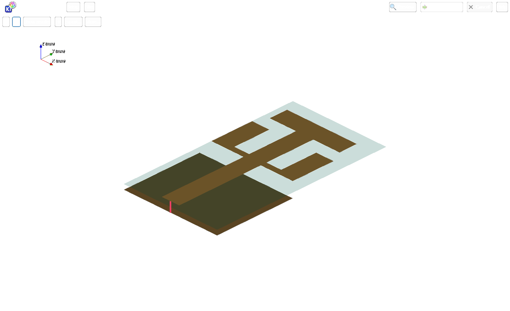

The native plugin displays the actual simulated radiator, feed, substrate and
partial ground rather than a generic patch illustration.

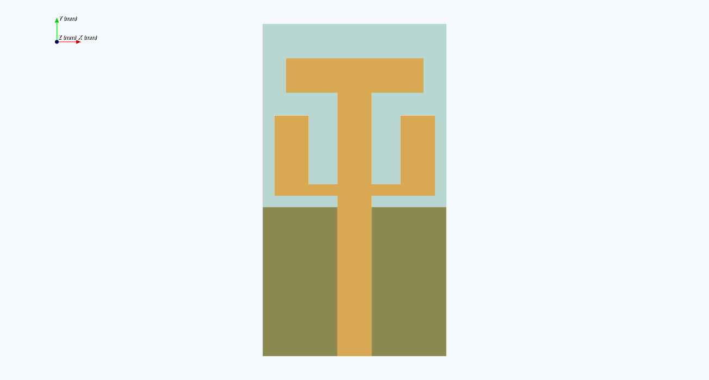

Top/orthographic projection of the native 3D model. The current software 2D
research fallback displays only the substrate, so this uses the actual 3D
model's camera instead; the fallback is not claimed fixed by this gallery.

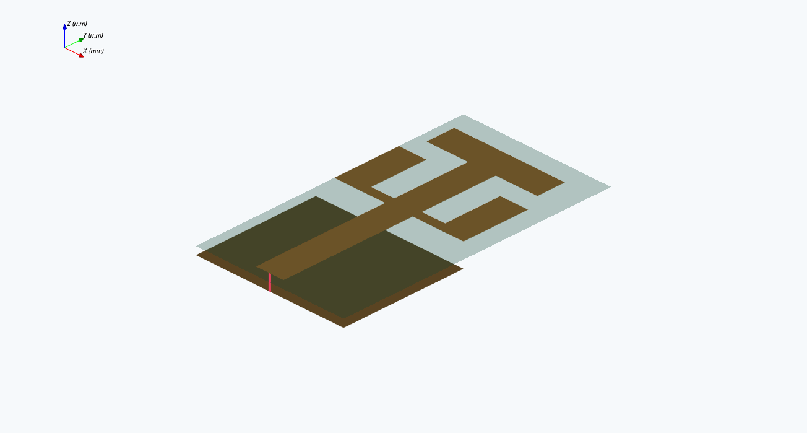

Native geometry-only framebuffer export. The lower ground and top radiator
are separate surfaces in the model, not a photograph of fabricated copper.

### S-parameter analysis

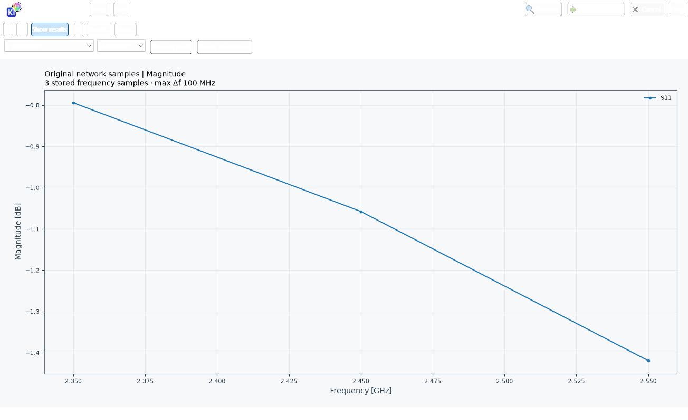

S11 in dB uses the original complex reflection samples. The poor match is
retained honestly; connecting lines do not supply missing frequency solves.

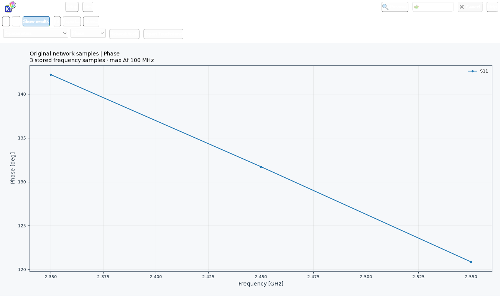

Phase of the same three S11 samples. This is not evidence of a resolved
group-delay curve, wideband phase behavior or a tuned resonance.

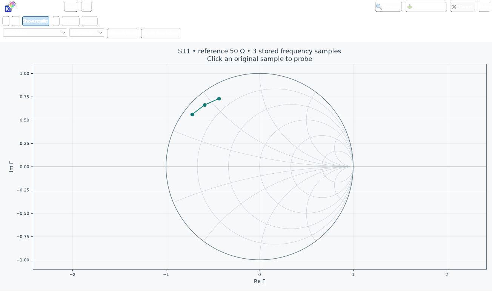

Reflection coefficients referenced to 50 ohm. The points' distance from the
center is consistent with the failed matching result.

### 2D and 3D field visualization

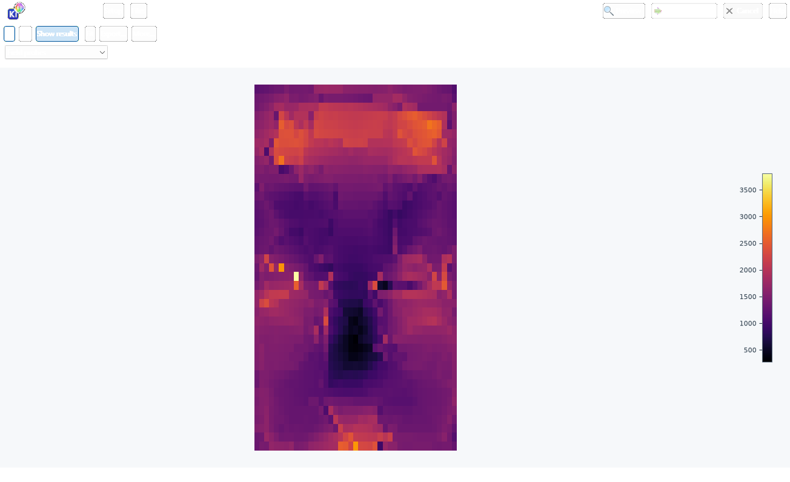

E magnitude in V/m at 2.45 GHz and Z = 2 mm. Pixels retain the original 41 x 41
samples; no invented high-resolution spatial detail is added.

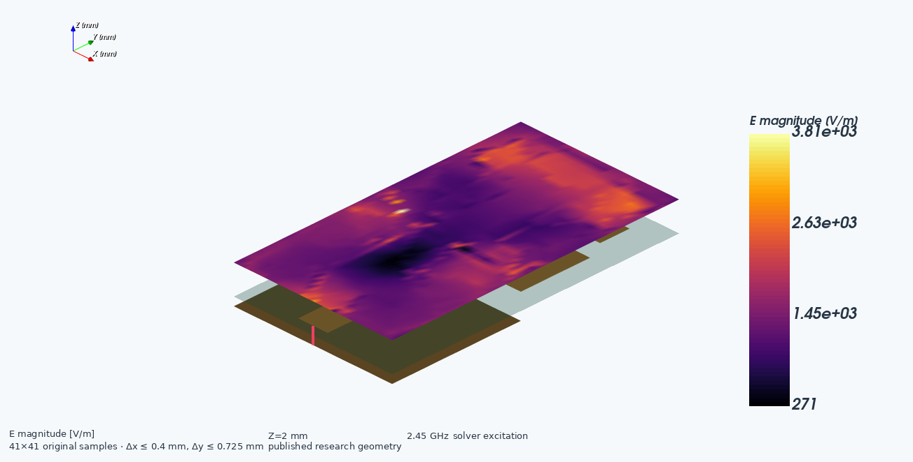

Native 3D display of the same solved plane over the geometry. This does not
represent independently solved depth slices or a full volume field dataset.

### 2D and 3D radiation visualization

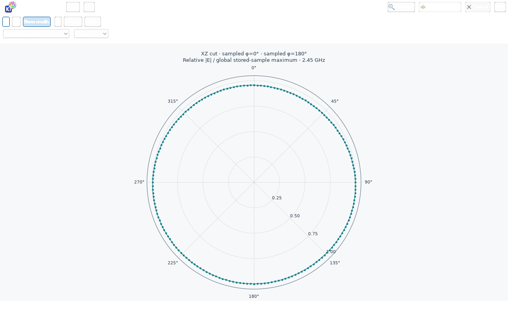

XZ polar cut at 2.45 GHz using opposite sampled azimuth planes. Radius is
relative E magnitude normalized to the global stored-sample maximum, not dBi.

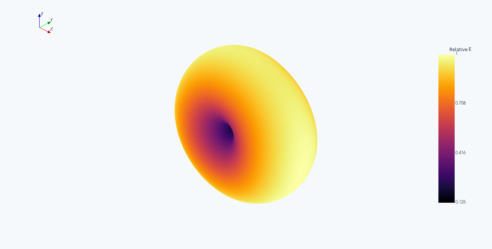

Native angular-sample framebuffer export with the same relative-E normalization.
A smooth-looking surface is not evidence of FEM mesh convergence.

### Polarization analysis from actual solved fields

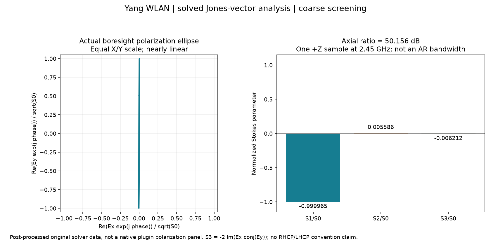

This figure is a **numerical post-processing plot**, not a screenshot of a
native polarization panel. It uses the stored complex boresight Ex/Ey at
2.45 GHz. The equal-axis ellipse is almost a line: axial ratio is **50.156 dB**,
not circular polarization. Normalized Stokes values are approximately
`S1/S0 = -0.999965`, `S2/S0 = 0.005586`, `S3/S0 = -0.006212`.
The convention is `S3 = -2 Im(Ex conj(Ey))`; no RHCP/LHCP mapping is claimed.
This single-direction, single-frequency result cannot establish AR bandwidth
or hemispherical cross-polarization performance. The ellipse's singular-value
ratio independently checks the stored axial ratio.

### Numerical data, provenance and reproduction

- [Portable numerical samples](../examples/quick_emerge/research_antennas/images/wlan-screening-samples.json)
  contain the exact configuration, original network/field/radiation samples,
  research metadata and failed comparisons. The local source-path block is
  omitted; this is numerical evidence, not a custody-complete GUI reload file.
- [Capture provenance](../examples/quick_emerge/research_antennas/images/provenance.json)
  records numerical/image hashes, runtime versions, source geometry digest and
  complex polarization components. No private project data or paths appear in
  the images. No numerical results were retouched or replaced with ideal curves.
- [Dated validation record](../examples/quick_emerge/research_antennas/VALIDATION.md)
  distinguishes this 4,429-tetrahedron run from earlier coarse screening runs.
- [Capture/reproduction helper](../tools/capture_research_antenna_results.py):
  from a source checkout run `python tools/capture_research_antenna_results.py solve`
  with a qualified EMerge interpreter, then `capture` with a complete
  wxPython/Matplotlib/VTK desktop interpreter. Use a fresh `--run-dir` on a drive
  with sufficient space and the same directory for capture. `verify` checks
  numerical/image digests and independently validates polarization by SVD.
- For step-by-step per-case settings and output analysis, use the
  [research walkthrough](../examples/quick_emerge/research_antennas/README.md).
  The other four research templates are not claimed to have case-specific
  solved screenshots in this WLAN gallery.

## Setup and launch

The desktop environment needs Python, complete wxPython/Matplotlib, NumPy,
VTK and ReportLab; use `requirements-desktop.txt` and the shared
[runtime setup guide](../wayricad_runtime/RUNTIME_SETUP.md). The desktop and
EMerge solver run in separate processes. A tiny complex-system check detects
working SuperLU/PARDISO backends. New studies prefer verified PARDISO when
available; loaded setups and explicit solver choices are preserved. KiCad-native saved-board extraction
uses the installed KiCad Python bindings.

```powershell
python -m quick_emerge_plugin --board C:/Projects/Example/board.kicad_pcb
```

Published antenna benchmarks can be discovered and turned into portable setup
files without launching wxPython:

```powershell
python -m quick_emerge_plugin --list-research-antennas "*satellite*"
python -m quick_emerge_plugin --show-research-antenna kabir-2023-cubesat-sx-shared-aperture
python -m quick_emerge_plugin --write-research-setup kabir-2023-cubesat-sx-shared-aperture sx.json
python -m quick_emerge_plugin --array-scan verho-2023-aesa-4x4 35 --array-phi 0
```

The registry includes a dual-feed polarized 2.45 GHz patch, dual-band WLAN
monopole, printed CubeSat Yagi, 3 GHz 4x4 AESA scan-law benchmark, and a stacked
CubeSat S/X-band shared aperture. Each result embeds its citation, source
dimensions, model scope, excitation, assumptions and sampled comparison against
published targets. See the [research examples](../examples/quick_emerge/research_antennas/README.md).

First-open setup discovers Python 3.10-3.13 and installs the latest non-yanked
EMerge 3+ candidate, including prereleases, into its own environment. Candidate
installation requires **3 GiB free** and internet access. CAD import and bounded
DXF/MsgPack export dependencies are included. `pip check` and **22 real
compatibility checks** must pass before atomic activation. The full gate can
take several minutes; its timeout is 20 minutes. Existing working environments
are never upgraded in place. Failed updates retain the working version; a first
installation can fall back to the tested EMerge 3.0.0b9 baseline.

Update checks occur at most daily. The Run settings offer setup/retry and
restore-previous-runtime controls. Stale adapter certificates trigger
requalification of the existing owned runtime without changing its packages.
Set `WAYRICAD_QUICK_EMERGE_HOME` to move managed environments to another drive,
`WAYRICAD_QUICK_EMERGE_PYTHON` for a base interpreter, or select an existing
solver Python in the workbench. Retained runtimes support rollback; they are
not silently deleted. This manager never upgrades KiCad's packages.

## Visual workflow

The viewport fills the workspace on opening. Use **Setup** in the top bar to
open the Geometry / Physics / Solve drawer; close it to reclaim that space.
Preview, Run simulation, Cancel and Help remain available, and progress/errors
stay in the status bar. **More → Probe details** opens the inspector below the view, initially
using at most 30% of its height. **More → Focus view** temporarily hides panels and restores
their previous visibility. Showing or hiding panels preserves the study and its
reviewed geometry. The setup sash leaves at least 540 logical pixels for the
workspace; viewport minimum size is 480 × 300 logical pixels. Geometry is drawn
as a continuous board viewport, without graph axes, ticks or a plot frame.
**Fit** focuses the signal copper and feed ports with equal physical X/Y scale.
**More → Fit full study region** reveals the complete crop. These are camera
changes; they do not change the simulation domain. Cursor coordinates and units
appear below the view. Wheel zooms; middle-drag pans the 2D view and dragging
orbits the 3D view. Spatial results also use a large canvas with a compact
legend; quantity, units, frequency/time and Z remain in the readout. Their actual
sample mask and values are unchanged; thin antenna outlines show the saved
signal copper instead of hiding the field beneath opaque graphics.

The primary flow is **Setup → Preview geometry and ports → Run simulation**.
Choose **2D / 3D** for geometry and **Show results** for solved fields in the
same dimension. **More** holds result charts, the numerical summary, probes and
specialist controls. **Export…** saves plots and offers report preview, HTML
and PDF. **Fit** frames the active view; **Files** stays available with Setup closed.

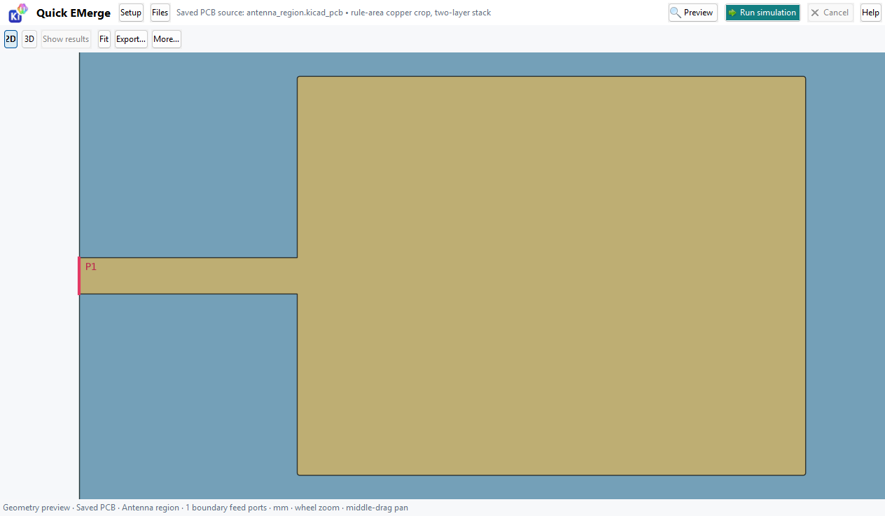

Windows native capture, 2026-11-01, Python 3.11.5 / wxPython 4.3.2 / VTK 9.7.1;
Matplotlib renders the 2D view. KiCad 10.0.6 extracted actual saved copper from
the public synthetic `antenna_region.kicad_pcb` fixture: a 28 × 22 mm patch and
2 mm feed inside a 48 × 40 mm rule area, with one ideal boundary feed port.
The antenna fills a 1264 × 639 canvas inside a 1264 × 738 client area. This is
a geometry preview, not a FEM solve or a tuned/qualified antenna. Source bytes
are unchanged. No private data, personal paths or redactions.

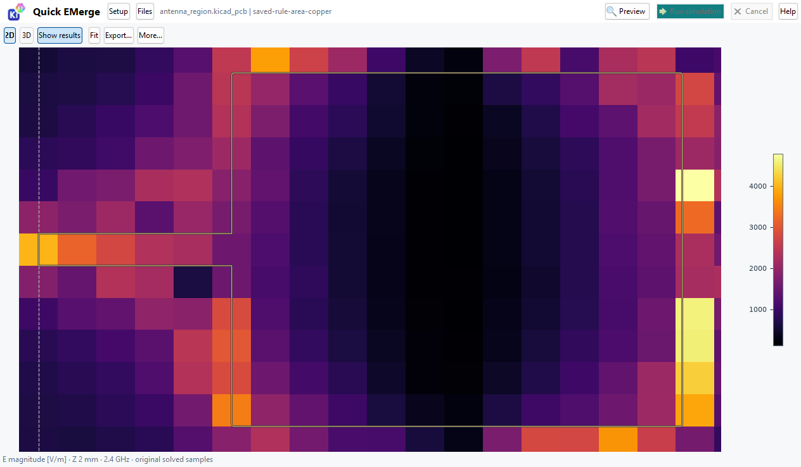

The same source was solved with EMerge 3.0.0b9 / SuperLU at 2.3, 2.4 and 2.5 GHz.
This native capture displays the original 21 × 21 E-magnitude samples at 2.4 GHz,
Z = 2 mm, with thin outlines of the actual signal copper. The coarse grid is
shown as sampled, without smoothing or invented values. This proves end-to-end
execution and display only; mesh/boundary convergence and physical antenna
performance are not qualified. Runtime, source immutability and privacy scope
match the geometry capture above.
The field/radiation selector is visible above a 1264 × 602 canvas.


1. Save the board and its antenna rule area in KiCad, then open Quick EMerge.
   Open **Setup → 1 Geometry**, choose **Saved PCB rule area**, select its
   enclosure, F.Cu signal net and B.Cu reference net. Use **2 Physics** for
   study/material/boundary controls, and **3 Solve** for sweep, mesh and runtime
   settings. The top-bar **Files** menu saves or loads setups and results. First open
   loads saved board/rule-area outlines while dependency preparation runs.
   Copper is extracted by Preview. Dimensions are **mm**, frequency entries are **GHz**, impedance is
   **ohm**. Setup JSON and solver requests retain canonical Hz.
2. Select **Preview** and inspect geometry and numbered ports. Review any
   blocking diagnostics before **Run simulation**. Editing the setup clears
   stale results, probes and report state and requires another preview.
3. Choose **2D** or **3D**, then toggle **Show results** to compare geometry with
   solved fields. The selector appears only when there are multiple result
   views. **More** holds charts, the summary, probe details and display settings.
   **More → Viewport controls** restores the full Orbit/Pan/Zoom/Probe and camera
   toolbar. Wheel zoom and drag navigation work with those controls hidden.
4. Inspect original samples, export results, or generate a report. Mesh and
   solver work run outside the UI process; Cancel stops the worker and retains
   its diagnostic files. Reviewed 2D/3D geometry stays visible during a run.
   **Export…** offers PNG plots and report preview, HTML and PDF. PNGs are static
   figures; the native 3D view remains interactive. File choosers begin in the
   board project folder and permit another location. Missing extensions are
   added. Plots check current source/setup before and after writing and replace
   the destination only after a successful render. Reports also check custody;
   changed results cannot silently produce a new report.

### Earlier workspaces

The following captures retain the previous layouts for comparison.

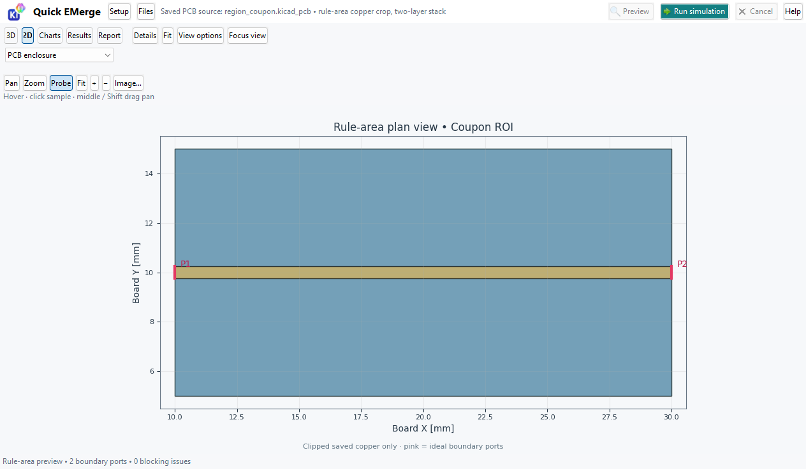

Windows native source-window capture, 2026-10-30, Python 3.14 / wxPython 4.2.5,
Matplotlib software rendering and KiCad 10.0.6 native extraction. The repository
`region_coupon` fixture shows actual clipped saved copper and two planned ideal
boundary ports. No FEM solve is represented. A 1280 × 800 window has a
1264 × 549 plot canvas; the source board is unchanged. No private data,
personal paths or redactions.

The earlier template workspace capture is retained below for comparison.

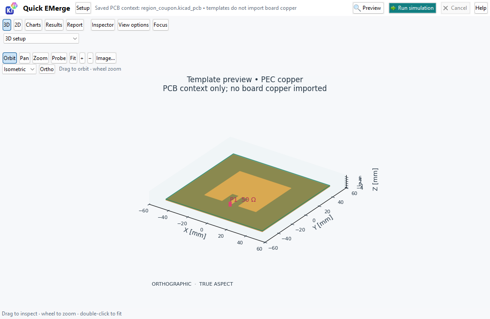

Windows source-window capture on 2026-10-29: Python 3.14, wxPython 4.2.5,
Matplotlib software rendering, repository `region_coupon` fixture and the default
parametric patch preview. It shows a template, not a solved/imported PCB.
No private data or paths appear; no redaction was required. At a 1120 × 780
window, the viewport container increased from 790 × 564 to 1104 × 582 pixels
(44% more area). This is layout evidence, not solver or installed-host validation.


### Save and reload studies

Use **Files → Save setup…** for reusable geometry, material, physics, sweep and
solver settings. The file chooser starts in the saved PCB's project directory;
choose another directory or filename if desired. A missing `.json` extension is
added. The chosen path is retained for the next operation. **Load setup…**
restores the complete supported configuration, then requires Preview before a
new run. Rule-area setups require the exact area and signal/reference nets to
exist in the current saved board. Invalid or missing choices are reported
instead of silently substituted. Reusing a setup after the board changes asks
for explicit confirmation; review current geometry and ports again. Original
schema-1 setup files remain readable.

Use **Files → Save results…** for a complete completed-results JSON file,
including original numerical arrays and source evidence. **Load results…**
opens those saved values in the read-only simulation viewer without solving.
Historical results remain historical if the board changed or moved; loading
does not certify them for the current board or enable a live solver run.
Setup files and result files are separate: choose the matching command.

### Simulate a PCB rule-area enclosure

Save a board with closed Edge.Cuts, filled zones and an explicit two-layer
stackup. Draw/name a polygonal **board rule area** around the subsection.
Choose **Saved PCB rule area**, load saved rule areas, select the
F.Cu signal and B.Cu reference nets, and review the material/bare-copper model.
Unsaved editor changes are excluded. Preview displays the clipped copper,
substrate and ideal boundary ports; the inspector lists unsupported inputs.

The XY enclosure crops the full two-layer column. Concavity and holes are
preserved; it is not replaced by a bounding rectangle. Tracks/arcs and SMT
pads use a recorded 0.005 mm polygonization tolerance; zones use saved fills.
A port must cross an actual rule-area cut with reference copper across its
whole span. Natural board edges and existing holes do not create ports.

This path supports **1-8 ideal vertical boundary ports**. Inside drilled
features, unfilled intersecting zones, unsupported copper graphics, unselected
cut conductors, incomplete returns, ambiguous corner ports and curved rule-area
contours block simulation. General multilayer/via-barrel/component extraction,
interior feeds and footprint-local rule areas remain unsupported. The separate
internal stripline/via template does not remove these extraction limits.
Polygon validation is bounded to 20,000 total / 2,000 per-contour vertices.
Saved dielectric separation, explicit material assumptions, source UUIDs,
ports and source/geometry hashes accompany the study. Source/configuration
changes reject stale results. PCB and adjacent project files are not written.

### Viewports, probing and charts

Native VTK supplies the 3D scenes; Matplotlib supplies 2D plots and charts.
Use **More → Viewport controls** for **Orbit / Pan / Zoom / Probe**, camera
presets and extra zoom/image buttons. **Fit** and **Export…** stay beside the
viewer. Choose projection and display controls in **More → Display settings…**;
physical Z aspect and explicitly labeled exaggeration affect display only.
Visibility and linear/log color scales preserve the original solver samples.
A sample grid is not the FEM mesh; missing values remain unknown.

Select E magnitude [V/m], H magnitude [A/m], power-flow magnitude [W/m2] or
thermal temperature [K] when available. EM fields use a recorded solved
frequency/excitation; clicking another S-parameter frequency does not recompute
them. Optional volume sampling supplies at most 17 Z layers / 100,000 original
samples, displayed as a point cloud or selected XY slice. It is not arbitrary
continuous-volume interpolation. Radiation shows relative electric-field
magnitude, not calibrated gain, efficiency or physical distance.

Probe selects original samples with linked 2D/3D markers. **More → Probe details** offers
extrema, pinned samples and CSV export. Line cut selects two samples and
records nearest-original-sample values against distance; it invents no new
field measurements. Colors may use reduced display geometry while inspection
retains original data. Focus view expands/restores the workspace.

Charts offer magnitude, phase, group delay, impedance, diagnostics and a Smith
chart for networks present in the result. **Network tools** can renormalize,
convert selected pairs to mixed mode, terminate ports, embed ideal R/L/C, or
perform bounded AAA/vector fitting. Each operation starts from the original
solved network and produces separate derived evidence/Touchstone; EM geometry
and fields retain their original excitation. Fits are models of sampled data,
not additional FEM solves or evidence of passivity outside the solved band.

### 2D and 3D radiation patterns

After a result containing radiation is loaded, use **More → 2D radiation
pattern** or **More → 3D radiation pattern**. You can also enable **Show results**
and choose radiation in the view selector. Switching **2D / 3D** keeps radiation
selected. Each view remembers its camera.

The 2D selector offers **XZ cut**, **YZ cut** and **XY azimuth** in the model's
Cartesian axes. Theta is measured from +Z. XZ combines the sampled phi = 0° and
180° halves, and YZ combines +90° and −90°. Their polar angle runs from +Z toward
+X or +Y on the positive half. XY uses theta = 90° and azimuth phi from +X toward
+Y. If a nearby sampled plane is used, its actual angle is shown; an azimuth cut
at a different theta is labelled as a cone, not the XY plane. Missing halves,
unknown samples and uncovered poles remain gaps.

Both views divide by the **same maximum known stored field magnitude across all
angles**, so a weaker cut stays weaker. Radius is relative |E|, not length,
gain, dBi, efficiency or radiated power. Lines join recorded samples; no extra
field values are computed. Click an original plotted sample to inspect or pin
its theta, phi and relative value. The 2D wheel changes radial zoom only;
**Fit** restores the complete pattern. The 3D view supports orbit, pan and zoom.

**Export…** saves the active 2D pattern or 3D camera image. HTML/PDF reports
include the 3D surface, available principal-plane cuts and a separate table of
radiation probes re-read from original indices. Changed frequencies, angles or
invalid indices are rejected; unknown values remain explicit. Studies without
radiation keep these views disabled with an explanation.

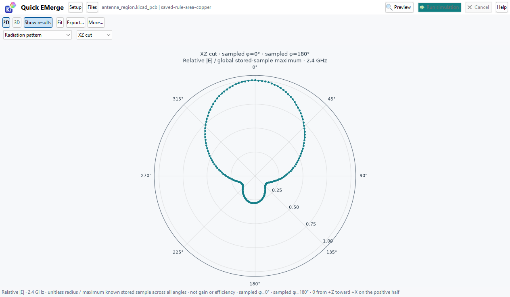

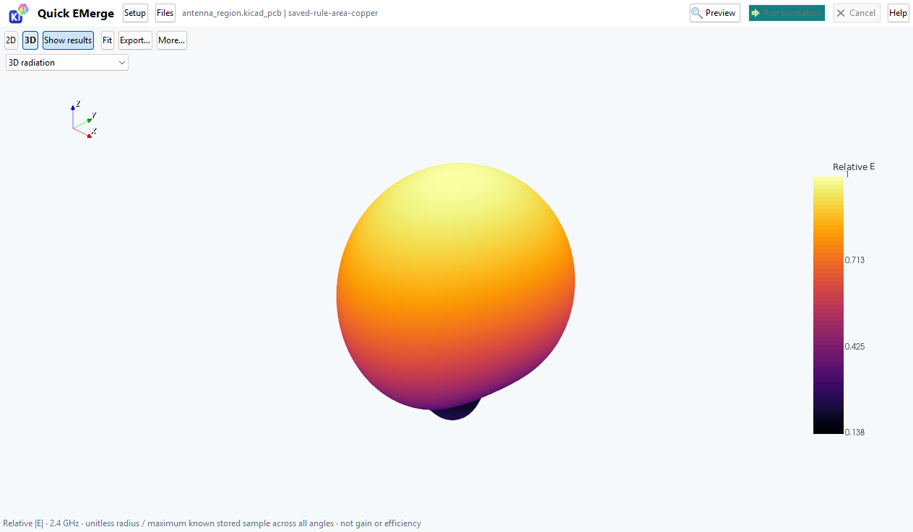

Windows native captures, 2026-11-01, Python 3.11.5 / wxPython 4.3.2 / VTK 9.7.1.
Each view has a 1264 × 602 canvas inside a 1264 × 738 client area.
Both show the same actual 2.4 GHz radiation result from the public synthetic
antenna-region study above: 91 theta × 181 phi samples at 2° spacing. The 2D cut
uses original samples; the 3D surface displays their relative magnitudes. These
are a coarse three-frequency execution example, not mesh/boundary convergence
or measured antenna qualification. Source bytes are unchanged; no private data,
personal paths or redactions.

### Reports and artifacts

**Export…** provides **Preview report**, **Export HTML report…** and **Export
PDF report…**. Reports include model assumptions, original response/field charts,
selected quantity/slice, probes/profiles, diagnostics and source hashes.
Derived networks remain distinct from the original response. HTML embeds its
assets for offline reading; PDF uses ReportLab. Source/configuration custody
is checked before publication, and stale exports are rejected.

Each run records `request.json`, `status.json`, `solver.log` and, on success,
`result.json`. Network studies also export Touchstone with explicit reference
impedance; thermal/scattering studies do not invent S-parameters. Optional
live-model exports provide planar-sheet DXF and Optycal-compatible far-field
MsgPack for supported driven/array studies. Setup files and completed runs
are user artifacts, not disposable caches.

## Physical scope and validation

The patch template optionally adds an external feed strip with
`advanced.patch_feed_extension_mm` (default zero), with signed patch-center
`advanced.patch_offset_y_mm` (default zero). The patch and feed must fit inside
the substrate; the ideal feed port moves to the feed outer end. This is a driven/
optimization patch feature, not a general connector or coax model.

The default model uses PEC and a homogeneous dielectric. Development controls
add finite-conductor surface/thickness/roughness models, dielectric loss and
linear frequency dispersion, ABC order 1/2, PEC/PMC/PML boundaries, periodic
Floquet studies, scattering, TE10 waveguide, finite arrays, bounded optimization,
steady/transient substrate thermal studies and dielectric RF heating.
[The capability inventory](CAPABILITIES.md) records the limits of each path.
Fabrication imports require an explicit reviewed recipe and source manifest;
they are expert adapters, not a general visual CAD editor/import wizard.

The **Published antenna benchmark** study uses reviewed, data-only templates.
Four templates build full-wave geometry; the Verho 4x4 active array evaluates
the paper's ideal scan law because its measured varactor/PIN/feed losses cannot
be reconstructed from geometry alone. The Yagi planar model omits its CubeSat
chassis and deployment angle. The dual-feed patch omits the reconfigurable feed
network; its linear state drives both probes with equal amplitude and phase.
The S/X satellite model includes the dimensioned dielectric stack and
two ideal probe ports but omits bolts and SMA bodies. A `publication_comparison`
is a sampled evidence check, not automatic mesh or hardware qualification.

Coarse compatibility solves do **not** establish antenna accuracy, mesh
convergence, power balance, array null depth or measured hardware agreement.
Adaptive limits can be reached before convergence. Thermal RF coupling covers
dielectric loss, not copper surface heating. Unsupported study/control
combinations fail explicitly. Optional CPU/GPU solver backends require their
own dependencies and hardware and remain unqualified here. Live KiCad menu
launch and physical mouse acceptance for the revised UI are separate checks;
see the dated evidence rather than inferring them from source tests.

```powershell
python -m pytest quick_emerge_plugin/tests -q
& 'C:/Program Files/KiCad/10.0/bin/python.exe' -m unittest discover -s quick_emerge_plugin/tests -p test_pcb_regions.py -v
python -m quick_emerge_plugin --check-runtime
```

The adapter targets upstream EMerge 3.0.0b9 at commit
[446232037d175a596606c6c9ea986e372560566f](https://github.com/FennisRobert/EMerge/commit/446232037d175a596606c6c9ea986e372560566f).
EMerge is by Robert Fennis and contributors, GPL-2.0-or-later. Its solver and
runtime are not vendored. New releases require fresh compatibility evidence.

## Earlier beta screenshots

These are actual captures of the **earlier beta UI**, not the redesigned
workbench. Local interpreter/output paths were replaced with generic paths;
numerical data and synthetic-board coordinates were preserved. The coarse
patch and rule-area runs are not converged-design evidence.

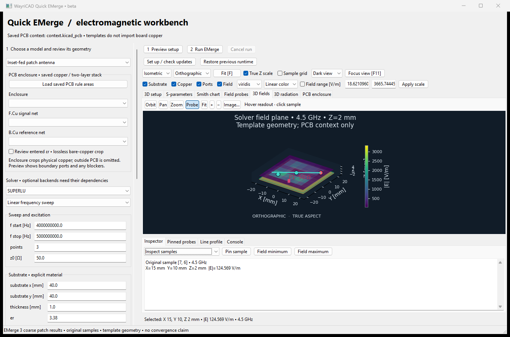
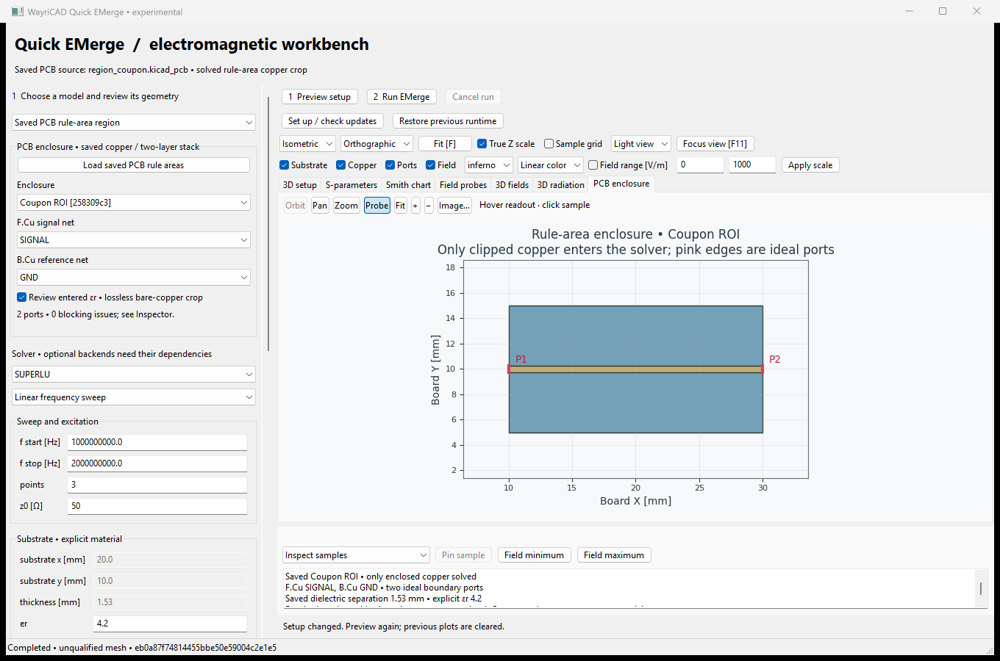
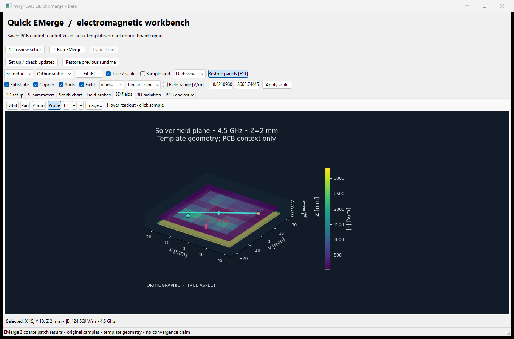

Reports show the active geometry, materials, boundary, mesh and sampling settings. PDF summaries omit inactive template defaults; the collapsed HTML configuration and downloadable JSON retain the complete setup for reproduction. Saved-PCB dimensions come from the recorded region.
