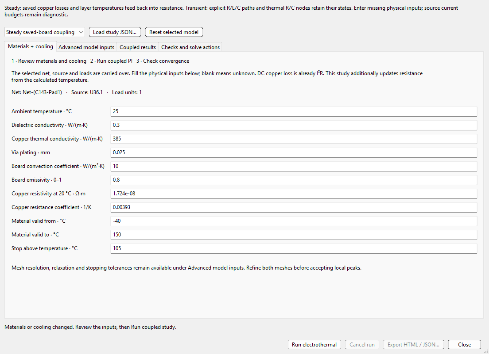

# Quick PI control reference

[Worked user guide](USER_GUIDE.md) · [Offline control reference](CONTROL_REFERENCE.html) · [Quick help](help.html)

This reference follows the current source. Guided Joule inputs and Blender are
source updates requiring a package containing those changes; previously released
3.6.41 installers have not been replaced. Units beside a control take precedence
over the base SI units used in saved JSON. A disabled action is not a passed check.

## Workspace and load setup

| Control | Operation, units and preconditions |
|---|---|
| Setup / Inspect | Show/hide side panels; drag dividers for more space. Hidden controls retain inputs. |
| Fit / + / − / image icon | Fit, zoom or save the current drawing. Normal wheel zooms, drag pans, double-click fits. An image does not replace numerical evidence. |
| Find net | Literal substring by default. `*`/`?` enable wildcards; `~` enables fuzzy search. Filtering preserves the selected net. |
| Net / Pick net | Exact saved net, or select a saved pad/track/via to choose its net. Rebuild preview after changing scope. |
| Source pad / Sink pad | Different contacts on the actual connected net; labels combine reference and pin number. |
| Include other same-net pins | Appears only when eligible same-footprint pads exist. Review the group; A/W applies to the whole ideal endpoint, not each pin. |
| Source · V | Fixed ideal source voltage; not a regulator waveform. |
| Sink current · A | Prescribed DC demand. Enables supported 2.5D and full-3D current solves. |
| Resistive load · Ω | Solve current through the path plus an external load to 0 V. Not constant-current behavior. |
| Constant power · W | Solve the stable high-voltage DC branch of P=VI. Collapse/infeasibility is retained; no transient regulation is implied. |
| Load value | A, Ω or W according to the selected mode. Changing mode invalidates old results. |
| Limit · A | Source budget: blank means unspecified/unlimited; zero means no budget. It is diagnostic, not a physical limiter. |
| Min · V / Max · V | Primary sink operating bounds. Blank minimum means 0 V, blank maximum is unbounded. |
| Additional sinks… | Add simultaneous units with currents/powers, bounds and reviewed grouped pins. Repeated or overlapping contacts are invalid. |
| Package contacts… | Explicit lead/solder/BGA geometry and material paths. Supported 2.5D prescribed-current cases only; not the same as ideal grouped pins. |
| Copper model | 2.5D sheets/barrels or full 3D copper volume. Switching invalidates old fields; 3D does not add AC or temperature feedback. |
| Include Joule heating / temperature feedback | DC already computes I²R. This additionally opens explicit temperature/resistance coupling, supported for one-net 2.5D prescribed-current units. |
| Rails / ground returns… | Explicit multi-rail and return-contact configuration. Different from sampled reference-plane auditing. |
| Preview / Run | Inspect saved copper first; Run validates, meshes and solves. Joule checkbox opens required physical settings first. |
| Export / Power flow / Blender… | Current HTML/JSON evidence, source-to-sink power accounting, or optional Blender field export. None changes PCB geometry. |
| Series | Build an explicit component/net path; review component interpretation, polarity and routing. |
| Cancel / progress | Cancel the isolated worker. Partial work is discarded, not accepted as complete. |
| Console / Enter | Expand command history, enter `help` or a supported PI/series command. It is not arbitrary Python. |

## Mesh and material controls

| Control | Meaning and valid use |
|---|---|
| Automatic mesh | Geometry-based 2.5D initial/local sizing. Not error-estimated convergence; off for 3D. |
| Mesh · mm | Manual edge target. Smaller raises cost; it is not a guaranteed error bound. |
| Via plating · mm | Conductive wall thickness, not drill diameter. The example 0.025 mm means 25 µm. |
| Copper · °C | Fixed electrical resistivity temperature, separate from a solved thermal field. |
| Initial / ambient · °C | Initial supported adiabatic-screen temperature. Does not supply cooling. |
| Pulse · s | Prescribed heating/melting-screen duration; no current waveform is inferred. |
| Limit · °C | Entered operating threshold for the screen. |
| Copper melt · °C | Supported 2.5D adiabatic threshold; nominal 1084.62 °C does not predict fuse clearing. |
| Latent heat · J/kg | Fusion heat in that screen; no cooling, arcing or post-melt interruption. |
| 3D cell budget | Hard tetrahedron capacity. Failure does not silently coarsen/truncate the model. |

## Field inspector and selection

| Control | Interpretation |
|---|---|
| Layer | All copper projected or one physical layer. Choose physical layers for unambiguous A/B voltage clicks. |
| Result | Potential/drop/resistance, density/sheet current, dissipation or supported risk/melting metric. Read the actual unit; W, W/mm² and W/mm³ differ. |
| Board / Copper / Field / Silk | Independent visibility. Board keeps edges/holes; Silk starts off. These do not modify the solve. |
| Only simulated nets | Isolate the analyzed domain. Surrounding visible copper is not automatically added to it. |
| Smooth gradient / Solver cells | Interpolated display or raw cell appearance. Probes and peak checks retain solver-cell semantics. |
| Auto: selected layer | Colors fit that layer; other layer colors need not be comparable. |
| Shared: all layers | One scale across solved layers. |
| Manual: this metric / Minimum / Maximum | Explicit finite display bounds; color clipping does not clip numerical values. |
| Hotspots | Ranked concentrated-heating entries; linked row selection locates the copper. Local singular peaks may not converge. |
| Losses → By layer / Heating | Integrated layer watts versus local J/volumetric heat. They are different summaries. |
| Full accounting details | Expand electrical conservation and loss-accounting details. |
| Probe → Single point | Hover/click supported solved geometry. Gaps, holes and unknown nodes remain unknown. |
| Set probe A / Set probe B / Clear A/B | Read signed V(A)−V(B) in one solved reference, or clear both. Not an AC/transient differential waveform. |
| Model and selection notes | Geometry identity, provenance and limits of the selected sample. |
| Select / Read | Cross-select an available native object in the originating editor, or read editor selection. Display-only cells do not become PCB objects. |
| Live current controls | Supported fixed-temperature prescribed-current 2.5D model only. Ctrl+wheel near an unambiguous sink changes that sink demand; normal wheel zooms. |
| Near-cursor preview | Current and parameter changes; wait for the latest update before export. Coupled/3D studies require a real rerun. |

### Exact result quantities

| Result selector | Unit and interpretation |
|---|---|
| Potential | V, relative to this solved source/reference convention. |
| Voltage drop | mV from the source, with physical-return sign conventions retained. |
| DC drop / current ΔV/I | mΩ for the current operating demand; not AC impedance. |
| Current density | A/mm², magnitude in copper; mesh/contact peaks can be singular. |
| Current flow | A/mm, sheet-current magnitude, distinct from volumetric J. |
| Copper loss density | W/mm² in the planar field; integrated watts appear separately. |
| Adiabatic pulse energy / limit | Dimensionless supported energy/threshold screen, not a cooling equilibrium. |
| Pulse / adiabatic melting action | Dimensionless action ratio for the supported pulse/material assumptions; not fuse-opening probability. |

## Return path and multi-rail dialogs

| Control | Procedure |
|---|---|
| Signal / rail; Use Setup net | Choose the actual saved net or copy the main selection. |
| Return net; Use suggested return | Confirm the reference; a GND-like name is only a suggestion. |
| Review return path / Export report… | Run a sampled geometry audit and preserve it. Not an electrical loop solve. |
| More return options | Exposes extra nets, optional contacts and sampling. |
| Additional return-net checklist | Search/check intended references; inspect checked count, including hidden checked rows. |
| Source return pad / Load return pad | Optional exact reference contacts, not power-net contacts. |
| Sample mm / Via radius mm | Along-route pitch and local via search radius. Smaller pitch costs more; sampled coverage is not proof of EM continuity. |
| Add net case… | One rail with its own source voltage, net and load units. |
| Edit source / load pads… | Review ideal multi-pad source/sink groups and total demands. |
| Set up ground / return… | Explicit ground source, load mappings and participating rail(s); shared copper is solved once. |
| Edit selected return… / Remove selected return | Change the selected group; inspect which cases become independent. |
| Load JSON… / Save study JSON… | Preserve a complete reviewed configuration, not an external case-reference descriptor. |
| Advanced JSON / Saved-board pad catalogue | Full supported schema and exact label/UUID inventory. Catalogue presence does not add a pad to the analysis. |
| Run / Cancel / Results / Export | Inspect every case and shared ground-rise status; retain parent evidence with child report directory. |

## More menu and 3D results

| Action | Preconditions and next step |
|---|---|
| Generate mesh only | Inspect discretization without claiming a solved field. |
| Select 3D copper analysis | Sets full-volume mode; prescribed current and manual Gmsh sizing required. |
| Transient load-step study… | Explicit lumped R/L/C setup; PCB selection seeds names and, only when valid, one total DC resistance. |
| Electrothermal study… | Advanced steady saved-board or explicit lumped transient coupling. Checkbox flow is steady-only. |
| AC / SMPS copper study… | Explicit uniform cross-section model, not routed-board AC extraction. |
| Layer thickness, losses and hotspots… | Current analytics; unavailable results disable the action. |
| Zoom to circuit terminals | Reframe contacts without moving PCB objects. |
| Refine mesh and rerun | Halve the edge target; expect greater cost. Hold other inputs fixed for comparison. |
| Check mesh convergence… | Supported fixed-input refinement sequence; read unsupported modes before running. |
| View convergence plots… | Inspect retained refinement evidence without another solve. |
| Series voltage ladder… | Component/path drop accounting from an existing supported series result. |
| DC current sweep… / View last current sweep… | Fixed-temperature path sweep, not a coupled thermal sweep. |
| Reload saved board | Re-read the intended saved/refilled revision and invalidate stale derived views. |
| 3D View | Board top or interactive 3D copper at physical XYZ mm scale. |
| 3D Layer | All copper, saved slab or interlayer barrels. Floating cells do not carry solved current. |
| 3D Field | Current density A/mm², potential V or loss density W/mm³. Up to 5,000 deterministic cells drawn; every tetrahedron stays in JSON. |
| 3D toolbar / Export interactive 3D report… | Navigate/probe displayed samples and retain HTML/JSON together. Sampling does not prove mesh convergence. |

## AC / SMPS study

| Input or action | Units, entry and review |
|---|---|
| Quick loop / Custom loop | Quick constructs a declared balanced geometry and one ripple frequency. Custom exposes conductors/harmonics. Run applies visible quick values directly. |
| Shared conductor length · mm | Uniform section length, not width or extracted board route. |
| DC rail voltage · V | Reporting context, not insulation qualification. |
| DC load current · A | Mean current, separate from AC RMS ripple. |
| Copper temperature · °C | Fixed resistivity temperature, not thermal equilibrium. |
| Quick preset | Supported outgoing/return arrangement; inspect its preview. Split-return sharing is an explicit assumption. |
| Copper width / thickness · mm | Actual cross section. 0.035 mm is 35 µm, not PCB thickness. |
| Surface gap to return · mm | Copper-surface gap, not centre spacing. |
| Ripple frequency · kHz / Ripple RMS · A | One harmonic; peak and peak-to-peak amplitudes are not RMS. |
| Review recipe in custom table | Inspect signed current scales and geometry before supplying a custom spectrum. |
| Conductor / return table | Name, centre X/Y mm, width mm, thickness mm, signed current multiplier. Multipliers sum to zero; include all modeled returns. |
| Harmonic table | Distinct frequency Hz and loop RMS A. Keep DC in its separate field. |
| Add / Remove conductor or harmonic | Edit the selected row; this invalidates old curves/export. |
| Build SMPS waveform… | Triangular output ripple or pulsed input current. Enter frequency Hz, ripple peak-to-peak or pulse-ON A, triangular DC mean A, duty 0–1 and highest harmonic order 1–32. Review the resulting RMS table. |
| Maximum mesh step / Air boundary padding · mm | Cross-section resolution and exterior magnetic domain. Refine separately. |
| Maximum cells | Hard capacity, not permission to truncate. |
| Convergence tolerance · fraction | 0.01 means 1%, not 0.01%. Does not certify local J peaks. |
| Permittivity for length check | Electrically-short applicability input, not dielectric-loss simulation. |
| Run AC / ripple losses / Cancel | Execute/cancel the section model; no partial result is accepted. |
| Summary cards | Total copper heat W, ripple heat W, loop drop RMS V and combined RMS A. |
| Inspect | Cross section, resistance/reactance or harmonic heating. One supplied frequency is one sample, not a swept measurement. |
| Harmonics / Conductors result tables | Linked selection uses actual frequency/conductor; saved JSON uses SI units. |
| Load study… / Save inputs… / Export HTML / JSON… | Inputs and result evidence are separate artifacts; export only after a current run. |

These genuine captures use an explicit illustrative section, not an extracted
Marble or White Rabbit switching circuit.

## Decoupling placement and lumped PDN

| Control | Meaning and operation |
|---|---|
| Rail / ground patterns | Match saved supply/reference nets; confirm actual matches and capacitor roles. |
| Load-reference patterns | Scope the IC/pad set instead of every unrelated part. |
| Maximum capacitor-pad distance | Millimetres for proximity; shorter does not automatically mean a solved lower loop L. |
| Analyze PDN / linked map / CSV | Eligible rail-to-return capacitors, warning/failure pins and linked component location. No parts are moved. |
| Lumped impedance screen | Independent explicit bank model; not derived from distance alone. |
| Source / upstream R · mΩ; source / loop L · nH | Upstream equivalent; avoid counting it again in individual branches. |
| Allowed ripple · mV; Load step ΔI · A | Defines Ztarget=ΔV/ΔI, a user engineering target. |
| Start / stop frequency · Hz; Coarse log samples | Span and starting grid. Narrow unobserved peaks may remain. |
| Capacitor / model; Effective C · µF | Label and bias-/temperature-/tolerance-adjusted C. No automatic catalogue derating. |
| ESR · mΩ; Total ESL · nH; Quantity | Include mounting/connection L. Integer quantity is a number of identical modeled parts. |
| Add capacitor / Remove capacitor | Edit a model row, not PCB placement or BoM quantity. |
| Calculate / Export curves | Magnitude, phase, target, peaks and refined-grid changes. Target status is sampled-network evidence only. |
| Load model JSON… / Save model JSON… | Exact complete input model with base SI values; see the bundled PDN recipe. |

**Optimal placement is not implemented.** The tool reviews connectivity and
proximity and solves an entered lumped bank. It does not optimize component
coordinates or a distributed plane/VRM model. A physical move requires a separate
placement workflow and renewed electrical review.

## Transient setup and visual results

| Input or action | Units, procedure and effect |
|---|---|
| Source V | Pre-step ideal source. Initial state is pre-step DC equilibrium. |
| Shared / total path R · mΩ | Shared upstream R. A valid one-load DC seed belongs here only once, not again as branch R. |
| Shared source L · nH | Explicit shared path L; zero deliberately omits it. |
| Source budget · A | Optional diagnostic, not a physical limiter. |
| Duration / Integration step · µs | Overall span and maximum numerical step. Include events and settling; refine independently. |
| Load | Unique unit ID binding demand, branch and capacitor bank. |
| Before A / After A | Prescribed demand, not an inferred IC waveform. |
| Step at · µs | Event time. Pre/post samples can share an event timestamp. |
| Branch R · mΩ / Branch L · nH | Per-load elements after the shared path. Do not double count shared elements. |
| Effective C · µF / Cap ESR · mΩ | Aggregate local bank when no individual bank is assigned. |
| Min V / Max V | Optional unit bounds; missing limits are not passes. |
| Add load / Remove load | Define 1–64 explicit units; inspect associated bank IDs after changes. |
| Shunt capacitors for selected load… | Select a load first. An individual bank replaces that load's aggregate C/ESR. |
| Return-net candidate filter | Actual reference; eligible two-pad rail/return C-reference parts only. Unknown parasitics are not guessed. |
| Shunt ID / C / ESR / total ESL | Unique branch label, effective F and reviewed Ω/H values in the displayed units. Include part and connection effects. |
| Finite rise time | Physically justified current edge. An ideal impulse-requiring all-inductive cutset is rejected. |
| Bulk ESR / ESL | Apply only to checked candidate rows; review count and units. |
| Recommend time step | Modal/resolution advice. Apply deliberately, then refine; not convergence proof. |
| Advanced SI editor (Ω / H / F / s) | Same canonical circuit in base units. Do not enter µF as F or µs as s. |
| Load inputs JSON… / Save inputs JSON… | Exact IDs, circuit values and timing independent of result HTML. |
| Run transient / Cancel | Validate and solve the explicit circuit; no complete distributed PCB L/C extraction. |
| Voltage / source-current plots | Hover/pin supported samples; inspect droop, ringing, events and settling. |
| Capacitor response | Select a branch to plot its own internal V/I; review ESR power/energy and total bank accounting. |
| Checks / half-step comparison | Charge, energy and finer-step waveform evidence. Smooth appearance is not numerical acceptance. |
| Export HTML / JSON | Exact samples plus inputs. PDF retains static evidence, not browser interaction. |

These captures use complete explicit circuit examples. They are not measured
Marble/White Rabbit PDNs. The older aggregate-only setup predates the individual
bank controls; its capture version is retained rather than relabelled.

## Guided Joule feedback and advanced coupling

Saved-board coupling uses PI’s own thermal backend. It currently rejects plated
slots and nonplated holes, even where standalone QuickTherm supports them. The
unchanged Marble example stops at this geometry guard; a valid input file alone
does not establish a successful temperature solve.

The updated-source checkbox opens **Materials + cooling** first. Guided fields
and **Advanced model inputs** edit one canonical study. Required blank values
remain unknown; editing invalidates results. The current net/source and load-unit
count are shown so the carried-over selection can be checked.

| Guided input | Required interpretation |
|---|---|
| Ambient temperature · °C | Actual boundary/initial temperature within the declared material range. |
| Dielectric conductivity · W/(m·K) | Thermal conductivity, not electrical εr. |
| Copper thermal conductivity · W/(m·K) | Separate from electrical resistivity. |
| Via plating · mm | Physical conductive wall thickness shared by linked models. |
| Board convection coefficient · W/(m²·K) | Declared cooling, not solved airflow. Zero omits this contribution. |
| Board emissivity · 0–1 | Declared radiation boundary coefficient; zero omits it. |
| Copper resistivity at 20 °C · Ω·m | Reference electrical material law. |
| Copper resistance coefficient · 1/K | Temperature coefficient, not heat capacity. |
| Material valid from / to · °C | Increasing validity range. |
| Stop above temperature · °C | Explicit stop bound, not a certified component rating. |
| Advanced grid cells / relaxation | Thermal resolution and iteration under-relaxation. Do not change them merely to hide a failed check. |
| Maximum iterations / temperature and loss tolerances | Stopping criteria; a cap/range/iteration stop is not a converged point. |
| Load study JSON… / Reset selected model | Load a reviewed configuration or restore its seed; neither establishes physical applicability. |
| Run electrothermal / Cancel run | Steady saved-board temperature/resistance feedback. Canceled/failed points are not accepted. |
| Coupled results | Cold/hot electrical quantities and thermal/convergence plots. |
| Checks and solve actions / Export HTML / JSON… | Conservation, limits and convergence before saving evidence. |
| Transient lumped coupling | Advanced explicit R/L/C plus thermal R/C nodes, separate from saved-board steady feedback. |

This capture carries Marble's selected net but uses illustrative entered physical
values; it is setup evidence, not a solved temperature. Current units may use
reviewed grouped pins. 3D, package, series, constant-power and shared-return
thermal combinations are not silently enabled. Ctrl+scroll live-current reuse
does not apply: changing coupled demand or boundaries requires another solve.

## Series and package-contact editors

| Control or entry | Operation |
|---|---|
| Series start/end pads | Exact contacts, including nets separated by a component. Review direction/polarity; matching names do not prove a path. |
| Component branch selection | Explicit supported R/L/forward-drop or parallel branch interpretation. Check units, component identity and actual pad connectivity. |
| Parallel parts suggestions | Review each proposed same-endpoint component. Highlighting a candidate does not include it until accepted. |
| Resistance / inductance / forward-drop values | Enter explicit component data; inductance is not a DC resistance. The supported DC model uses winding/series resistance and declared drop behavior. |
| Series saved JSON / console command | Retain exact part/pad identity and model. Output ladder shows path/component drops; it is not a full switching circuit. |
| Package reference / pad / face | Select the actual physical endpoint; reject repeated faces and cross-net identities. |
| Lead / solder / BGA contact kind | Explicit modeled conduction geometry, not a package-name heuristic. |
| Length / cross-section / resistivity | Use the editor's indicated mm and Ω·m units. Supplying an attractive package model without reviewed dimensions does not establish resistance. |
| Contact preview / Apply to study / remove | Review the added model paths and remove incorrect entries before rerunning. This edits simulation configuration, not PCB pads. |

## CLI options

Use `wayricad-pi --help` in the intended interpreter. Named JSON modes reject
unrelated flat DC overrides. Complete recipes are linked from the worked guide.

| Option(s) | Input and effect |
|---|---|
| Positional PCB | Saved board; alone lists nets/pads/layers. Optional only for supported explicit-study modes. |
| `--net`, `--source`, `--sink` | Exact selected net and contact labels/IDs. |
| `--voltage`, `--current` | Fixed source V and prescribed sink A. |
| `--load PAD CURRENT_A`, `--power-load PAD POWER_W` | Repeat supported 2.5D load demands. |
| `--load-power` | Primary sink constant-power W, with that mode's combination guards. |
| `--load-voltage-limits PAD MIN_V MAX_V` | Per-load bounds; `-` omits a bound; needs a matching load. |
| `--sink-min-voltage`, `--sink-max-voltage`, `--source-current-limit` | Primary sink V bounds and source A budget. |
| `--load-ohms`, `--sweep START_A STOP_A POINTS` | Resistive operating point or prescribed-current sweep, not temperature feedback. |
| `--mesh-edge`, `--auto-mesh`, `--max-cells` | Manual mm target, automatic 2.5D recommendation and total triangle capacity; conflicting settings fail. |
| `--mesh-backend auto/gmsh/vtk` | Requested mesher; full 3D requires Gmsh. |
| `--model-dimension 2.5d/3d`, `--max-tetrahedra` | Volume model and tetrahedron budget, distinct from planar max cells. |
| `--plating`, `--temperature` | Conductive plating mm and fixed electrical °C. |
| `--ambient`, `--pulse`, `--temperature-limit` | Initial °C, supported adiabatic duration s and operating threshold °C. |
| `--melting-temperature`, `--latent-heat` | Supported 2.5D melting °C and J/kg. |
| `--return-path`, `--return-nets`, `--return-pitch`, `--return-via-radius` | Sampled reference audit with explicit nets, mm pitch and via radius. |
| `--batch` | Complete multi-net study, including reviewed shared returns where supported. |
| `--transient`, `--electrothermal`, `--ac` | Complete mode-specific circuit/thermal/cross-section JSON. |
| `--package-conduction`, `--series-file`, `--command` | Reviewed contact model, series-editor JSON or quoted supported console command. |
| `--mesh-only` | Inspect a mesh without a solved electrical field. |
| `--converge-levels`, `--convergence-tolerance-percent` | Supported refinement sequence and relative percentage criterion. |
| `--probe-result`, `--probe-a`, `--probe-b` | Saved DC two-point sampling: each is `LAYER X_MM Y_MM`, no new solve. |
| `--verify` | Analytical references, not qualification of your board. |
| `--output`, `--html`, `--timeout` | Separate JSON/HTML paths and worker seconds. Full-3D flat CLI accepts JSON; its window exports interactive 3D HTML. |
| `--help` | Exact options for the installed version. |

## Limits and outcomes to check every time

### Exact secondary-dialog action names

| Action shown in the window | What it does |
|---|---|
| Run all cases | Run the reviewed Rails and returns study; inspect each case status, not only its parent summary. |
| Set up ground / return after this rail | Continue directly from adding a rail to mapping that rail's ground contacts. |
| Choose pads… | Select the supply-ground contact group in the return-net picker. |
| Choose load ground pads… | Map the selected rail/load row to its intended ground pads; double-clicking the row opens the same picker. |
| Suggest matching footprint pads | Propose same-component ground contacts for review. Suggestions are not automatically confirmed. |
| Use selected component | Populate the series editor from the currently selected candidate. |
| Add component to path | Add that reviewed branch to the explicit path, then inspect validation. |
| Save path… / Load path… | Retain/reload the supported series configuration, including identities and parallel selections. |
| Run this path | Accept the series configuration and execute its supported analysis. |
| Highlight detected parts on PCB | Cross-highlight candidate parallel parts before including them. It does not modify tracks or footprints. |
| Add manual capacitor | Append a shunt branch; enter unique identity, effective C, ESR and total ESL. |
| Remove selected | Remove the selected shunt-model row, not its PCB footprint. |
| Use aggregate C instead | Leave individual-bank mode and use that load's aggregate C/ESR fields. Review those fields after returning. |
| Set selected ESR / ESL… | Open the bulk parasitic editor for checked/selected bank rows. |
| Set selected rows | Confirm the bulk values; inspect units and affected row count before Apply bank. |
| Add selected board capacitors | Add selected eligible candidate rows; saved capacitance remains a suggestion, unknown ESR/ESL need explicit values. |
| Apply bank | Validate unique assignments/values and return the bank plus finite-rise setting to the selected load. This does not write PCB fields. |
| Add to existing PCB selection | Keep earlier editor selection instead of replacing it during explicit cross-selection. |
| Add sink / Update selected | Create a load unit or replace the selected unit's reviewed demand/limits/pad group. |
| PDN target impedance / capacitor bank… | Open the explicit impedance model from the decoupling placement workspace. |
| Calculate impedance | Calculate the explicit PDN network and its sampled/refined target evidence. |
| Export samples CSV… | Save computed impedance samples with units; not a full distributed-board model. |
| Methods / help | Open the active dialog's model, inputs and limitation explanation. |
| AC model help | Open the AC setup guide; RMS, gap/centre spacing and section-model boundaries are explained there. |

### Literal modes, live tuning and series parameters

| Choice or parameter | Meaning |
|---|---|
| Copper and return path | AC current-density cross section; geometry is explicit, not a PCB trace extraction. |
| Resistance and reactance | AC loop R/X by supplied harmonic frequency, in displayed engineering units. |
| Heating by harmonic | AC copper watts by harmonic; does not include converter switching-device loss. |
| Triangular output ripple / Pulsed input current | Supported SMPS waveform helpers; they generate reviewed RMS harmonics, not a simulated converter controller. |
| Steady saved-board coupling / Transient lumped coupling | Spatial steady board temperature feedback, or explicit circuit/thermal-node transient. Selecting a mode does not extract missing inputs. |
| Highest current density / Highest volumetric heating / Copper melting bottlenecks | Sort hotspot findings by J, local heat generation, or the supported adiabatic melting screen. Each has a distinct unit/model. |
| Ctrl+scroll load | Enable current tuning only for an eligible completed 2.5D fixed-temperature prescribed-current model. |
| Total · A | Set total prescribed demand for supported live tuning. It is not the current through every same-net pin independently. |
| Base step · A | Starting wheel adjustment; initial 0.1 A. Scroll acceleration selects finer/coarser changes. Check the proposed value. |
| Cursor preview | Show/hide the near-pointer change feedback without modifying the solve. |
| Selected metric / All metrics | Show the chosen field's proposed change, or the available parameter set; not every simulated physical mode supports live reuse. |
| Current · A / Constant power · W | Additional-sink demand mode; current and power are not interchangeable or both assigned to one unit. |
| Resistance / RL | Series branch R plus optional L. DC drop uses the resistance; stored L is not treated as another DC resistor. |
| Fixed forward drop | Explicit voltage-drop branch under supported DC assumptions. |
| Diode at DC current | Reviewed diode approximation at operating current, not a dynamic switching model. |
| Resistance / Inductance | Engineering-unit entries, e.g. 5mΩ and 1mH. Check the parser's preview before Run this path. |
| Fixed forward drop | Enter a reviewed V value, not an arbitrary negative resistance. |
| Vf at Iref / Reference current | Reference diode forward V and corresponding A. |
| Ideality n / Junction temperature | Explicit diode DC model coefficient and °C, initially 2 / 25 °C in the editor. |

### Initial values and optional bounds

The main window initially shows 1 V / 1 A in prescribed-current 2.5D mode,
automatic mesh enabled, manual edge field 0.5 mm, plating 0.025 mm and fixed
copper/ambient temperatures 20 °C. Pulse is 1 s, temperature limit 150 °C,
nominal melting threshold 1084.62 °C, latent heat 206750 J/kg and 3D capacity
250000 tetrahedra. They are editable initial/example values, not inferred
fabrication or operating data. The CLI's temperature-limit default is 105 °C;
CLI and window defaults are not silently treated as identical evidence.

Initially Board/Copper/Field are visible, Silk is off, Only simulated nets is on,
the field is Voltage drop and the display uses Smooth gradient. The 3D window
starts in Board top view / All copper / Current density. Return-audit starting
pitch is 0.25 mm and via search radius 2 mm. Source current and maximum voltage
bounds start blank; the primary minimum defaults to 0 V. Guided Joule physical
unknowns start blank, preserving the source values only when already declared.

1. Confirm source revision, model dimension, units, source/load identities and
   explicit return/thermal boundaries before running.
2. Read rejected, incomplete, floating, unknown and failed rows. A plot or process
   exit alone is not physical acceptance.
3. Check conservation and source budget/voltage/temperature limits separately.
4. Refine mesh and time where relevant. Playback and smoother colors are not
   refinement. Local singularities can remain unresolved despite a stable port R.
5. Save inputs, complete result and report together. Re-run after source/config
   changes. Never rewrite numerical assumptions merely to obtain PASS.
