# WayriCAD Quick PI

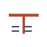

**[Detailed user guide](USER_GUIDE.md)** · [Offline HTML guide](USER_GUIDE.html) · [Compact help](help.html)

Start with [Choose a study](USER_GUIDE.md#choose-a-study), then follow the inputs,
inspection, reports and troubleshooting steps for your selected workflow.

## Individual shunt capacitors in transient studies

Open **More → Transient load-step study**, select a load row, then
**Shunt capacitors for selected load…**. Add individual bypass/filter capacitors
and edit effective C, ESR and total part + connection ESL. The bank **replaces**
that row’s aggregate C/ESR; the marked cells say **Bank**. Nothing is double-counted.

| Control | Meaning |
|---|---|
| C | Enter µF or an explicit value such as `100nF`, `4n7`, `1uF`. Use effective capacitance at operating bias. |
| ESR / total ESL | Explicit mΩ and nH. Enter zero only when deliberately omitting that effect. |
| Load-current rise | A prescribed linear rise in µs; zero means an ideal current step. Finite rise is needed for an all-inductive feed/shunt cutset. |
| Bulk parasitics | Select capacitor rows, then **Set selected ESR / ESL…**. Both values are validated before the selected rows change. C values are retained. |
| Board candidates | Choose the actual return net and select two-pad C-reference footprints on that exact net pair. Unit-bearing saved values may prefill; ambiguous codes remain unknown. Inclusion is opt-in. |
| Capacitor response | Select a part for internal capacitor voltage, branch current and peak ESR heat. Reports retain each branch and its half-step difference. |

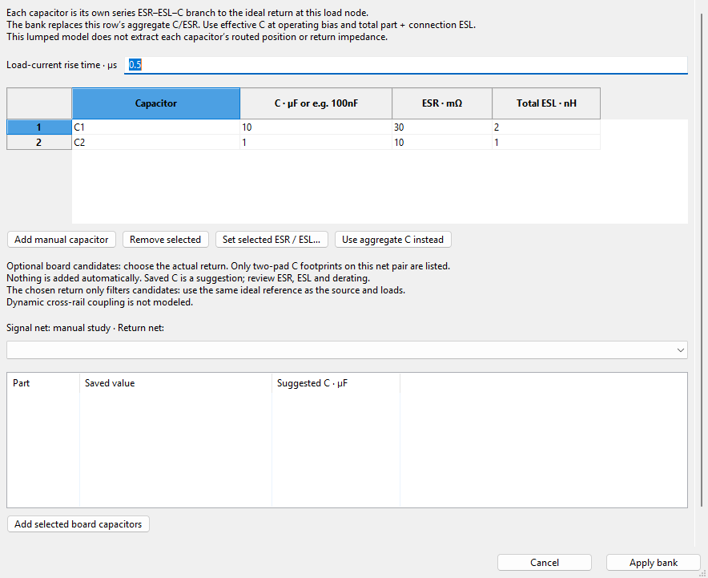

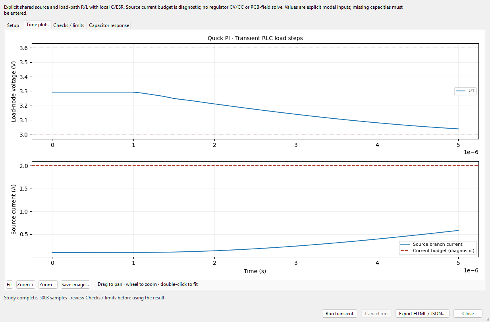

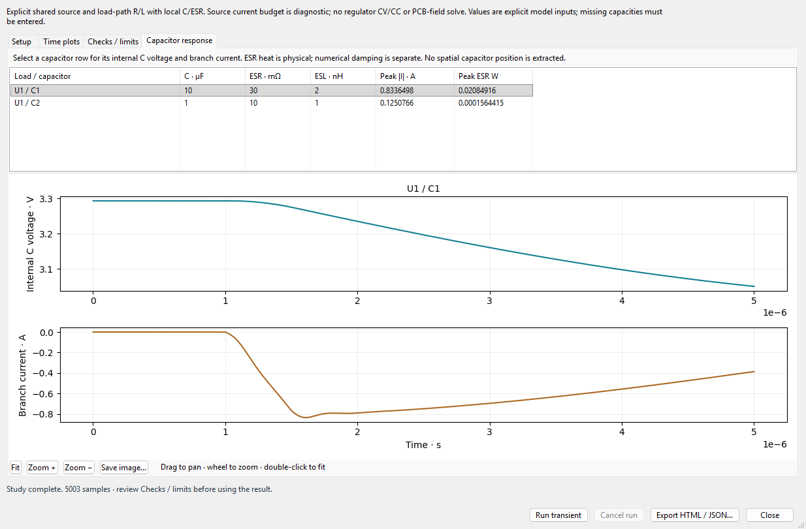

These are genuine native captures of [the explicit example](studies/transient-shunt-bank.json):
3.3 V, shared R 50 mΩ / L 1 µH, branch R 20 mΩ / L 100 nH, 0.1→1 A starting 1 µs
with 0.5 µs rise; C1=10 µF/30 mΩ/2 nH and C2=1 µF/10 mΩ/1 nH.
The 5 µs window uses 1 ns steps (5,003 event-aware samples). Its minimum load
voltage is 3.038876 V; the maximum load-voltage half-step difference is 29.60 µV.
This short illustrative window does not establish settling or measured board behavior.
No board was opened for these screenshots. [Validation and model limits](../docs/audits/SHUNT_CAPACITORS_2026-10-27.md).

CLI uses the same model:

```text
wayricad-pi --transient transient-shunt-bank.json --html shunt-report.html
```

Each load may contain `shunt_capacitors: [{id, capacitance_F, esr_ohm, esl_H}]`
and optional `rise_time_s`. Values are F/Ω/H/s in JSON. IDs must be globally
unique. At most 128 total shunt/aggregate branches and the existing time/trace
budgets bound work. Unknown routing, mounting, package and return parasitics are
not extracted. Individual banks currently run only in standalone lumped rail
transients; coupled electrothermal stepping rejects them explicitly. Constant-power
control and converter dynamics remain outside this model.

## New endpoint and study workflows (3.6.38)

| Task | Start here | Model and limits |
|---|---|---|
| Several connector/IC pins carry one supply | Select one source/sink pad; check the suggested **Include other same-net pins** box if it appears. Additional sinks have the same option. | Exact footprint UUID + net matching. One ideal equipotential endpoint; A or W is the total across the group. Pins reserved by other endpoints are excluded. |
| Load consumes fixed power | Choose **Constant power · W**, or choose the power kind for an additional sink. | Solves P = Vload × I at the high-voltage DC operating point. Mixed current/power endpoints are supported in fixed-temperature 2.5D copper. Collapse/limits are reported; no converter control or source foldback is invented. [Math and limits](CONSTANT_POWER.md). |
| Parts are parallel across one series stage | Open **Series path editor**, add the primary stage, then **Parallel parts**. | Finds two-pad parts across the exact saved net pair, including reversed pin order. Review each R/L model before checking it. Bare resistor values can be suggested from PCB values; unknown DCR and diode/capacitor behavior are not guessed. Highlight detected footprints on the originating PCB or see included branches in the result. |
| Set up a load-step transient | **More → Transient load-step study**. | Engineering-unit source/path R/L and effective load C/ESR; advanced SI grid retained. Import/export JSON and recommend a timestep. [Transient guide](transient_setup_help.html). |
| Run AC copper/ripple losses | **More → AC / SMPS copper study**; select a balanced loop preset and click **Run AC / ripple losses**. Run uses the visible quick recipe. | Explicit straight cross-section/return geometry, DC and RMS ripple. Review skin/proximity, conservation and refinement. No automatic whole-PCB or converter model. [AC setup](ac_setup_help.html). |
| Check a decoupling bank | **Decoupling → Lumped impedance screen**. | Explicit source R/L + capacitor-bank C/ESR/ESL, target impedance, resonance/antiresonance sampling, hover/click probes and CSV. Separate from the placement-proximity planner. [PDN model](decoupling/help.html). |

The grouping recommendations are opt-in and are available for supported 2.5D
current/power endpoints. They do not combine different components merely because
references look alike. 3D, resistive, package-contact and console/series modes
retain their documented restrictions. Constant-power mode also rejects automatic
current-based mesh-convergence checks, sweeps and transient/electrothermal
regulation; refine independent operating points explicitly instead. The result
report shows declared watts, solved amperes, delivered power and operating-point
evidence.

Plain wheel scrolling zooms. In eligible fixed-temperature current results,
**Ctrl+scroll** near a sink marker or its actual pad edge changes only that sink
unit. Near a source marker it scales the total. Markers have modest translucent
fills; the pick radius is screen-sized and follows pan/zoom/DPI. Close ambiguous
endpoints consume the gesture without changing any current: move closer, zoom,
or select the specific layer. Power-load live current scaling is disabled so a
constant-power endpoint cannot silently become a constant-current endpoint.

Transient path inductance and capacitance are active circuit terms, not decoration.
Enter effective capacitance (including known decoupling/path capacitance), ESR
and source/branch inductance explicitly. Only one matching feasible DC copper
path may seed total R from its solved drop/current; do not count that resistance
again as branch R. Missing L/C are not inferred from a DC mesh or filled with
invented board values. Ideal current steps, timestep-refinement and energy/error
checks do not establish finite-rise switching or regulator-loop stability.

PDN plots use a declared lumped network. Resonance-aware samples and a refined
frequency grid help expose narrow peaks, but a sampled target pass is not proof
of board-level impedance, capacitor bias behavior or SI/EMI compliance.

```text
wayricad-pi board.kicad_pcb --net VCC --source J2.1 --sink U1.1 --voltage 3.3 --load-power 1.65
wayricad-pi board.kicad_pcb --net VCC --source J2.1 --voltage 3.3 --power-load U1.1 1.65 --load U2.1 0.25
wayricad-pi board.kicad_pcb --series-file reviewed-path.json --voltage 3.3 --current 2
```

`--series-file` reads the editor's schema-1 saved path, including explicitly
selected parallel components, and revalidates it against the current PCB.
Current/power CLI flags preserve endpoint voltage windows and source budgets.
The service/batch JSON interface supports grouped pad UUIDs; current/power batch
cases are independent, without shared-return or electrothermal power regulation.

## Current interface examples

### Current and power endpoints


Computed synthetic copper fixture: 3.3 V, a 1.65 W grouped load and a 0.25 A
current load. Source 0.750252 A, copper loss 1.3862 mW. This is a declared
example, not a measured board or a converter transient.

### Transient load-step setup and result

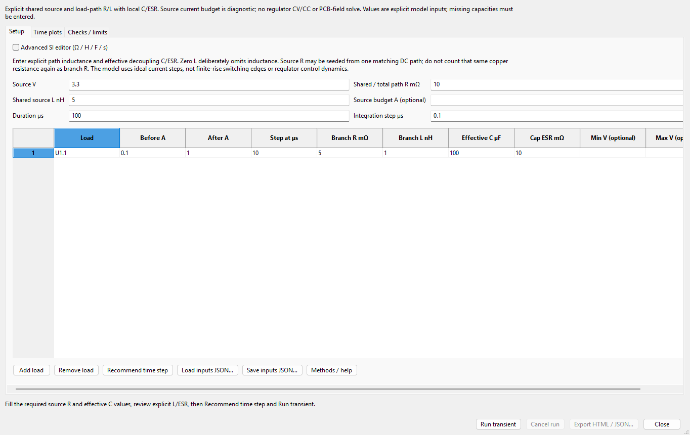


Explicit passive R/L/C, ideal steps or bank-only linear current ramps; no inferred board parasitics or regulator
dynamics are inferred. Inspect the inputs and refinement/error diagnostics.

### PDN capacitor-bank screen

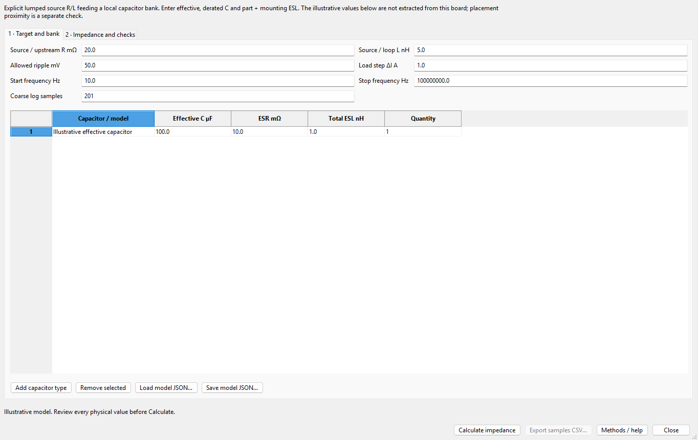
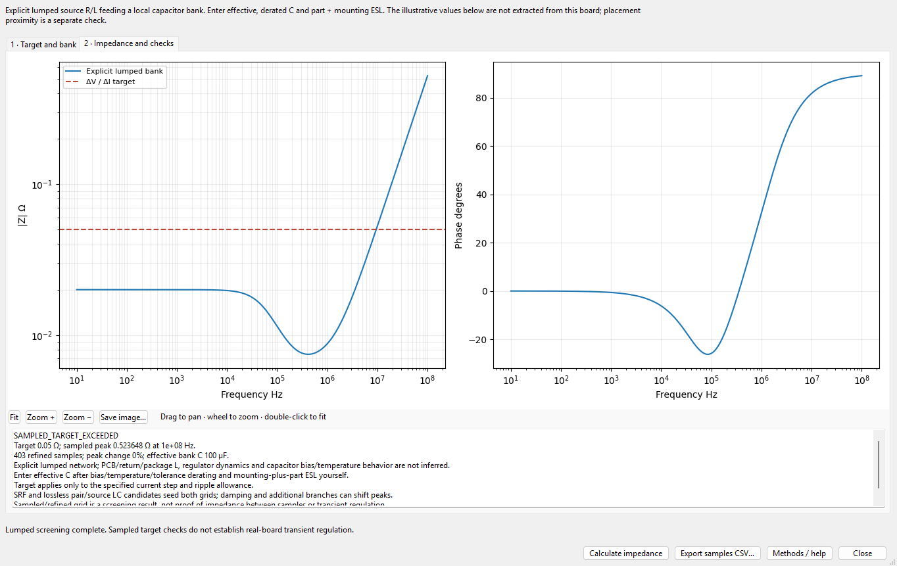

Declared lumped source/capacitor model. The sampled target comparison is separate
from saved-board decoupling placement and is not a complete board impedance proof.

### AC loop setup and result

The 3.6.40 interface starts with a quick loop and a live outgoing/return
preview. Enter dimensions, DC current and RMS ripple, then use the main **Run**
button. Custom conductors, SMPS spectra and mesh settings start folded below.
Switch to **Custom loop** to run those tables without replacing them with a recipe.

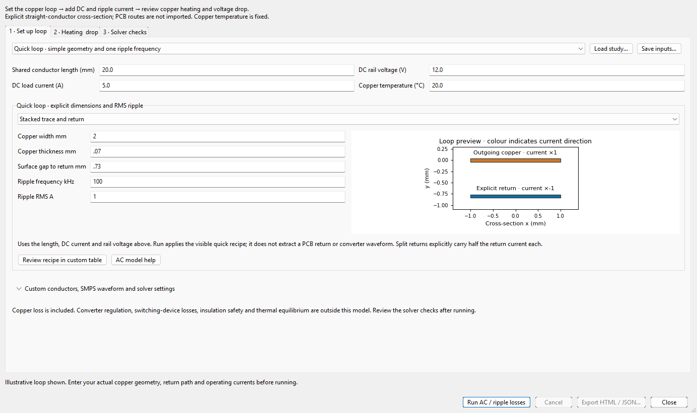

Results open with four headline quantities and a large harmonic-heating plot. Use **Inspect**
to switch between copper/return, resistance/reactance and harmonic heating. Tables
use kHz, mΩ and mW; drag the divider to give either the plot or table more space.
One supplied frequency is shown as a discrete comparison, not a continuous sweep.

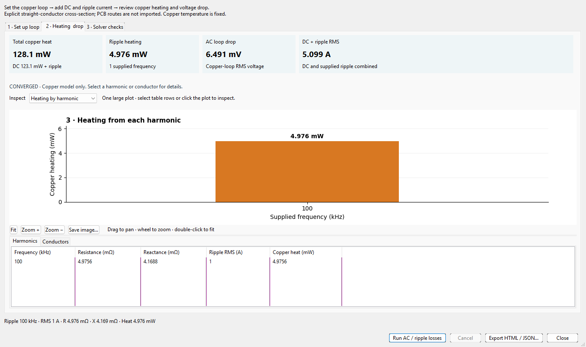
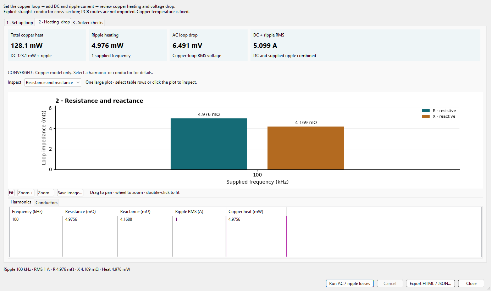

Genuine native captures of the unchanged illustrative 20 mm loop: two 2 mm ×
0.07 mm copper sections, 0.73 mm surface gap, 5 A DC plus 1 A RMS at 100 kHz,
20 °C. Total copper heating is 128.1256 mW; the ripple contribution is 4.97555 mW.
Geometry is explicit; no PCB or converter was simulated automatically.

<details><summary>Earlier 3.6.38 AC interface and capture provenance</summary>

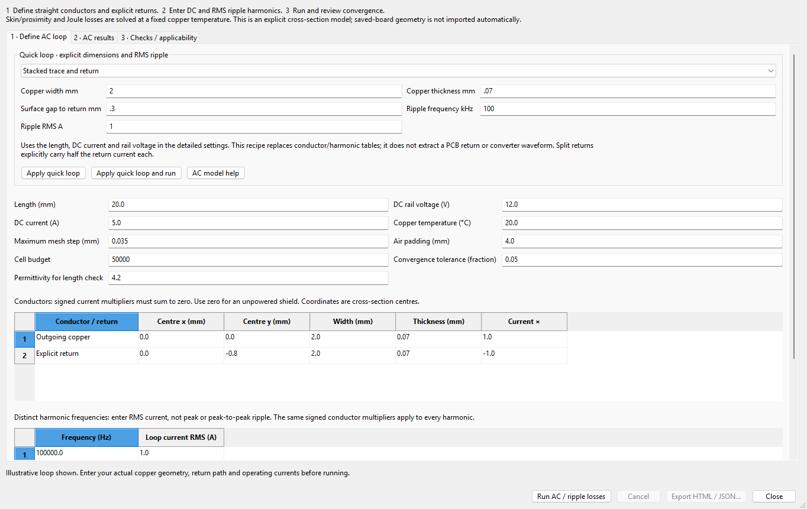


These earlier captures used a staged Apply workflow.
[Capture provenance and assumptions](../docs/audits/QUICK_TOOL_VISUALS_3.6.38.md).

</details>

## Start here

**AC / SMPS copper studies are included in 3.6.34.** See the
[AC guide](AC_ANALYSIS.md) for explicit return geometry, skin/proximity effects,
SMPS waveform helpers and Joule-loss interpretation.

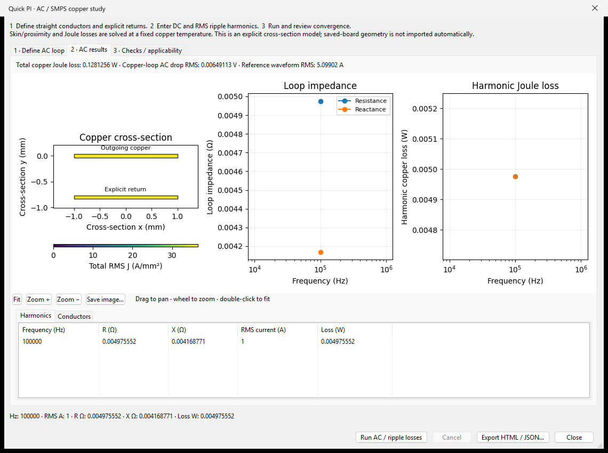

Actual computed synthetic loop, captured on Windows with KiCad 10.0.6. The
cross-section is entered explicitly; no PCB geometry or converter model is
inferred. The screenshot contains no private design or local paths.

| Need | Open |
|---|---|
| Install or update | [Latest release](https://github.com/wayri/WayriCAD/releases/latest) · [Installation](../docs/INSTALLATION.md) |
| First power-path check | [Workflow](#workflow) · [Reading results](#reading-results) |
| Multiple rails, returns and heating | [Multi-net studies](#multi-net-cases-return-copper-and-joule-feedback) |
| SMPS ripple, skin effect and proximity losses | [AC copper analysis](AC_ANALYSIS.md) |
| Scripts and reports | [Command line](#command-line) · [Offline help](help.html) |
| Equations and applicability | [Solver methods](#solver-methods) · [References](#references-and-research) |

**3.6.28:** initial inspection no longer extracts a display scene only to discard
and rebuild it. Inventory updates are batched, and shared dropdown/picking caches
avoid repeated full-board work. Marble geometry-ready time improved from 33.09 s
to 20.26 s; the first load remains substantial. [Measured phases and limits](../docs/audits/SUITE_RESPONSIVENESS_2026-10-23.md).
These startup changes do not change material values, mesh targets or solver equations.

### Current Marble geometry preview


Actual 3.6.28 native window after loading public Marble. This shows extracted
`+12V` copper and saved board context, not a completed mesh/voltage solve.
The visible source/load defaults have not been reviewed as a power-path study.
Set the actual ports and operating conditions before Run. [Capture provenance](../docs/audits/README_GALLERY.md#capture-provenance--23-october-2026).

## First-open copper preview

Copper autoload shipped earlier; the all-layer default and separate Silk toggle
are included in 3.6.40.
[Validation and remaining startup latency](../docs/audits/QUICK_PI_COPPER_AUTOLOAD_2026-10-26.md).

The saved board's copper loads automatically in the background with the net and
pad inventory. The selected net opens with **All copper layers (projected)** selected and
**Silk** off. Changing nets filters the cached board without another extraction. Uncheck
**Only simulated nets** to show surrounding copper. **Board** controls edges and
holes; **Silk** independently enables saved silkscreen. **Copper** and **Field**
control copper geometry and the solved overlay. An explicit physical-layer choice
is retained when a new mesh or result arrives.

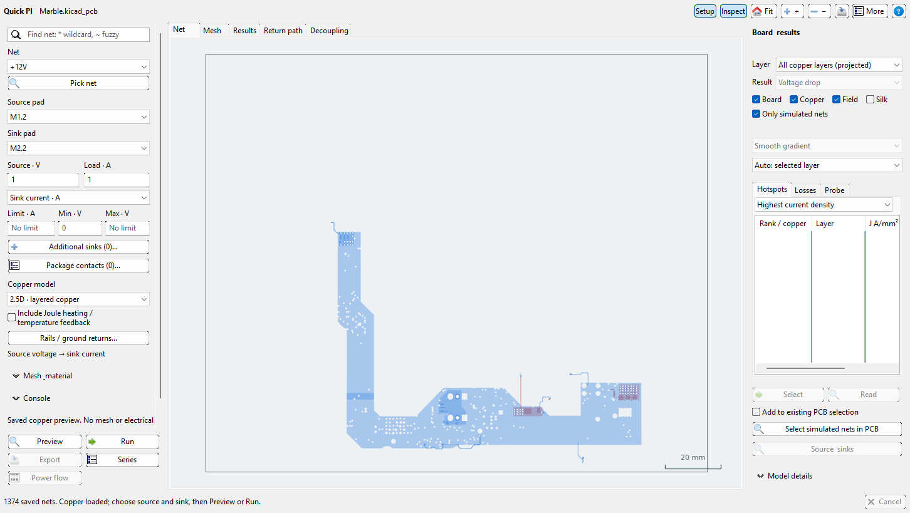

Actual saved +12 V copper from public Marble, across its copper layers, with
Silk off. This is a geometry preview; no mesh or electrical solve was run.
The source board was read only and its SHA-256 stayed unchanged.

This first view requires no solver stackup, source/sink pair or mesh. **Preview**
prepares physical simulation geometry and **Run** solves it; their normal stackup
and electrical-input checks still apply. A saved copper display is not a solved
PI result.

## Board navigation and labels

The board view uses saved, visible silkscreen at its actual size, position and
rotation. It no longer invents reference labels at footprint centres or adds
repeated source/load captions. Source and load markers remain available, with
pad details in the inspector; scientific report plots keep their captions.
Fabrication and courtyard drawings are excluded from this default board view.

Pan uses a cached image while dragging, then redraws the exact view on release.
Redraw requests are coalesced, and hover probes search nearby geometry instead
of scanning every cell. Unchanged hover values do not repaint the whole board.

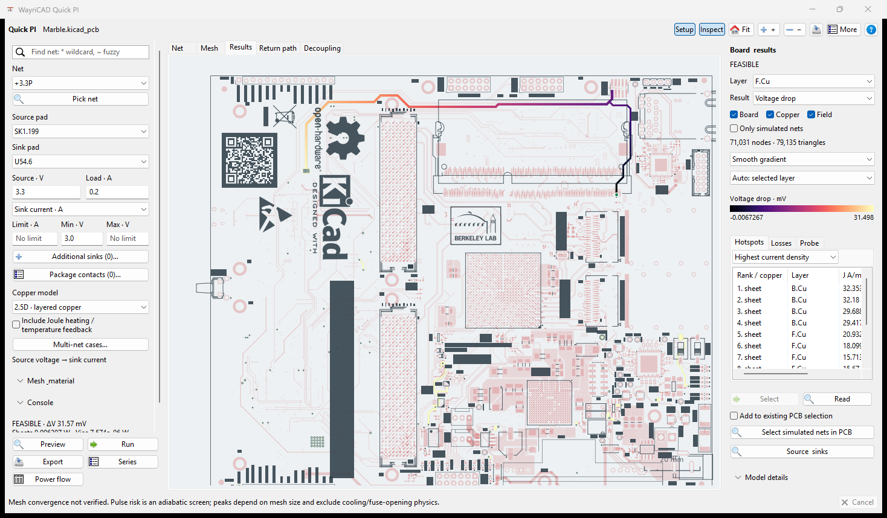

On Marble, median full redraw time fell from **763 ms to 58 ms**. See the
[viewport benchmark and screenshot provenance](../docs/audits/QUICK_PI_VIEWPORT_PERFORMANCE_2026-10-23.md)
for scope, assumptions and native-window checks. These changes are included in WayriCAD 3.6.27.

## First-run performance

Fresh solves load only the VTK geometry modules they need. A multi-net batch
owns one native PCB instead of loading it again for every rail or return case;
each case still checks the saved source before and after analysis. Contour
queries, edge bookkeeping, matrix assembly and full-field result summaries also
avoid unnecessary Python work. Mesh targets, copper boundaries, material
values and solver tolerances are unchanged.

See the [uncached Marble comparison](../docs/audits/QUICK_PI_COLD_PERFORMANCE_2026-10-22.md)
for first-run timings, exact-field comparisons and limits. Existing result reuse
is separate; these improvements do not depend on a previous solved request.
These first-run improvements are included in WayriCAD 3.6.27.

## Automatic mesh sizing

**Automatic mesh** is enabled in the 2.5D window. Preview the saved copper to
review the recommended background edge and smallest local target in the
inspector. Run uses that recommendation and grades the mesh near straight
tracks, pad contacts and plated-barrel lands. Uncheck the option to enable the
manual edge field; its previous value is retained. Switching to 3D selects manual
sizing because automatic volumetric size fields are not supported yet.

| Control | Behaviour |
|---|---|
| Automatic sizing | Background starts from occupied copper extent / 40, capped at 0.8 mm. An area-based cost estimate reserves 75% of the triangle budget for local features and boundary vertices by increasing only the background target when necessary. |
| Local refinement | Physical track width, contact bounding-box width and conservative annular-land width target three edges across the feature. Sizes grow gradually with distance. Each split is shared by both neighbouring triangles; copper contours, holes and contact partitions remain intact. |
| Budget reached | The run stops with an actionable budget error; local splitting checks its exact predicted child count before allocation. Local feature targets are not silently coarsened or dropped. The initial cost estimate is not a guarantee that a complex net fits. |
| Reports | HTML/JSON record ideal and chosen background sizes, local target, budget, actual cell counts, achieved edge/target ratios and unresolved feature classes. |
| Convergence | A convergence study fixes the recommended background once, then uses uniformly sized manual meshes and halves the actual edge each level. It does not recompute the same automatic mesh repeatedly. **Refine** also switches to a manual half-edge mesh. |

CLI: add `--auto-mesh` to a normal solve or mesh-only command. Use
`--mesh-edge 0.2` for manual sizing; combining both is rejected. JSON requests
and batch rail/return settings use `"mesh_sizing": "auto"` or `"manual"`.
Legacy requests without this key keep their manual edge behaviour. Series paths
record separate recommendations for each copper domain.

These are geometry heuristics, not an error estimator or convergence result.
Arcs retain native polygon contours but have no centreline-width target;
arbitrary zone necks, curved-contour error and ideal-contact singularities need
separate review. Contact bounding boxes approximate local support. Review both
terminal-drop refinement and local current-density sensitivity before relying
on a result.

## Source-to-sink power flow

After solving, choose **Power flow** to open an offline Sankey diagram. Sources
appear on the left; delivered load power and modeled losses appear on the
right. Hover or select a ribbon to inspect its watts. HTML exports include this
diagram automatically, including CLI `--html`, 3D exports and multi-net studies.
The multi-net dialog also has **Power flow…** for a lightweight preview.

The diagram uses solved source voltage × total source current and each load
unit's solved voltage × total current. A unit with several pads is counted
once; individual pad sharing is not invented. Shared-return studies pool their
sources, show delivered load power and count common return loss once. Explicit
independent loops include both supply and return losses. Ordinary rail reports
include their modeled supply-path losses only. These are accounting budgets,
not geometric current streamlines or a prediction of where delivered load power
becomes board heat. Large lists combine additional loads without dropping power.

Missing, negative, non-finite or inconsistent power evidence produces a visible
**Power flow unavailable** explanation instead of a misleading balanced plot.
Infeasible requested-current diagnostics stay labelled as such. Return-only
ground-reference plots direct you to the coupled study. Steady electrothermal
reports show separate cold and hot DC budgets with acceptance status; transient storage is not
represented by a DC Sankey.

## SMPS ripple and AC copper losses

Open **More → AC / SMPS copper study…** for a declared straight copper section
and its return conductors. Enter the mean DC current and the **RMS current of
each ripple/switching harmonic**. The separate cross-section model calculates
frequency-dependent copper current redistribution, impedance and Joule loss;
it does not reinterpret the board's DC field as an AC field.

Use [AC analysis](AC_ANALYSIS.md) for the geometry, units, equations, input JSON,
CLI and limits. Both low- and high-voltage rails can be described: rail voltage
is an operating context, not an insulation or dielectric qualification. High
current is accepted as a prescribed input; a fixed-temperature loss result does
not establish a safe operating temperature or ampacity. The existing
**Include Joule heating / temperature feedback** checkbox remains the
saved-board DC electrothermal workflow described below.

## Multi-net cases, return copper and Joule feedback

| Goal | In the window | Command line |
|---|---|---|
| Several rails | Choose a rail's source/load, then **Rails / ground returns…**. Use **Add net case…** for each additional rail; enter its voltage, current and pads. | `wayricad-pi board.kicad_pcb --batch cases.json --output raw-cases.json --html cases.html` |
| Include ground-return voltage drop | In **Rails / ground returns…**, select a rail and **Set up ground / return…**. One form shows the return net, supply-ground pads and every load-ground pad unit. | Existing `return_conduction` studies remain supported and editable; new groups use `shared_returns`. |
| Shared ground and multi-pad units | Check the rails in the return setup, choose their ground net and pad units, then **Apply return setup**. **Suggest matching footprint pads** proposes candidates for explicit review. | Add top-level `shared_returns`, as in [the shared-return example](studies/shared-return.example.json). |
| Review reference planes and return vias | Open **Return path**, choose the return net and **Review return path**. Advanced sampling, multiple returns and optional pins stay collapsed. | Existing `--return-path --return-nets GND`, or the batch example. |
| Solve temperature feedback | Check **Include Joule heating / temperature feedback**, then **Run**. Fill the explicit thermal/material settings before running the steady study. | Existing `--electrothermal study.json`; batch cases may include explicit `electrothermal` settings. |

Ordinary DC **always computes copper I²R loss**. The checkbox adds a steady
thermal solve and temperature-dependent resistance; it does not switch losses
on or off. Its setup leaves material conductivity, cooling, emissivity, ambient,
material temperature range, temperature cap, resistivity and its temperature
coefficient unset until reviewed. Missing values prevent the run. Delivered
load power is not automatically counted as board heat. See
[the coupling model and inputs](ELECTROTHERMAL.md).

### Easier return setup

**Rails and returns** is the default multi-net view. Select, edit or remove a
staged return mapping in its table; raw settings remain under **Advanced JSON**.
Searchable pad pickers support multiple physical contacts and full pad names.
Source/load pad suggestions use the owning footprints; they do not infer the
actual electrical loop. Apply explicitly confirms the visible mappings.

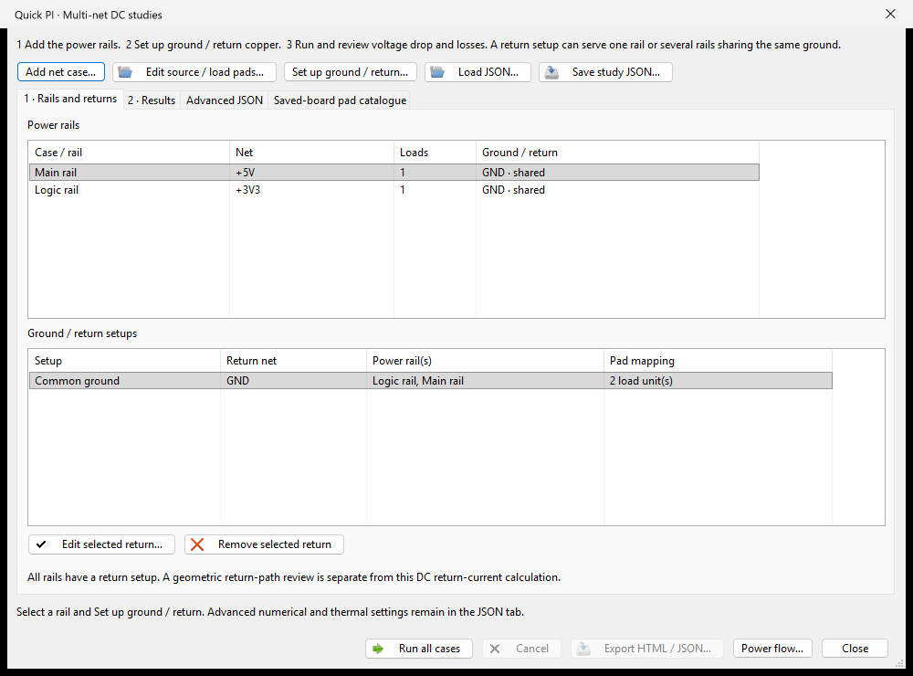


These native captures show synthetic staged inputs, including two rails and
multi-pad return units. They are setup previews, not solved board results.
The separate [Return path review](RETURN_PATH.md) checks saved reference-plane
coverage without requiring source/load return pins.

Batch studies contain **1–32 cases bound to one saved PCB hash**. They retain
failures per case; source/study changes invalidate the entire batch. Cases are
independent unless explicitly connected by a `shared_returns` group. Each group
solves the common return copper **once with every mapped load current**, including
common-impedance coupling. Ground rise at each load is subtracted from its solved
supply-pad voltage. Group loss counts shared copper once, with current and total
source/load/copper power conservation checks. No inter-net AC fields, regulator
interaction or combined heating between rails is inferred.

Use `source_terminals: ["J1.1", "J1.2"]` instead of `source_terminal` to select
multiple source pads. A load uses `{"id":"chip", "terminals":["U1.1","U1.2"],
"current_A":0.2}`. All pads in a unit must be on the selected net and are explicitly
assumed **ideal equipotential contacts**. The FEM distributes total unit current
according to copper conductance; it does not divide the demand equally. This is
an explicit ideal internal connection, not an inference from matching pad nets.
Package/internal contact resistance is not modeled by these ideal units. Repeated
pads, aliases, overlapping contacts and cross-net pad selections fail validation.
Legacy single-pad fields remain supported, but must not be combined with their
plural counterparts. Grouped units currently support fixed-current 2.5D copper.

Each `shared_returns` entry needs `name`, `net`, `source_terminals` (source-ground
zero reference), and `loads`. Each load mapping has `case`, `sink` (the supply
load's stable `id`), and `terminals` (its load-ground unit). Map every load of a
participating case exactly once. Put loads on the same supply net in one case;
use one group for each common return net. Separate groups may not reuse a case.
Return mesh/material settings belong to the group. Changing one rail's current
can change ground rise at other rails through the shared copper. Load reports
show delivered voltage and actual voltage-limit status; they do not count the
same shared loss again per rail.

The solver uses an auxiliary reversed-current solve at zero source-ground
potential and reverses its field signs to obtain physical return injection.
JSON retains the raw auxiliary evidence and explicit sign convention; shared
return HTML maps show **physical positive ground rise and return-current arrows**.
The analytical tests check a common two-section strip with transfer resistance
matrix `[[R,R],[R,2R]]`, superposition, conservation, and unequal parallel pad
current division. These are numerical reference checks, not board measurements.

The legacy case-level `return_conduction` remains available for one prescribed
load. Its `source_terminal` is load ground and `sink_terminal` is source ground;
its raw plots retain the declared auxiliary reference offset. Use a shared-return
group for multiple loads or rails. Shared-return groups reject packages, series
branches, resistive-load current solving, 3D loops and coupled loop heating.

The separate geometric return audit screens reference coverage and via
transitions. It establishes neither a closed electrical loop nor loop
inductance/AC impedance. Supply-only cases continue to assume their declared
load return reference; use `return_conduction` or `shared_returns` when return copper drop matters.

Start from [batch-rails.example.json](studies/batch-rails.example.json), replace
the sample nets/pads with those on your saved board, and review every load.
These example values are illustrative inputs, not a validated board design.
CLI exits: **0** all cases completed; **3** failed/incomplete/review-needed cases;
**4** an infeasible case; **2** invalid intake or execution/publication errors.
JSON output and HTML's paired JSON must use different destinations.

## Interactive inspection

Use **Find net** or **Pick net** to choose an analysis input from
saved pads, vias or tracks. Select the two terminals and rerun after changes.
Search keeps an exact selected net when it matches. If it no longer matches,
the selection clears; choose a result explicitly before running an analysis.
Hover over solved Results cells and click to pin exact cell values; Ctrl-right-click
clears probes. Holes and unresolved cells remain gaps.

### Change load current with the wheel

After a fixed-temperature **2.5D** current solve, open **Results** and leave
**Ctrl+scroll load** checked. Plain wheel scrolling zooms normally. Hold **Ctrl**
and wheel over solved copper to change **Total · A**. **Base step · A** sets
the normal increment: slow scrolling uses 0.1×, normal scrolling 1×, and fast
scrolling 5×. A pause or direction reversal restarts with a fine step. You can
also enter the total directly and press Enter, or use its arrows. Disable
**Ctrl+scroll load** to keep wheel zoom for both gestures.

All sink currents scale together, preserving their proportions and grouped pad
assignments. Voltage drop and current density scale with current; copper loss
scales with current squared. Source voltage, conductivity, temperature, mesh and
terminal locations remain fixed. Limits, probes, summaries and exported results
update with the new current. Zoom and selected-object highlights stay in place.

Updates reuse the solved linear field, without remeshing or another matrix
factorization. Wheel bursts combine into the latest requested current, numerical
work runs away from the window thread, and exports wait for that update to
finish. The displayed calculation time excludes drawing and input scheduling.
Changing simulation inputs or the saved PCB requires a new solve. Resistive
loads, series/package paths, coupled returns, 3D and Joule-temperature feedback
use their normal solve workflows; they do not enable this control.

See [Marble timing and numerical checks](../docs/audits/QUICK_PI_LIVE_CURRENT_2026-10-24.md)
for measured response and mesh limitations.

The native 3D copper view supports orbit, pan, wheel zoom and sampled-cell probes.
**Export 3D report** saves an offline interactive viewport plus the complete JSON.
HTML 3D views use drag to orbit, Shift-drag to pan and the wheel to zoom. Planar
reports include three interactive field maps alongside static print figures.
Display movement does not modify board geometry or the solve.

Large planar reports (more than 100,000 mesh triangles or at least 250 extracted
vias/PTHs) render three static maps: voltage drop or ground rise, current density,
and copper loss density. Static figures use **Solver cells**, preserve every
cell and drill contour on the plotted layer, and batch dense geometry into
collections without sampling. Three interactive fields and complete numerical
JSON remain available. To request all seven static maps, set
`"report_options": {"extended_snapshots": true}` on the result bundle before
calling `write_report` or `write_batch_report`; batch options apply to its child
reports. This export option has no CLI flag. Small reports retain seven maps.
Each static figure is released before rendering the next. Batch DC and return
child JSON files are small evidence descriptors, with source custody, scalar
summaries, and exact JSON pointers into the complete parent batch JSON.
Shared-return descriptors declare the potential/current sign transforms used
by their physical maps. Keep the parent JSON beside the case-report folder:
these descriptors are not standalone numerical results. All original arrays
remain in the parent archive; they are not serialized again for each child.
Standalone `write_report` exports retain full paired JSON. Its optional
`evidence_reference` keyword is used by batch publication to link parent data.

See [analysis views and probe controls](../docs/ANALYSIS_INTERACTIONS.md) for details.

On Windows, net, terminal and settings dropdowns open wider than the sidebar
when needed. Hover over the closed control to read the complete selected value
and its help text. Filtering and programmatic selection keep exact names. Other
platforms retain native popup sizing and the same full-value tooltips.

## Capabilities

- Analyze saved traces, filled zones, pads and plated vias using a layered 2.5D DC conduction mesh and saved copper thicknesses.
- Select one voltage source and multiple constant-current sinks; check an optional source current budget and individual sink voltage limits.
- Visualize voltage/drop, current density/flow, loss density and pulse-risk screening; separate sheet, via and component losses.
- Define repeated series resistance/RL, fixed-drop and current-dependent diode elements through the console or CLI, with engineering notation and console completion/history.
- Build the same saved-net series path in a native editor, including source/sink pad selection from the originating PCB Editor, ordered components, and reusable JSON paths.
- Solve a voltage-driven resistive load or sweep a bounded range of prescribed DC currents on one extracted path.
- Screen selected return nets against saved filled copper and local return vias, and estimate component temperatures from mapped board fields in air or vacuum.
- Run bounded mesh-refinement studies and reference benchmarks; export local HTML and JSON reports.
- Couple DC conductor losses and local resistivity to the shared QuickTherm layer model; run explicit lumped electrothermal rail transients with thermal R/C paths.

## Limitations

- Both copper models solve fixed-temperature DC conduction, not AC electromagnetics or thermal feedback. Series inductance adds stored-energy reporting in those modes. Separate transient and electrothermal studies use the explicit models described below.
- Zones must be filled when included in the path; valid connectivity and explicit material/stackup inputs are required. Assumed via plating is not a measured property.
- Local current-density peaks depend on mesh/contact assumptions; stable total resistance alone does not certify hotspot convergence.
- Pulse-risk estimates omit cooling, heat spreading and fuse-opening dynamics. They are not fusing-time predictions or manufacturing sign-off.

## Overview

Quick PI estimates DC voltage drop and current flow through saved PCB copper. It uses the board's filled copper polygons, pads, holes, layer thicknesses and plated via barrels to build a layered finite-element conduction model. Analysis runs in a cancellable worker process and does not edit the board.

## Workflow

1. Save the PCB and update zone fills in KiCad. Open **WayriCAD Quick PI**.
2. Use the left **Setup** panel to choose a net, source pad and primary sink pad. Enter **Source · V** and **Load · A** (or switch to a resistive load in Ω). Set **Limit · A** for an optional source current budget and **Min · V / Max · V** for the primary sink's bounds. Use **Additional sinks** for further loads.
3. Click **Preview** or **Run** at the bottom of Setup. The **Net**, **Mesh** and **Results** tabs show the same extracted geometry in a full-height board canvas. The window opens maximized.
4. Use the right **Inspect** panel to choose a layer and result. Its colour legend gives the numerical range and units. Drag the board to pan, scroll to zoom, or double-click / click **Fit** to restore the board extent. **Setup** and **Inspect** in the header hide either panel; the divider adjusts the inspector width. **Board**, **Copper** and **Field** toggle saved context, extracted copper and the result overlay independently. Millimetres stay proportional during resizing, and a compact ruler replaces graph axes.
5. Use **Export** for an offline HTML report with maps of the selected layer and paired JSON containing all layers and numerical results. Large reports default to three static maps; smaller reports include seven. The save-image icon exports the current board view. **Mesh & material**, **Console** and **Model details** start collapsed; **More** retains transient, electrothermal and diagnostic studies.


This UI demonstration uses a disposable portrait PCB as saved context and an
analytical **65 × 90 mm, 35 µm uniform copper plate**, with full-height edge
contacts at **5 V / 2 A**. Its computed drop is **0.71149 mV**. The plate is a
known-answer display fixture, not a simulation of the illustrated routed PCB.
Source files remain unchanged during navigation and inspection.

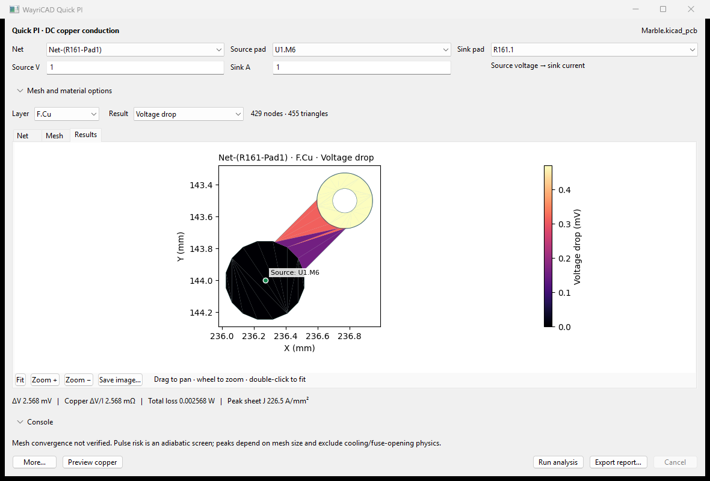

This is the **small `Net-(R161-Pad1)` connection on Berkeley Marble**, from `U1.M6`
to `R161.1`, at 1 V / 1 A. It is not a power-rail or full-board loading test.
The result is about **2.568 mV**, comprising **0.652 mW sheet loss + 1.916 mW via
barrel loss**. The saved copper thickness is 35 µm. These are computed regression
results, not measurements or proof of mesh convergence.

| Preview | What to check |
|---|---|
| Net | Actual extracted copper, pads, drill holes and selected terminals. |
| Mesh | Triangles on the selected layer; inspect narrow necks and contacts. |
| Results | Select voltage, drop, current density, arrows, loss or pulse screening. |

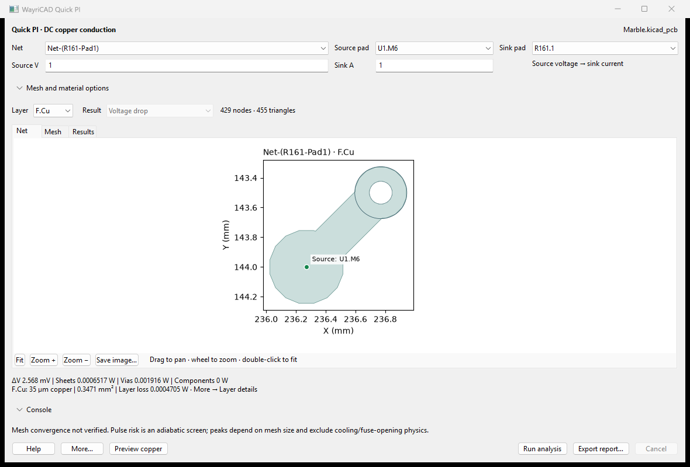

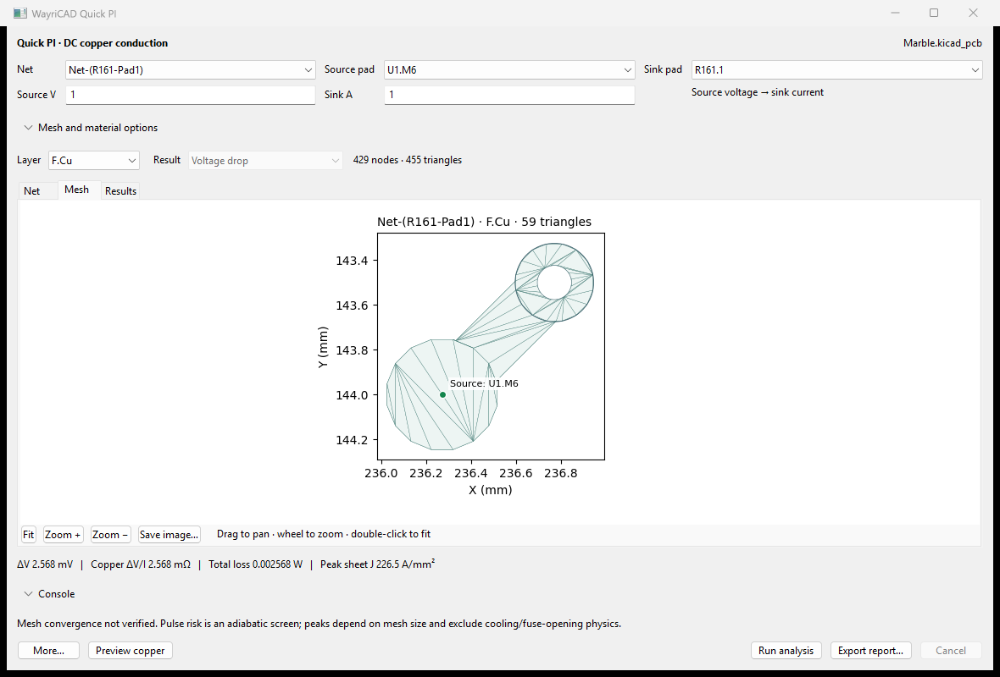

**Mesh & material** in Setup contains mesh size, assumed via plating, copper temperature, ambient temperature, pulse duration and a temperature limit. Expanding it scrolls the sidebar without reducing the board height. A smaller mesh costs more time and memory. Compare successive mesh sizes before relying on localized peaks. The default 25 µm plating is an assumption, not a measured board property.

### Multiple loads and source limits

The primary sink uses **Load · A**, **Min · V** and **Max · V**
controls. **Additional sinks** opens a table to add, edit or remove other pad
demands, each with its own current and optional minimum/maximum voltage. All
sinks must be distinct pads on the selected net and different from the source.
Blank minimum voltage defaults to 0 V; blank maximum is unbounded. **Limit · A** is an optional nonnegative
current budget: blank means unlimited and zero supplies no current.

Quick PI solves all requested constant-current loads together at the entered
source voltage. Results and reports show each sink voltage/drop, total demand,
source current headroom and **FEASIBLE** or **INFEASIBLE** against that budget
and the entered voltage windows. This is a DC requirement check, not thermal,
transient, regulator-stability or hardware qualification. If demand exceeds the
source budget, maps and losses remain **requested-load diagnostics**: the source
cannot sustain that operating point. Loads are not scaled to fit; foldback,
constant-current regulation and voltage-collapse dynamics are not simulated.

For multiple sinks, **Worst drop / total demand** divides the largest sink drop
by total requested current; it is not a physical two-terminal resistance. The
inspector's **Losses** tab and console retain every sink's demand,
voltage and bounds. Source and all sinks are marked in the views and included
in terminal selection/zoom. Changing any demand or bound clears stale results.
Multiple sinks with explicit series components are not supported; remove
additional sinks before running a console series path. The legacy single-sink
series path retains source current and sink voltage limits.

The mesher preserves copper, hole and terminal boundaries while improving triangle
angles. Broad, complex planes receive interior mesh points to avoid spending the
cell budget on long, thin triangles. Geometry, area and electrical conservation
checks still apply; the default mesh budget is 400,000 triangles across all layers. A successful solve or stable
total resistance does not establish convergence of local current-density peaks.

For a dense saved-board 2.5D copper net, explicitly raise capacity with
`--max-cells 1500000`, or set `"max_cells": 1500000` in a batch case's
`electrical` settings or a `shared_returns` group. The advanced batch JSON editor
accepts the same field. It must be an integer from 1,000 through 2,000,000;
omitting it retains the default. Each rail and return group has its own total
triangle budget. The solver also caps vertices at 2,000,000 for an enlarged
request. Larger limits can require several GB of memory and longer execution;
they do not alter mesh edge length or relax contour, hole, area or conservation
checks. These overrides apply to 2.5D copper only; explicit series/package paths
retain their existing limits, and 3D uses its separate tetrahedron budget.

If the Quick PI Python runtime has the optional `gmsh` package, meshing uses
Gmsh's conforming planar surfaces for extracted copper and contact regions.
The default internal 2.5D DC solver uses those triangles. With no Gmsh
package, `auto` uses the existing VTK mesher.
The JSON mesh report records the selected backend. For a reproducible CLI run,
choose `--mesh-backend gmsh` to require Gmsh or `--mesh-backend vtk` to require
VTK. Managed launches prepare Gmsh automatically when explicitly selected,
including within batch rails, independent returns and shared-return groups.
Setup failures remain actionable; direct worker use requires the selected
backend to be installed. Geometry, area, edge length and cell-budget checks
remain in force.

### Explicit lead, solder and BGA contact paths

**Package contacts** in Setup or CLI `--package-conduction paths.json` adds finite
axial package paths to the selected 2.5D constant-current net. Supply a JSON list
(or the request field `package_conduction`) with one record per pad face:

```json
[{"id":"U1-ball-A1","reference":"U1","pad_number":"A1","layer_id":0,
  "port":"sink:U1.A1","segments":[
    {"shape":"spherical_ball","length_mm":0.3,"diameter_mm":0.5,"rho_ohm_m":1.4e-7,"material":"User-declared solder"},
    {"shape":"rectangular","length_mm":0.1,"width_mm":0.3,"thickness_mm":0.3,"rho_ohm_m":1.4e-7}
  ],"evidence":"Replace with measured geometry/property source"}]
```

The numbers illustrate syntax, not recommended solder properties. Ports are
`source` and `sink:<selected sink pad UUID>`. CLI also accepts
`sink:<the exact requested sink terminal label/UUID>`; reports canonicalize the
port and `pad_uuid` to the extracted UUID. Several balls/pads may share a port;
the network solves their currents from the board and contact resistances. Do
not prescribe per-ball currents. A source pad/sink selection remains the port's
identity; configured paths define its actual board attachments. Ports without
paths retain legacy ideal electrodes across their selected pad layers.

Each record declares `reference`, `pad_number`, integer copper `layer_id`, and
optionally `pad_uuid` to disambiguate repeated pad numbers. Attachment requires
one unambiguous saved pad on the selected net and meshed copper on that face.
Duplicate face ownership, cross-net pads, overlapping mesh contacts and overlap
with legacy ideal terminals are rejected. A PTH face attachment preserves the
finite plated-barrel path to other layers; it does not short all pad faces.

Segments in one path are in series. `cylinder` requires `length_mm` and
`diameter_mm`; `rectangular` requires `length_mm`, `width_mm`, `thickness_mm`;
`spherical_ball` is a symmetric truncated sphere with `0 < length_mm < diameter_mm`,
using the axial integral of inverse area. Every electrical segment requires
positive `rho_ohm_m`. There are no inferred dimensions or default materials.
Optional `additional_electrical_ohm` explicitly adds interface resistance.
`material`/`evidence` text and computed segment properties remain in JSON.

Reports separate sheet, barrel, package and component losses and give each
contact's solved current, resistance, voltage drop, I²R, board voltage and
package voltage. Source voltage and sink voltage bounds apply at package
endpoints. Package contacts are 1D circuit paths coupled to the 2.5D board,
not a 3D package/solder field solve or a solder reliability assessment. 3D,
series paths, resistive loads, sweeps, rail transients and electrothermal modes
reject explicit contacts; those modes cannot silently omit their losses.
Changing contact definitions invalidates results. Analysis never changes the PCB.

### Opt-in volumetric DC analysis

`--model-dimension 3d` builds copper solids from every extracted layer at its
saved stackup position, adds the extracted polygonal drill/annular plating of
circular through vias and PTH pads, and tetrahedralizes the conductor with
Gmsh. A three-dimensional conductivity FEM then solves voltage, current density
and copper loss at a prescribed DC sink current. This is a separate model from
the default 2.5D sheet/barrel solver. The 3D path requires Gmsh in the Quick PI
worker runtime; the launcher installs its compatible wheel if needed.

```text
python -m quick_pi_plugin.cli C:/Projects/Example/board.kicad_pcb \
  --net VCC --source J1.1 --sink J2.1 --current 1 \
  --model-dimension 3d --mesh-edge 0.25 \
  --plating 0.025 --output C:/Projects/Example/pi-3d.json
```

The 3D JSON contains tetrahedra, node voltages, XYZ current-density vectors,
per-cell loss, electrode current residual, power balance and an independent
extracted-polygon volume check. Source and sink pads are ideal equipotential electrodes. Mesh
refinement remains necessary near narrow copper and contacts. A run fails if
the mesh lacks electrode nodes, has disconnected source/sink copper, exceeds its
tetrahedron budget, or violates conservation. Plated slots, backdrills and
unresolved drill contours are unsupported rather than converted to cylinders.
The 3D model is fixed-temperature DC conduction: it does not solve AC skin or
proximity effects, dielectric current, thermal feedback or series components.
In the native window, choose a net and two pads, set **Copper model** to
**3D · copper volume (Gmsh)**, and enter a specified sink current. The first
run prepares Gmsh in Quick PI's private Python runtime when needed; setup may
require access to the configured package source. Set the 3D tetrahedron budget
under **Mesh and material options**. Start with a coarse mesh edge and refine
after inspecting the result. **Run 3D copper** opens a result view with a board
top view and a 3D view, copper-layer or interlayer barrel filtering, and current
density, voltage and volumetric loss density. The display samples cells for
speed; the DC drop, loss and conservation checks use the full mesh. **Export
3D JSON** from that window or the main window saves the complete field and
verification metrics. Editing an input invalidates that result. Switch back to
**2.5D · layered copper** for the standard per-layer maps and HTML report.
Resistive-load/sweep, series paths and pulse screening remain 2.5D.

## Console

Expand **Console** to enter commands. `help`, `nets`, and `pads <net>` list available names. **Tab** cycles context-aware completions; **Up/Down** recall commands. Commands run through the same cancellable worker as the controls; the pane does not execute Python or shell commands.

**Series elements and CLI support are retained in v3.2.0.** Press **Enter** to run
a console command. Use `run pi NET START END` for an explicitly named net, or
`run pi START END` to infer the net from the pads. Quote net names containing spaces.

```text
run pi "Net-(R161-Pad1)" U1.M6 R161.1
```

The console also accepts explicitly defined series components. Use `help` for resistance, inductance, fixed-drop and diode syntax. Component links are drawn as dashed lines and recorded in the report; they are not invented board tracks. Source voltage, load current and material settings come from the visible controls.

```text
run pi U1.M6 R161.1 5m R161.2 U1.M5
run pi U1.M6 R161.1 5mH+30m R161.2 U1.M5
run pi VIN.1 D1.1 1V D1.2 LOAD.1
run pi VIN.1 D1.1 diode(Vf=0.7V,Iref=1A,n=2,T=25C) D1.2 LOAD.1
```

The first command assigns 5 mΩ to the explicitly named two-pad component. The
second assigns 5 mH and 30 mΩ in series. These values are user assumptions, not
automatic identification of R161's actual component. In DC, the inductance adds
no voltage drop; its stored energy is reported. `m` means milli, `M`/`Meg` mega,
and `u`, `µ`, `n`, `p`, scientific notation and explicit `H`/`ohm`/`Ω` are supported.

For a forward-drop component, select its two pads in the source-to-load order.
`1V` or `500mV` imposes a fixed forward drop. The `diode(...)` form uses a
user-supplied forward-voltage/current anchor, ideality factor and temperature:
it evaluates the ideal diode equation at the specified DC load current. `Vf`
and `Iref` must be positive; `n` is 1–4; `T` is in °C. No model is read from the
KiCad symbol. The result lists each component's current, forward drop, voltage
before and after, and dissipated power. The same fields appear in exported JSON
and HTML. The console accepts the same syntax in two-pad shortcuts, such as
`D1:1V`, when the incoming net identifies one pad unambiguously.

The default mode prescribes load current. **Resistive load** mode solves a DC
current from source voltage, path drop and the specified load resistance.
Neither mode solves reverse bias, turn-off, transients or temperature feedback.
A diode Vf is therefore a **DC operating-point** value, not an instantaneous waveform.
If the requested current and path drops make the sink voltage negative, Quick PI
warns that the operating point may be infeasible. Forward-drop paths must cross
each net once, so an alternate path cannot silently bypass the selected diode.
With a forward drop, circuit ΔV/I is an apparent ratio at that current, not a
resistance; copper losses and device power remain separate.

### Multiple series components

Repeat `FROM_PAD VALUE TO_PAD` triplets between the starting and ending pads:

```text
run pi C1.1 R1.1 5m R1.2 L1.1 5mH+30m L1.2 U8.2
```

This models R1 as **5 mΩ**, followed by L1 as **5 mH with 30 mΩ series
resistance**. Pad names can include ICs and transistors, such as `U8.2` or
`Q2.3`. Each component triplet must join two distinct pads of the same component;
the intervening copper sections must belong to the corresponding actual nets
and be electrically connected. Replace these illustrative references with pads
on your board. Values are explicit user-supplied models, not inferred part ratings.

**DC limitation:** resistance and forward-drop elements contribute voltage drop and power loss. Inductance
is retained for stored-energy reporting and contributes no steady-state DC drop.
The copper DC mode does not simulate RL transients or AC impedance; entering an inductance
or a pulse duration does not enable a transient circuit simulation. Copper and
component losses are reported separately.

## Reading results

Copper thickness comes from each layer of the **saved board stackup** (or an explicit
stackup override). It is used in the conductance and thermal-mass calculations;
missing thickness is an error, never a nominal copper-weight guess. The layer selector
shows the solved layer's thickness, area and loss beneath the preview.

Choose **More → Layer thickness, losses and hotspots** for all layer areas, volumes,
thickness ranges and peak current density. The same details are in the HTML report.
Sheet, via-barrel and explicit component losses are accounted separately. Floating
copper is included in total geometry area but excluded from connected area and loss.
Ranked local hotspots include coordinates, layer and current/heating density. These
are mesh-dependent cell/barrel estimates, not whole-track ratings or fusing predictions.

The inspector's **Hotspots** tab ranks current density or volumetric heating.
Select a row to switch to its layer, mark the actual solved location and zoom
there. **Probe / object** shows the selected cell or barrel, coordinates and
units. Click solved copper in **Results** to inspect the containing triangle or
plated barrel; empty space and drill holes have no copper result. Cell values
are local mesh estimates, not measurements of an entire track. The hotspot
table uses W/mm³ for volumetric heating; the loss map uses W/mm².

Board context uses the actual saved outlines, footprint/pad shapes, traces,
vias and filled zones, with source object identities where extraction supports
them. It is display-only: showing the rest of the board does not include those
objects in the selected-net DC solve. Inspection highlights source tracks,
pads or vias when their actual copper shape covers the selected location;
unsupported or purely merged sheet geometry retains a local mesh identity.

Choose **Auto: selected layer**, **Shared: all layers**, or **Manual: this metric**
for the color scale. Manual limits use the displayed units, require minimum
below maximum, and reset to solved limits when the metric changes. Shared
scales include solved barrel values where the metric supports them. HTML maps
and JSON retain the chosen scale mode; a manual range applies only to its
selected metric and can clip values outside that range.

**Smooth gradient** is the default result display and remains continuous when
zooming. Voltage, drop and transfer resistance interpolate the solved nodal
potential within the existing triangles. Current density, flow, loss and pulse
risk use area-weighted corner colors for display, restricted to the same layer
and copper thickness. Holes, disconnected islands and unavailable cells remain
uncolored. This does not refine the analysis mesh. Probes, hotspot rankings and
automatic color limits retain the original solver values and peaks; use
**Solver cells** to see the unsmoothed cell resolution. HTML maps and JSON retain
the display choice.

**Select object in PCB** selects an exact saved via or plated-pad identity when
available. **Select source and all sinks in PCB** selects the reviewed terminals.
**Read PCB selection** brings a selected track, pad or via back to the inspector.
Objects outside the DC model remain selectable for navigation but have no
invented electrical values.
Sheet cell indices cannot be selected as native PCB objects; navigation is
available only when exact source copper identities resolve at that location.
Navigation uses the originating editor and rejects changed saved
board bytes or unresolved object identities. Live unsaved geometry is outside
the saved analysis snapshot; save, reload and rerun after editing. The inspector
shows model basis and snapshot status, and export rejects a changed saved board.

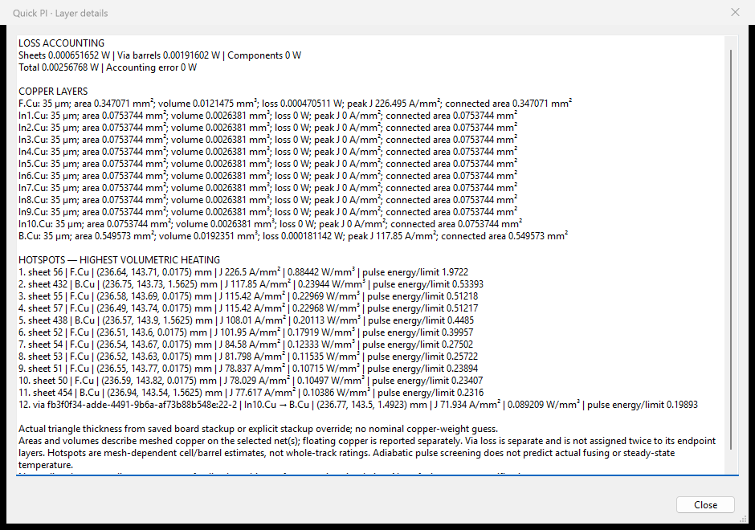

The inspector's **Layers / losses** tab separates sheet, via-barrel and component losses, includes the
accounting error, and lists local hotspot XYZ coordinates. A pulse energy/limit
ratio above one means the **adiabatic screen** exceeds the entered temperature
limit. It does not mean a trace will fuse in that time.

- **Copper ΔV/I** is conductor resistance for a single-net run. **Circuit ΔV/I** includes explicit series components. Operating-point source **V/I** is displayed separately.
- Current-flow arrows indicate in-plane direction. Sheet current is A/mm; volumetric sheet and barrel current density is A/mm². Via barrels have their own current, resistance and loss records.
- Density and pulse-risk maps color the plated via barrel around its white drill hole. The color scale includes both sheet and barrel values. Each layer shows the worst barrel segment crossing that layer; coincident segments are combined without adding their risk values.
- The pulse-risk map compares adiabatic deposited energy with energy to reach the chosen temperature limit. It excludes heat spreading, cooling, phase change and fuse-opening dynamics; it is not a fuse-time prediction.
- Floating copper has no solved potential. Geometry extraction and meshing issues are reported rather than silently connecting disconnected islands.
- This is a **2.5D DC conduction model**, not an AC, electromagnetic or thermal field solver. Explicit inductance does not change the DC solution. Contact-current peaks depend on mesh refinement and terminal assumptions.

## Series editor, sweep and board screens

Use **Build series path…** in the native window to choose source and sink pads, then add compatible two-pad parts in source-to-load order. **Use KiCad selected pads** reads one or two pads from the PCB Editor that opened Quick PI; review pad order before running. **Use selected component** adds one compatible selected two-pad footprint at the next net transition. The editor validates each net transition with the same parser as the console and can save or reload a JSON path. Its component values are explicit models, not values inferred from the symbol or footprint.

Choose **Resistive load** beside the voltage/current controls to enter a load in ohms. Quick PI solves the positive DC current for that source voltage using the saved copper and explicit components. **More → DC current sweep** plots path drop and sink voltage over 2–200 prescribed positive current points. Both retain the fixed-temperature and mesh assumptions of the main solve; the sweep does not represent a time waveform. The HTML export includes a chart and paired JSON.

The **Return path** tab asks for one signal net and explicit return net(s). It maps saved straight tracks, adjacent filled return zones, sampled coverage gaps and return vias near evidenced layer transitions. Warnings identify missing local evidence; a clear sampled route is not proof of a continuous return-current path or controlled impedance. Refill zones and save before running. [Return-path method and limits](RETURN_PATH.md).

Board and component thermal screening is provided by the separately installable [QuickTherm plugin](../quick_therm_plugin/README.md).

## Runtime and installation

Install the WayriCAD PCM ZIP through KiCad's Plugin and Content Manager, or use the suite's documented manual installation. KiCad 10's native Python needs NumPy, SciPy, VTK, Matplotlib and wxPython. The UI uses Matplotlib's wx canvas when available and a native wx/Agg canvas when the optional wx SVG backend is missing. Everything renders locally.

The Berkeley Marble smoke test used `Net-(R161-Pad1)`, source `U1.M6`, sink `R161.1`, 1 V and 1 A. The tested mesh produced approximately 2.568 mV drop. This is a regression example, not validation against a physical measurement.

## Command line

After installing the suite wheel, `wayricad-pi --help` lists the options. From a
source checkout use `python -m quick_pi_plugin.cli` in place of `wayricad-pi`.
The CLI parent does not need numerical libraries: the same isolated native worker
performs the analysis and report generation.

```text
wayricad-pi board.kicad_pcb
wayricad-pi board.kicad_pcb --net "Net-(R161-Pad1)" --source U1.M6 --sink R161.1 --voltage 1 --current 1 --mesh-edge 0.5 --pulse 1 --temperature-limit 150 --html pi.html --output pi.json
wayricad-pi board.kicad_pcb --command "run pi U1.M6 R161.1 5mH+30m R161.2 U1.M5" --voltage 1 --current 1 --html series.html
wayricad-pi board.kicad_pcb --net VIN --source J1.1 --sink U1.1 --voltage 5 --load-ohms 10 --html load.html
wayricad-pi board.kicad_pcb --net VIN --source J1.1 --sink U1.1 --voltage 5 --sweep 0.1 2 20 --html sweep.html
wayricad-pi board.kicad_pcb --return-path --net VIN --return-nets GND --html return.html
wayricad-pi board.kicad_pcb --net +3V3 --source J1.1 --voltage 3.3 --source-current-limit 2 --load U1.1 0.8 --load U2.1 0.6 --load-voltage-limits U1.1 3.1 3.4 --load-voltage-limits U2.1 3.0 - --html multisink.html
```

The same multiple-component path used in the native console can run from a shell:

```text
wayricad-pi board.kicad_pcb --command "run pi C1.1 R1.1 5m R1.2 L1.1 5mH+30m L1.2 U8.2" --voltage 3.3 --current 1 --html report.html
```

Quote the entire `--command` value. `--voltage` is the source voltage in volts
and `--current` is the load current in amperes. The native console instead uses
the visible voltage/current controls. Both interfaces use the same path parser
and analysis worker, with the DC limitations described above.

Repeat `--load PAD CURRENT_A` for each sink instead of `--sink`/`--current`.
Use `--load-voltage-limits PAD MIN_V MAX_V` for a matching load, with `-` for
an omitted bound (minimum defaults to 0 V; maximum is unbounded).
`--sink-min-voltage` and `--sink-max-voltage` set bounds for legacy single-sink
or series `--command` paths. `--source-current-limit` accepts a nonnegative current in
amperes and works with the legacy single-sink or series `--command` path too.
`--load` cannot combine with `--sink`, `--current` or `--command`.

The first command lists saved nets, pads and layers. Replace the example pad/net
names with ones from your own board. `--mesh-only` builds a mesh without solving;
`--plating` and `--mesh-edge` use mm, `--pulse` seconds, and temperatures °C.
Without `--pulse`, CLI thermal screening is marked as requiring a pulse duration.
HTML is available after a solve, sweep or board screen; its paired JSON retains the corresponding evidence.
Exit code 0 indicates a completed calculation whose entered source/load limits
passed, 2 a command/model error, 3 an incomplete/unstable convergence study, and
4 an infeasible source/load requirement. Infeasibility takes precedence over
convergence status. Successful execution does not establish electrical
suitability, convergence or physical accuracy.

## If a run fails

The console starts folded so the copper preview has more room. Expand it when
you need job details; the plot supports Fit, wheel zoom and drag panning.
If an older installation reports `name 'math' is not defined` after **Run
analysis**, update Quick PI to 3.6.4 and restart PCB Editor.

| Message or symptom | Next action |
|---|---|
| Missing/ambiguous stackup | Save explicit copper and dielectric thicknesses in Board Setup; retry the saved board. |
| Unfilled zone | Refill zones in KiCad and save before rerunning. |
| Source and sink disconnected | Check the selected pads/net, copper continuity and filled-zone contacts. Use explicit series components when the path crosses nets. |
| Mesh budget or timeout | Increase mesh edge length or select a smaller net; then refine gradually. |
| Environment/dependency setup failed | Read the reported setup log. Verify KiCad 10 Python and binary-wheel mirror/proxy access; configured offline wheels are supported. |
| Wrong or stale project | Launch from the intended PCB Editor and save changes. The action uses that editor's connection, not another running KiCad window. |
| Peak changes after refinement | Keep refining and compare total resistance and local J separately; report the unresolved sensitivity. |

**Help** opens the bundled local guide; **More → Layer thickness, losses and hotspots**
opens numerical details. No external website is needed to use either.


## Decoupling placement

The **Decoupling placement** tab incorporates the former PDN and Decoupling
Planner. Set rail/ground patterns, load-reference patterns and the maximum
capacitor distance; run **Analyze PDN**, inspect the linked placement map and
export findings as CSV. Rail-to-ground capacitor qualification, proximity
checks and regulator candidates are retained. These placement heuristics are
separate from the DC copper solver and do not predict AC PDN impedance.

The tab uses the same saved originating board as the solver. **More → Reload
saved board** refreshes both. Save/refill in KiCad first; the tab does not move
components. [Detailed placement help](decoupling/help.html).

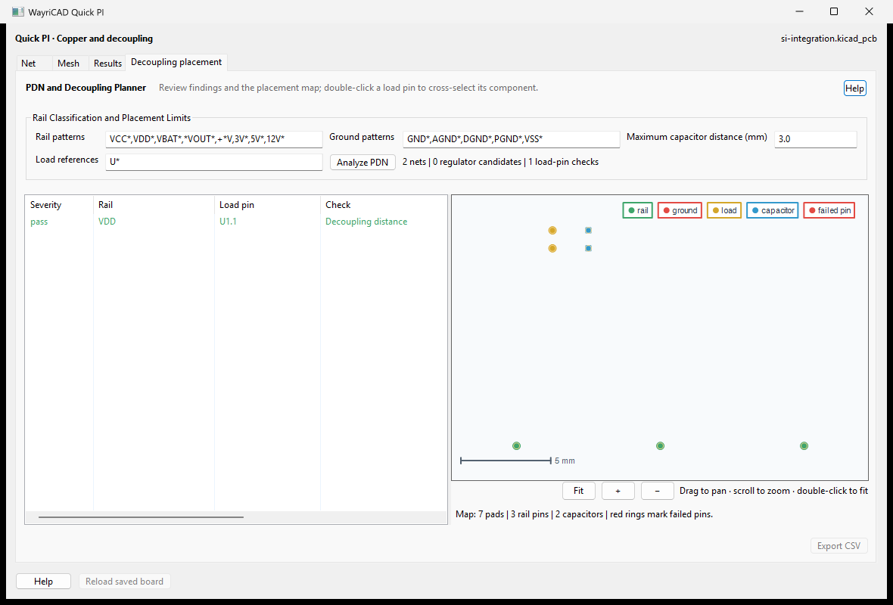

## Zoned power-rail example

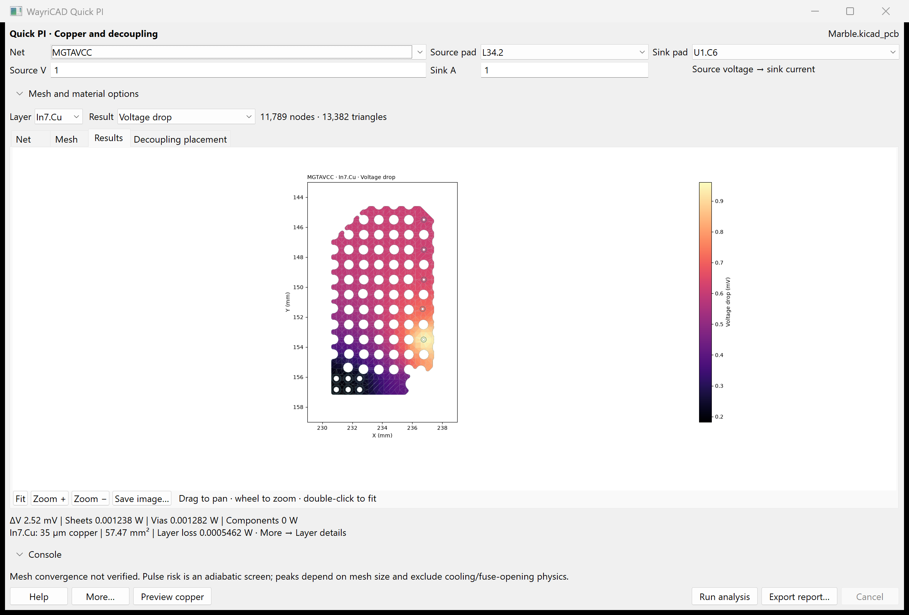

This is the actual MGTAVCC copper between L34.2 and U1.C6 with an explicit,
hypothetical 1 A load at one FPGA ball. The pictured coarse mesh gives 2.520 mV;
refinement to 0.0625 mm gives 2.657 mV. The two-step 1% stability criterion fails. Peak current density is
not converged. This does not model the FPGA's distributed load or regulator.
See the [validation record](../docs/audits/QUICK_PI_3.2_VALIDATION.md).


## Transient load steps and decoupling

Open **More → Transient load-step study**. The selected sink labels, final
demands and voltage bounds seed the setup. Enter the shared source resistance,
each load's local capacitance, optional source/path inductance and capacitor
ESR. Set before/after current and the step time for every load. The setup uses
explicit SI units (100 µF is `100e-6` F); it does not extract L or C from copper
or guess decoupling values. **Run transient** opens voltage/current time plots
and **Checks / limits**. Changing an input clears the previous result.

This is a separate lumped rail network: the shared source R/L feeds parallel
load paths, each with its own R/L and series-ESR capacitor to return. It starts
in the pre-step DC state. Backward Euler advances the state and reports a
half-step comparison, charge balance, energy accounting and voltage bounds.
Step timestamps include before/after samples for instantaneous ESR jumps.
Refine the integration step until the reported waveform differences are
acceptable; stable integration alone does not establish waveform accuracy.
Source current limits are **budget diagnostics**, not simulated regulator
CV/CC, foldback or control loops. The resulting time traces are not full-board
transient field maps or a distributed electromagnetic solve.

Export HTML/JSON from the study window for the explicit inputs, raw time samples
and checks. Saved-source changes block a new run or export. Standalone CLI:

```text
wayricad-pi --transient transient-load-step.json --html pi-transient.html --output pi-transient-data.json
```

Use the bundled [example input](studies/transient-load-step.json) as an
illustrative circuit, then replace its values with your actual source, paths
and capacitors. An optional positional PCB records and checks the saved-file
revision; it does not supply circuit parameters. Exit 4 indicates a limit
violation; exit 2 indicates invalid inputs or an execution failure.

## Electrothermal coupling

For explicit lead/solder/BGA paths, the separate
[package conduction guide](../docs/PACKAGE_CONDUCTION.md) describes fixed-point
Joule-heat transfer to QuickTherm, pad bindings, assumptions and verification.
Temperature feedback through those contacts remains unsupported.

**More → Electrothermal study** offers steady saved-copper/layer-temperature
feedback and explicit lumped rail/thermal-RC transients. The shared QuickTherm
kernel is independently bundled in Quick PI. Model settings and thermal paths
are explicit; losses, state updates and source/study identities retain checks.
See the [setup, CLI, examples and limitations](ELECTROTHERMAL.md).

## Numerical verification and mesh refinement

Run `wayricad-pi --verify --output pi-reference-results.json` to check eight production-mesher/solver cases against analytical references: strips, parallel current sharing, a plated via, the published Elmer beam/circuit operating point and three radial-annulus meshes. See [equations, tolerances and sources](../docs/PI_REFERENCE_BENCHMARKS.md).

For a board path, use **More → Check mesh convergence** (3–5 levels) or add `--converge-levels 4` to the CLI solve. The viewer plots drop and peak current separately and reports conservation plus total/sheet loss stability. Two final steps must meet the selected tolerance; incomplete or unstable studies return CLI exit 3. HTML/JSON exports retain this evidence. This does not certify physical accuracy or local peak current/fusing limits.

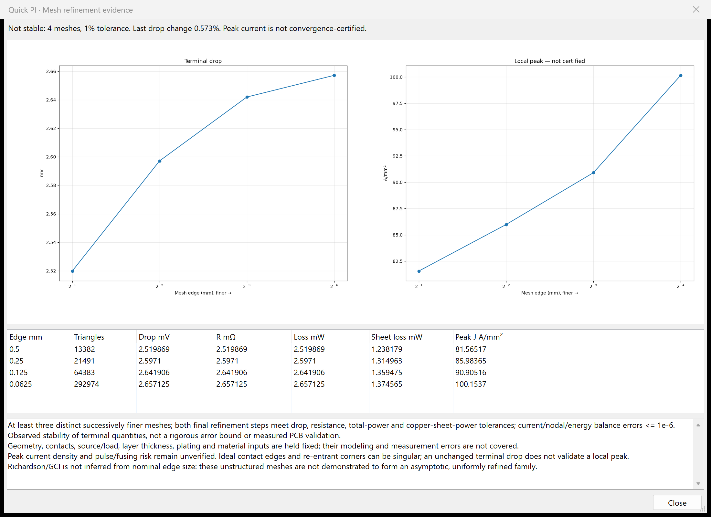


Report export starts in the originating board’s project folder and proposes `<board>-quick-pi.html`; its JSON companion preserves all layers and convergence evidence.


## Jobsets and automatic reports

Use this tool’s existing CLI in a shared WayriCAD report sequence. The runner adds ordered steps, failure propagation, per-run logs and an HTML/JSON report index, and can insert the sequence into a native KiCad jobset. See [setup, presets and examples](../wayricad_runtime/JOBSETS.md). The CLI keeps the same input requirements and engineering limitations as interactive use.

HTML reports put three primary Matplotlib plots first: voltage drop, current density and copper loss density for the selected layer. Additional maps remain available in an expandable section. All images are embedded for offline viewing.


## Solver methods

| Workflow | Method used | References and limits |
|---|---|---|
| Layered DC copper | Linear triangular finite-element method (FEM) for scalar conductivity, with copper thickness in each sheet and axial plated-barrel resistors between layers. The assembled sparse system uses SciPy's SuperLU factorization. | [Implementation](solver.py), [SciPy sparse LU](https://docs.scipy.org/doc/scipy/reference/generated/scipy.sparse.linalg.splu.html), [analytical conductor benchmarks](../docs/PI_REFERENCE_BENCHMARKS.md). This is 2.5D DC conduction; it does not solve AC return currents, skin effect or electromagnetic waves. |
| AC straight-section copper | Two-dimensional magnetoquasistatic cross-section model with prescribed conductor currents and explicit returns; harmonic RMS copper losses are added to mean-current DC loss. | [Inputs, equations and limits](AC_ANALYSIS.md). Skin/proximity redistribution is confined to the declared straight parallel conductors; no complete converter, arbitrary routed-board AC field or dielectric insulation model is inferred. |
| Volumetric DC copper | Linear tetrahedral conductivity FEM on supported Gmsh volumes. | [Implementation](full3d.py), [Gmsh paper](https://doi.org/10.1002/nme.2579). Gmsh generates the mesh; Quick PI solves the electrical system. Unsupported volume/contact geometry remains blocked. |
| Multi-pad sources and sinks | Ideal equipotential electrodes with a prescribed total current per unit; the conduction solution determines individual pad currents. | [Terminal model](terminals.py), [contact model and assumptions](../docs/PACKAGE_CONDUCTION.md). An electrode does not supply missing package-internal impedance or justify equal current per pad. |
| Shared return across rails | One linear DC solve on the common return conductor with all declared load currents; the resulting return potentials reduce the delivered supply voltages. Shared-return loss is counted once. | [Implementation](shared_return.py), [Marble study and limitations](../docs/audits/MARBLE_COUPLED_ANALYSIS.md). Fixed-temperature, prescribed-current model; shared electrothermal feedback and regulator dynamics are not solved. |
| Optional Joule-heating feedback | Steady fixed-point iteration between copper conduction, conservative I²R heat transfer and the board thermal model, updating copper resistivity with temperature. | [Implementation](electrothermal.py), [Joule-heating background](https://doc.comsol.com/6.3/doc/com.comsol.help.models.llac.busbar_llac/busbar_llac.html). COMSOL is a reference, not a backend. Supported independent studies require explicit thermal/material inputs and convergence checks. |
| Return-path review | Geometric sampling of saved reference copper and nearby return-via contacts. | [Return-path method](RETURN_PATH.md). This evidence review does not calculate an AC return-current field or loop inductance. |

Mesh refinement, current conservation and power balance check different aspects
of a result. None alone establishes physical accuracy; see the
[benchmark evidence](../docs/PI_REFERENCE_BENCHMARKS.md) and
[Marble coupled study](../docs/audits/MARBLE_COUPLED_ANALYSIS.md).

### Geometry, equations and supporting algorithms

These methods describe the v3.6.32 implementation. Coordinates enter in mm;
the electrical assembly uses SI units (m, A, V, Ω, W). Material values and
temperatures are explicit study inputs, not inferred properties of a board name.

| Stage | Implemented method and source | Assumptions and interpretation |
|---|---|---|
| Saved copper and contacts | [Board extraction](board_geometry.py), [package contacts](package_contacts.py), [mesh construction](mesh.py) build conducting regions from the saved board, filled copper, holes and declared terminals. Supported plated slots retain their geometry. | Refill and save before solving. An outline, pad or same-net label alone does not prove a continuous conducting path. Unsupported or disconnected contacts require review. |
| Planar mesh | Conforming first-order triangles, with the supported VTK/Gmsh paths and boundary/contact checks in [mesh.py](mesh.py). [Automatic sizing](mesh_sizing.py) uses geometry widths and contact sizes. | Geometry-based sizing is a resolution heuristic, not an error estimator. Arbitrary narrow zone necks and peak-current singularities need separate inspection. |
| Sheet assembly | [solver.py](solver.py) assembles `K_e = σ t A BᵀB` for each linear triangle, solves terminal constraints, then recovers `J = −σ∇V` and Joule loss `σ|∇V|² × volume`. Copper resistivity follows the supplied linear temperature coefficient. | Scalar, isotropic DC conductivity and constant gradient within each triangle. Via barrels contribute axial `R = ρℓ/A` through declared plating and length; no skin/proximity effect or spreading model is inferred from that resistor. |
| Declared series paths and operating point | [Series components](series_models.py) and [operating_point.py](operating_point.py) combine supported resistance and explicit forward-drop models; a positive resistive-load current is found by bounded bisection of source voltage minus path and load drops. | A DC inductor has zero resistive drop in its ideal model. Source-current and load-voltage limits assess feasibility; a failed prescribed-current case does not establish a regulator's current-limited operating point. |
| Explicit supply/return loop | [power_loop.py](power_loop.py) combines separately declared supply and return copper solves at the same prescribed current and checks their balances before reporting delivered voltage. | Supported linear 2.5D single-load scope differs from the multi-load shared-return mode. Neither calculation supplies switching-loop inductance. |
| Fast current adjustment | [live_current.py](live_current.py) applies exact linear scaling only after eligibility checks: for common positive factor `a`, `Vnew = Vs + a(Vold − Vs)`, `Jnew = a Jold`, `Pnew = a² Pold`. | Fixed geometry, temperature, conductivity and relative sink currents. Package/series/nonlinear, coupled and other unsupported studies are excluded; this is not a fresh factorization or a nonlinear extrapolation. |
| Decoupling review | [decoupling/analysis.py](decoupling/analysis.py) matches reviewed net/reference patterns, checks capacitor rail/ground pad membership and measures nearest rail-pad distance. Regulator value keywords provide candidates. | Distance thresholds and keyword matches are heuristics. They do not compute capacitor ESL, PDN impedance, resonances or effective high-frequency decoupling. |
| Pulse temperature-limit screen | [solver.py](solver.py) uses declared density, heat capacity, temperature limit and pulse duration for an adiabatic energy screen. | Neglects cooling and material phase changes; a temperature-limit warning is not a qualified fuse-opening current or safety rating. |

### Time-domain methods

[transient.py](transient.py) solves a **declared lumped circuit**, rather than
deriving a broadband model from the DC mesh. For branch currents `i`, capacitor
voltages `v` and prescribed load currents `d`, its equations are
`L di/dt + R i + v = Vs·1 + ESR·d` and `C dv/dt = i − d`.
Common source R/L contributes shared matrix terms. Backward Euler handles
finite-L states and zero-L algebraic limits; event handling preserves stored
energy while resolving algebraic/ESR voltage changes. Reports distinguish
resistor heat, reactive storage and numerical damping. Step refinement is an
accuracy check; damping is not additional physical heating.

[electrothermal_transient.py](electrothermal_transient.py) couples that circuit
to explicitly supplied lumped thermal R/C paths. Each exchange iterates a
midpoint temperature for `R(T) = Rref[1 + α(T − Tref)]`, integrates electrical
resistor energy over substeps, and advances the thermal RC analytically using
[thermal_rc.py](../wayricad_runtime/thermal_rc.py). Trial exchanges restart from
the accepted state; only converged trials are accepted. Thermal input excludes
reactive storage and numerical damping. This bounded model does not add spatial
temperature gradients, switching-device physics or missing package properties.

### Verification evidence and research scope

The following are existing regression/benchmark sources, not a claim that they
were rerun for this documentation edit or that a physical PCB was measured.

| Evidence | What it checks |
|---|---|
| [Solver](tests/test_solver.py), [multi-sink](tests/test_multisink_solver.py), [verification](tests/test_verification.py) | Analytical conductor behavior, terminal/current accounting and energy consistency. |
| [Mesh](tests/test_mesh.py), [contact partition](tests/test_contact_partition.py), [plated slots](tests/test_plated_slots.py), [volume](tests/test_full3d.py) | Supported geometry, topology and mesh/volume assembly contracts. |
| [Refinement](convergence.py), [refinement tests](tests/test_convergence.py) | Distinct refined meshes, terminal/result stability and conservation gates. Nominal edge size alone does not establish asymptotic Richardson convergence or GCI; local peak J can remain unresolved. |
| [Operating point](tests/test_operating_point.py), [live scaling](tests/test_live_current.py), [shared return](tests/test_shared_return.py), [explicit loop](tests/test_power_loop.py) | Supported circuit assumptions, scaling eligibility and return-current/loss accounting. |
| [Steady coupling](tests/test_electrothermal.py), [lumped transient](tests/test_transient.py), [transient coupling](tests/test_electrothermal_transient.py) | Declared model convergence, events, time refinement and separate energy ledgers. |

## References and research

| Source | How it relates to Quick PI |
|---|---|
| [MIT, *Electromagnetic Field Theory*, Chapter 3](https://ocw.mit.edu/courses/res-6-002-electromagnetic-field-theory-a-problem-solving-approach-spring-2008/2cccce322d387cccbc78c3ed65843f49_MITRES_6_002S08_chp03_text.pdf) | Conduction and cylindrical/annular resistor equations used for analytical known-answer checks. |
| [Elmer published conductor/circuit fixture, pinned revision](https://github.com/ElmerCSC/elmerfem/tree/b461e4be77d0ca13bada61f04819fccb20a524ab/fem/tests/ConstantUnknownPotStatCurrent) | Geometry and operating-point reference for the reproduced beam benchmark. Elmer itself was not executed for that comparison. |
| [NASA verification overview](https://www.grc.nasa.gov/www/wind/valid/tutorial/overview.html) and [grid convergence](https://www.grc.nasa.gov/www/wind/valid/tutorial/spatconv.html) | Verification/validation and refinement guidance. Arbitrary-board asymptotic convergence and GCI are not established. |
| [Geuzaine & Remacle, Gmsh paper, 2009](https://gmsh.info/doc/preprints/gmsh_paper_preprint.pdf) — DOI [10.1002/nme.2579](https://doi.org/10.1002/nme.2579) | Research behind the optional planar and volumetric meshing backend; it does not validate the PI solver. |
| [COMSOL busbar example](https://doc.comsol.com/6.3/doc/com.comsol.help.models.llac.busbar_llac/busbar_llac.html) | Background on Joule heating and conservation, already discussed in the contact-model notes. COMSOL is not the Quick PI backend. |

[Implemented benchmark equations and results](../docs/PI_REFERENCE_BENCHMARKS.md) ·
[Contact conduction model](../docs/PACKAGE_CONDUCTION.md).
These references explain methods or checks; they are not measured validation of a user's PCB.

## Explicit return-path evidence

Choose the signal and its actual return net(s); **Find…** searches the multi-select
return list without clearing hidden selections. Optional source/load return pads
record the declared terminals. No ground or return current is inferred from a net
name. Quick SI exposes these controls under **Explicit return-path review**;
Quick PI uses its **Return path** tab.

The result includes per-layer sampled reference coverage and each signal-via
transition's observed routing layers, local reference nets/layers and nearby
return-via candidates. Candidates show distance, layer span and sampled annulus
contact to filled copper on their own net. A nearby via that lacks contact evidence
stays unresolved. Changes between reference nets require separate engineering
review; geometric proximity cannot establish a transfer path between them.

The review covers the whole selected signal net, even in Quick SI's two-terminal
workflow. It does not solve return-current distribution, closed-loop continuity,
return resistance or loop inductance. Undeclared return terminals remain unresolved.
HTML reports retain the detailed evidence and warnings; Quick PI's paired JSON
also retains the filled polygon and terminal inventory. Refill zones and save
before reviewing a changed board.

Signal-via centers normally lie in reference antipad voids. Local reference
candidates are therefore sampled around a recorded radius equal to the saved
via diameter; the drill/antipad is never filled in by the review. A stitching
candidate must contact the same local filled polygon on its own net, not merely
a different island with the same net name. Both annular checks are sampled
geometric evidence; neither proves the closed return circuit.

## Selection and responsive results

Search accepts case-insensitive text, `*` and `?` wildcards, or `~text` for fuzzy
matching. Bus brackets remain literal (`DATA[*]` matches indexed bus members).
Typing filters the list without changing the chosen net or invalidating a solved
study. Choose a result explicitly. Multi-net cases retain their separate source,
load and return models; a search pattern never silently becomes a simulation.

**Only simulated nets** is enabled by default. Net, mesh, result maps and exported
reports show the selected copper domain with board outlines and component
context. Turn it off to review surrounding copper. **Select simulated nets in
PCB** replaces the editor selection with those exact net objects across layers;
it does not expand to every pad of a component or to similar net names.

Choose **All copper layers (projected)** to overlay the solved layers in one
view, including HTML maps. Layer fields overlap visually; they are not summed or
averaged. Click an overlapping solved point to choose its layer. Single-layer
maps remain the clearest way to inspect local values. Offline report probes
identify each cell's layer.

Board display extraction runs in the isolated worker. The Decoupling tab loads
its native board only when needed. Display paths and unchanged plot artists are
reused during navigation; numerical geometry is unchanged. See the
[performance measurements](../docs/audits/QUICK_TOOLS_PERFORMANCE.md) for measured
scope, cold/warm timing and limitations.


**Read PCB selection** expands selected component pads only on the selected or simulated nets. Unrelated pad nets are excluded. The numeric inspector still describes its primary item. Enable **Add to existing PCB selection** to extend the editor selection rather than replace it. Inputs changed during a job cancel that job and discard late results. Navigation uses the originating saved board and confirms selection; it does not edit copper or certify unsaved geometry.


## Resizing the workspace

Drag the divider beside Setup to widen input fields. Drag the divider beside Inspect to widen result details. Setup and Inspect can be hidden and reopened without losing the study. Expanded Mesh & material and Console sections scroll inside Setup.

## Copper melting and bottleneck screening

After a 2.5D solve, choose **Copper melting bottlenecks** in Inspect, or the
**Pulse / adiabatic melting action** result map. Selecting a row focuses its
actual solved sheet cell or barrel segment and highlights the matching saved
PCB object when an exact identity is available. **Select** navigates to that
object in the originating editor. Blue B1–B6 markers on density/melting maps
locate the first six ranked regions; these markers and the complete bottleneck
table are included in HTML reports. Small-board reports include the melting
map; large-board reports retain three primary maps and provide the melting
map with `report_options.extended_snapshots=true`. Numerical JSON and the CLI
summary retain `result.fusing` regardless of rendering mode.

**Mesh & material** contains **Copper melt · °C** (1084.62 default),
**Latent heat · J/kg** (206750 default) and **Pulse · s**. Initial copper
temperature uses **Initial / ambient · °C**, independently of the fixed
temperature used for the DC conductivity solve. The existing **Limit · °C**
temperature-limit energy screen remains a separate quantity. CLI equivalents:

```text
wayricad-pi C:/Projects/Example/board.kicad_pcb --net +3V3 --source J1.1 --sink U1.1 --current 2 --pulse 0.01 --ambient 25 --melting-temperature 1084.62 --latent-heat 206750 --output melt.json --html melt.html
```

The model integrates `J²t = density × ∫[Cp(T)/rho(T)] dT`, with `J` in A/mm²
and the SI integral multiplied by `1e-12`. Resistivity is the declared
`rho20 × [1 + alpha × (T − 20 °C)]`; this is an explicit high-temperature
approximation. Heat capacity is piecewise-linear interpolation of
[NIST-JANAF Cu(cr), 250–1358 K](https://janaf.nist.gov/tables/Cu-002.html),
converted using 0.063546 kg/mol. Eight-point Gaussian integration is applied
separately within each Cp interval; an interval resistivity ratio above four
is unsupported rather than silently under-integrated. Initial or melting
temperatures outside the Cp table leave the screen unknown while retaining
the DC solution. Density is constant. Full melting additionally requires
`density × latent_heat / rho(Tm)`. The nominal latent input rounds the
[JANAF solid/liquid enthalpy difference at 1358 K](https://janaf.nist.gov/tables/Cu-004.html),
`(42.798 − 29.660) kJ/mol / 0.063546 kg/mol = 206748 J/kg`.
The temperature-dependent adiabatic energy balance is consistent with the
method described by [Guillet and Delamarre](https://arxiv.org/abs/1503.01279);
the implemented interpolation and linear resistivity approximation are stated
here, rather than claiming their complete material model.

For constant local J, onset/full-melting time is its respective action divided
by J². The pulse map is `J² × pulse_duration / full_melting_action`; it is not a
fraction of physical damage. Barrel I²t is action times the **actual solved axial
metal area squared**, including obround barrels. An unambiguous straight-track
match uses native width times local solved thickness for a **nominal** section
and I²t; the local field is not an integrated track current, and adjacent zone
copper can provide another path. Arc-only, plane-only and ambiguous cells keep
track cross-section/I²t unknown.

Ranking selects up to twelve spatially separated sheet regions and twelve
barrels by local J and predicted time. Spatial suppression (twice the larger
of 0.05 mm and board XY extent / 64, per layer) prevents adjacent triangles from
crowding the list. This is **local current-density bottleneck screening**, not
geometric minimum-cut or guaranteed neck detection. Contact/corner singularities,
nearby regions merged by suppression, mesh resolution and parallel paths require
review. A remote second neck remains a separate candidate when sufficiently
separated. Live proportional-current updates rescale times by `1/I²` and
pulse/action by `I²`, preserving material and I²t budgets.

The DC current distribution is frozen throughout this screening calculation.
There is no cooling, laminate heat transfer, thermal expansion, changing
current sharing, liquid-metal geometry, arcing or circuit interruption model.
Long predicted times are especially sensitive to omitted cooling. **Melting is
not fuse opening, clearing I²t, safe ampacity or protection coordination.**
Infeasible imposed loads remain diagnostic. Full 3D explicitly reports this
screen unavailable; transient/electrothermal studies do not turn it into a
coupled fault-clearing prediction. No board geometry is modified.

## Individual sink current wheel control

In the solved 2.5D viewer, ordinary scroll zooms. Hold Ctrl and scroll over a
sink pad to change only that sink's specified current. Every pad in an explicitly
grouped sink controls the same load. An orange ring identifies the selected sink.
Slow scrolling makes fine adjustments; faster scrolling uses larger steps.

Ctrl+scroll elsewhere on solved copper and the Total current control scale all
loads proportionally. After an individual change, total tuning retains the new
load proportions. Independent changes reuse the mesh and re-solve shared copper
currents, voltage drops, I²R losses and melting screens in a background thread.
Rapid inputs are coalesced; superseded results are discarded. Probes and view
limits are retained. Fixed-temperature prescribed-current 2.5D cases are
supported; electrothermal, package, series, resistive-load and 3D cases retain
their separate solve workflows. The first independent update can take longer
than a proportional update; it performs a new electrical solve, without meshing.

Enable **Cursor preview** beside the current controls to see the old current,
new current and signed parameter change next to the pointer. Choose **Selected
metric** for a compact readout, or **All metrics** for local fields plus total
model loss. Orange/blue values distinguish increases/decreases; these colours
are change indicators, not pass/fail. Pending fields show a computing marker.
Projected all-layer views retain known sink voltages but leave ambiguous local
field samples unknown; select a layer for those values.

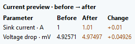

Actual native readout from the synthetic two-sink regression: changing one sink
from 1 A to 1.01 A leaves the other demand unchanged. Fields are computed by the
real fixed-mesh solver; no numerical values or pixels were altered.

### Losses and Probe tables

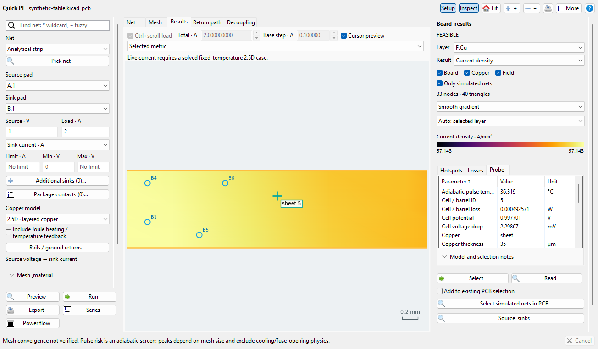

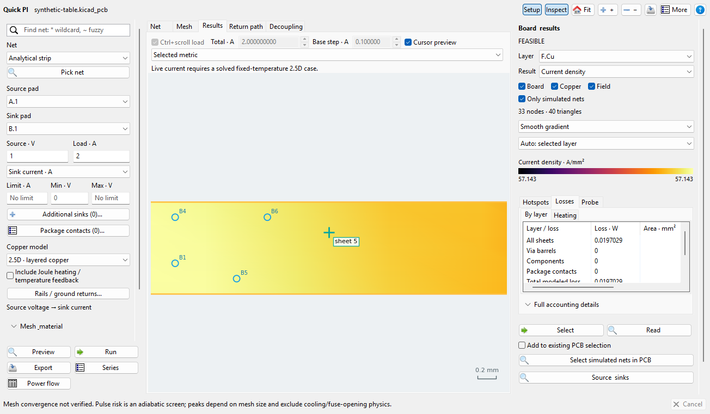

Actual synthetic native regression windows. Select a table row to focus the
corresponding layer peak, copper cell or barrel; Probe metric rows also switch
the map quantity. Column headers sort numerically, unknowns stay last, and
column widths can be dragged. Narrow panes scroll horizontally to retain readable
numbers and units. Full values are also available in row tooltips. These captures
use computed synthetic data and contain no private board or local folder paths.

## HTML and PDF reports

Use [the common report workflow](../wayricad_runtime/REPORTS.md) to save HTML as PDF, or render this tool's saved JSON as readable HTML/PDF tables. The direct PDF exporter retains text, tables and embedded PNG/JPEG figures; interactive-only views are listed explicitly and remain available in HTML. Install the optional `reports` extra only in the interpreter performing PDF export.

## Differential voltage probes

In **Inspect → Probe**, choose **Set probe A**, then click solved sheet copper.
The next click sets B; A is orange and B is blue. The readout is signed
**V(A) - V(B)** in volts and millivolts. **Clear A/B** returns to single-point
inspection. In an all-layer projection, choose each point's physical layer.

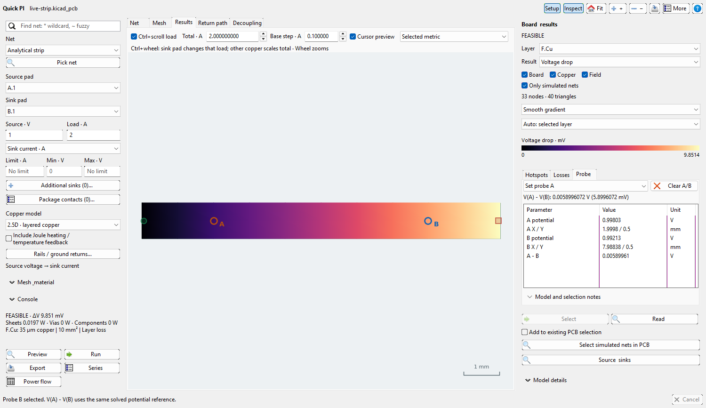

This native capture uses the analytical 10 × 1 mm, 35 µm copper strip at 1 V / 2 A.
It demonstrates the interface, not a measured PCB. The two screen-click locations
are sampled in the solved strip; small coordinate rounding follows native pixels.

Probes evaluate the P1 finite-element nodal potential with barycentric weights
inside the containing triangle. They do not use the smoothed display or a nearest
cell average. Empty space, drill holes, unknown nodes and unsupported full-volume
or barrel-interior points stay unknown. A and B must belong to one solved case's
common potential reference; independent net/case gauges cannot be subtracted.
Locations are cached for fast current updates; their voltages are re-evaluated.

The HTML report includes the saved A/B coordinates, potentials and signed difference.
Up to 20,000 triangles it also has a click-to-pick A/B map with layer selection.
Larger reports keep the native and CLI probes, saved numerical table and existing
field maps without duplicating another large interactive mesh payload.

```text
python -m quick_pi_plugin.cli --probe-result result.json --probe-a 0 2 0.5 --probe-b 0 8 0.5 --output differential.json
```

Layer identifiers are the saved mesh layer IDs, not layer positions. The CLI checks
saved source fingerprints and the result-file hash; no new simulation or board write
occurs. An unresolved probe returns status UNKNOWN and exit code 3. This is a DC
potential difference, not a transient/AC differential waveform.

## Readable copper identifiers

Probe markers, inspector tables and reports use **V1, V2, …** for physical vias, ordered from top to bottom and then left to right in board coordinates. Axial segments of the same extracted via share its V number; the layer span distinguishes their results. Coincident but distinct saved vias remain distinct. **C1, C2, …** identify mesh cells (one-based), not PCB vias or component references. Cell numbers may change when remeshing; V numbers are scoped to the extracted model and may change when the via inventory changes. Full original solver and saved-object identities remain in JSON, with a `display_identifiers` mapping for the short via labels. Selection and cross-probing continue to use the originals.
