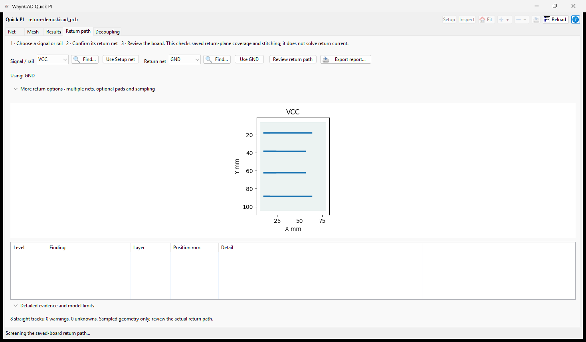

# Return-path screen for Quick PI

## In the window

1. Open **Return path**. It starts with the net selected in PI Setup; use
   **Use Setup net** to restore that choice after selecting a different signal.
2. Choose its actual **Return net**, or explicitly confirm **Use GND** when the
   suggested domain is correct. **Find…** searches full net names. Suggestions
   use names only and are not selected automatically.
3. Click **Review return path**. Review the map, findings and report.

**More return options** contains multiple return nets, optional source/load
return pads, sampling pitch and via-search radius. The usual geometric review
does not require pad assignments. Duplicate pad labels retain distinct IDs;
changing the signal clears old optional endpoint assignments and results.
**Detailed evidence and model limits** expands the textual findings.



This is a computed review of a synthetic saved PCB with eight straight tracks
and a filled opposite-side return zone. It is a sampled geometry check, not a
solved return-current loop or measured board validation.

For **DC ground voltage drop**, use **Rails / ground returns… → Set up ground / return…**
instead. Its single form shows the return net, supply-ground pad unit and each
load-ground mapping. Multiple pads remain one explicit equipotential unit.
See the [multi-net guide](README.md#multi-net-cases-return-copper-and-joule-feedback).

## Geometry model and scripting

Quick PI can screen the **saved board's** signal routing against a return net that
the user names explicitly. The screen reads native filled copper-zone polygons,
the selected signal tracks, and signal/return vias. It reports locations where
sampled trace points have no filled return copper on an adjacent layer. At an
evidenced signal layer transition, it also reports when no via on the selected
return net spans the local reference layers within the chosen radius.

For a native `pcbnew.BOARD`:

```python
from quick_pi_plugin.return_path import collect_board_evidence, audit_return_path

evidence = collect_board_evidence(board, "VCC", ["GND"])
result = audit_return_path(evidence, sample_pitch_mm=0.25,
                           return_via_radius_mm=2.0,
                           return_terminal_ids=["J1.2", "U1.2"])
for finding in result["findings"]:
    print(finding["level"], finding["code"], finding["position_mm"])
```

`collect_board_evidence` and `audit_return_path` are separate entry points for
UI preview and repeatable tests. The evidence and result are JSON-compatible.
The caller should load a saved board if the report must correspond to a saved
revision; reading a live board does not prove that its state has been saved.
The screen never writes to the PCB.

An unfilled reference zone, unsupported arc, or via without routing evidence on
two layers produces an **unknown** finding. A zero-warning result is only a
screening result: point sampling can miss narrower splits, and this check does
not solve return current density, via inductance, plane transfer impedance,
parallel-plane coupling, reference trace continuity, or full-wave behavior.
Inspect the layout and use a qualified field or circuit model where those
effects matter. The selected return net is a design input, not inferred from a
name such as `GND`.

Return-terminal identifiers are optional exact pad labels or UUIDs on the selected
return nets; labels that match several pads are rejected as ambiguous. Leave them
unset when the source/load return pads are unknown. The result retains their
inventory and declaration separately from the geometric findings.

`coverage` lists each straight segment's length, covered/sample counts and
reference net/layer pairs. `transitions` lists observed signal routing layers,
local references and nearby stitching candidates with distance, span and sampled
annulus contact. Missing contact or changes between reference nets remain unknown.
A candidate does not prove connectivity through a reference plane or return loop.
The native UI and HTML exports show these details. The implementation is shared
with Quick SI through the runtime included in each independent PCM package.

Signal-via centers normally lie in reference antipad voids. Local reference
candidates are therefore sampled around a recorded radius equal to the saved
via diameter; the drill/antipad is never filled in by the review. A stitching
candidate must contact the same local filled polygon on its own net, not merely
a different island with the same net name. Both annular checks are sampled
geometric evidence; neither proves the closed return circuit.
