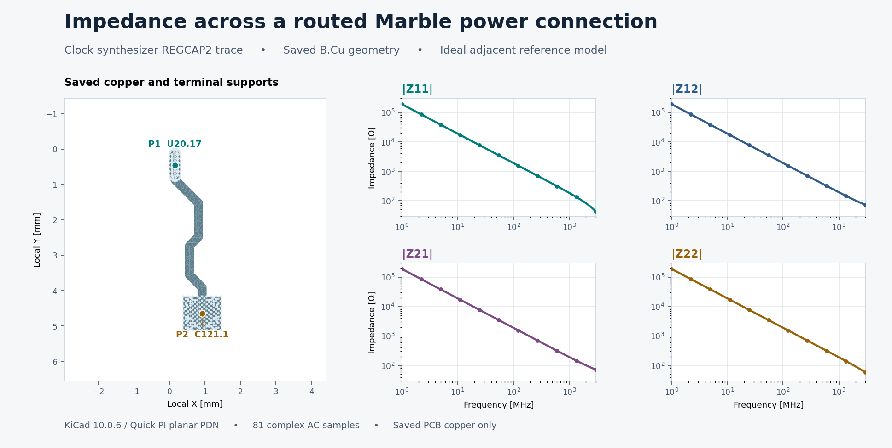

# Z11, Z12, Z21 and Z22 on Berkeley Lab Marble

Quick PI extracted the saved **B.Cu** route `Net-(C121-Pad1)` between the
clock synthesizer’s `U20.17` (`REGCAP2`) and the capacitor footprint pad
`C121.1`. The two positive terminals are pad-supported ports on the same
connected copper trace. Both use a common, ideal reference plane assigned
to the adjacent `In10.Cu` (`GND10.Cu`) layer.



## Setup

| Input | Value |
|---|---|
| Copper | Saved trace and pad geometry, 35 µm nominal thickness |
| Mesh | 463 vertices, 787 triangles, 0.14 mm VTK edge target |
| Dielectric | Saved stackup separation 0.105454 mm, relative permittivity 4.5, loss tangent 0.02 |
| Reference model | Full ideal adjacent plane with magnetic edge walls |
| Frequency | 81 log-spaced samples from 1 MHz to 3 GHz |

The board contributes the copper shape, pad locations and stackup dimensions.
The model uses an unbroken reference and omits reference voids, surrounding
copper, package parasitics and installed component models. In particular it
uses the `C121.1` copper pad as a port, so the nominal 22 µF component does not
load the result. The modeled path has 0.836 pF of ideal-plane capacitance.
This small capacitance drives the large common-reference impedances at low
frequency. Use these curves to inspect the modeled copper path and port
coupling. They do not characterize the assembled clock synthesizer rail.

## Results

| Frequency | \|Z11\| | \|Z12\| | \|Z21\| | \|Z22\| |
|---|---:|---:|---:|---:|
| 1 MHz | 190.285 kΩ | 190.285 kΩ | 190.285 kΩ | 190.285 kΩ |
| 54.77 MHz | 3.4738 kΩ | 3.4743 kΩ | 3.4743 kΩ | 3.4740 kΩ |
| 3 GHz | 42.93 Ω | 72.29 Ω | 72.29 Ω | 57.97 Ω |

The solver returned **MODELLED**. The worst relative matrix residual was
`8.30e-10`, reciprocity error `4.13e-16`, and power balance error `1.79e-12`.
The minimum passivity eigenvalue was positive at every sample. These are
numerical consistency checks for this mesh. Mesh refinement and independent
physical correlation remain separate.

## Reproduce

1. Open a copy of the pinned Marble design in KiCad. In Quick PI choose
   **2.5D**, net `Net-(C121-Pad1)`, source `U20.17` and sink `C121.1`.
   In **Mesh & material**, clear **Automatic mesh** and use a 0.14 mm edge.
2. Choose **More → Planar PDN impedance from selected pad ports**. Set the
   plane name and values above and confirm the ideal reference. Choose
   1 MHz, 3000 MHz and 81 frequency samples.
3. For an exact replay on the retained mesh, use the included [study](study.json).

   ```text
   wayricad-pi --plane-ports quick_pi_plugin/examples/marble_zxx/study.json --output marble-zxx-replay.json
   ```

   Exit code **3** reports `MODELLED`. The [numerical results](result.json)
   include the real and imaginary parts of all four impedance terms and
   the checks at every original frequency.

Quick PI ran on a disposable copy with KiCad 10.0.6 on Windows. The original
and the copy retained SHA-256
`3304ba37c2bd891849fc36b500cd940934aaf1f2013a95639c03564fb925c512`.
The [provenance](provenance.json) records the source revision and file hashes.
[Public Marble PCB](https://github.com/BerkeleyLab/Marble/blob/a426777d92c0f22a546d4740b419a3937e0c1f90/design/Marble.kicad_pcb) · [Quick PI planar solver guide](../../PLANE_PORTS.md)

The extracted copper geometry derives from Marble, copyright 2019–2023,
The Regents of the University of California, through Lawrence Berkeley
National Laboratory. The Marble design is licensed under CERN OHL v1.2.
[Upstream copyright and license notice](https://github.com/BerkeleyLab/Marble/blob/a426777d92c0f22a546d4740b419a3937e0c1f90/README.md#copyright).
