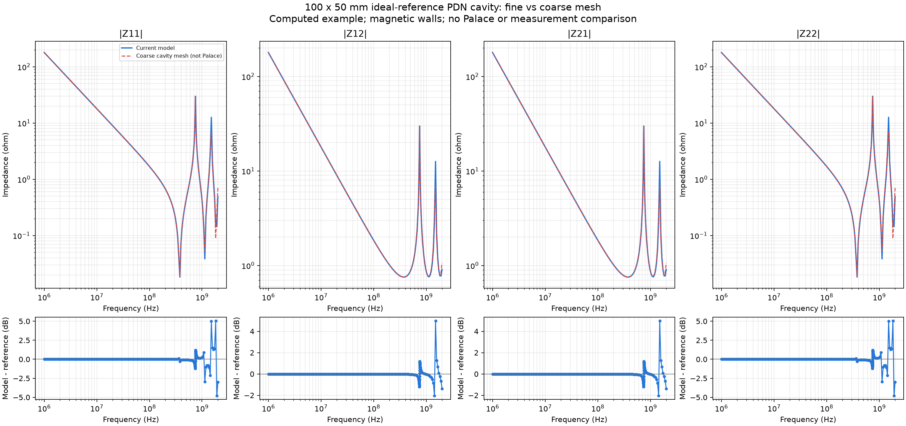

# Planar PDN Magnitude And Mesh Comparison



This is an actual computed **100 x 50 mm homogeneous parallel-plate cavity**,
not a PCB measurement, Palace comparison or native-window screenshot. Both
curves use this implementation; the reference uses a coarser mesh. Differences
near narrow resonances are deliberately retained, not smoothed or hidden.
The example does not establish mesh convergence or arbitrary-board accuracy.

## Reproduce

1. Use an existing Quick PI scientific runtime with NumPy, SciPy and matplotlib.
   No Palace executable is needed. The [model guide](../../PLANE_PORTS.md) lists
   equations, assumptions, limits and references.
2. Run the saved fine mesh from the repository root:

   ```text
   python -m quick_pi_plugin.cli --plane-ports quick_pi_plugin/examples/planar_pdn/study-24x12.json --output new-fine-result.json
   ```

   Exit code **3** is expected: the result is `MODELLED`, not automatically
   mesh-converged. Use a new output filename. The input study is unchanged.
3. Repeat using `study-12x6.json` and a separate output to compare the coarse
   discretization. Each saved input includes physical port weights, material
   assumptions and all 282 sampled frequencies. Frequency sampling is denser
   near the first analytical cavity mode, not uniformly dense at every mode.
4. Inspect the saved result in the native result viewer:

   ```python
   import json
   import wx
   from pathlib import Path
   from quick_pi_plugin.ac_ports_ui import create_frame

   app = wx.App(False)
   result = json.loads(Path("new-fine-result.json").read_text(encoding="utf-8"))
   frame = create_frame(result_only=result)
   frame.Show()
   app.MainLoop()
   ```

5. Select **Reference...** and load `coarse-reference.json` from this folder.
   The lower plots show signed `20 log10(|Zfine|/|Zcoarse|)` at common samples.
   Hover the original samples for complex values, phase and frequency. Use the
   plot toolbar to pan/zoom/save the image; Save Result retains complete data.

## Expected Interpretation

The low-frequency response is capacitive. The first longitudinal ideal cavity
mode is approximately `c / (2 L sqrt(epsr))`, about 749.5 MHz for L = 100 mm and
epsr = 4. Sharp dips and peaks make small spatial/frequency errors conspicuous.
The same-method coarse/fine curves are not independent validation. Compare with
an independently qualified solver only after matching geometry, port area,
reference-plane behaviour and magnetic-wall boundaries.

`result-12x6.json` and `result-24x12.json` retain complete numerical checks and
model limits. `provenance.json` records the plot hash and creation time.
