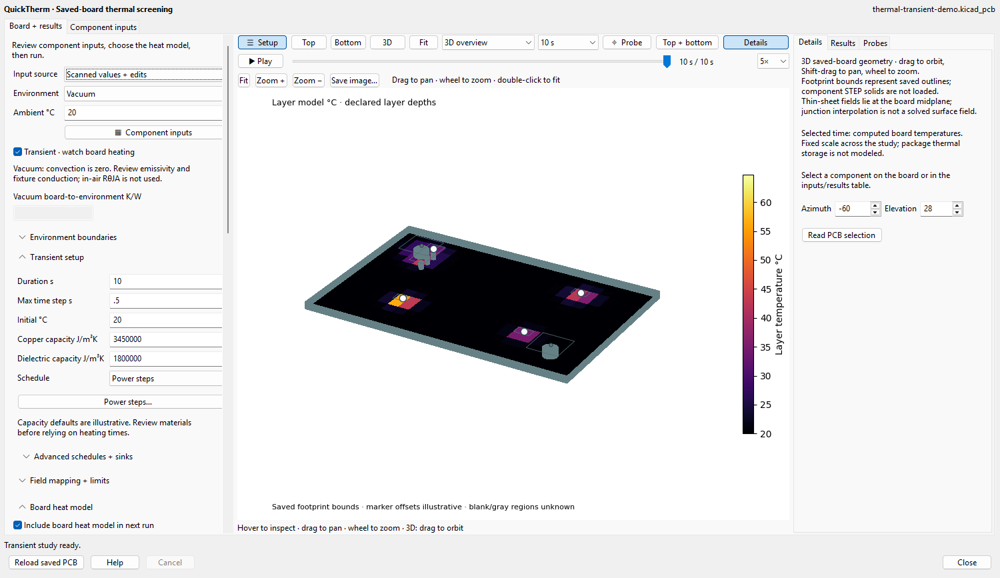

# QuickTherm user guide

QuickTherm reads a saved KiCad PCB and performs component, board and scheduled
transient thermal screening. It is independently installable and does not require
Quick PI. Thermal inputs entered in its workspace do not change the PCB.
This guide describes the current 3.6.40 workflow. Screenshots retain their capture
versions and stated assumptions; older images are not new validation runs.

## Contents

| Start or operate | Model or review |
|---|---|
| [First study](#first-study) | [Choose a thermal model](#choose-a-thermal-model) |
| [Component inputs and limits](#component-inputs-and-limits) | [Environment and cooling](#environment-and-cooling) |
| [Board workspace and probes](#board-workspace-and-probes) | [Mesh and convergence](#mesh-and-convergence) |
| [Transient heating and playback](#transient-heating-and-playback) | [Contacts, component storage and heatsinks](#contacts-component-storage-and-heatsinks) |
| [Reports and dissipation Sankey](#reports-and-dissipation-sankey) | [Import Quick PI copper heat](#import-quick-pi-copper-heat) |
| [CLI and jobsets](#cli-and-jobsets) | [CalculiX and Gmsh](#calculix-and-gmsh) |
| [Public examples](#public-examples) | [Troubleshooting](#troubleshooting) |

## First study

1. Save the intended board in PCB Editor, including its current zone fills. Open
   **WayriCAD QuickTherm**. Unsaved editor changes are not included.
2. Start on **Component inputs**. Check only the parts whose heat you intend to
   include. Enter actual dissipated watts; a part's rated maximum power is not
   its operating dissipation.
3. For a first independent air screen, enter each part's reviewed RθJA in K/W.
   Enter junction limits if you want conditional PASS/FAIL decisions. Missing
   thermal paths remain unknown.
4. Open **Board + results**. Choose **Air** and the actual ambient temperature.
   Keep the optional board model disabled for this simple screen.
5. Click **Run thermal**. Review solved/selected counts and unknown or excluded
   sources before reading the largest temperature as a board-wide result.
6. Select parts in the table and board. Use **Export…** to retain HTML and JSON.
   For a physical board field, continue with the model and boundary sections below.

The simple air equation is `Tj = Tamb + P × RθJA`. For example, 0.5 W with
40 K/W at 25 °C gives 45 °C. This is an equation example, not a hardware result.


This native public-demo capture shows four included hypothetical heat sources.
The two mounting footprints are excluded. It precedes the solve; no measured
hardware temperatures are shown. [Capture inputs](../docs/audits/QUICK_TOOL_VISUALS_3.6.38.md).

## Component inputs and limits

| Input | Meaning and units | How to enter it |
|---|---|---|
| Power | Actual heat generation, W | Bare `0.5`, `500mW`, or `1 W`; explicit zero is permitted |
| RθJA | Junction-to-ambient resistance for the characterized assembly, K/W | Air component screen; do not reuse an air rating in vacuum |
| RθJB | Junction-to-board equivalent path, K/W | Board-site-to-junction estimate; not a general package-solid model |
| RθJC | Junction-to-case resistance, K/W | Virtual heatsink path with separate contact and sink resistances |
| Tmin / Tmax | Allowed junction temperature, °C | Map the selected saved property names or enter detached overrides |
| Included | Study scope | Hidden checked rows still participate after filtering |

Use **Field mapping…** for nonstandard or ambiguous saved footprint property
names. Unique recognized aliases may be suggested automatically; review them.
Property-name mappings refer to saved footprint fields, not schematic fields
that have not been transferred and saved to the PCB.

1. Review each row's scanned value, status and input source.
2. Edit numeric cells for temporary overrides. Blank means unknown; thermal
   resistance must be positive and power cannot be negative.
3. Use **Select all**, **Select none**, or **Include visible** carefully: search
   changes visibility, while checked scope can extend beyond visible rows.
4. **Restore saved row** removes selected-row overrides. **Scanned values + edits**
   uses overrides; **Saved fields only** ignores them and reads mapped fields.
5. Save PCB changes, then use **Reload saved PCB** before another analysis.
   Same-board reload retains valid explicit mappings and checked references,
   but clears old results. Changing inputs invalidates exports.

A computed board-site temperature is not automatically a junction temperature.
Without a valid package path, Tj and its limits stay UNKNOWN. A body RC node
also does not qualify a junction limit. Read per-part decisions and coverage;
missing limits never silently pass. The CLI can require every scoped limit to pass.

## Choose a thermal model

| Model | Choose it when | Required evidence and important limits |
|---|---|---|
| Component-only air | You have RθJA at relevant conditions | Independent `Tamb + P RθJA`; no board spreading or coupling |
| Component-only vacuum | You have a reviewed board-to-environment path | Shared isothermal board node plus each RθJB; no spatial board field |
| Virtual heatsink | A specific part has a characterized sink path | RθJC + contact + environment-specific RθSA; no automatic parallel PCB path |
| Thin sheet | You need an approximate whole-board spreading map | Effective in-plane conductivity, saved thickness and cooling; one midplane field |
| Copper layers + vertical paths | Layer copper and supported pad/via/mount paths matter | Saved stackup, filled copper, conductivities, plating, mesh and boundaries |
| CalculiX 3D · fixed lower face | A supported fixed-temperature lower-face conduction study | Gmsh/ccx, explicit mesh/materials; strong geometry and boundary restrictions |
| Component heating · R / C | Finite equivalent package/body storage is needed | Reviewed meaning, resistance, capacity and optional physical paths |

Use **Board model…** or expand **Board heat model**, enable **Include board heat
model in next run**, and choose the model before running. Existing mapped fields
and entered powers remain yours to review. Unknown inputs are not inferred from
colors, STEP geometry, package name or electrical dielectric constant.

For a thin sheet, enter effective conductivity in W/(m·K), board emissivity,
airflow assumptions and mesh size. Top and bottom show the same midplane field;
they are not two independent surface solutions. The saved board supplies thickness.

For **Copper layers + vertical paths**:

1. Save a complete physical stackup, closed Edge.Cuts and filled zones.
2. Enter dielectric and copper thermal conductivities and fabricated via plating
   thickness in mm. Electrical εr does not determine thermal conductivity.
3. Review source contact geometry. A footprint bounding-box injection is a
   proxy; a configured contact pad uses its saved copper polygon.
4. Select fixed-temperature contact pads only when a real fixture path exists.
   Enter fixture temperature and positive contact resistance. An NPTH needs
   **Include NPTH fixture contacts** and physical mechanical-contact evidence.
   A GND net name alone creates no cooling path.
5. Run and inspect each physical layer field, source coverage, signed fixture
   heat flow and energy residual. Positive fixture heat leaves the board;
   negative heat enters it.

Circular and rotated obround plated slots have supported reduced contact/barrel
representations in the internal multilayer model. A diagnostic coarse contact
proxy is not resolved geometry: review its warning and mesh acceptance. Models
omit airflow fields, detailed package gradients and radiation view factors.

## Environment and cooling

Choose the environment, then expand **Environment boundaries**. Expanded modes
use the layer-resolved model and explicit boundary parameters; the simple RθJA
air calculation is not a sealed-enclosure or potting calculation.

| Environment | Review these inputs | What is not calculated |
|---|---|---|
| Air | Ambient, airflow and emissivity | Airflow is not solved; the simple board approximation uses `h = 5 + 4v` W/(m²·K) |
| Vacuum | Zero convection, emissivity and/or fixture conduction | Residual gas, chamber view factors and installed contact quality |
| Forced air | Explicit effective convection h in W/(m²·K), ambient and radiation | Fan operating point and CFD velocity field |
| Potting | Conductivity W/(m·K), thickness mm and outer h | Full encapsulant geometry or local voids; the boundary is an equivalent series path |
| Sealed enclosure | Explicit h and prescribed enclosure temperature | Enclosure wall warmup, recirculation and external cooling are not solved |

Vacuum disables airflow/convection. The board workflow requires a solvable steady
heat rejection path even for a transient run: nonzero radiation or a real fixture
path. Do not substitute an air heatsink rating for vacuum performance. A fixed
enclosure temperature assumes something outside the model maintains it.

For CLI board configurations, these settings belong inside
`thermal_network_settings`: `board_h_w_m2k` for forced air; that coefficient
plus `enclosure_temperature_c` for sealed; `potting_k_w_mk`,
`potting_thickness_mm` and `potting_outer_h_w_m2k` for potting. Set top-level
`environment` to `forced_air`, `sealed` or `potting` and
`thermal_model_kind` to `multilayer`. Review the effective boundary recorded
in the result rather than assuming these modes load a material database.

## Contacts, component storage and heatsinks

### Virtual heatsinks

Open **Heatsinks…**, choose a component, select straight fins, pin fins, radial
fins, flat plate or resistance-only, and enter positive contact resistance plus
air and/or vacuum sink-to-environment resistance. Assign/update, then confirm.
Remove the assignment to return to its ordinary component path.

Shape dimensions in mm describe the visual envelope, not a rated product. They
do not determine thermal resistance. Board-model sinks also need explicitly
entered exposed area; a fin envelope is not fin area. Airflow and thermal data
must match the actual environment. The lumped relation is
`Tj = Tamb + P × (RθJC + Rcontact + RθSA)`.

For CLI use, an illustrative `sinks.json` mapping is:

```json
{
  "U1": {
    "shape": "straight_fin",
    "width_mm": 40,
    "depth_mm": 40,
    "height_mm": 15,
    "contact_k_per_w": 0.2,
    "theta_sa_air_k_per_w": 8,
    "theta_sa_vacuum_k_per_w": 20
  }
}
```

Pass `--heatsinks sinks.json --theta-jc-field RthetaJC --thermal-refs U1`
with the ordinary board/power/environment arguments. Replace these hypothetical
values with characterized data. Components without assigned sinks still need
the normal RθJA/RθJB mapping for their selected environment.

### Equivalent component heating

Open **Component heating · R / C…** and enable the desired parts. Declare body
or junction meaning, resistance K/W, capacity J/K and optional initial temperature.
Steady studies may use zero capacity; transient studies require positive reviewed
capacity. Power enters each storage node once. An optional contact pad uses its
saved copper face; blank uses the footprint proxy. Direct package cooling needs
exposed area, convection h and emissivity together. Vacuum requires h=0.

### Lead and solder paths

Use **Lead / solder contacts…** to enter saved pad number, copper layer, path ID,
axial dimensions and material conductivity. Supported segments include cylindrical
pins, rectangular leads and symmetric truncated spherical BGA balls. Repeated path
IDs are series segments; different IDs are parallel paths.

For those parts, enable component storage, set aggregate R to zero and clear
an overlapping RθJB. Reviewed internal/interface resistance belongs in the
explicit path; do not add the complete datasheet RθJB again. Missing/ambiguous
pads, duplicate ownership and unresolved annuli reject the study. See
[package conduction](../docs/PACKAGE_CONDUCTION.md) for geometry, equations and examples.


Native public-demo capture with assumed RC values and stackup, validation STEP
boxes and library models. Gray parts lack declared temperatures. It demonstrates
computed equivalent-node heating, not solved internal solid gradients.
[Inputs and validation](../docs/audits/QUICKTHERM_COMPONENT_HEATING.md).

## Import Quick PI copper heat

1. Solve Quick PI at the operating point on the same saved board and export JSON.
2. In QuickTherm, choose the multilayer model and **Import PI copper losses…**.
3. Review the imported source count/watts and source identity. The importer checks
   board hash, feasible operation, stackup and planar/via loss evidence.
4. Enter actual component dissipation separately. Delivered load power is not
   necessarily dissipated in that package; do not enter copper watts twice.
5. Run, then inspect loss coverage and energy balance. Use **Clear imported losses**
   before changing operating point or replacing the electrical result.

Copper heat deposits conservatively into supported physical cells. Via segments
use their retained resolved contact stencils. Unsupported cutouts, missing lands
or unresolved coarse contacts can reject transfer; refine instead of discarding
heat. Copper-only runs need no selected component sources.

Contact I²R losses need matching explicit thermal paths, identities, faces and
segment geometry. Material segments allocate joint heat by thermal resistance;
extra unspecified lumped resistance leaves heat location unknown and rejects
that transfer. Imported watts stay fixed during playback unless explicitly
scheduled by source ID. This import does not recalculate electrical current,
resistivity or losses with temperature. Quick PI's separate electrothermal
workflow has its own scope; it does not make this an automatic coupled solver.

## Mesh and convergence

Leave **Automatic mesh** checked for an initial geometry-based recommendation.
The thin-sheet recommendation is uniform. The multilayer model splits actual
rectilinear intervals around supported sources, contacts, barrels and copper
regions. Read effective X/Y cells, size range and unmet-target warnings after
running. Uncheck the control to edit **Mesh cells · long axis** manually.
CalculiX mesh sizing is manual.

Automatic defaults bound total layer cells to 50,000, four refinement passes,
511 intervals per axis and 2048 sizing regions. Storage/sink nodes remain within
the 150,000-node hard limit. Source/contact targets have priority. A budget-limited
recommendation is not an error-estimated adaptive solution or convergence proof.

1. Establish a small baseline with complete sources and boundaries.
2. Run successively finer spatial meshes and compare component temperatures,
   source peaks, layer peaks, field differences and resolved source contact area.
3. In CLI configuration, use the optional steady `mesh_acceptance` gate. The
   [model guide](TRANSIENT_MODEL.md#steady-copper-field-mesh-checks) documents
   grid arrays, allowed temperature change, minimum source cells and shifted-grid checks.
4. Refine transient time steps independently. Playback never remeshes each frame.
   A small energy residual proves numerical conservation only.

Tiny or rotated copper, plated-wall thickness and package solids may remain
unresolved. Diagnostic annulus proxies preserve heat bookkeeping but fail their
resolution gate. Do not claim a local peak is accurate solely because it is drawn.

## Transient heating and playback

1. Review **Component inputs**, then open **Heating study…**. Choose
   **Time-varying board heating**, or check **Transient · watch board heating**.
   The native spatial transient uses the multilayer model.
2. Review duration, maximum integration step, stored-frame interval, initial
   temperature and copper/dielectric volumetric heat capacities J/(m³·K).
   Defaults are 10 s, 0.1 s solver step and 0.1 s frame interval. Capacities
   are illustrative assumptions until replaced by reviewed material data.
3. **Power steps…** accepts actual **Initially W**, optional switch time and
   **After W** for each included part. Blank switch time means constant power.
   Applying chooses held steps. Positive scheduled power needs positive base
   power in Component inputs; it cannot come from an unknown/zero source.
4. For multiple events or linear ramps, retain **Advanced schedules + sinks**.
   It uses reference-to-`[[time_s, multiplier], ...]` maps: 1 is entered power,
   0 is off. Choose held steps or linear ramps explicitly. Sink storage requires
   explicit per-sink J/K capacity.
5. **Apply setup** retains settings; **Apply and run** validates and starts the
   normal worker. Integration lands on schedule events and stored times. A frame
   interval shorter than the maximum solver step also reduces actual time steps.
6. After running, use **Play/Pause**, **Previous/Next**, slider and speed selector.
   The 0.25× / 1× / 5× / 20× choices affect playback, not simulated physics.
   **Steady state** shows the separately calculated steady boundary solution.


Native KiCad 10.0.6/wxPython 4.2.2 public-demo setup: four sources total 1.05 W,
10 s duration, 0.1 s solver/frame intervals, C2 off at 4 s. It is a setup capture,
not a newly computed temperature. The example material/cooling values are assumptions.



Public-demo computed screening study with assumed two-layer stackup, emissivity
0.8 and reviewed-as-input capacities; C2 switches off at 4 s. This older capture
has STEP loading off. [Transient capture provenance](../docs/audits/QUICKTHERM_TRANSIENT_PLAYBACK.md).

Each displayed frame is stored computed data; no intermediate temperatures are
invented. Fast playback or slow drawing may skip visible frames: Previous/Next
inspects them individually. Color range spans the study, and selected component,
power, probes and limit checks follow time. Edits stop playback and invalidate
exports. The limits are 1000 frames and five million node values; oversized
studies are rejected with guidance. **Use 100 playback intervals** is a convenience,
not convergence proof. Small pulses retain declared energy, but accurate peaks
still require time and space refinement. Plated-barrel thermal storage is excluded.

### Other transient tools are separate

- **Independent component RC:** `wayricad-therm --transient STUDY.json` uses the
  explicit lumped study contract, not the native spatial mesh. Its report offers
  searchable/sortable per-unit peak/final temperatures, selected stored time,
  trace selection and pinned probes. Missing limits say NOT EVALUATED. Start
  with [transient-power-step.json](studies/transient-power-step.json).
- **Four-board airflow/RC:** `wayricad-therm-transient` runs a separately
  parameterized four-board network with serial or parallel-passage airflow,
  fan P–Q/system operating point or prescribed sensitivity flow, optional
  package/body/sink nodes and ohmic R(T) feedback. It is not CFD or a spatial
  copper model. Follow [TRANSIENT_MODEL.md](TRANSIENT_MODEL.md), including its
  flow, source-hash, capacity, insulation and qualification requirements.

A four-board CLI example is:

```text
wayricad-therm-transient quick_therm_plugin/examples/thermal-demo-parallel-flow.json --output airflow.json --csv airflow.csv --svg airflow.svg --require-checks-pass
```

Run from the repository root so the fixture board paths resolve. JSON is full
evidence; CSV retains time/board/node temperatures and heat flows, and SVG is a
static plot. This command returns 3 for unmet required checks, 2 for invalid
input, and 0 for completion without an unmet required gate. It does not export
the native spatial HTML playback report.

## Board workspace and probes

| Action | Use |
|---|---|
| Top / Bottom | Inspect saved-side geometry; bottom is mirrored |
| 3D | Orbitable saved board and declared layer depths; drag orbits, Shift-drag pans |
| Wheel / drag / Fit | Zoom, pan and reset; these do not move PCB components |
| Setup / Details | Hide side panels for a larger board viewport |
| Table row or component click | Cross-select the result and exact component |
| Read PCB selection | Bring originating editor selection back into the workspace |
| Probe | Pin supported board-field samples; inspect or clear them in Probes |
| Top + bottom | Simultaneous front/back comparison with linked selection |
| STEP models | Load actual saved shapes using KiCad CLI/FreeCAD where available |

The viewport shows Edge.Cuts, supported cutouts, holes, slots, pads and footprint
bounds. Hover reads coordinate and supported temperature; only hovered/selected
parts receive labels. Blank/outside/drilled regions have no valid board-field
probe. Saved fields and junction estimates are different quantities.

**Component estimates** contours interpolate same-side junction anchors only
inside their supported hull and board boundary. They are not board-temperature
solutions. **Board temperature** and physical layer fields come from the chosen
solver. Thin-sheet top/bottom share a midplane field. Temperature charts rank
available component values; missing case/junction temperatures remain unknown.

STEP supplies geometry only. Placements/offsets/rotation are retained when loaded;
missing models remain outlined and listed. A footprint height or STEP model does
not supply conductivity, die power, thermal capacity or contact resistance.
Cross-selection needs the originating live editor and unchanged saved source;
stale board identity is rejected rather than redirected to a different project.


Native public-demo thin-sheet result: 1.05 W, 20 °C ambient, assumed 35 W/(m·K),
0.8 emissivity and 10 m/s airflow. Both faces share the midplane field; STEP was
off. These are illustrative results, not measured board temperatures.

## Reports and dissipation Sankey

After a valid run, choose **Export…**. Keep HTML and its paired JSON together.
HTML includes source identity, assumptions, coverage, component limits, probes,
heat balance and supported interactive board/thermal views. Tables and board
selection support review without exposing raw evidence as the main presentation.
Three printable plots show top, bottom and component temperatures. Use the CLI
`--extended-report-snapshots` only when you also need static 3D/contours/all layers;
it can be much slower on dense boards. Interactive views and full evidence are
retained without those extra snapshots.

**Dissipation Sankey…** opens an offline left-to-right diagram from individual
parts and retained copper/contact I²R sources to total known watts. HTML reports
include it automatically. Hover/focus reads values; click pins a probe. Sources
after the largest 30 are grouped visually but remain individual in the source
table. Zero, unknown and excluded parts are listed separately.

The Sankey is the saved steady/reference power point, independent of playback
time. It shows generated heat, not environmental outflow, transient storage or
heat-transfer paths. Missing sources make the total incomplete.

For a static PDF, use the report toolbar's browser print/save workflow or:

```text
python -m wayricad_runtime.tool_cli report-pdf thermal.html --output thermal.pdf --evidence thermal.json
```

The optional `wayricad[reports]` extra supplies ReportLab. Static export retains
text/tables/embedded PNG/JPEG; unsupported interactive/canvas/SVG views are listed
as HTML-only. PDF conversion does not rerun the solver or create missing plots.
[Shared reporting guide](../wayricad_runtime/REPORTS.md).

## CLI and jobsets

Install the source wheel and required native/scientific runtime, or use KiCad's
compatible Python with module invocation from the checkout. PCM independently
installs the plugin; it does not imply that shell commands are globally on PATH.
Check `wayricad-therm --help` or `python -m quick_therm_plugin.cli --help`.

### Component screen with explicit fields

```text
wayricad-therm C:/Projects/Example/board.kicad_pcb --environment air --power-field Power_W --theta-ja-field RthetaJA --thermal-refs U1 U2 --ambient 25 --output thermal.json --html thermal.html
```

Add `--temp-min-field Tmin_C --temp-max-field Tmax_C --require-limits-pass` to
require all scoped junction limits. Add a repeatable probe such as
`--probe Centre:30,20:top` (or `bottom`). Vacuum simple screens use
`--theta-jb-field RthetaJB --board-rtheta 10` instead of the air RθJA mapping.
The 10 K/W here is an example argument, not a suggested default.

### Repeatable board-model configuration

Start with [thermal-demo-config.json](examples/thermal-demo-config.json), replace
its scope/fields/materials/boundaries, and retain the reviewed file with outputs.

```text
wayricad-therm C:/Projects/Example/board.kicad_pcb --config thermal-config.json --auto-mesh --output thermal.json --html thermal.html --require-limits-pass
```

`--config` cannot be mixed with individual environment, field, scope, heatsink,
ambient or probe options. Mesh overrides are permitted only with config containing
`thermal_network_settings`. Use `--mesh-mode manual` for explicit grid control.
Forced air, potting and sealed environments require config with explicit multilayer
boundary settings. Config size is bounded to 256 KiB and must map `field_map.power_w`.

A spatial board transient adds top-level `transient_settings` to the multilayer
config. For example, the following *section* uses hypothetical capacities; it is
not a complete standalone config:

```json
{
  "transient_settings": {
    "duration_s": 10,
    "timestep_s": 0.1,
    "frame_interval_s": 0.1,
    "initial_c": 20,
    "copper_volumetric_capacity_j_m3k": 3450000,
    "dielectric_volumetric_capacity_j_m3k": 1800000,
    "schedule_interpolation": "step",
    "power_schedules": {"C2": [[0, 1], [4, 0]]}
  }
}
```

Keep spatial steady mesh acceptance separate from transient runs; refine transient
space/time with separate analyses. For an independent component RC study:

```text
wayricad-therm --transient quick_therm_plugin/studies/transient-power-step.json --output rc.json --html rc.html
```

That mode accepts only transient/output/HTML/timeout options (plus optional board
provenance), not board-model flags. Its limit-violation exit code is 4. Normal
board CLI returns 0 for completed analysis, 2 for input/runtime errors and 3 when
`--require-limits-pass` is unmet; zero without that flag is not a temperature pass.

### Job sequences and KiCad jobsets

```text
wayricad-jobs init Example.kicad_pro --preset thermal --output thermal-jobs.json --set thermal_config=thermal-config.json
wayricad-jobs run thermal-jobs.json
```

Review generated paths/steps before running. The thermal preset invokes the
standalone CLI with a limit gate. `wayricad-jobs jobset --help` describes conversion
to KiCad's native jobset; use the resulting jobset from KiCad's normal job runner.
Keep each board/config/output bound to the intended project and avoid output
paths that alias sources. [CLI catalogue](../docs/TOOL_CLI_CATALOGUE.md).

## CalculiX and Gmsh

1. Install a compatible CalculiX `ccx`. Choose **CalculiX 3D · fixed lower face**,
   then **Locate CalculiX…** and **Check solver setup**. The selected executable
   is remembered locally; PATH or `WAYRICAD_CCX` can also locate it.
2. Gmsh is reused from PATH or prepared in the private runtime on first use.
   First setup may need network access; normal runs reuse it.
3. Use a supported saved board/stackup and top-side heat-source scope. Enter
   copper/dielectric conductivity, manual XY mesh target and prescribed entire
   lower-face temperature. Map power; RθJB is optional for displayed Tj.
4. Run and review solver status, complete imported nodal field, boundary
   temperatures and lower-face heat balance. Accepted top/bottom fields appear
   in workspace/probes/report; incomplete results are not presented as solved.

The mesh uses Gmsh XY triangles extruded through stackup intervals into CalculiX
DC3D6 wedges. Copper classification and source distribution use triangle centroids;
small features can be missed and need refinement. Other faces are adiabatic.
The model rejects vias, drilled pads, mounting contacts, bottom-side heat sources,
virtual heatsinks, convection and radiation. This is not a general air/vacuum
assembly solver, and fixed entire-lower-face cooling is not a mounting-point model.

CLI config uses `thermal_model_kind: "calculix"` with `calculix_settings`.
Use `--calculix-dir` to retain a new evidence directory, `--calculix-exe` to supply
ccx and `--run-calculix` for explicit prepared-deck invocation. Existing evidence
directories are not overwritten. Automatic rectilinear mesh flags do not apply.
[Complete configuration and solver contract](CALCULIX_BRIDGE.md).

## Public examples

From the repository root, the following read-only example uses the public demo's
hypothetical fields, not private project data:

```text
python -m quick_therm_plugin.cli quick_therm_plugin/examples/thermal-demo.kicad_pcb --environment air --power-field Power_W --theta-ja-field RthetaJA --thermal-refs C1 C2 C3 J1 --ambient 20 --html quicktherm-demo.html
```

| Part | Entered power | RθJA | Independent estimate at 20 °C |
|---|---:|---:|---:|
| C1 | 0.20 W | 45 K/W | 29.0 °C |
| C2 | 0.45 W | 35 K/W | 35.75 °C |
| C3 | 0.10 W | 65 K/W | 26.5 °C |
| J1 | 0.30 W | 50 K/W | 35.0 °C |

These published fixture values follow `Tamb + P RθJA`; no new solve was performed
for this guide. The [saved example report](examples/thermal-demo-report.html)
and [summary](examples/thermal-demo-result.json) record the earlier run.
For board spreading, use the demo config command in the README, retain all its
assumptions and compare its field with the separate independent estimates.

The [four-board transient example](examples/thermal-demo-transient.json) and
[parallel-flow sensitivity example](examples/thermal-demo-parallel-flow.json)
are teaching configurations with invented powers, capacities and flow data.
They are not measured fan/board characterization. See the transient model guide
before adapting either to hardware.

## Troubleshooting

| Symptom | Action |
|---|---|
| A field is absent | Add/transfer it to the PCB footprint, save and reload; review mapping ambiguity |
| No useful temperatures | Check selected scope, actual power and the thermal path required by the chosen model |
| A board field exists but Tj is unknown | Map reviewed RθJB or define supported equivalent junction paths; do not substitute board temperature |
| No temperature in a hole/blank region | This is outside valid field support; inspect outline, mesh and contact warnings |
| Vacuum solve is singular/rejected | Supply real radiation or fixture rejection; zero convection alone cannot reject heat |
| Sink shape edits have no temperature effect | Entered thermal resistance/area drive the thermal model, not visual dimensions |
| Limit status is UNKNOWN | Supply applicable limits and a junction temperature; body or board-only values cannot pass it |
| PI import is stale or unresolved | Regenerate from exact saved source and refine contacts; do not bypass identity/coverage checks |
| Transient storage budget exceeded | Increase frame interval or reduce mesh/duration; verify convergence independently |
| ccx/Gmsh missing | Use Locate/Check solver setup, confirm compatible dependencies; retain the explicit error |
| Report export disabled | Inputs/source changed; reload/review and rerun before export |
| Dense report is slow | Keep default three static plots and omit extended snapshots; reduce unnecessary playback output |
| Editor cross-selection fails | Use originating live editor and same saved board revision, then Read PCB selection |

Review warnings, incomplete source coverage, failed mesh gates and unknown limits
before accepting a result. Numerical convergence, conservation and a completed
command each prove a limited property; none qualifies materials, contacts or
measured hardware performance.

## Equations, references and further reading

- [Thermal methods and applicability](QUICK_THERM.md)
- [Transient network and mesh contracts](TRANSIENT_MODEL.md)
- [CalculiX/Gmsh method and manuals](CALCULIX_BRIDGE.md)
- [Lead/solder package conduction](../docs/PACKAGE_CONDUCTION.md)
- [Solver references and research](README.md#references-and-research)
- [Installation and compatibility](../docs/INSTALLATION.md)
- [Offline HTML edition](QUICK_THERM_USER_GUIDE.html)

## Blender visualization

This feature is in the updated source; existing 3.6.40 installers do not contain it.

After a supported completed study, choose **Blender…** in the main result workspace. Choose a new output folder and optionally open an installed Blender. The export includes geometry, available field data and supported computed frames. Export saved transient or other supported results through the shared CLI when they are not the main workspace result. Review [the Blender walkthrough](../wayricad_runtime/BLENDER.md) for commands, units, playback, result coverage and limits. This is visualization, not an additional numerical solve.
