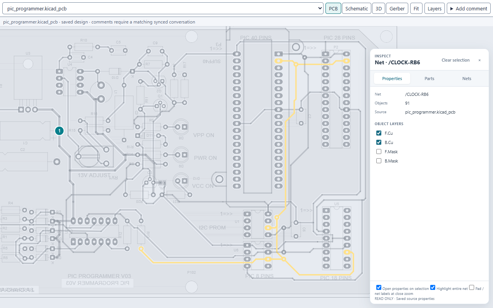
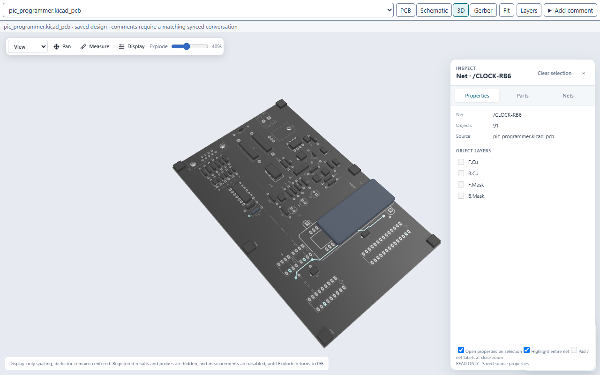
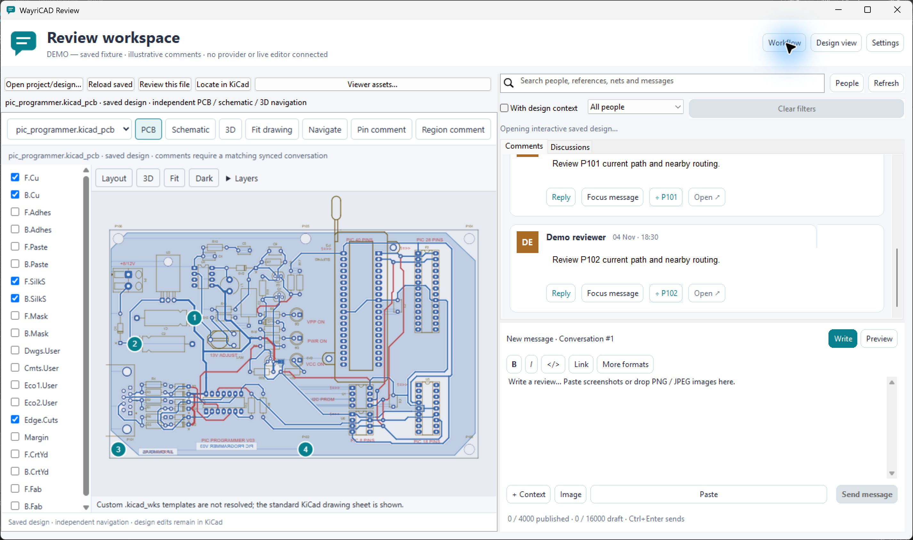
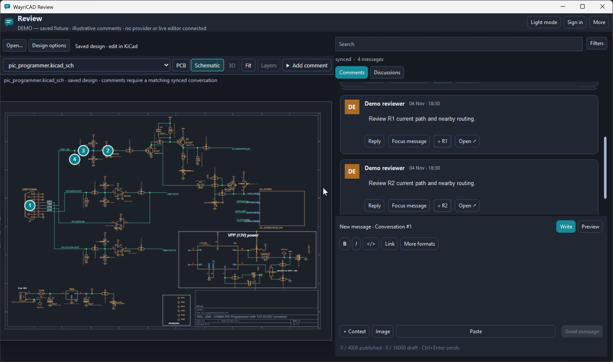
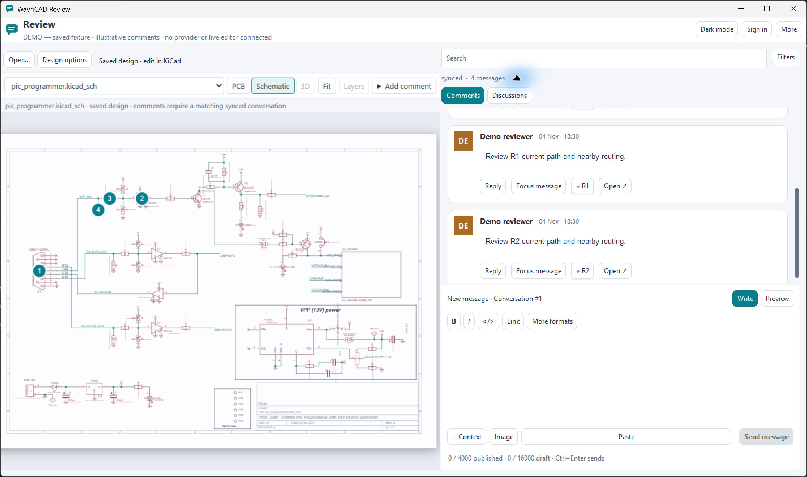
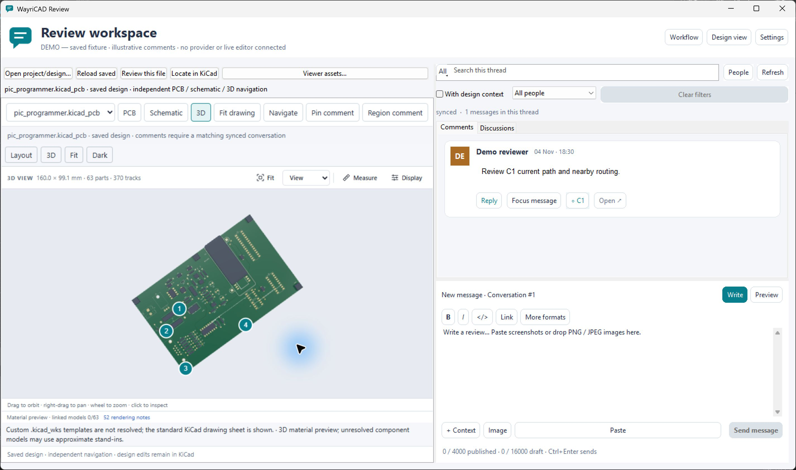
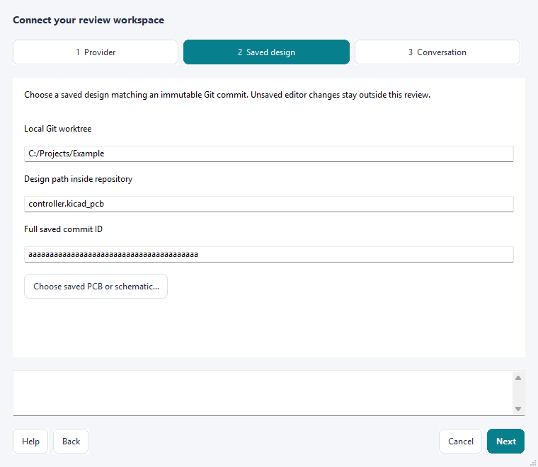

# WayriCAD Review


Read and discuss a saved KiCad design using individual message cards, inline
replies, a guided setup and a resizable formatted composer. **Comments** uses the configured
GitHub/GitLab issue/PR/MR conversation; **Discussions** uses real GitHub
Discussions and native threaded replies. GitHub and GitLab own published comments and anchors. Local files hold
private settings, pending drafts and an optional cache.

[Review **4.5.0**](https://github.com/wayri/WayriCAD/releases/tag/v4.5.0)
is a **testing** package. It adds BOM and Gerber context, variant tags and
orphan-status diagnostics alongside the compact composer and reply improvements.
Windows KiCad 10 GitHub sign-in, visible additions and deletions, and draft
retention were verified; the GitLab and browser live-sync matrix remains
incomplete. See the [offline visual user guide](USER_GUIDE.html) for setup.

## What appears beside KiCad

Launching Review opens a separate, resizable native wx window beside PCB
Editor. It contains message cards, Comments and Discussions tabs, search,
author filters and a Markdown reply composer. Current source has a compact
header with one **Light mode / Dark mode** toggle, **Account**, and **More**.
**More** holds settings, refresh, reviewer highlights, workflow, design
visibility and Review sign-out. Filters and the PCB layer list open when needed;
the theme applies to the whole window and embedded viewer. Its embedded
KiView pane also renders saved PCB and schematic files, including a selector
for paired files and schematic hierarchy sheets. The pane supports independent
pan, zoom, PCB layer controls, comment pins and regions, and a PCB 3D view.
It does not mirror unsaved editor geometry or make design edits; those stay in
the main KiCad window. The current document catalog supplies no component
model assets, so 3D uses stand-ins where models are needed. STEP models are not
supported by this integration.

Both themes keep disabled labels readable, distinguish control borders and
show a visible keyboard-focus outline. Sign-in fields have persistent labels;
composer updates preserve the chosen theme, including warnings and character
counts. Switching themes retains drafts and field values.

**Introduced in 4.8.3:** source bundles the unmodified
**KiCad WebView 0.6.0** full ESM distribution
under MPL-2.0, with its licenses and notices; no separate viewer setup is needed.
Its integration-owned [pin receipt](vendor/kicad-webview/REVIEW-PIN.json) records
the official archive identity and exact file hashes. The pane serves an in-memory snapshot of those assets through
a temporary loopback listener, closed with the window. **Open project/design…**
chooses a saved PCB or schematic; **Review this file** connects its exact saved
file to the provider conversation. Pins and regions are local drafts until
**Send message** publishes them. Provider reads, saved-file SHA-256 and scope
matching remain the authority for displayed markers and publication.

Optional overrides: set `WAYRICAD_REVIEW_VIEWER_ROOT` before launch or choose
**Viewer assets…**. Select the verified 0.6.0 package root or its complete `dist`
folder, not a lone script or the lite/classic bundle. All nine pinned ESM/notice
files must match. Earlier reviewed `web-library/extension` and `src/engine`
source layouts remain supported with their original notices and closure checks.
Review does not download renderer updates or import another plugin's copy.

PCB/schematic camera navigation uses the public copied camera API, preserving
zoom and flip when focusing comments. Object focus uses exact saved UUIDs,
never a reference-name guess. Layer controls also work in the current 3D viewer.
In exploded 3D, review overlays are hidden until explode returns to zero: this
adapter has no verified registration from provider XY anchors to displaced
layer geometry. Draft pins/regions in 2D; 3D has no supported inverse mapping.





These are current **browser-pane** captures of the public KiCad 10 PIC programmer
demo, not native wx windows, live provider comments or running-editor evidence.
The single illustrative marker is unpublished; explode is 40 in the 3D capture.
See [capture provenance and acceptance scope](VALIDATION.md#published-060-browser-adapter).

For an object-linked message, the intended interaction is:

1. Select one PCB object in the originating editor.
2. In Review, choose **Use PCB selection**, write a message and explicitly send it.
3. The provider stores the comment with the repository, exact saved commit,
   design path and object UUID.
4. After a successful provider refresh, click the message's design-item button
   to request selection and focus in the originating PCB Editor through IPC.

Use the direct Review IPC action for that editor connection. The **All tools**
saved-board fallback opens the conversation window without live navigation.
Running-editor selection has isolated regression coverage but is **not yet
verified by a live Review-to-PCB Editor acceptance test**. The independent
viewer shows schematic and PCB markers; native schematic selection and native
KiCad canvas overlays are unavailable.

The current source integration was captured in the actual Windows Review
window using KiCad's PIC programmer demo. The drawing is real saved-design
geometry; comments are explicitly illustrative, with sending disabled and no
provider or live editor connected. These are source-development screenshots,
not screenshots of the published 4.3.0 package.









The 3D capture uses approximate component stand-ins; linked model count is zero.
See [validation and screenshot provenance](VALIDATION.md) for the tested scope.

## How GitHub and GitLab connect

| Destination | What Review synchronizes |
| --- | --- |
| GitHub issue or pull request | The root description and general conversation comments, through the issue-comment REST API. |
| GitLab issue or merge request | The root description and general notes; self-hosted HTTPS instances are supported. |
| GitHub Discussion | Actual Discussion comments and threaded replies through GraphQL, in the separate Discussions tab. |

Connect the local Git worktree, an exact committed design and an existing
conversation number in Settings. Current-source desktop **Sign in browser**
uses the provider's device flow directly. It needs no CLI installation or
token paste. The access token stays in this process's memory and expires after
at most eight hours, sooner if the provider's token does. Activity does not
extend it; closing Review loses the sign-in. There is no silent refresh or CLI
fallback. **Send message** publishes explicitly. Active refresh is about every
eight seconds; drafts remain local until sent.

An example is a message about a connector's return via: select that via, attach
its context, then post to a PR's general conversation. Another reviewer can
read the same provider comment and, with the matching saved revision and an
IPC-connected editor, request navigation to that object. The shared KiView
marker carries its design context; it does not make GitHub or GitLab natively
render the PCB. Browser rendering is a separate KiView capability.

Inline code-diff review comments, PR review summaries, shared cursors and
GitHub Projects editing are not implemented. GitHub Projects and GitLab work
boards open in the browser. GitLab screenshots have a confirmed-upload flow;
GitHub image attachments use the provider's browser editor.

## Start a review

If the toolbar is crowded, use **Tools → External Plugins → WayriCAD — All
tools…** and search **Review** with the updated suite launcher. Selected rows
remain readable in light and dark themes. The saved-board menu launch opens
Review for the originating editor's saved PCB; it does not provide an IPC
connection or access to unsaved changes. Use the direct Review IPC toolbar
action for live-editor navigation.



1. Save and commit the design. Launch **WayriCAD Review** from PCB Editor.
2. Open **Settings** and follow **Provider → Saved design → Conversation**.
   The design picker fills the repository, saved revision and design path from Git.
   Check the detected repository/worktree, full commit ID and
   design path. Enter the issue, pull request or merge request number, and the
   GitHub Discussion number for the separate Discussions tab.
3. In current source, choose **Account → Sign in browser** (or **Sign in** in
   the header). Review opens the provider's device-code page; copy the displayed
   code if needed, approve access in the browser, then return. GitHub defaults
   to `public_repo` and `write:discussion`. Check **Include private GitHub
   repositories** only if needed; it requests the broader `repo` write scope.
   GitLab requests `api`; its OAuth application must allow the device grant.
   Self-hosted GitLab needs a public client ID via
   `WAYRICAD_REVIEW_GITLAB_CLIENT_ID`. A disabled device grant or missing client
   ID fails with an actionable message. The account is verified before Review
   treats sign-in as complete. GitHub sign-in was checked on KiCad 10; other
   provider and native acceptance remains incomplete.
4. Read the message cards and use **Reply** on the relevant card, or write a new
   message. **Send message** or **Ctrl+Enter** publishes to the active conversation.
   **View thread** focuses a message and its replies; **All messages** returns to
   the feed without changing your draft. Use the author chooser and **With design
   context** to filter; **People** highlights authors without hiding other messages.
5. **Open in provider** opens the authoritative thread. Settings also
   provides **Open work board** for GitHub Projects or GitLab issue boards.

Expiry or Review sign-out blocks provider reads, publication, uploads and native
navigation, and clears canvas comment authority while preserving drafts.
**More → Sign out** affects this Review process only; it does not sign out the
browser, KiView extension or a shared CLI session.

On the Discussions tab, open the provider to choose or create an engineering
topic if none exists, then enter its Discussion number in Settings. The plugin
does not silently create public topics or replace Discussions with issues.

The saved file must match the chosen immutable Git commit, allowing only the
LF/CRLF conversion of a normal text checkout. Exact local bytes are hashed for
subsequent stale checks. A branch name is not
an acceptable anchor revision. Unsaved editor changes are outside this review;
an existing object UUID does not prove its live position matches the commit.

## Formatted messages and workspace

The compact toolbar keeps bold, italic, inline code and links at hand; it has
no separate Paste or Image buttons. Use **More → Attach image…** for an image. **More
formats** opens headings, quotes, numbered/bulleted lists, tasks, engineering
tables and code blocks. The editor stores provider-compatible Markdown;
**Write / Preview** switches between editing and the local formatted view.
Pasting text returns to the editor and focuses it before insertion, including
when the formatted preview was open. The composer identifies the destination conversation and changes **Send message**
to **Send reply** when replying. Its published-character estimate includes the
generated reply reference and pending image links. **Ctrl+B**, **Ctrl+I**
and **Ctrl+K** format a selection; **Ctrl+Enter** sends. Pasted HTML becomes safe
Markdown rather than active HTML. Preview never loads remote images or scripts.

The **Workflow** button folds the guided sidebar. Drag the horizontal divider
to give the conversation or composer more space. Toolbars wrap at narrow widths.
Long messages scroll inside their cards. Background work shows an activity indicator.
Drafts support 16,000 characters; publication is limited to 4,000 including
reply and image-link text. Overlong drafts remain local with a clear message.

Paste an image with **Ctrl+V**, use **More → Attach image…**, or
drag PNG/JPEG files onto the composer. Up to four images are supported per
message, including multiple-file drops. Files are limited to 4 MiB and
16 megapixels before decoding; upload copies are reduced to 1024 pixels per
side and encoded as PNG. Each GitLab image requires approval in a preview
before upload. Pending images show removable chips and local thumbnails;
restored drafts retain their provider attachment references.

Search applies within the focused thread when one is open. Combine it with the
author chooser and design-context filter; **Clear filters** resets those choices
while retaining thread focus and your draft. If a refreshed thread disappears,
the pane returns to the surviving feed. Message actions wrap rather than run
off narrow cards, and the guided sidebar initially yields space in small windows.
Your explicit Workflow choice is retained while the pane is open.

**Ctrl+F** focuses search and **Ctrl+Shift+P** switches Preview. **Escape** first
returns from Preview to Write, then cancels a reply, leaves thread focus, or
clears active filters, one step at a time. These navigation actions never send a
message or erase draft text. **Ctrl+Enter** remains the explicit send shortcut.

## Locations, images and updates

| Action | Behaviour |
| --- | --- |
| Attach location… → Selected PCB object | Reads one native PCB selection; the UUID must exist in the saved file. The location is attached to the draft, not published until Send. |
| Attach location… → Region | Enter board-top XY, width and height in mm. Current source can also draft a region in the embedded viewer. Neither action changes the design. |
| Embedded viewer → Pin comment / Region comment | Draft a point or region on the saved PCB or schematic after the matching provider conversation has refreshed; write and explicitly send the message to publish it. |
| Design-item chip on a message | Resolves a matching provider-read UUID in the originating PCB editor. Selection is confirmed; previous selection is restored on failure where supported. |
| Paste image — GitLab | Preview a clipboard PNG, approve its upload, then post the confirmed image link and KiView attachment metadata with your comment. Images are reduced to at most 1024 pixels per side. |
| Paste image — GitHub | Opens GitHub's browser editor for its supported image/screenshot attachment workflow. Refresh after posting there. |
| Reply | Opens an inline reply composer. Issue/PR/MR replies link their parent message; GitHub Discussions replies use the actual provider thread. Replies to replies stay in their top-level Discussion thread. |
| Quote reply | Adds the current comment's visible text as a Markdown quote at the end of your existing draft and selects that comment as the reply target. The insertion can be undone; it never sends automatically. |
| Refresh | Fetches root description and all general comments, including edits and deletions. Failed or incomplete reads never replace the last cache. |
| View thread / All messages | Focus the selected message and its replies, then return without changing a draft or pending reply. |
| Author / With design context / Search | Combine filters for an author, provider-read anchors and message/design text. Search stays within a focused thread. Clear filters retains the thread and draft. |
| People | Highlight several authors without filtering them. This does not imply online presence, typing or cursors. |

Replies show the sender and immediate recipient in their header, even when
replying to another reply. Every reply retains one indentation level. Removed
or ambiguous parents are labeled unavailable rather than attributed to another
person. Quoting a comment does not retarget any attached design location.

Refresh runs about every eight seconds while the pane is visible, including
while you work in the main KiCad editor, backing off to two minutes after
failures. Requests do not overlap. Hidden, minimized, signed-out and closed
panes pause polling. Remote additions, edits and deletions replace the complete
conversation snapshot and update the matching in-view markers.
Text drafts survive refresh and failed publication. A next draft typed during
publication is preserved. Pending text is saved separately before posting and
on close, so it cannot be mistaken for a published comment.
Conversation changes save the outgoing draft before loading the destination;
editing pauses during that transition. The feed creates at most 80 message
cards at a time and preserves scroll position when unchanged snapshots arrive.

Uploads are a separate provider operation: cancelling or failing to post can
leave an uploaded GitLab attachment on that project. Review screenshots for
private paths and credentials before uploading. GitHub has no documented
general-purpose attachment upload endpoint used by this plugin.

## Supported scope and limits

| Capability | Status |
| --- | --- |
| GitHub issue / PR general conversation | Read and post through REST issue-comment endpoints. |
| GitLab issue / MR general notes | Read and post through the current-source desktop OAuth transport, including self-hosted HTTPS instances. Published 4.3.0 uses `glab api`. |
| GitHub Discussions | Complete GraphQL reads of comments and replies, with native threaded `addDiscussionComment` publication. Requires an existing Discussion and provider permissions. |
| Pocket KiView anchors | Shared `kicad-review:v1` published Markdown marker, exact provider/host/repository/commit/file matching. |
| GitLab issue boards | Provider API lists board names; browser handles board interaction. |
| GitHub Projects | Opens repository Projects in the browser. No Projects GraphQL changes are implemented. |
| PCB navigation | Official IPC selection through the originating editor; no saved design edits. |
| Embedded saved-design viewer (4.4.0) | KiView PCB, schematic and hierarchy-file navigation, PCB 3D, independent pan/zoom/layers and review markers; needs separately supplied assets. Windows source visual checks passed; native editor attachment remains unverified. |
| Schematic selection / native KiCad canvas overlays | Unavailable in this adapter. The embedded viewer draws its own review layer; no fake native markers are written. |
| Inline diff reviews / PR review summaries | Not imported. Open the provider to inspect these. |
| Presence / shared cursors / typing | Not implemented; polling is comment synchronization only. |

No local sidecar or cache can authorize a published location. Navigation and
posting require a successful provider read. After an ambiguous write failure,
refresh and inspect the thread before retrying; writes are never auto-retried.
Up to 5,000 general comments are supported; exceeding limits fails explicitly.

## BOM, Gerbers, variants and orphan context

- **BOM** opens a read-only native field-value grid for the displayed saved PCB
  or schematic. It includes custom fields, hierarchy identities and DNP/exclusion
  flags. Select a cell or row, choose **Comment on cell / row**, then write and
  send explicitly. Connect the matching saved file with **Review this file**
  first. Editing stays in KiCad; this is not a live copy of its field editor.
- **Gerbers…** lists existing project-local drawings, or offers **Load files…**
  and **Generate Gerbers**. Generation uses the matching KiCad CLI and a
  disposable input snapshot, writes a unique project-local folder and preserves
  existing fabrication files. Unsupported formats show an error. Viewing needs
  the bundled viewer with manufacturing support (or a compatible explicit override).
  Pins/regions use that Gerber's coordinates and exact saved-file hash;
  **Design options → Comment on current Gerber** attaches a file-level note.
- **All variants** or an explicitly saved named variant sets new-comment
  context. Cards retain variant labels, and drawing markers respect the selected
  variant. The choice does not regenerate geometry or calculate effective
  inherited variant field values: the table shows base saved fields and retains
  explicit variant metadata. No population state is guessed.
- Replies appear under their origin post at **one indentation level**, including
  replies to replies. Missing parents and malformed thread relationships remain
  visible with diagnostics. The composer has a padded focus border and scrolling.

Orphan checks distinguish missing files, objects, BOM rows/fields and variants
from changed content, older revisions, ambiguous identities and unavailable
evidence. A failed read is not deletion. Original anchors remain intact; no
rename or nearby-object matching silently moves a comment. To attach a replacement,
reply to the original note and explicitly choose the new saved context.

**Review settings → Post changed/orphan context status updates** controls
append-only provider status notes. Two stable observations and fresh provider
and source preflight are required. Local working-tree observations identify
the Git HEAD baseline without claiming those changes exist in that commit.
No author comment is overwritten. At most one status note is sent per refresh;
uncertain writes halt automatic status publication until the user checks the
provider and reconnects. Cross-client deduplication is best effort because the
provider has no atomic compare-and-append API. CLI `sync` stays read-only.

Changing/removing the selected design permits **context-only** diagnostics;
publication and navigation stay blocked until a matching saved revision is
connected. Generated artifacts need not be committed, but must stay inside the
origin design's project directory. Caches cannot authorize any location.

## CLI

Use `python -m review_comments_plugin.cli --help` from a source installation.
Settings are private JSON with `provider`, `repository`, `root`, `ref`, `file`,
`kind`, `number` and, for GitLab, `host`. Do not commit settings or caches.

```console
python -m review_comments_plugin.cli inspect-source board.kicad_pcb
python -m review_comments_plugin.cli --settings review-settings.json sync
python -m review_comments_plugin.cli --settings review-settings.json boards
python -m review_comments_plugin.cli --settings review-settings.json post --body-file comment.txt
python -m review_comments_plugin.cli --settings review-settings.json post --body-file comment.txt --publish
python -m review_comments_plugin.cli --settings review-settings.json locate 12345
```

`post` previews by default. Only `--publish` sends a comment. Optional
`--anchor-file` supplies a v1 anchor; `--reply-to` identifies a current comment.
`cached` prints explicitly unverified cached data and never permits navigation.
`inspect-source` checks the saved design against its local Git HEAD without
settings or provider access. It is also available as a read-only Assistant action.
The CLI keeps its separate legacy `gh`/`glab` authentication; desktop's
memory-only sign-in does not supply credentials to CLI commands.
The current-source embedded viewer uses an ephemeral loopback HTTP listener for
its allowlisted, in-memory assets. It has no fixed port or background service;
the published 4.3.0 package did not include this viewer.
The suite dispatcher also exposes `wayricad-tools run review-comments -- --help`.

## Online viewer interchange

The saved `.kicad_pcb` and `.kicad_sch` documents use the same KiView renderer
as the online viewer. Comments share the `kicad-review:v1` Markdown marker.
Actual online-parser round trips covered GitHub/GitLab PCB and schematic
point/region annotations, reference and net names, Unicode text and review
state metadata. The online client's JSON export and sidecar serializers also
accepted those annotations. Desktop Review reads provider Markdown; it does
not directly open arbitrary annotation JSON as a synced conversation.

Both clients must select the same provider/host, repository, full 40-character
commit ID and file path. Branch-name annotations are not current-revision
authority in desktop Review. Remote comment changes refresh automatically;
new messages still require an explicit Send. Changing the design's Git revision
requires reconnecting that saved revision; Review never pulls or rewrites a
working tree automatically.

See [visual user guide](USER_GUIDE.html), [integration contract](INTEGRATION.md), [offline help](help.html) and
[validation scope](VALIDATION.md).

## Methods and references

- [GitHub issue comments API](https://docs.github.com/en/rest/issues/comments)
  supplies issue and PR general conversation text.
- [GitHub Discussions GraphQL](https://docs.github.com/en/graphql/reference/discussions)
  supplies actual discussion threads and replies.
- [GitLab Notes API](https://docs.gitlab.com/api/notes/) supplies issue/MR notes.
- [GitLab Markdown uploads](https://docs.gitlab.com/api/project_markdown_uploads/)
  publishes confirmed screenshot attachments.
- [GitHub OAuth device flow](https://docs.github.com/en/apps/oauth-apps/building-oauth-apps/authorizing-oauth-apps)
  and [GitLab device grant](https://docs.gitlab.com/api/oauth2/) describe the
  current-source desktop sign-in.
- [KiCad IPC API](https://dev-docs.kicad.org/en/apis-and-binding/ipc-api/)
  provides read-only object selection/navigation. API capability is separate
  from native-window verification.
