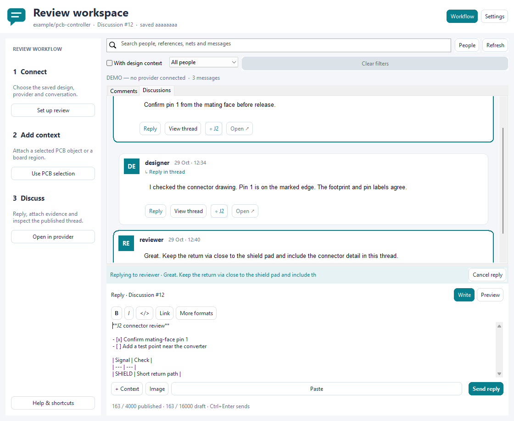
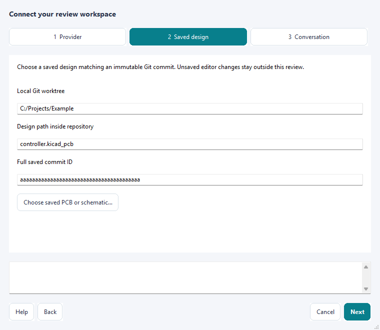

# WayriCAD Review


Read and discuss a saved KiCad design using individual message cards, inline
replies, a guided setup and a resizable formatted composer. **Comments** uses the configured
GitHub/GitLab issue/PR/MR conversation; **Discussions** uses real GitHub
Discussions and native threaded replies. GitHub and GitLab own published comments and anchors. Local files hold
private settings, pending drafts and an optional cache.

Review **0.1.0** is a **testing** package included in WayriCAD 3.6.45.


The image is a native wx window capture using illustrative comments. It is UI
layout evidence, not a live GitHub/GitLab or running-editor demonstration.



The Discussions preview also uses illustrative data. Settings and authentication
stay out of the conversation feed. Engineering messages can carry component,
net or region context without turning the pane into a properties table.


This native demo shows the local preview and a synthetic attachment thumbnail;
no provider upload or remote image fetch is represented.

## Start a review

If the toolbar is crowded, use **Tools → External Plugins → WayriCAD — All
tools…** and search **Review** with the updated suite launcher. Selected rows
remain readable in light and dark themes. The saved-board menu launch opens
Review for the originating editor's saved PCB; it does not provide an IPC
connection or access to unsaved changes. Use the direct Review IPC toolbar
action for live-editor navigation.



1. Save and commit the design. Launch **WayriCAD Review** from PCB Editor.
2. Open **Settings** and follow **Provider → Saved design → Conversation**.
   The design picker fills the repository, saved revision and design path from Git.
   Check the detected repository/worktree, full commit ID and
   design path. Enter the issue, pull request or merge request number, and the
   GitHub Discussion number for the separate Discussions tab.
3. Choose **Connect with browser**. Install [GitHub CLI](https://cli.github.com/)
   or [GitLab CLI](https://docs.gitlab.com/cli/) first. Credentials stay in the
   provider CLI's storage; this plugin never saves a token in its configuration.
   Approve the official CLI application in this computer's browser. Phone sign-in
   is separate. Connected appears only after a successful provider API check.
   If a stored GitLab CLI session is confirmed rejected with HTTP 401, this
   explicit action replaces that host’s rejected session before browser approval.
   Missing sessions open sign-in directly. Permission, network and malformed-response
   failures do not clear credentials. **Cancel sign-in** stops an unfinished flow; sign-in does not restart automatically.
   If the browser does not open, cancel and use **Copy terminal sign-in command**
   in your normal PowerShell window to expose any interactive CLI prompt.
4. Read the message cards and use **Reply** on the relevant card, or write a new
   message. **Send message** or **Ctrl+Enter** publishes to the active conversation.
   **View thread** focuses a message and its replies; **All messages** returns to
   the feed without changing your draft. Use the author chooser and **With design
   context** to filter; **People** highlights authors without hiding other messages.
5. **Open in provider** opens the authoritative thread. Settings also
   provides **Open work board** for GitHub Projects or GitLab issue boards.

On the Discussions tab, open the provider to choose or create an engineering
topic if none exists, then enter its Discussion number in Settings. The plugin
does not silently create public topics or replace Discussions with issues.

The saved file must match the chosen immutable Git commit, allowing only the
LF/CRLF conversion of a normal text checkout. Exact local bytes are hashed for
subsequent stale checks. A branch name is not
an acceptable anchor revision. Unsaved editor changes are outside this review;
an existing object UUID does not prove its live position matches the commit.

## Formatted messages and workspace

The compact toolbar keeps bold, italic, inline code and links at hand. **More
formats** opens headings, quotes, numbered/bulleted lists, tasks, engineering
tables and code blocks. The editor stores provider-compatible Markdown;
**Write / Preview** switches between editing and the local formatted view.
Pasting text returns to the editor and focuses it before insertion, including
when the formatted preview was open. The composer identifies the destination conversation and changes **Send message**
to **Send reply** when replying. Its published-character estimate includes the
generated reply reference and pending image links. **Ctrl+B**, **Ctrl+I**
and **Ctrl+K** format a selection; **Ctrl+Enter** sends. Pasted HTML becomes safe
Markdown rather than active HTML. Preview never loads remote images or scripts.

The **Workflow** button folds the guided sidebar. Drag the horizontal divider
to give the conversation or composer more space. Toolbars wrap at narrow widths.
Long messages scroll inside their cards. Background work shows an activity indicator.
Drafts support 16,000 characters; publication is limited to 4,000 including
reply and image-link text. Overlong drafts remain local with a clear message.

Paste an image with **Ctrl+V** or **Paste**, use **Image** to choose files, or
drag PNG/JPEG files onto the composer. Up to four images are supported per
message, including multiple-file drops. Files are limited to 4 MiB and
16 megapixels before decoding; upload copies are reduced to 1024 pixels per
side and encoded as PNG. Each GitLab image requires approval in a preview
before upload. Pending images show removable chips and local thumbnails;
restored drafts retain their provider attachment references.

Search applies within the focused thread when one is open. Combine it with the
author chooser and design-context filter; **Clear filters** resets those choices
while retaining thread focus and your draft. If a refreshed thread disappears,
the pane returns to the surviving feed. Message actions wrap rather than run
off narrow cards, and the guided sidebar initially yields space in small windows.
Your explicit Workflow choice is retained while the pane is open.

**Ctrl+F** focuses search and **Ctrl+Shift+P** switches Preview. **Escape** first
returns from Preview to Write, then cancels a reply, leaves thread focus, or
clears active filters, one step at a time. These navigation actions never send a
message or erase draft text. **Ctrl+Enter** remains the explicit send shortcut.

## Locations, images and updates

| Action | Behaviour |
| --- | --- |
| + Design context → Selected PCB object | Reads one native PCB selection; the UUID must exist in the saved file. |
| + Design context → Region | Enter board-top XY, width and height in mm. The anchor is published, without drawing anything into the design. |
| Design-item chip on a message | Resolves a matching provider-read UUID in the originating PCB editor. Selection is confirmed; previous selection is restored on failure where supported. |
| Paste image — GitLab | Preview a clipboard PNG, approve its upload, then post the confirmed image link and KiView attachment metadata with your comment. Images are reduced to at most 1024 pixels per side. |
| Paste image — GitHub | Opens GitHub's browser editor for its supported image/screenshot attachment workflow. Refresh after posting there. |
| Reply | Opens an inline reply composer. Issue/PR/MR replies link their parent message; GitHub Discussions replies use the actual provider thread. Replies to replies stay in their top-level Discussion thread. |
| Refresh | Fetches root description and all general comments, including edits and deletions. Failed or incomplete reads never replace the last cache. |
| View thread / All messages | Focus the selected message and its replies, then return without changing a draft or pending reply. |
| Author / With design context / Search | Combine filters for an author, provider-read anchors and message/design text. Search stays within a focused thread. Clear filters retains the thread and draft. |
| People | Highlight several authors without filtering them. This does not imply online presence, typing or cursors. |

Refresh runs about every eight seconds while the pane is active, backing off to
two minutes after failures. Requests do not overlap. Hidden, inactive and closed
panes do not start polling; hidden responses do not update the visible pane.
Text drafts survive refresh and failed publication. A next draft typed during
publication is preserved. Pending text is saved separately before posting and
on close, so it cannot be mistaken for a published comment.
Conversation changes save the outgoing draft before loading the destination;
editing pauses during that transition. The feed creates at most 80 message
cards at a time and preserves scroll position when unchanged snapshots arrive.

Uploads are a separate provider operation: cancelling or failing to post can
leave an uploaded GitLab attachment on that project. Review screenshots for
private paths and credentials before uploading. GitHub has no documented
general-purpose attachment upload endpoint used by this plugin.

## Supported scope and limits

| Capability | Status |
| --- | --- |
| GitHub issue / PR general conversation | Read and post through REST issue-comment endpoints. |
| GitLab issue / MR general notes | Read and post using `glab api`, including self-hosted HTTPS instances. |
| GitHub Discussions | Complete GraphQL reads of comments and replies, with native threaded `addDiscussionComment` publication. Requires an existing Discussion and provider permissions. |
| Pocket KiView anchors | Shared `kicad-review:v1` published Markdown marker, exact provider/host/repository/commit/file matching. |
| GitLab issue boards | CLI API lists board names; browser handles board interaction. |
| GitHub Projects | Opens repository Projects in the browser. No Projects GraphQL changes are implemented. |
| PCB navigation | Official IPC selection through the originating editor; no saved design edits. |
| Schematic selection / transient region overlays | Unavailable in this adapter. Use the revision link/KiView; no fake markers are written. |
| Inline diff reviews / PR review summaries | Not imported. Open the provider to inspect these. |
| Presence / shared cursors / typing | Not implemented; polling is comment synchronization only. |

No local sidecar or cache can authorize a published location. Navigation and
posting require a successful provider read. After an ambiguous write failure,
refresh and inspect the thread before retrying; writes are never auto-retried.
Up to 5,000 general comments are supported; exceeding limits fails explicitly.

## CLI

Use `python -m review_comments_plugin.cli --help` from a source installation.
Settings are private JSON with `provider`, `repository`, `root`, `ref`, `file`,
`kind`, `number` and, for GitLab, `host`. Do not commit settings or caches.

```console
python -m review_comments_plugin.cli inspect-source board.kicad_pcb
python -m review_comments_plugin.cli --settings review-settings.json sync
python -m review_comments_plugin.cli --settings review-settings.json boards
python -m review_comments_plugin.cli --settings review-settings.json post --body-file comment.txt
python -m review_comments_plugin.cli --settings review-settings.json post --body-file comment.txt --publish
python -m review_comments_plugin.cli --settings review-settings.json locate 12345
```

`post` previews by default. Only `--publish` sends a comment. Optional
`--anchor-file` supplies a v1 anchor; `--reply-to` identifies a current comment.
`cached` prints explicitly unverified cached data and never permits navigation.
`inspect-source` checks the saved design against its local Git HEAD without
settings or provider access. It is also available as a read-only Assistant action.
There is no local HTTP listener, fixed port, background service or token bridge.
The suite dispatcher also exposes `wayricad-tools run review-comments -- --help`.

See [integration contract](INTEGRATION.md), [offline help](help.html) and
[validation scope](VALIDATION.md).

## Methods and references

- [GitHub issue comments API](https://docs.github.com/en/rest/issues/comments)
  supplies issue and PR general conversation text.
- [GitHub Discussions GraphQL](https://docs.github.com/en/graphql/reference/discussions)
  supplies actual discussion threads and replies.
- [GitLab Notes API](https://docs.gitlab.com/api/notes/) supplies issue/MR notes.
- [GitLab Markdown uploads](https://docs.gitlab.com/api/project_markdown_uploads/)
  publishes confirmed screenshot attachments.
- [GitHub browser login](https://cli.github.com/manual/gh_auth_login) and
  [GitLab browser login](https://docs.gitlab.com/cli/auth/login/) own authentication.
- [KiCad IPC API](https://dev-docs.kicad.org/en/apis-and-binding/ipc-api/)
  provides read-only object selection/navigation. API capability is separate
  from native-window verification.
