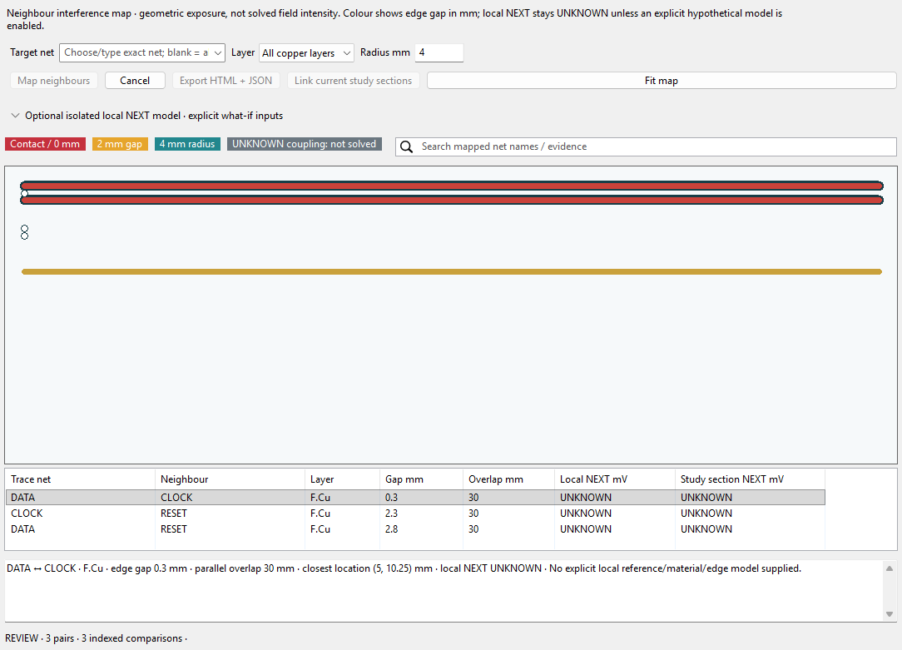
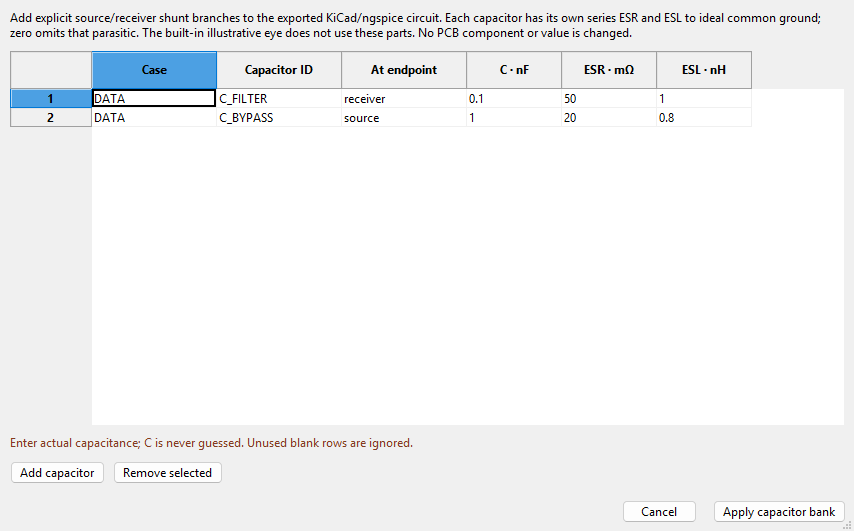
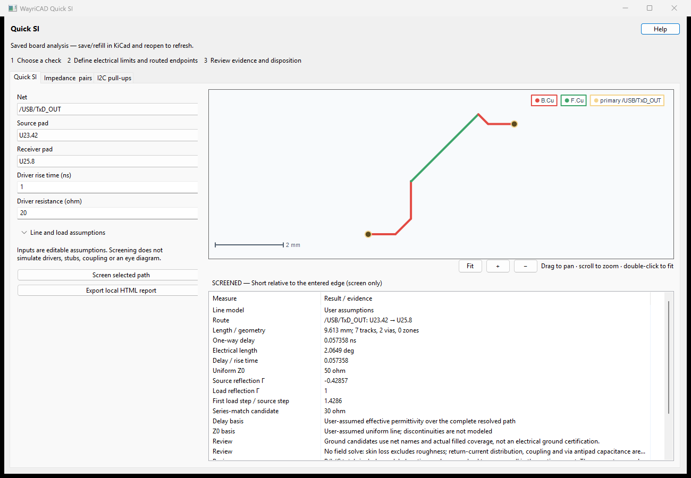
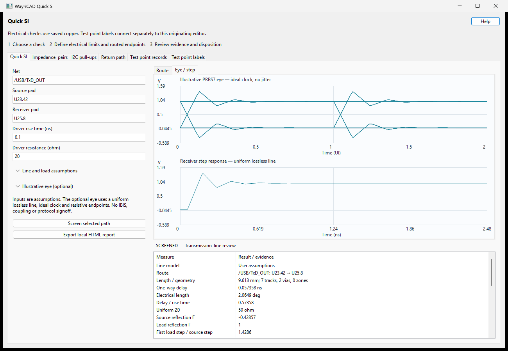
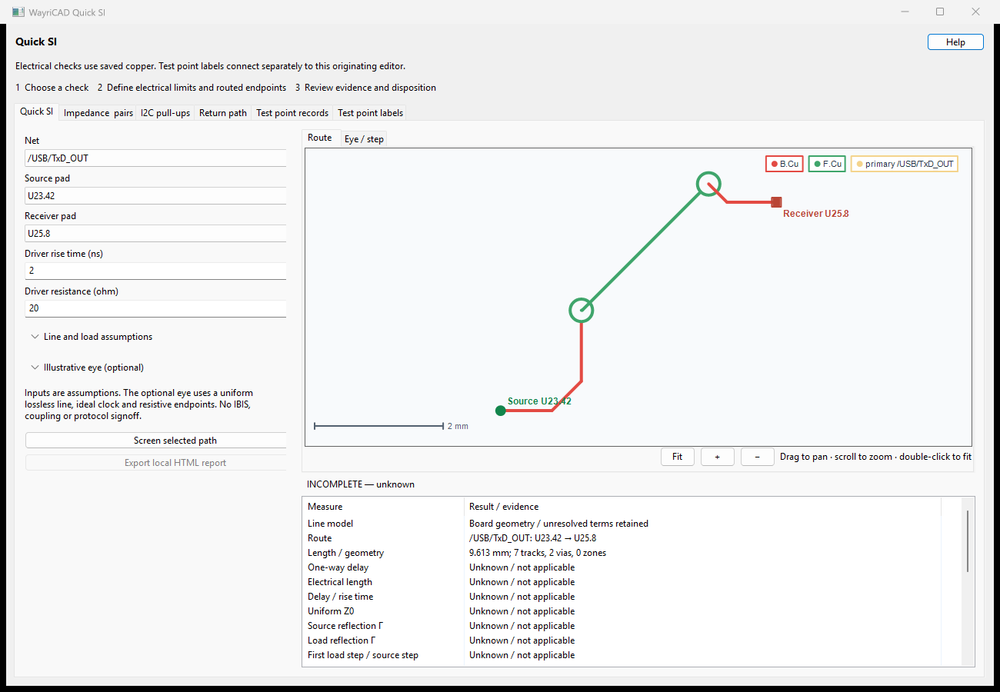
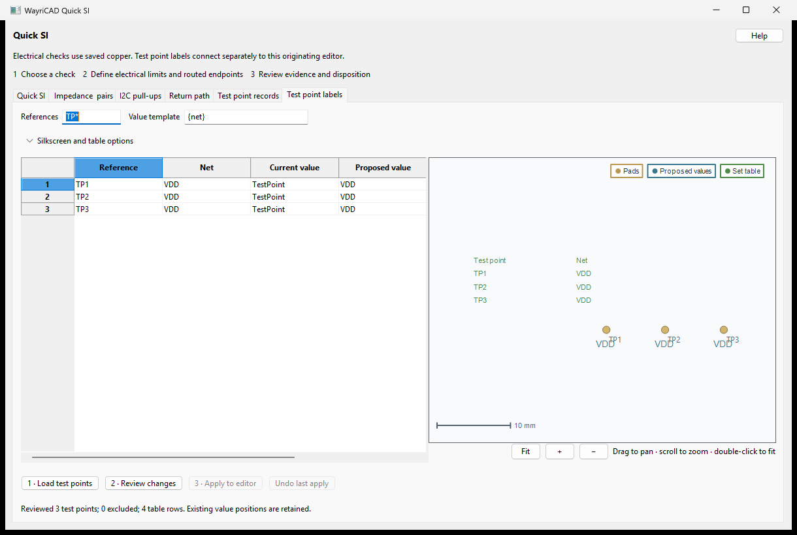
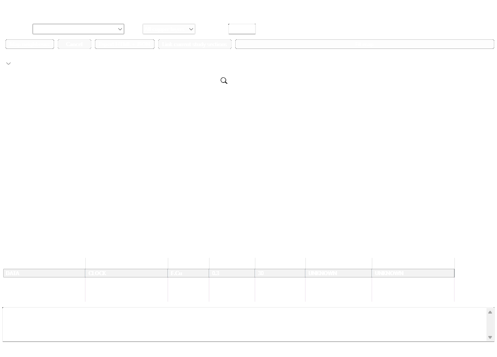

# WayriCAD Quick SI


## Start here

| Need | Open |
|---|---|
| Install or update | [Latest release](https://github.com/wayri/WayriCAD/releases/latest) · [Installation](../docs/INSTALLATION.md) |
| First source-to-receiver screen | [Normal workflow](#normal-workflow) |
| Several nets and explicit returns | [Multi-net studies](#multi-net-studies-and-explicit-returns) |
| Reviewed IBIS circuit | [KiCad circuit export](#reviewed-ibis-circuit-export) |
| Bypass / filtering capacitors | [Endpoint shunt capacitors](#endpoint-shunt-capacitors-for-transient-circuits) |
| Local coupling | [Directed crosstalk](#directed-local-crosstalk) |
| Nearby traces and locations | [Neighbour exposure map](#neighbour-trace-exposure-map) |
| Scripts and help | [CLI](#cli) · [Offline help](help.html) |
| Equations and applicability | [Solver methods](#solver-methods) · [References](#references-and-research) |

**3.6.28** defers the existing RLC numerical backend until the first calculation.
Setup imports are faster; first-use initialization is deferred, not eliminated.
The equations and unknown-result rules are unchanged. [Measurements](../docs/audits/SUITE_RESPONSIVENESS_2026-10-23.md).

Quick SI analyzes routed paths, filled-zone corridors and via transitions with
its existing path and screening models. It does not consume a finite-element
triangle mesh, so Gmsh meshing alone would not improve its impedance or timing
estimates. Optional local coupled-strip screening uses a two-dimensional
electrostatic boundary-element model; full plane fields and via discontinuities
remain outside its scope.

Drag the horizontal divider to share space between the route preview and its
results table. Drag the input divider to widen settings, or use the preview's
Fit control to inspect the whole route.

## Guided path and response setup

Open **Set up path and response…** to review the common SI inputs together.

| Step | Review |
|---|---|
| Physical path | Search the net (`*` wildcard, `~` fuzzy), choose distinct source/receiver pads, or explicitly swap their roles. |
| Other pins | The guide lists other pads on the same physical footprint and net. They remain separate SI terminals; no ideal short or point-to-point channel is invented. |
| Edge and line | Enter rise time, evaluation frequency and driver/load resistance. Blank load means open. Blank Z0/Er retain the existing geometry/stackup evidence; entered values remain assumptions. |
| Time response | Enable the existing illustrative NRZ eye/step screen when appropriate. Its ideal uniform lossless line is separate from IBIS circuit simulation. |
| Apply | **Apply setup** invalidates old results/exports; **Apply and screen** also runs the existing path analysis. Cancel retains the current workspace. |


This native KiCad 10.0.6 setup capture uses public Marble's `/ETH_PHY/MII_MDC`,
`U6.8` → `U54.16`, with explicit 50 Ω, effective Er 3.2, 1 ns rise time,
20 Ω driver, 50 Ω receiver and 100 MHz. GND was already selected in the main
workspace; the guide retains that return review. It is a setup screen, not a new
solver result. The board SHA-256 remained
`482850dbaaef9157e2e98af765a3c0d4d9c9f800daae224a54bf10e0621f52b0`.
The RGB24 image is a direct native client-area capture, with no redaction or
composited controls.
Native results now include the structured **Needs review** reasons and concrete
next actions, plus the whole-net routing-coverage review used by circuit export.
A source-to-receiver route does not automatically account for extra loads,
branches, stubs or filled planes. These limits remain visible beside the numbers.

For IBIS circuit export, **Suggest timing from selected routes** proposes a
reviewable transient duration and timestep from every selected route's declared
rise time, frequency and resolved delay. The step is the smallest of rise/20,
delay/20 and period/100; duration covers ten slowest periods, eight longest
one-way delays and ten slowest rise times. Suggestions with a duration/step ratio above two million
are rejected rather than silently coarsened; adaptive internal steps may be smaller
and more numerous. This is numerical setup advice:
actual IBIS edge bandwidth and ngspice timestep convergence still need review.
The exported schematic and clipboard both use
`.tran TSTEP TSTOP 0 TMAX`, with TSTEP and TMAX equal to the reviewed timestep.
TMAX explicitly bounds ngspice's adaptive internal step; it does not guarantee
uniform output samples or establish convergence. This follows the
[official ngspice .TRAN definition](https://ngspice.sourceforge.io/docs/ngspice-manual.pdf).
Copper thickness and via L/C stay explicit; this button does not enable manual
approximations or execute a simulation.

The same advice is available without native GUI dependencies:

```text
wayricad tools run quick-si -- timing-advice route.json --output timing.json
wayricad tools run quick-si -- timing-advice study.json --case clock --case data --output timing.json
```

The command reads a Quick SI report and writes a new advice file, recording its
SHA-256 and chosen cases. It does not load a board, modify a report, infer IBIS
models or claim a simulated result. Use its reviewed values with the existing
`circuit --duration-ns … --timestep-ns … --frequency-mhz …` export options.

## Current native workspace — 3.6.38


This actual saved-board run follows `/ETH_PHY/MII_MDC` from `U6.8` to `U54.16`
on public Marble: 253.670 mm, 31 tracks and three vias. The example deliberately
uses a uniform **50 Ω** line and **effective Er 3.2**, 1 ns driver rise time,
20 Ω driver, 50 Ω load and 100 MHz. Its 1.5136 ns delay comes from the declared
permittivity, not a complete extracted channel. The table says **User assumptions**;
SCREENED does not establish protocol compliance. GND is explicitly selected for
the geometric return review. The PCB is unchanged.

Choose the net and distinct source/receiver first. The visible **Return path
(optional)** control can retain **No return-path check**, or use a return you
confirm. Keep **More return options** closed unless multiple return nets, optional
pins or a reference-layer override are needed. **IBIS models for KiCad circuit
export**, **Line and load assumptions**, **Multi-net study** and **Illustrative
eye** are independent expandable sections; opening one does not establish its
inputs automatically. Drag the settings/route and route/results dividers to
make the active evidence readable. [Capture provenance](../docs/audits/QUICK_TOOL_VISUALS_3.6.38.md).

## Neighbour trace exposure map



This disposable three-trace example reports three geometric pairs. The selected
DATA/CLOCK pair has 0.3 mm edge gap and 30 mm parallel overlap; coupling stays
UNKNOWN because no reference/material/edge model is supplied. The older
[neighbour capture](help-neighbours.png) remains available.

Open **Neighbour traces**, choose/type an exact target net (blank searches all
connected nets), select a copper layer and set the search radius in mm.
**Map neighbours** runs a cancellable worker on the saved board. Search the
results, hover/click coloured traces, or select a table row for shortest edge
gap, parallel overlap and closest board location. Wheel zooms, drag pans and
**Fit map** restores the overview.

Colours represent **geometric edge-gap closeness**, red at contact, amber at
half the search radius and teal at the radius. They never represent field
intensity, interference voltage or compliance. Crossings retain geometric gap;
only exactly parallel straight same-layer segments have overlap length. Arcs,
vias, pads, zones and other-layer/broadside coupling are not solved. An empty
map is not evidence of zero crosstalk.

**Local NEXT mV** defaults to UNKNOWN. Optional explicit reference layer,
center-to-plane height, Er, copper thickness, 10–90% rise time and open-circuit
source swing reuse the existing converged equal-width homogeneous-plane,
matched-end local model. Actual reference continuity, terminal direction and
whole-route loading remain unresolved. Unsupported geometry retains unknown
reasons. Section peaks are never added. **Link current study sections** retains
existing directed study NEXT by matching saved-source hashes and item UUIDs.
Those sections can exceed a mapped track's extent; their own length, reference
status and pair ID remain in the selected evidence.

**Export HTML + JSON** retains a searchable/selectable SVG, units, source
fingerprints, assumptions, unknowns and coverage. Input changes clear stale
results; changed saved PCB/project/rules require reopening. The normal saved
sidecar supplies background execution; unsaved legacy/live geometry is not
silently replaced by saved data.

```text
python -m signal_integrity_advisor_plugin.cli neighbours C:/Projects/Example/board.kicad_pcb --net DATA --radius-mm 1 --html neighbours.html --output neighbours.json
```

Optional `--model model.json` accepts exactly `reference_layer`, `height_mm`,
`epsilon_r`, `copper_mm`, `rise_ns` and `swing_v`. `--study-report study.json`
links earlier explicit pair sections. The grid index avoids whole-board pair
joins. Budgets are 200,000 tracks, 500,000 index references, 200,000 comparisons,
800,000 candidate visits, 2,000 pairs, 32 local models and 15 seconds. Radius
is at most 20 mm; `--seconds` permits at most 60 seconds. Narrow nets/layers/radius
when coverage is INCOMPLETE. REVIEW (CLI exit 3) means evidence requires review.

Spacing alone cannot establish crosstalk: reference height, edge time and
parallel length also matter ([TI primary guidance](https://www.ti.com/document-viewer/lit/html/SSZT935/GUID-0FCA647D-9DF5-4B70-AFC8-2E976F7A12D6)).
Geometric colour and conditional local NEXT therefore remain separate.

## Multi-net studies and explicit returns

A study runs up to 64 **independent source-to-receiver route screens** on the same
saved PCB and rules snapshot. Optional directed **crosstalk pairs** add local
parallel-section coupling estimates. The study does not solve simultaneous
switching, whole-route coupled waveforms or full-bus/protocol qualification.
Missing geometry, return continuity and model terms remain unresolved.

1. Open **Multi-net study**, search/check the desired nets and choose **Add checked nets to study**.
2. Choose **Edit study cases**. Enter each source and receiver as `Reference.Pad`;
   use the single-route pad lists to inspect exact labels. Newly added nets have
   blank terminals until you explicitly assign signal direction.
3. Set each row's reference layer, rise time, frequency, driver/load resistance and
   optional assumed impedance/permittivity. Blank assumed values preserve the
   geometry model's unknowns. Default numeric inputs are editable assumptions.
4. Enter explicit return nets, source-return pad and receiver-return pad per row.
   This invokes the real copper/via return-path audit, including sampled coverage,
   reference transitions and return-pad inventory. It covers the whole signal net,
   rather than only the chosen source-to-receiver branch. It does not prove a
   continuous low-inductance return loop or solve plane fields.
5. Run the study and choose a case above the route preview. Failed cases retain
   their error while successful cases retain their own route, return evidence,
   plots and measurements. Export creates an offline comparison report.

Editing inputs clears the study result. Changed saved board/project/custom-rule
files abort the study and block export. Locked source files are never modified.

### CLI study

Use KiCad's Python or the installed `wayricad-si` command. First discover exact
net and terminal labels; then adapt [the example study](independent-routes.json).

```text
wayricad-si inspect C:/Projects/Example/board.kicad_pcb --net DATA
wayricad-si study C:/Projects/Example/board.kicad_pcb --config independent-routes.json --output study-results.json --html study-results.html
```

The JSON records a common hash for the PCB, project and custom rules, plus each
case's exact assumptions, terminal roles, result and error. One invalid case does
not discard other cases; changed sources invalidate the entire run. `COMPLETE`
means every independent numerical screen completed, not physical qualification.
`REVIEW` and `INCOMPLETE` return exit code 3.

A single route supports the same explicit return audit:

```text
wayricad-si screen C:/Projects/Example/board.kicad_pcb --net DATA --start U1.1 --end J1.1 --rise-ns 1 --source-ohm 20 --return-net GND --return-source U1.3 --return-load J1.3 --html data-return-review.html
```

Repeat `--return-net` for multiple return nets. No ground name or source/receiver
return pad is inferred. Ambiguous pad labels and absent return nets produce an
explicit error. Omitting returns preserves the route screen and makes no return
closure claim.

## Reviewed IBIS circuit export

Quick SI can export a **separate, editable KiCad simulation project** for a
completed point-to-point route. The existing Quick SI eye and step plots remain
illustrative ideal-line calculations; loading IBIS does not change those plots.
Open the exported project in KiCad Schematic Editor and run its native simulator
to calculate the IBIS response. The exporter creates a circuit and records its
assumptions; it does not run or validate the native transient for you.

1. Save the PCB, then run **Screen selected path** or a multi-net study. A live
   unsaved-board result cannot be exported as a circuit. Reopen and rerun if the
   PCB, project or custom rules change.
2. Open **IBIS models for KiCad circuit export**. Use **Load IBIS…** separately
   for **Source / driver** and **Receiver / load**, or **Use source file for
   receiver**. Choose the exact IBIS **Component**, **Pin** and compatible
   **Model**. A sole component and sole compatible model may be selected
   automatically; the pin is suggested only when its number matches the PCB
   pad. Select a different IBIS pin explicitly when the package mapping calls
   for it. The pane shows `PCB Reference.Pad → IBIS Component.Pin`; check this
   mapping against the device documentation. Choose one `typ`, `min` or `max`
   corner for VCC and pin R/L/C parameters. The file tooltip shows its full path.
3. For a study, choose each completed case above the route preview and assign
   both endpoints. **Export KiCad circuit…** and **Copy circuit…** let you check
   which completed cases to include. Every checked case needs both assignments;
   failed or unassigned cases are reported rather than silently omitted.
4. Review duration, maximum timestep, stimulus frequency and duty cycle. They
   start at 100 ns, 0.1 ns, 100 MHz and 50%. Copper thickness is blank unless
   you enter an explicit assumption. Via approximation is off unless you check
   it and enter both via capacitance (pF) and complete loop inductance (nH).
   Choose a parent folder; a new `SI-circuit-…` bundle is created there.

The bundle contains `circuit.kicad_pro`, `circuit.kicad_sch`, channel sheets,
`quicksi.kicad_sym`, a symbol library table, `manifest.json`, `clipboard.txt`
and copied SHA-256-named `.ibs` files under `models/`. Keep the bundle: the
**Copy circuit…** action first creates it, then copies a KiCad schematic fragment
whose IBIS references point to those bundled model files. Moving or deleting
the bundle can break a pasted circuit's model links. Inspect the manifest and
the schematic in KiCad before simulation.
Each fresh export uses its own non-ground signal net names. Pasting the **same**
clipboard fragment more than once reuses its global signal names and connects
those copies electrically; re-export to obtain an isolated second copy. Ground
is intentionally common in this ideal-reference circuit.

Circuit export requires exactly two signal pads and positive evidence that the
selected route accounts for all routing on the signal net. Zones, branches,
stubs, loops, disconnected sections and unresolved copper are rejected; a
selected endpoint path alone is insufficient. A via needs explicit consent and
reviewed manual L/C values. Where copper thickness is absent from the saved
stackup, enter **Assumed copper thickness µm** and screen the route with
explicit assumed `--z0-ohm` and `--epsilon-eff` (or the corresponding UI fields)
before exporting. The exporter rescales its section DC resistance to the
entered thickness; the assumed uniform Z0 and effective permittivity remain
declared approximations. Independent cases have an ideal common reference and
no inter-net coupling or simultaneous switching. Neither the exported project
nor Quick SI's screening result establishes compliance or convergence.

### CLI catalog and circuit

`ibis-catalog` reads bounded component, pin, model and selector metadata and
prints the file's SHA-256. It does not validate the file's electrical tables or
guarantee simulator compatibility. Obtain the actual manufacturer `.ibs` file,
review the catalog and replace every placeholder SHA-256 in
[ibis-assignments.example.json](ibis-assignments.example.json). Model paths in
the assignment file are resolved relative to that file. A single-route report
uses case ID `route`; a study uses its declared case IDs. By default `circuit`
requests every study case, so use repeatable `--case` to select a subset.

```text
wayricad-si ibis-catalog C:/Projects/Example/models/driver.ibs --output driver-catalog.json
wayricad-si ibis-catalog C:/Projects/Example/models/receiver.ibs --output receiver-catalog.json
wayricad-si screen C:/Projects/Example/board.kicad_pcb --net DATA --start U1.1 --end J1.1 --z0-ohm 50 --epsilon-eff 3.2 --output route.json
wayricad-si circuit route.json --assignments ibis-assignments.json --output C:/Projects/Example/SI-circuit-review
```

The `--output` directory must not already exist. For a study, pass its saved
study JSON and repeat `--case data --case clock` as needed. The CLI rechecks
the saved board/rules report fingerprints, assignment document, report JSON,
and reviewed model SHA-256 before publication. Use `--allow-approximations`,
`--via-capacitance-pf` and `--via-inductance-nh` only with reviewed via values;
the latter represents the **complete via loop**. Use
`--copper-thickness-um` only with a reviewed thickness when the stackup
lacks one, after rescreening with explicit Z0 and effective permittivity.

KiCad's [Schematic Editor simulator and IBIS model guide](https://docs.kicad.org/10.0/en/eeschema/eeschema.html#ibis-models)
describes native IBIS component, pin, model and parameter selection, including
explicit symbol-to-model pin mapping. The [IBIS Open Forum 7.1 specification](https://ibis.org/ver7.1/)
defines the file format. Quick SI reads only the supported metadata needed for
assignment; KiCad owns the actual model interpretation and transient run.

### Directed local crosstalk

After assigning route cases, choose **Configure crosstalk pairs (optional)**.
Select an aggressor case and a victim case, the aggressor's 10–90% rise time and
open-circuit source swing. The source/receiver order of both cases determines
the near/far victim side; reversing the victim changes that mapping.
Choose a reference model:

- **saved-stripline**: select the two copper layers bounding the signal layer.
  The saved stackup supplies copper thickness, center-to-plane distances and Er.
  Both layers must be immediately adjacent; all intervening dielectric must have
  the same Er. Actual filled copper must cover the complete pair corridor and a
  transverse field margin of three plane spacings. A third same-layer conductor
  in that corridor, including a same-net branch, makes the section unresolved.
  Three plane spacings are excluded at both ends of each overlap to keep the
  local section away from pads, vias and bends; these lengths remain unmodeled.
  Dielectric sublayer records are currently rejected instead of being collapsed.
- **homogeneous-plane**: enter one reference layer, center-to-plane height and Er
  as explicit hypothetical assumptions. This ideal single-plane model does not
  establish the board's actual dielectric or return geometry.

Run the study, then choose **Review crosstalk results**. The offline report links
each directed pair back to its route cases and includes local step plots, exact
overlap coordinates/object IDs, widths, gaps, modal impedances and coverage.
Via transitions, arcs, crossing/broadside coupling, unequal trace widths and
unsupported materials remain unresolved. Extra physical pads or branches are
retained as omitted loading; local section values never become whole-route
terminal voltages. Source groups with several physical pads are not silently
collapsed into an SI two-port.

The numerical model uses finite rectangular conductor contours, integrated
electrostatic image/Dirichlet Green functions and even/odd lossless TEM modes.
Adaptive panel refinement must change modal capacitance by less than 2%.
The coupling coefficient has a separate 2% refinement gate with an absolute
`1e-9` reporting floor; this prevents nearly cancelling modal values from
appearing as a precise weak NEXT estimate. Reports show both changes and label
below-resolution coupling. These are numerical convergence checks, not physical
error bounds. Four local section ports
use `R = sqrt(Zeven × Zodd)`; the independent route's driver/load values do not
apply. The model integrates finite linear edges and modal reflections to report
the exact piecewise-linear NEXT peak. Its equal modal velocities give zero FEXT:
**that is an ideal homogeneous-model property, not a zero-crosstalk board result**.
Section peaks are neither summed nor cascaded. Infinite PEC-plane boundaries,
lossless material and electrically uniform straight sections remain assumptions
even where saved stackup and filled reference coverage are verified.

CLI studies use the same optional top-level `crosstalk` list:

```json
{
  "id": "clock-to-data",
  "aggressor": "clock",
  "victim": "data",
  "rise_ns": 0.2,
  "swing_v": 1.0,
  "reference": {
    "model": "saved-stripline",
    "layer": "In1.Cu",
    "upper_layer": "In3.Cu"
  }
}
```

Each entry references IDs in `cases`. See [coupled-routes.json](coupled-routes.json)
for a complete template; exact net, pad and copper layer names must be adapted
to the inspected PCB. A hypothetical reference instead uses
`{"model":"homogeneous-plane","layer":"B.Cu","height_mm":0.2,"epsilon_r":4.0}`.
Coupling always requires review; wholly unresolved requested pairs make the
study incomplete. The native worker preserves the saved PCB/project/rules hash.

Validation includes analytic cylinder-over-plane capacitance, centered
stripline conformal-map references, zero/thin-copper limits, refinement,
reciprocity, scale/Er/TEM identities, direct independent even/odd reflected-step
superposition, zero coupling and native straight/crossing/reversed paths.
Mode superposition follows
[Steer, Coupled Transmission Line Theory](https://eng.libretexts.org/Bookshelves/Electrical_Engineering/Electronics/Microwave_and_RF_Design_II_-_Transmission_Lines_%28Steer%29/05%3A_Coupled_Lines_and_Applications/5.03%3A_Coupled_Transmission_Line_Theory).
The independent zero-thickness centered reference follows
[Cohn's 1955 shielded-strip analysis](https://doi.org/10.1109/TMTT.1955.1124973),
also implemented in
[KiCad's coupled-stripline calculator](https://github.com/KiCad/kicad-source-mirror/blob/master/common/transline_calculations/coupled_stripline.cpp).
The two-plane Green kernel is checked independently against its eigenfunction
series and integrated image-charge series. These checks validate the bounded
model, not arbitrary PCB topology.

## Interactive inspection

Use **Search net names** or **Select net on board** to choose a saved pad, via or
track's net, then select source/receiver pads and run a fresh screen. Route previews
provide coordinate probes through **Probe** or Ctrl-click; **Clear probes** removes them.
Search preserves a selected matching net and otherwise clears the selection.
It never assigns the first search result automatically.

On Windows, net, terminal and settings dropdowns open wider than the sidebar
when needed. Hover over the closed control to read the complete selected value
and its help text. Filtering and programmatic selection keep exact names. Other
platforms retain native popup sizing and the same full-value tooltips.

Offline route, eye and step plots support hover values, click-to-pin probes, pan,
wheel zoom and Fit. Static figures remain available for printing. Native eye/step
plots show exact sample time and voltage; click pins and right-click clears them.
Unknown samples leave gaps, and ideal estimates retain their model labels.

See [analysis views and probe controls](../docs/ANALYSIS_INTERACTIONS.md) for details.

## Automatic timing and section results

Choose the net and its two pads, then run **Screen selected path**. With a saved
physical stackup, Quick SI now computes a first-order travel time across outer
microstrip, internal homogeneous dielectric and via transitions without requiring
manual Er entry. `APPROXIMATE` means adjacent copper is assumed to form ideal
continuous reference planes; via delay includes dielectric travel but does not
solve via reflections. Missing or incompatible dielectric data remains unresolved.

The offline HTML report embeds three Matplotlib plots: cumulative delay, section impedance and cumulative DC resistance. Via positions are marked; unknown values leave gaps. Normal managed launches provision the plotting dependency automatically. For direct source/wheel CLI use, install `python -m pip install "wayricad[si]"` (or `python -m pip install -e ".[si]"` from a checkout).

The result table and HTML report show route length, DC/AC resistance, the
impedance range and length of supported extracted sections, and local endpoint
impedance/reflection estimates. Section values remain separate from a uniform
route Z0. Vias, varying line impedance and missing reference coverage can prevent
one uniform impedance from being reported even when timing is available.
User-entered Z0/Er overrides retain their explicit assumption labels.

## Endpoint shunt capacitors for transient circuits

In **Export KiCad circuit** or **Copy circuit**, open **Shunt capacitors…** in the
export settings. Add a capacitor ID, exported case, source/receiver attachment,
and its actual capacitance, ESR and ESL. The editor uses **nF, mΩ and nH**; the
CLI assignment JSON uses **F, Ω and H**. Omitted/blank ESR or ESL means ideal zero, not an extracted estimate. Enter the actual values to include their effects. Zero ESR/ESL deliberately omits that
parasitic. Blank capacitance is an error. Each branch remains separate, so unlike
capacitors are not collapsed into one ideal summed capacitor.



Actual RGB24 native editor capture, with manually entered demonstration values:
receiver C_FILTER = 100 pF, 50 mΩ, 1 nH; source C_BYPASS = 1 nF, 20 mΩ, 0.8 nH.
No board was opened or edited for this capture. These are entered model inputs,
not extracted component values or a solved waveform.

After exporting, open the generated schematic in KiCad, review the manifest and
run the native simulator's transient analysis. The circuit contains an editable
**signal → ESR → ESL → C → ideal reference** branch for every selected capacitor.
Schematic, clipboard and manifest keep the same connections and values. The
reviewed maximum integration step remains explicit in the `.tran` directive.
Inspect capacitor/internal nodes as well as receiver voltage and refine the
maximum step before relying on peaks. The route timing suggestion uses declared
edges/delays/frequency only; it does not include the entered capacitor/ESL
timescales, and the export dialog warns when shunts are present.

For one branch, `Z(s) = ESR + s·ESL + 1/(s·C)`. Parallel branches add admittance,
`Ytotal(s) = Σ 1/Zk(s)`; ESR and ESL generally cannot be replaced by the values of
one arbitrary capacitor. A single ideal capacitor driven through resistance has
`τ = R·C`; with nonzero inductance the response can ring. The installed ngspice
reference tests use exported branch values: 50 Ω and 100 pF give a 5 ns RC time
constant, and a separate 1 nH / 100 pF / 50 mΩ branch reproduces the analytical
series-RLC step peak within 3 mV under its explicit 1 Ω test drive. Native KiCad
netlist checks also verify every shunt signal/return connection.

**Scope:** these capacitors affect the **exported KiCad/ngspice transient
circuit**, not Quick SI's resistive endpoint summary or illustrative lossless-line
eye. Nothing is automatically added to that eye. Only source and receiver nodes
are supported here. PCB capacitor-pad fanouts, arbitrary along-route shunt
positions, the capacitor's actual return loop, bias-dependent capacitance,
package fields and board-wide coupling are not inferred. Existing whole-net
branch/additional-terminal guards remain in force; entering a manual shunt does
not declare extra PCB branches modeled or waive those guards.

For CLI, add this optional field beside `source` and `sink` in each assignment
case. The complete [assignment example](ibis-assignments.example.json) shows the
same field with generic IBIS placeholders that must be replaced:

```json
{
"shunt_capacitors": [
  {
    "id": "C_FILTER",
    "at": "receiver",
    "capacitance_F": 1e-10,
    "esr_ohm": 0.05,
    "esl_H": 1e-9
  }
]
}
```

The bounds are 64 capacitors per case and 256 per export; the existing total
circuit-block budget still applies. Unknown/negative/non-finite values and
ambiguous IDs are rejected. Source PCB, IBIS and assignment fingerprints are
still checked before publication. The [ngspice manual](https://ngspice.sourceforge.io/docs/ngspice-manual.pdf)
documents passive device models, `.tran` controls and the shared-library API used
by the optional installed-simulator reference test. A passive reference test does
not qualify a full IBIS channel or a physical board.

## Capabilities

- Inspect a saved routed source-to-receiver path and screen delay, electrical length and transmission-line relevance.
- Estimate ideal resistive endpoint reflections and series-match candidates; retain impedance/pair and I2C pull-up tools.
- Generate illustrative PRBS7 eye and step plots for a supported uniform lossless-line model.
- Apply 33 protocol screening profiles with explicit timing, pair/bus and reference assumptions.
- Review return paths and test points, preview bulk test-point labels and prepare a silkscreen table.
- Use read-only analysis CLI commands and export local HTML/JSON evidence.

## Limitations

- Quick SI's screen and illustrative eye do not run IBIS models; the separate exported circuit requires a KiCad native simulator run. Neither path is BER measurement or protocol compliance certification.
- The illustrative eye omits loss, jitter/noise, branches and via discontinuities; unresolved parameters, zone routes and extra terminals can disable it.
- Path endpoints must be on the same net; the tool does not silently bridge series components or disconnected copper.
- Saved-board geometry and explicit source/load/stackup assumptions determine coverage. Unknown results are not passes; test-point edits require separate review.
- Automatic line Z0 uses only single-ended microstrip or symmetric stripline screening formulas. Nearby same-layer copper leaves plain-microstrip Z0 unresolved; CPWG and coupled differential impedance need a validated field model.

## Overview

Quick SI answers a focused question: **does this routed source-to-receiver path
need transmission-line and termination review at the entered edge rate?** It
measures saved PCB copper, shows the route, screens delay and electrical length,
and calculates ideal resistive endpoint reflections. It retains the existing
**Impedance & pairs** and **I2C pull-ups** tabs. This is the former Signal Integrity
Advisor package; its stable PCM identifier is unchanged, so it upgrades in place.



The screenshot uses Marble `/USB/TxD_OUT`, `U23.42` to `U25.8`: **9.612525 mm,
7 tracks and 2 vias**. The entered assumptions are **50 ohm uniform Z0** and
**effective Er 3.2**, a 1 ns rise time, a 20 ohm resistive driver and an open load.
The resulting 57.3577 ps delay and 30 ohm series-match candidate are **screening
estimates under those assumptions**, not extracted USB compliance results.

## Normal workflow

1. Open the project in PCB Editor, save the board and refill zones. Launch
   **WayriCAD Quick SI**. The originating editor supplies the saved board even
   when other KiCad instances are open. A saved selection seeds the net/endpoints
   when its objects still exist; otherwise review the proposed two-pad net.
2. On **Quick SI**, choose the net, source pad and receiver pad. Labels such as
   `U1.1` identify reference and pad number. Endpoints must be distinct and on
   the same net. The tool does not silently bridge series components or gaps.
3. Enter the actual driver rise time and output resistance from your device
   information. The visible defaults, 1 ns and 20 ohm, are editable assumptions.
4. Expand **Line and load assumptions** when needed. Enter frequency for phase
   length, a resistive load, an explicit reference layer, or a clearly labelled
   assumed Z0/effective Er. A blank load means ideal open circuit. Blank Z0/Er
   asks the routed geometry/stackup model; unknown terms stay unknown.
5. Choose **Screen selected path**. Pan, zoom or Fit the route. Read the model
   basis and review notes as well as the numbers. Export a self-contained local
   HTML report if useful; the save dialog defaults to the board's directory.

For a large saved board, a WayriCAD loading window appears during the PCB read and window setup. Closing it cancels opening Quick SI after the current read finishes. The source board remains unchanged.

Changing an input clears the previous result and disables export until a fresh
screen is run. IPC analysis uses a saved snapshot; save/refill and reopen after
editing the board. Analysis does not move copper or write project files.

## Illustrative eye and step response

Expand **Illustrative eye (optional)** and enable the model. Enter the NRZ bit
rate and the driver's **open-circuit source swing**, then run the path screen.
The **Eye / step** tab draws a local PRBS7 eye and receiver step response.
The HTML export includes both plots, model inputs and limitations.



The capture uses the Marble path above with assumed 50 ohm Z0, effective Er 3.2,
100 ps rise time, 1 Gbps bit rate, 1 V source swing, 20 ohm source and open load.
This is an illustrative what-if calculation, not USB signaling validation.

This is a uniform **lossless transmission-line** model with the screen's delay,
Z0 and resistive source/load. Rise time means **10–90%**; rising and falling edges
use equal linear ramps. The periodic 127-bit pattern includes settled history.
The ideal clock is aligned to first arrival. Center opening is minimum high
minus maximum low at **0.5 UI**; it is not optimized eye height, eye width, BER
or a protocol pass/fail. Negative opening means overlap at that sampling phase.
64 samples/UI can miss narrow peaks. No random jitter or noise is added.

Unknown delay/Z0, extra net terminals and zone routes disable the routed eye.
Vias may contribute to the path's delay estimate, but the eye model does **not**
simulate their discontinuities. Non-decaying ideal reflections and excessive
settling workloads produce an actionable error. Source/load matching can be
compared by changing resistance and rerunning; changing inputs clears old plots.

The standalone model needs ordinary Python only, with no KiCad or numerical
library dependency:

```text
wayricad-si eye --z0-ohm 50 --delay-ns 0.4 --source-ohm 20 --rise-ns 0.1 --bitrate-mbps 1000 --swing-v 1 --output eye.json --html eye.html
```

Add `--eye-bitrate-mbps 1000 --eye-swing-v 1` to a `screen` command to use a
resolved board path. Omitting these flags preserves the original screen.
An explicitly requested but unavailable routed eye returns CLI exit code 3.
The standalone model does not infer geometry from a board.

Model basis: successive load arrivals have amplitudes
`swing × Z0/(Rs+Z0) × (1+ΓL) × (ΓS×ΓL)^n` and delays `(2n+1)×td`.
See [TI AN-807: Reflections—Computations and Waveforms](https://www.ti.com/lit/an/snla027b/snla027b.pdf).

## Path screening results

| Result | Meaning |
|---|---|
| One-way / round-trip delay | Complete modeled section delay, or total resolved route length times `sqrt(effective Er) / c` under an explicit assumption. Partial RLC delay is never presented as total delay. |
| Electrical length | `360 × frequency × delay`; a phase estimate at the entered frequency, not a data-rate or protocol limit. |
| Delay / rise time | Conservative screening requests transmission-line review when one-way delay is at least one sixth of the entered rise time. Being below this threshold is not signoff. |
| Source / load reflection Γ | `(R − Z0) / (R + Z0)` for an ideal uniform, linear line with resistive endpoints. An open load gives +1; a short gives −1. |
| First load step / source step | `Z0 / (Rsource + Z0) × (1 + Γload)`. This is the first lossless arrival, not maximum overshoot or a complete waveform. |
| Series-match candidate | `Z0 − Rsource` when nonnegative. It is a candidate for review, not an instruction to add a resistor. Source resistance above Z0 cannot be fixed by adding positive series resistance. |

`SCREENED` means the requested first-order calculations were available; it does
not mean PASS. `INCOMPLETE` preserves unresolved delay/Z0. `UNRESOLVED` means no
usable endpoint path; explicit assumptions cannot turn a disconnected route into
a valid result. More than two terminals, vias, layer changes and zone corridors
produce review notes. Other branches and stubs are not simulated.

JSON and HTML reports include structured **blockers** with a stable code, the
missing evidence, and a next action. Automatic impedance needs saved dielectric
thickness and Er between the routed layer and a continuously filled adjacent
reference. Missing stackup values are never replaced by generic FR-4 dimensions.



## CLI

The installed wheel provides `wayricad-si`; from the repository use
`python -m signal_integrity_advisor_plugin.cli`. Ordinary Python automatically
hands native geometry analysis to a compatible KiCad runtime. The initial runtime
setup may install dependencies; calculations, interface assets and reports are
local. `--help` needs no KiCad connection.

```text
wayricad-si inspect board.kicad_pcb --net "/USB/TxD_OUT"
wayricad-si screen board.kicad_pcb --net "/USB/TxD_OUT" --start U23.42 --end U25.8 --rise-ns 1 --source-ohm 20 --z0-ohm 50 --epsilon-eff 3.2 --output quick-si.json --html quick-si.html
```

Omit `--z0-ohm` and `--epsilon-eff` to retain automatic geometry results and
unknowns. Add `--load-ohm 50` for a 50 ohm resistive load; omit it for open load.
Use `--reference In1.Cu` to request an explicit copper reference. It still needs
actual filled coverage and saved dielectric data. JSON contains all assumptions,
structured blockers, per-section route evidence and a SHA-256 of the analyzed file.
Only separate `.json` and `.html` output files are accepted. Exit codes: 0 for
inventory/screened results, 1 for input/runtime errors, 2 for unresolved routing,
and 3 for incomplete line estimates. Code 0 is not an electrical PASS.

## Other checks and limits

**Impedance & pairs** retains editable targets, route/reference review and pair
length skew. Two independent single-ended impedances are not summed into a
claimed coupled differential Z0. **I2C pull-ups** retains the permitted resistor
range from bus capacitance, rise time and sink-current limits.

Quick SI's screen does not solve full-wave behavior, IBIS driver/receiver
behavior, receiver capacitance, coupled differential modes, IBIS-derived eyes or
frequency-dependent discontinuities. Its separate IBIS circuit export must be
opened and run in KiCad; independent cases do not add inter-net coupling.
Zone paths are finite-width
corridors, not full plane field solutions. Effective Er is not automatically the
laminate's bulk Er. Use a suitable solver and measurements for signoff.

Troubleshooting: verify endpoint spelling and connectivity for unresolved routes;
refill saved zones; check reference-ground coverage and the physical stackup for
unknown estimates; review every explicit assumption rather than entering a number
only to obtain a result. A missing native runtime is reported by the launcher;
install KiCad and retry instead of installing random `pcbnew` packages.

Equations and screening context: [TI High-Speed DSP Systems Design](https://www.ti.com/lit/ug/spru889/spru889.pdf)
and [TI endpoint termination discussion](https://www.ti.com/document-viewer/lit/html/SSZTB23A/GUID-B7704918-202D-4557-B6E0-F0BB82D05C97).

Validation: six closed-form/unknown-input/export tests, a native Marble path run,
and an actual native window check cover selected-pad defaults, calculation and
result invalidation. The screenshots above are captured from the current window.


## Return paths and test points, in one window

The standalone Return-Path Auditor and Test Point Descriptor workflows now live
inside Quick SI. No second installation is needed.

- **Return path** retains return-net patterns, transition-via proximity, plane
  coverage, stubs, differential geometry, board preview and CSV findings. These
  are conservative geometric checks, not coupled electromagnetic simulation.
- **Test point records** retains descriptor parsing, connected-IC/series-path
  records, CSV/HTML exports and the separate bed-of-nails fixture draft.
- **Test point labels** loads current test points from the *originating editor*.
  Enter a reference pattern (default `TP*`) and value template (`{net}` or
  `{ref}: {net}`), then **Load test points**. Edit individual proposed-value
  cells when required. **Review changes** shows pads, existing value anchors,
  proposed names and the optional table in a pan/zoom preview.



Expand **Silkscreen and table options** to expose values on front/back silk or
place a two-column test-point/net table at entered board coordinates. The table
uses editable KiCad text cells. Existing footprint value positions and sizes
are preserved. The preview shows anchor geometry with approximate glyphs;
inspect actual rotated/mirrored text, pad clearances and silk DRC before saving.

**Apply to editor** performs one native IPC undo transaction. Nothing is applied
until that button is clicked. Any board change after review rejects the stale
plan. **Undo last apply** reverses the operation only if the board has not
changed since applying; otherwise use KiCad's normal undo history. Locked,
unconnected and ambiguous multi-net footprints are excluded. Standalone saved-
board runs can preview but cannot write to an unrelated editor.

Editing PCB footprint values does not update schematic values; a later
Update PCB from Schematic can overwrite them. Use a reviewed project convention.

## Differential pair delay and phase matching

In **Protocol suites**, add independently screened P and N paths, assign the
same **Group**, and run the suite. The **Pair delay / phase** tab shows both leg
delays, signed N-minus-P skew and lane mean-delay differences. Select a pair to
inspect its evidence and navigate to its first route in **Selected route**.

Enter **Pair phase frequency (MHz)** for phase comparisons; leave it blank for
delay/skew only. Frequency is not inferred from a protocol data rate. Optionally
enter a reference group for lane matching; the default is the first valid pair
alphabetically. Exported HTML includes a printable static table and all evidence.

```text
wayricad-si suite --profile lvds --reports lane0-p.json lane0-n.json lane1-p.json lane1-n.json --timing-frequency-mhz 100 --timing-reference-group lane0 --html pair-timing.html --output pair-timing.json
```

Reports need explicit `suite_role` (`P`/`N`) and `suite_group`, distinct routed
nets, resolved delays with provenance and matching saved board fingerprints.
Missing or incompatible evidence stays unknown. The CLI compares recorded
revisions without reopening boards. Review transmitter-to-receiver direction.

The calculations are `skew = tN - tP`, `phase = -360 f (tN - tP)` and
`mean delay = (tP + tN)/2`, using seconds and Hz for phase. Positive skew means N
arrives later. Phase excludes the intended 180-degree differential inversion;
both unwrapped degrees and the wrapped interval [-180, 180) are reported. Lane
skew compares mean leg delays to the reference pair, not receiver crossing time.
For example, 125 ps N-minus-P skew gives -45 degrees at 1 GHz.

These are independent route propagation estimates, including declared effective
permittivity assumptions when used. They are not coupled/dispersive phase or
mixed-mode simulations. Package and device delay, launch/via discontinuities,
common-mode conversion and protocol compliance are not inferred. Use explicit
skew budgets and corroborate with a coupled channel model or measurements where
needed. The phase relation follows the pure delay transfer function
`H(f) = exp(-j 2 pi f t)`; it does not establish actual channel bandwidth.

## Protocol suites

The **Protocol suites** tab offers 33 interface profiles: I2C, SPI, UART, CAN, I2S/TDM, GPIO, SDIO, USB, LVDS, SerDes, PCI/PCIe, DDR, Ethernet and M.2 PCIe/SATA. Screen paths in Quick SI, add their snapshots, assign P/N or clock/data roles with explicit groups, then review timing, impedance and reference evidence against your budgets. Missing coupled impedance and via-transition models stay unknown. Optional eye-rate checks do not establish compliance.


Use `wayricad-si profiles` to list profile IDs and sources. `wayricad-si suite --profile uart --reports route.json --html suite.html` screens saved reports without KiCad. Generate paired reports with `screen ... --role P --group lane0` and `--role N --group lane0`. See the [protocol suite guide](../docs/QUICK_SI_PROTOCOL_SUITES.md) for full CLI examples, budget units and limitations; local help includes the workflow.


## Jobsets and automatic reports

Use this tool’s existing CLI in a shared WayriCAD report sequence. The runner adds ordered steps, failure propagation, per-run logs and an HTML/JSON report index, and can insert the sequence into a native KiCad jobset. See [setup, presets and examples](../wayricad_runtime/JOBSETS.md). The CLI keeps the same input requirements and engineering limitations as interactive use.

## Optional Nubis SignalIntegrity interoperability

The CLI now reads Touchstone 1.0 networks through the optional
[SignalIntegrity](https://github.com/Nubis-Communications/SignalIntegrity)
library. Install `SignalIntegrity==1.5.2` in the Python environment running
`wayricad-si`; installation is explicit and analysis runs offline afterward.

```text
wayricad-si network channel.s2p --to-port 2 --from-port 1 --output channel.json
wayricad-si line-network route.json --stop-hz 1000000000 --points 1001 --output ideal-line.s2p
```

`network` retains the source hash, backend version, frequency grid and selected
complex S response with dB magnitude and wrapped phase. Use `--to-port 1` for
S11; zero response has null dB and phase. Only Touchstone 1.0 S data with an
explicit option line is accepted (32 ports, 10001 frequency records, 16 MiB).

`line-network` requires a complete two-terminal Quick SI route report without
zone corridors. It exports an **ideal lossless uniform line**, not extracted
board S-parameters, and needs no optional library. Its explicit stop frequency
is in Hz; source/load, loss, vias and coupling are omitted. The upstream desktop,
calibration, advanced eye and other capabilities are not embedded in this phase.
Use `wayricad-si desktop --check` to verify the installed full upstream desktop
and `wayricad-si desktop [trusted-project.si]` to run it in a separate process.
An optional `--python` chooses its Python executable. The command waits until
the application closes and surfaces failures. This exposes the original desktop
workflow; it does not embed it in the Quick SI window or validate every upstream
analysis. Upstream ERL, PZ and IXT remain their own installed console commands.
See the [integration scope, setup, numerical checks and roadmap](https://github.com/wayri/WayriCAD/blob/develop/docs/QUICK_SI_SIGNALINTEGRITY.md).


## Solver methods

| Workflow | Method used | References and limits |
|---|---|---|
| Routed-net delay and impedance | Extract the saved connected route, estimate supported quasi-static cross sections, and accumulate section propagation delays. Transmission-line relations provide reflection coefficients and first-step screening from the declared driver/load values. | [RLC cross-section methods](../trace_impedance_plugin/ReadMe.md#solver-methods), [pinned EMerge equations](https://github.com/wayri/EMerge/blob/50283a2/src/emerge/_emerge/geo/pcb_tools/calculator.py). Missing reference geometry or electrical inputs remain unresolved; this is not a full-channel waveform solve. |
| Local coupled-line fields | Electrostatic boundary-element method on finite rectangular conductor contours, using integrated single-plane image or two-plane Dirichlet Green functions. Modal capacitances give lossless homogeneous TEM even/odd impedances. | [Implementation](crosstalk.py), [coupled-line theory](https://eng.libretexts.org/Bookshelves/Electrical_Engineering/Electronics/Microwave_and_RF_Design_II_-_Transmission_Lines_%28Steer%29/05%3A_Coupled_Lines_and_Applications/5.03%3A_Coupled_Transmission_Line_Theory), [Cohn's centered-stripline reference](https://doi.org/10.1109/TMTT.1955.1124973). Cohn is an independent zero-thickness check, not the finite-thickness solver. Only supported straight, parallel equal-width sections are modeled. |
| Local NEXT/FEXT | Even/odd modal superposition with reflected finite linear edges and four ports matched to the geometric mean of the modal impedances. | [Modal theory](https://eng.libretexts.org/Bookshelves/Electrical_Engineering/Electronics/Microwave_and_RF_Design_II_-_Transmission_Lines_%28Steer%29/05%3A_Coupled_Lines_and_Applications/5.03%3A_Coupled_Transmission_Line_Theory), [directed-crosstalk setup and refinement gates](#directed-local-crosstalk). Equal modal velocities give zero FEXT in this ideal model. Local sections are not summed or cascaded into a complete-board prediction. |
| Return-path review | Sample reference-zone coverage along the signal and inspect declared return nets, layer transitions and local via contacts. | [Return-path evidence](#explicit-return-path-evidence). Geometry alone does not establish return impedance or solve return-current distribution. |

Protocol presets supply representative checks, not a separate solver for each
protocol. Bends, vias, branches, packages and unsupported dielectric/coupling
geometry can leave a study incomplete. See the
[Marble results and modeled coverage](../docs/audits/MARBLE_COUPLED_ANALYSIS.md)
before interpreting local crosstalk as a whole-route result.

## References and research

### Implemented extraction, termination and eye methods

Saved-route extraction uses [measurement.py](measurement.py),
[copper_path.py](copper_path.py) and [rlc_model.py](rlc_model.py); aggregate
screening and multi-net custody use [quick_si.py](quick_si.py) and
[study.py](study.py). Geometry is in mm; impedance/resistance in Ω, inductance
in nH, capacitance in pF and propagation delay in ns. Section coverage and
unknowns remain explicit rather than silently assigning a uniform line to
branches, discontinuities or missing reference copper.

| Method | Implementation and applicability | Existing verification evidence |
|---|---|---|
| Delay and edge-length screening | [quick_si.py](quick_si.py) prefers an explicit whole-path effective-permittivity assumption when supplied, otherwise complete modeled section delay, then a separately labelled ideal-stackup screening estimate. It reports one-way delay, twice that value for round trip, electrical length `360 f_MHz delay_ns / 1000`, and `delay/rise_time`. The `1/6` ratio threshold requests transmission-line review; it is a heuristic, not a protocol limit or proof that a shorter route is safe. Missing route or reference evidence stays unresolved. | [Timing and input-precedence cases](tests/test_quick_si.py). |
| Endpoint termination screen | Transmission-line reflection coefficients `ΓS = (RS − Z0)/(RS + Z0)` and `ΓL = (RL − Z0)/(RL + Z0)` use declared resistive endpoints; an open load uses `ΓL = 1`. First-arrival and source/load matching guidance applies to the supported endpoint model, not intervening bends, vias, packages or a nonlinear receiver. | [Quick SI cases](tests/test_quick_si.py), [study cases](tests/test_study.py). |
| Illustrative eye and step | [eye_model.py](eye_model.py) superposes a bounded lossless reflection series: the first receiver coefficient is `Z0/(RS + Z0) × (1 + ΓL)` and each later round trip multiplies it by `ΓS ΓL`, arriving at odd multiples of one-way delay. The source is periodic PRBS7 with a linear ramp whose full duration is `rise_10–90 / 0.8`. All cyclic histories are included, avoiding artificial zero-start eye traces. | [Analytical eye and step checks](tests/test_eye_model.py), [integration](tests/test_eye_integration.py). |
| Sampling and convergence limits | Eye traces use 64 samples/UI over two UI for all 127 PRBS7 contexts. The reflection-tail bound and finite work/echo budgets reject inadequately damped cases; `|ΓS ΓL| ≥ 1` is rejected. Step plots retain echo/ramp corners. Eye opening is a sampled model statistic, not BER, statistical jitter, an IBIS receiver or a protocol mask test. | [Eye-model edge cases](tests/test_eye_model.py), [probe UI](tests/test_eye_probe_ui.py). |
| Directed local crosstalk | [crosstalk.py](crosstalk.py) extracts supported straight parallel equal-width overlaps, solves finite rectangular conductor contours with the declared reference-plane Green function, then superposes lossless even/odd modes. Refinement gates assess supported local sections; mixed dielectric velocities and whole-route cascading are absent. | [Crosstalk analytical/refinement cases](tests/test_crosstalk.py). |
| Protocol and report workflows | [Protocol profiles](protocol_profiles.py) provide representative inputs/checks, while [report_plots.py](report_plots.py) displays the computed evidence. Reports retain per-study hashes, coverage, blockers and explicit return declarations. Protocol names do not select a separate compliance solver. | [Study report review](tests/test_study_report_review.py), [native study fixtures](tests/test_study_native.py). |
| IBIS metadata and assignment | [ibis_models.py](ibis_models.py) reads bounded component/pin/model/selector metadata and checks source/receiver compatibility and selected parameter corners against the saved model SHA-256. It does not interpret electrical I/V tables. [ibis_workflow.py](ibis_workflow.py) binds assignments to completed saved-board reports and rechecks source identity. | [Metadata cases](tests/test_ibis_models.py), [assignment and freshness cases](tests/test_ibis_workflow.py), [UI mapping cases](tests/test_ibis_ui.py). |
| Complete circuit scope | [circuit_scope.py](circuit_scope.py) compares whole-net routing inventory and native item lengths with the ordered path. Exactly two signal terminals and complete coverage are required; zones, branches, stubs, loops and unresolved copper are rejected. This is a topology/coverage gate, not an electromagnetic solve. | [Routing-inventory cases](tests/test_circuit_scope.py). |
| Native IBIS circuit construction | [si_circuit.py](si_circuit.py) exports independent single-ended cases as lossless distributed line sections plus extracted lumped series DC resistance. Vias require explicit reviewed complete-loop L/C; missing copper thickness requires a declared assumption. Native IBIS endpoints replace screening resistors; package parasitics are left to KiCad rather than counted twice. Models are copied under content-hashed names into a guarded new bundle. KiCad performs the separate native simulation; export does not produce an IBIS eye in Quick SI. | [Circuit construction cases](../tests/test_si_circuit.py), [recorded native circuit evidence](../docs/audits/IBIS_CIRCUIT_EXPORT_2026-10-26.md). The ideal common reference omits return impedance, inter-net coupling, skin/dielectric loss and dispersion. |

The tests above are existing numerical and workflow checks, not a statement
that they were rerun for this README edit or that measured-board correlation
exists. Vendor documents below supply profile context; optional Nubis tooling
has its separately documented interoperability scope.

| Source | How it relates to Quick SI |
|---|---|
| [Pinned EMerge calculator](https://github.com/wayri/EMerge/blob/50283a2/src/emerge/_emerge/geo/pcb_tools/calculator.py) and [Qucs CPW equations](https://qucs.github.io/tech/node86.html) | Shared supported quasi-static cross-section estimates. The whole upstream calculator is not automatically available in board mode. |
| [NXP UM10204, I2C specification](https://cache.nxp.com/docs/en/user-guide/UM10204.pdf) | I2C electrical/timing reference recorded in the protocol registry. |
| [TI SLLA414, high-speed layout guidance](https://www.ti.com/lit/an/slla414/slla414.pdf) | USB hub/signal-conditioner routing context for representative profiles. |
| [TI SLLA270, CAN physical layer](https://www.ti.com/lit/an/slla270/slla270.pdf) | Bus topology and termination context; a cable termination is not a universal PCB impedance requirement. |
| [AMD UG863 DDR4 rules](https://docs.amd.com/r/en-US/ug863-versal-pcb-design/Physical-Design-Rules-for-DDR4-Signals) | Device/platform-specific memory-routing context; not universal DDR compliance. |
| [Nubis SignalIntegrity](https://github.com/Nubis-Communications/SignalIntegrity) | Optional Touchstone interoperability and separately launched upstream desktop. Its full analysis suite is not embedded in Quick SI. |

[All recorded protocol source URLs](protocol_profiles.py) ·
[Protocol model scope](../docs/QUICK_SI_PROTOCOL_SUITES.md) ·
[Nubis integration and numerical checks](../docs/QUICK_SI_SIGNALINTEGRITY.md).
The registry retains original vendor URLs, which can move. For the Intel DDR5
routing document, a related archived [Agilex M-Series guide, ID 772538 (2023)](https://cdrdv2-public.intel.com/789400/ug-772538-789400.pdf)
is available; its revision differs from the registry's later web edition.
Vendor guidance informs representative screens, not certification of every speed,
protocol, device or complete channel.

## Explicit return-path evidence

1. Choose the signal, source and receiver in Quick SI.
2. In **Return path (optional)**, choose its actual return net. A ground-like
   name appears as a suggestion; **Use GND** (or **Use suggested return**) is
   an explicit confirmation, not inferred connectivity. **No return-path check**
   leaves the review off.
3. Run **Screen selected path**. The same run includes the return-copper review;
   no extra setup window or source/receiver return pins are required.

**More return options** stays collapsed for the normal single-return case. Open
it for several return nets, optional endpoint pins or the impedance-reference
layer override. **Find… / Ctrl+F** searches full names without losing checked
items. Return-pin lists put pads on the chosen source/receiver footprint first,
but do not assign them automatically. Duplicate pad numbers use exact saved
pad identities. The impedance-reference layer remains **Auto** by default; it
controls line estimation separately from the net used for geometric coverage.

For a multi-net study, choose the common return once and press **Use this return
setup for study cases**. Optional per-case return pins are cleared, because each
route can have different endpoints. Edit only exceptions in **Edit study cases**.
The action rejects a case whose signal would also be its return, without partly
updating other cases.


Actual native synthetic route with declared 50 Ω / effective-Er assumptions.
The fixture has no filled return zone, so geometric return coverage remains
unresolved. No private design, local path or edited numerical value is shown.
Quick PI exposes its corresponding review in the **Return path** tab.

The result includes per-layer sampled reference coverage and each signal-via
transition's observed routing layers, local reference nets/layers and nearby
return-via candidates. Candidates show distance, layer span and sampled annulus
contact to filled copper on their own net. A nearby via that lacks contact evidence
stays unresolved. Changes between reference nets require separate engineering
review; geometric proximity cannot establish a transfer path between them.

The review covers the whole selected signal net, even in Quick SI's two-terminal
workflow. It does not solve return-current distribution, closed-loop continuity,
return resistance or loop inductance. Undeclared return terminals remain unresolved.
HTML reports retain the detailed evidence and warnings; Quick PI's paired JSON
also retains the filled polygon and terminal inventory. Refill zones and save
before reviewing a changed board.

Signal-via centers normally lie in reference antipad voids. Local reference
candidates are therefore sampled around a recorded radius equal to the saved
via diameter; the drill/antipad is never filled in by the review. A stitching
candidate must contact the same local filled polygon on its own net, not merely
a different island with the same net name. Both annular checks are sampled
geometric evidence; neither proves the closed return circuit.

## Responsive saved-board runs

The normal native sidecar runs Quick SI, its optional eye calculation and explicit
return review in a separate worker process. The window remains available while
it runs. **Cancel analysis**, changing an input, or closing the window cancels the
owned job. A result from older inputs cannot replace the current preview.

The worker checks the saved PCB, project and custom-rule hashes before and after
analysis; the window checks them again before accepting or exporting the result.
If those files change, reopen Quick SI and screen the new snapshot. Runs have a
300-second budget and terminate their worker on cancellation or timeout. No PCB
file is written. The first managed-runtime setup can take longer than subsequent
runs.

A legacy/live-board window retains synchronous, UI-thread analysis of its current
board objects. It does not silently analyze a saved copy in place of unsaved edits.
Use the normal saved-board sidecar for cancellable background screening.

## Cross-selection with the originating PCB Editor

- **Select route in PCB** selects the measured route's exact saved item UUIDs.
  Clicking a route item in the preview selects that item. Geometry probes remain
  separate from this ordinary click action.
- **Select return nets in PCB** selects all items on every checked return net.
  The selection must resolve completely; missing or ambiguous identifiers fail
  before replacing the editor selection. The shared selection transaction checks
  the result and restores the prior selection if confirmation fails.
- **Use PCB selection** reads the launching editor's selected UUIDs and maps them
  to the local analysis view. It prefers the current signal net if present. If
  several unrelated nets are selected, it retains the current inputs and asks
  for one explicit signal net. Selected footprints include their pads.

Pad selection does not establish signal direction. With two selected pads and a
known existing source or receiver role, the other endpoint can be filled in.
Otherwise choose Source and Receiver explicitly; a new signal net starts with
unassigned terminal roles. Reverse synchronization clears the old analysis.

IPC navigation runs separately from analysis and does not share native board
objects with a worker thread. It uses only the connection that launched the
plugin. Save/reopen after source changes or when selected UUIDs no longer match
this view. Selecting or focusing items does not edit PCB geometry.


## Resizing the workspace

In Quick SI, drag the vertical divider to widen the input form, or the horizontal divider to enlarge the results table. Expanded assumptions, return-path and eye sections scroll inside the input pane. The Help button opens the packaged workflow and model limitations.



Actual three-trace synthetic native worker result, not an electromagnetic field
plot. No numbers or pixels were altered. The map, gap/overlap readouts and
search/selection use the same result exported to HTML/JSON.

## HTML and PDF reports

Use [the common report workflow](../wayricad_runtime/REPORTS.md) to save HTML as PDF, or render this tool's saved JSON as readable HTML/PDF tables. The direct PDF exporter retains text, tables and embedded PNG/JPEG figures; interactive-only views are listed explicitly and remain available in HTML. Install the optional `reports` extra only in the interpreter performing PDF export.
