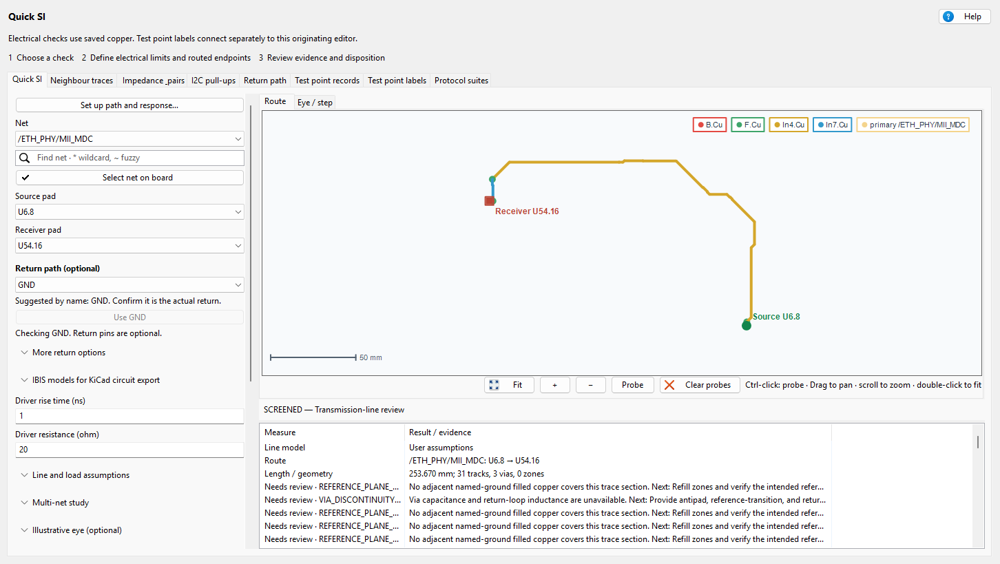
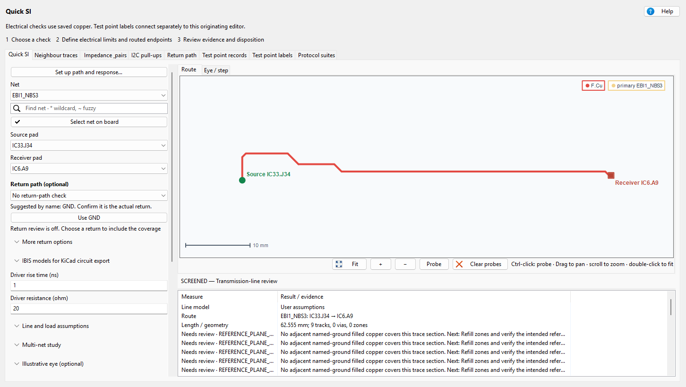

# Quick SI user guide

> **Workspace controls:** the route fills the work area on opening. **Set up path…**
> is the guided starting point; **Setup** shows the manual fields and optional
> studies described below. **Run SI** starts screening, **Details** opens the
> results table, and **Files** contains setup/result Save and Load, reports,
> Blender and KiCad circuit exports. **PCB** contains cross-selection and highlighting.
> **Fit** frames the route; **Focus view**
> hides/restores panels without changing inputs or results. Earlier tutorial
> screenshots are retained as worked examples; their controls now live here.


A control-by-control guide to implemented Quick SI workflows, with worked boards
and complete CLI argument tables. It covers 3.6.41 and explicitly marked source
updates. Use it with
the [feature reference](ReadMe.md), [offline help](help.html) and
[offline HTML edition](USER_GUIDE.html). Screenshots retain their actual capture
versions; they demonstrate workflows rather than measured hardware results.

## Save and recall setup

1. Save the PCB, then choose **Save setup…** in the input column. The suggested
   filename is `<board>.quick-si.setup.json` beside the PCB. Choose any JSON
   filename or another folder in the dialog.
2. **Load setup…** restores every main route input, reference layer, return net
   and optional source/receiver return pin, eye setting, checked study net,
   drafted study case, directed crosstalk pair and IBIS selection. Blank draft
   endpoints remain blank; loading does not guess signal direction.
3. A changed PCB revision requires explicit review before loading. Nets, pads,
   layers and model assignments are checked against this board first. Missing
   or changed IBIS files stop loading with an error; no assignment is silently
   dropped. Keep external `.ibs` files available when moving a setup.
4. Existing computed results are cleared when setup loads. Run a new analysis.
   To inspect a previous calculation without running, use **Files → Load results…**
   and choose its result JSON instead. Setup JSON and result JSON are different
   file types and cannot be substituted for each other.

Cancelled dialogs and invalid files leave existing inputs unchanged. These
operations change annotation-free analysis data only; the PCB is not written.

## Contents

- [Marble worked example](#marble-worked-example)
- [White Rabbit worked example](#white-rabbit-worked-example)
- [Control reference](#control-reference)
- [Complete CLI parameter reference](#complete-cli-parameter-reference)
- [Choose a workflow](#choose-a-workflow)
- [Prepare the project](#prepare-the-project)
- [First path screen](#first-path-screen)
- [Read the results](#read-the-results)
- [Return paths](#return-paths)
- [Several nets and endpoint pins](#several-nets-and-endpoint-pins)
- [Inspect and cross-select](#inspect-and-cross-select)
- [Eye and step response](#eye-and-step-response)
- [IBIS and circuit export](#ibis-and-circuit-export)
- [Shunt capacitors](#shunt-capacitors)
- [Differential delay and phase](#differential-delay-and-phase)
- [Protocol suites](#protocol-suites)
- [Neighbour exposure and crosstalk](#neighbour-exposure-and-crosstalk)
- [Impedance targets and I2C](#impedance-targets-and-i2c)
- [Test points](#test-points)
- [Reports and PDF](#reports-and-pdf)
- [CLI cookbook](#cli-cookbook)
- [Troubleshooting](#troubleshooting)
- [Methods and acceptance](#methods-and-acceptance)

## Choose a workflow

| Question | Use | Output |
|---|---|---|
| Length, delay and termination? | Quick SI path screen | Connected route, section evidence and conditional estimates |
| Reference copper near transitions? | Return review / Return path tab | Sampled geometry and nearby return-via findings |
| Compare several routes? | Multi-net study | Independent cases and case-specific errors |
| Match P/N timing? | Protocol suites, Pair delay / phase | Skew, explicit-frequency phase and lane mean-delay differences |
| Investigate nearby traces? | Neighbour traces | Geometric exposure map; conditional local NEXT with model inputs |
| Simulate a board channel eye? | Board RLC eye | Cascaded extracted sections, receiver C and reviewed via equivalents |
| Use device IBIS models? | Reviewed circuit export | Separate schematic to open and simulate in KiCad |
| Select I2C pull-ups? | I2C pull-ups | Permitted resistance range and candidate |
| Document/label test points? | Test point records / labels | Records or explicitly reviewed editor annotations |

Analysis is read-only. **Test point labels** is a separate annotation-write
workflow with review and **Apply to editor**. A screen, a geometric audit, a
generated circuit and an executed simulation are different deliverables.

## Prepare the project

1. Install Quick SI through the WayriCAD PCM repository and restart PCB Editor.
   See [installation](../docs/INSTALLATION.md) and
   [runtime setup](../wayricad_runtime/RUNTIME_SETUP.md).
2. Open the intended project, refill zones and save the board/project/custom rules.
   Saved-board analysis excludes unsaved edits.
3. Review enabled copper layers, dielectric thickness/Er and copper thickness.
   Missing data must remain unknown or become a clearly declared assumption.
4. Launch Quick SI from that editor. Start with one simple path before many nets.
5. Inspect the route and model basis before exporting a report.

Source CLI board operations need KiCad's native Python bindings. An editable
package install does not supply pcbnew or wxPython. Install `wayricad[si]` for
plotting and `wayricad[reports]` in the interpreter performing PDF export.
Profiles, saved-report suites, timing advice and standalone eyes can work without
reopening a board; this does not make old evidence current.

## First path screen

1. Open **Set up path…** in **Quick SI**. Search full net names:
   ordinary text is substring search, `*`/`?` enables wildcards and `~` fuzzy matching.
2. Select distinct Source and Receiver pads, for example `U1.1` and `J1.1`.
   Confirm direction from the schematic/device data; swap roles explicitly.
3. Enter actual driver/line inputs using the table below.
4. Confirm the real return net in **Return path (optional)** if geometric return
   review is wanted. Extra return-pin assignments are not required for that review.
5. Choose **Apply and screen**, or **Apply setup** then **Run SI**.
   Cancel preserves the workspace; input changes invalidate old results.
6. Review route coverage, model basis, **Needs review** reasons and next actions.


This native capture uses public Marble `/ETH_PHY/MII_MDC`, `U6.8` to `U54.16`.
Its 50 Ω, effective Er 3.2, 1 ns edge, 20 Ω driver, 50 Ω receiver and 100 MHz
are explicit demonstration inputs. This is setup evidence, not a new simulation.

| Input | Units / blank behavior | Selection advice |
|---|---|---|
| Rise time | ns; default 1 ns is assumed | Use the relevant driver edge, not simply inverse bit rate |
| Frequency | MHz; default 100 MHz is assumed | Used for electrical length; distinct from data rate |
| Driver resistance | Ω; default 20 Ω is assumed | Device/corner approximation and intended series path |
| Receiver resistance | Ω; blank = ideal open | Resistive termination, not receiver input capacitance |
| Assumed Z0 | Ω; blank = extracted evidence or unknown | Justified uniform-line approximation only |
| Effective Er | Dimensionless; blank = geometry or unknown | Not automatically laminate bulk Er |
| Reference layer | Auto or explicit layer | Separate from the return-net geometric audit |
| Eye rate/swing | Mb/s and open-circuit V | Explicit NRZ demonstration inputs |

A saved physical stackup can support first-order timing across outer microstrip,
internal homogeneous dielectric and via travel. APPROXIMATE can assume ideal
continuous reference planes; it does not prove continuity or solve via reflections.
Missing/incompatible physical data remains unresolved.

## Read the results

| Quantity | Meaning / caution |
|---|---|
| Length/tracks/vias/layer changes | Selected connected path, not necessarily every branch |
| Delay / round trip | One-way propagation estimate and twice it within stated coverage |
| Electrical length | 360 × frequency × delay |
| Delay/rise ratio | The 1/6 transmission-line trigger is a heuristic, not signoff |
| Z0 and section range | Supported extracted sections or declared assumption; partial coverage is not uniform whole-route Z0 |
| Reflection | Ideal resistive `(R - Z0)/(R + Z0)` endpoint model |
| First arrival | First lossless load step, not worst overshoot or receiver margin |
| Series-match candidate | Nonnegative `Z0 - Rsource`; review topology/device limits |
| Resistance | DC/AC section estimates within the selected model |
| Needs review / coverage | Omitted geometry, materials, branches, terminals and assumptions |

HTML includes cumulative delay, section impedance and cumulative DC resistance
plots, with via positions and gaps for unknown values. A useful partial result
does not become complete by replacing unknowns with arbitrary defaults.
SCREENED, COMPLETE or a budget pass does not establish protocol compliance.

## Return paths

### Normal one-return setup

1. Choose the signal and terminals first.
2. Confirm its actual return with **Use GND** / **Use suggested return**, or
   choose it manually. Ground-like names are suggestions, not inferred connectivity.
3. Run the same path screen; **No return-path check** deliberately leaves it off.
4. Review per-layer sampled coverage, signal-via transitions, reference nets/layers
   and nearby return vias. A candidate needs contact with the local filled polygon,
   not merely the same net name or close coordinates.


This synthetic example has no filled return zone, so coverage remains unresolved.
It demonstrates the controls rather than a passing return path.

Open **More return options** for multiple return nets, optional endpoint return
pads or reference-layer override. **Find… / Ctrl+F** searches while retaining
checked items; inspect the count after filtering. Pins are not assigned automatically.

### Studies and board-wide review

For a study, select common returns and **Use this return setup for study cases**.
Optional per-case pins are cleared because endpoints differ; edit exceptions in
**Edit study cases**. Signal=return is rejected without partly updating cases.

The **Return path** tab provides board-wide return-net patterns, transition-via
radius, stub length, differential uncoupling gap and length-skew thresholds.
Choose **Analyze Board**, inspect findings/preview and **Export CSV…**.
Thresholds are engineering inputs, not universal design rules.

The route-linked review covers the whole signal net, even in a two-endpoint
screen. Sampling copper/annular contact does not solve distributed return current,
closed-loop continuity, return resistance/inductance or transfers between reference nets.

## Several nets and endpoint pins

1. Expand **Multi-net study**, search/check nets and **Add checked nets to study**.
2. **Edit study cases**: set unique IDs, exact Source/Receiver labels and direction.
   Review each row's edge, frequency, resistance, reference and optional Z0/Er.
3. Apply common returns, then edit exceptions. A study supports up to 64 independent
   source-to-receiver screens on one saved PCB/project/rules revision.
4. Run and select each case above the preview. Failed cases retain their errors;
   successful cases retain individual routes, plots and evidence.
5. Export the comparison and review incomplete/omitted coverage.

The setup guide lists other pads on the same footprint/net. **They remain separate
SI terminals**: they are not silently collapsed into an ideal two-port pin group.
Screen meaningful paths separately and inspect additional terminals, branches and
loading. A two-pad path does not model a whole multi-load bus. Circuit export has
stricter whole-net guards and rejects unresolved branches/additional terminals.
A multi-net study alone adds neither simultaneous switching nor coupled waveforms.

Adapt [independent-routes.json](independent-routes.json), replacing all placeholder
nets/pads/values. Optional directed local coupling is described below.

## Inspect and cross-select

- Wheel zooms, drag pans and Fit restores the overview. Pane dividers resize
  settings/results; expanded controls and tables scroll separately.
- **Select net on board** chooses a saved pad/via/track net. Confirm endpoint roles.
  **Probe** or Ctrl-click adds geometry coordinates; **Clear probes** removes them.
- **Select route in PCB** selects exact saved UUIDs. Ordinary preview clicks can
  select measured items through the originating editor connection.
- **Select return nets in PCB** selects checked return items; incomplete/ambiguous
  identity resolution is rejected instead of partly selecting unrelated items.
- **Use PCB selection** reads the launching editor. For several unrelated selected
  nets, choose one signal explicitly. Two selected pads alone do not define direction.
- Disabled live controls in saved/offline contexts cannot write to an unrelated editor.
  Save/reopen after source changes or identifier mismatches.

Offline route/eye/step plots support hover, click-to-pin, pan/zoom and Fit where
provided. A coordinate probe is not a solved field/voltage at that board point.
See [interaction controls](../docs/ANALYSIS_INTERACTIONS.md).

## Eye and step response

Enable **Board RLC eye**, enter the actual NRZ rate, open-circuit swing,
driver resistance/rise time and receiver resistance/capacitance, then run SI.
The channel cascades the selected route's ordered extracted R/L/C sections;
width changes retain their reflections and copper resistance produces loss.
Vias require explicit reviewed loop L and shunt C per via. Missing references,
unsupported sections and unmodelled branches block the eye without ideal fallback.

The model is linear, with frequency-independent DC copper resistance and
quasi-static L/C. Skin/proximity effect, dielectric loss, IBIS, coupling and
jitter are not included. Uniform Z0/Er overrides affect the separate route
screen, not this eye. Native plots and reports include refinement/settling
checks; click to pin probes and right-click to clear them.

See the [complete setup, equations, CLI and limits](BOARD_RLC_EYE.md).
The standalone `wayricad-si eye` command remains explicitly ideal and lossless.

## IBIS and circuit export

1. Complete a saved-board screen/study and review **whole-net** routing coverage.
   Exactly two signal pads and accounted routing are required. Zones, branches,
   stubs, loops or disconnected copper can block export.
2. Expand **IBIS models for KiCad circuit export**. **Load IBIS…** separately for
   driver/receiver, or **Use source file for receiver** when appropriate.
3. Choose the exact Component, Pin and compatible Model. Verify the displayed
   PCB-to-IBIS mapping against manufacturer data; matching numbers are suggestions.
   Select typ/min/max corner explicitly.
4. For studies, assign both ends for every exported completed case. Failed or
   unassigned cases are reported rather than silently omitted.
5. Review duration, maximum timestep, frequency and duty cycle. **Suggest timing
   from selected routes** uses declared edges, delays and periods; it excludes
   capacitor/ESL timescales and is not convergence proof. Above two million suggested
   intervals is rejected rather than silently coarsened.
6. Leave via approximations off unless manual capacitance and **complete via-loop**
   inductance are justified. Missing copper thickness needs reviewed thickness
   and rescreening with declared uniform Z0/effective Er.
7. **Export KiCad circuit…** or **Copy circuit…** creates a new bundle. Open it in
   KiCad, inspect connections/model paths, run the native simulator and refine
   maximum timestep until relevant peaks stabilize.

The bundle contains a project/schematic, channel sheets, symbol library/table,
manifest, clipboard fragment and hashed model copies. Keep it: clipboard model
links depend on those files. Re-export for an isolated second copy; pasting the
same fragment twice reuses global signal names and connects the copies. Ideal
reference ground is shared intentionally.

Export does not execute/qualify IBIS simulation. Cases remain independent with
ideal references, without inter-net coupling or extracted via discontinuities.
See [export scope](ReadMe.md#reviewed-ibis-circuit-export).

## Shunt capacitors

In export/copy settings choose **Shunt capacitors…**. Enter a unique ID, case,
source/receiver attachment, C/ESR/ESL. UI units are **nF, mΩ, nH**; JSON uses
**F, Ω, H**. Blank capacitance is invalid. Blank/omitted ESR/ESL means ideal zero,
not inferred parasitics. Each series-RLC branch remains separate, up to 64 per
case and 256 per export.


The genuine capture contains entered demonstration values, not a board simulation.
Branches connect signal → ESR → ESL → C → ideal reference. They affect **exported
KiCad/ngspice transients only**. Along-route capacitor pads, actual return loops,
bias dependence and omitted PCB loading are not inferred. A manual shunt does not
waive whole-net export guards. Inspect internal capacitor nodes and receiver
voltage and refine timestep for actual RC/LC scales.

## Differential delay and phase

1. Screen both legs in the same transmitter-to-receiver direction/revision.
2. In **Protocol suites**, add snapshots with exactly one P and N sharing the same
   Group, such as `lane0`.
3. Enter **Pair phase frequency (MHz)**, or leave blank for delay/skew only.
   Frequency is never inferred from bit rate.
4. Run and inspect **Pair delay / phase**. Choose a lane reference group or review
   the first valid alphabetical default, then export tables/evidence.

Signed skew is `tN - tP`; phase is `-360 × f × (tN - tP)` in degrees using seconds
and Hz. Thus 125 ps gives -45° at 1 GHz. Reports include absolute skew, mean delay,
unwrapped/wrapped phase and lane mean-delay differences. Intended 180° differential
inversion is excluded. Missing delay/provenance or incompatible revisions remains
unknown/blocked. Independent propagation timing is not mixed-mode/dispersive phase,
package delay, receiver crossing time or common-mode conversion.

## Protocol suites

Choose the actual interface, add route snapshots, assign roles/groups and justified
engineering budgets. A synchronous bus needs one clock and data routes per group;
for DDR DQ, its strobe may serve as clock without modeling a coupled strobe.
Use `profiles` for current IDs. USB/PCIe/DDR/Ethernet/LVDS/CAN and other profiles
organize review, not every revision's compliance simulation. M.2 alone is a form
factor: choose actual PCIe/SATA.

Budgets are maximum delay ns, skew ps, single-ended impedance error % and delay/rise
ratio. Blank evidence/needed budgets stays unknown. Defaults are not device limits.
Two single-ended impedances do not establish differential impedance by addition.
See the [profile/budget reference](../docs/QUICK_SI_PROTOCOL_SUITES.md).

## Neighbour exposure and crosstalk

### Find nearby traces

1. Open **Neighbour traces**; choose an exact net or blank for all connected nets,
   copper layer and radius mm.
2. **Map neighbours**, then search/select table rows or hover/click traces for
   closest location, edge gap, parallel overlap and coverage.
3. Narrow scope if budgets truncate the search and retain warnings in HTML/JSON.


This genuine synthetic three-trace capture maps geometry: red=contact,
amber=half-radius and teal=radius. **Colour is not interference voltage**. Only
straight same-layer tracks are searched; pads/vias/arcs/zones/broadside coupling
are excluded. An empty map is not proof of no interference. Defaults include
15 seconds, 2,000 pairs and 32 optional local models.

NEXT stays UNKNOWN without explicit reference layer, center-to-plane height, Er,
copper thickness, 10–90% edge and open-circuit swing. The optional equal-width
homogeneous-plane matched-end model does not prove actual reference continuity.
**Link current study sections** associates existing directed estimates by source
hash/UUID; it does not add section peaks.

### Directed study coupling

1. Assign cases, then **Configure crosstalk pairs (optional)**.
2. Select aggressor/victim IDs; their source/receiver order determines near/far.
3. Enter edge/swing. **saved-stripline** uses supported adjacent bounding layers,
   homogeneous saved dielectric and filled coverage. **homogeneous-plane** is an
   explicit hypothetical single-plane height/Er model.
4. Run and **Review crosstalk results**. Inspect supported overlap, gaps, modal
   impedances, local step peak, panel refinement and omitted length.

Finite-thickness electrostatic BEM models supported straight parallel equal-width
sections. Saved-stripline needs adjacent reference planes, complete corridor/field
margin and no extra same-layer conductor. End margins near pads/vias/bends remain
unmodeled. Unsupported widths/materials/transitions/crossings/loading stay unresolved.
Four local ports use `R = sqrt(Zeven × Zodd)`; independent case resistances do not
apply. Equal homogeneous modal velocity gives zero FEXT **in the ideal model**,
not on the actual board. Refinement gates are numerical, not physical error bounds.
Local peaks are not added/cascaded into whole-route waveforms. Adapt
[coupled-routes.json](coupled-routes.json) and read [field limits](ReadMe.md#directed-local-crosstalk).

## Impedance targets and I2C

### Impedance & pairs

Choose a preset and review target Ω, tolerance %, frequency, primary pads,
mate/pads and reference layer. Check inferred mate names: names are not proof of
connectivity. **Analyze and validate path**, then inspect availability/error,
route/reference notes, length skew and stubs. PASS means a supported estimate
meets the chosen tolerance, not channel qualification. Live **Use PCB selection**
may be disabled in a saved-board context.

### I2C pull-ups

Enter bus voltage V, total capacitance pF (devices/tracks/connectors), maximum
rise time ns, sink capability mA and VOL maximum V. **Calculate permitted range**
reports minimum from current, maximum from rise time and an E24 midpoint candidate.
If no range exists, review actual capacitance/speed/driver rather than selecting
outside both constraints. This does not extract total bus capacitance or simulate
buffers and every device's timing specification.

## Test points

### Records and fixture draft

In **Test point records**, set descriptor field (normally `TP_Descriptor`), board
order and filters, then **Extract Preview**. Review net/descriptor, connected IC
pin/function and intermediate paths. Double-click rows to cross-select; export
CSV/Markdown/HTML. Passive traversal may include shunts, so verify against the
schematic; missing pin functions/direction remain review items.

**Export Fixture Plan** creates a channel map; **Generate Fixture PCB** creates
a separate bed-of-nails draft. Assign actual connector/probe footprints, inspect
alignment/routing and run native DRC. It does not qualify mechanical contact or
edit the source board. See [descriptor help](test_points/help.html).

### Labels and board table

1. Open **Test point labels** with its originating editor connected.
2. Set reference pattern (`TP*`) and template `{net}` or `{ref}: {net}`.
3. **Load test points**, edit proposed values and **Review changes**.
4. **Silkscreen and table options** exposes front/back values or a two-column
   editable TP/net table at entered coordinates.
5. Inspect preview and **Apply to editor** for one undo transaction. Source changes
   after preview reject the plan. **Undo last apply** requires the apply still be
   current; otherwise use native KiCad undo.

Locked/unconnected/ambiguous multi-net footprints are excluded. Offline saved
runs preview but cannot write to unrelated editors. Existing value positions/sizes
are preserved. Glyph previews are approximate: inspect actual rotation/mirroring
and silk/pad DRC. PCB values do not update schematic values and can be overwritten
by Update PCB from Schematic.

## Reports and PDF

Export HTML for readable route/eye/step figures, interaction and evidence; retain
paired JSON. Study/neighbour/suite outputs retain their own model/coverage notes.
Raw JSON stays in a disclosure. Reopen/rescreen changed sources rather than editing
hashes; outputs must not overwrite input designs/models.

Print trusted HTML after reviewing print preview, or use direct PDF below. Direct
PDF retains text/tables and embedded PNG/JPEG; canvas/SVG/unsupported interaction
is explicitly retained in HTML, not silently reproduced. It does not execute
scripts or retrieve external assets. Keep HTML/JSON alongside PDF. Install the
reports extra in that interpreter first.

```text
python -m wayricad_runtime.tool_cli report-pdf route.html --output route.pdf --evidence route.json
python -m wayricad_runtime.tool_cli report route.json --html review.html --pdf review.pdf --title "Signal review"
```

Evidence is optional and checks declared source fingerprints. Generic JSON
rendering presents recorded data without recomputation. Add `--include-raw-evidence`
to report-pdf only for a full JSON appendix. See [report details](../wayricad_runtime/REPORTS.md).

## CLI cookbook

Examples use the source-module entry point. Installed users may substitute
`wayricad-si` or `wayricad tools run quick-si --` before the subcommand. Replace
generic paths/net/pad names with inspect results. Quote hierarchical names/spaces.
Use an interpreter with the relevant native/optional dependencies.

### One route

```text
python -m signal_integrity_advisor_plugin.cli inspect C:/Projects/Example/board.kicad_pcb --net DATA --output inventory.json
python -m signal_integrity_advisor_plugin.cli screen C:/Projects/Example/board.kicad_pcb --net DATA --start U1.1 --end J1.1 --rise-ns 1 --frequency-mhz 100 --source-ohm 20 --load-ohm 50 --return-net GND --return-source U1.3 --return-load J1.3 --output route.json --html route.html
```

Omit load-ohm for ideal open load. Optional `--z0-ohm 50 --epsilon-eff 3.2` declares
assumptions, not missing-data repairs. Repeat return-net for several returns.

### Multiple routes, neighbours and ideal eye

```text
python -m signal_integrity_advisor_plugin.cli study C:/Projects/Example/board.kicad_pcb --config independent-routes.json --output study.json --html study.html
python -m signal_integrity_advisor_plugin.cli neighbours C:/Projects/Example/board.kicad_pcb --net DATA --layer F.Cu --radius-mm 1 --output neighbours.json --html neighbours.html
python -m signal_integrity_advisor_plugin.cli eye --z0-ohm 50 --delay-ns 1 --source-ohm 20 --load-ohm 50 --rise-ns 0.5 --bitrate-mbps 100 --swing-v 1 --output eye.json --html eye.html
```

Adapt the bundled study templates first. Neighbours accepts repeated net/layer,
optional `--model model.json` and source-bound `--study-report study.json`.

### Pair roles, budgets and phase

```text
python -m signal_integrity_advisor_plugin.cli screen C:/Projects/Example/board.kicad_pcb --net DATA_P --start U1.1 --end J1.1 --role P --group lane0 --output p.json
python -m signal_integrity_advisor_plugin.cli screen C:/Projects/Example/board.kicad_pcb --net DATA_N --start U1.2 --end J1.2 --role N --group lane0 --output n.json
python -m signal_integrity_advisor_plugin.cli profiles
python -m signal_integrity_advisor_plugin.cli suite --profile lvds --reports p.json n.json --max-skew-ps 20 --timing-frequency-mhz 100 --timing-reference-group lane0 --output pairs.json --html pairs.html
```

20 ps is arbitrary usage data, not an LVDS requirement. Add justified
`--max-delay-ns`, `--max-impedance-error-percent`, `--max-delay-to-rise-ratio`
budgets when needed. Never mix PCB revisions by editing report hashes.

### IBIS and circuit bundle

```text
python -m signal_integrity_advisor_plugin.cli ibis-catalog C:/Projects/Example/models/driver.ibs --output driver-catalog.json
python -m signal_integrity_advisor_plugin.cli ibis-catalog C:/Projects/Example/models/receiver.ibs --output receiver-catalog.json
python -m signal_integrity_advisor_plugin.cli timing-advice route.json --output timing-advice.json
python -m signal_integrity_advisor_plugin.cli circuit route.json --assignments assignments.json --duration-ns 100 --timestep-ns 0.1 --frequency-mhz 100 --duty-percent 50 --output C:/Projects/Example/SI-circuit-review
```

Adapt [ibis-assignments.example.json](ibis-assignments.example.json): replace hashes,
model/component/pin placeholders with catalog evidence. Relative model paths resolve
against that file. Single route case ID is `route`; studies use exact IDs.
Repeat `--case clock --case data` for subsets; output directory must not exist.
Catalog metadata is not electrical-table validation or simulator qualification.
Reviewed via fallback requires `--allow-approximations --via-capacitance-pf …
--via-inductance-nh …`; thickness uses `--copper-thickness-um` with the rescreen above.

### Touchstone and optional desktop

```text
python -m signal_integrity_advisor_plugin.cli line-network route.json --stop-hz 1000000000 --points 1001 --reference-ohm 50 --output ideal-line.s2p
python -m signal_integrity_advisor_plugin.cli network channel.s2p --to-port 2 --from-port 1 --output network.json
python -m signal_integrity_advisor_plugin.cli desktop --check
python -m signal_integrity_advisor_plugin.cli desktop C:/Projects/Example/channel.si
```

Line-network is an ideal lossless uniform two-port, not extracted board S-parameters:
source/load/loss/vias/coupling are omitted. A complete two-terminal route without
zones is required; stop frequency is Hz. Network uses optional SignalIntegrity 1.5.2
for bounded Touchstone 1.0 S data with an option line; ports are one-based.
It retains complex response, dB and phase. The upstream Tk desktop is separate,
may use `--python`, accepts trusted projects and blocks until closing. Its advanced
features are not embedded/automatically qualified in Quick SI.

### Jobsets and outcomes

Use these commands with the [shared jobset runner](../wayricad_runtime/JOBSETS.md)
for ordered steps, logs and HTML/JSON index, including native KiCad jobset invocation.
Input/model requirements remain unchanged. Suite exits: 0 within supplied budgets,
1 input/export error, 2 blocked, 3 review/incomplete. Study/neighbour REVIEW or
INCOMPLETE also returns 3. Always inspect status and coverage, not just completion.

## Troubleshooting

| Symptom | Next action |
|---|---|
| No nets / wrong project | Confirm originating editor/saved PCB and runtime; do not install unrelated pcbnew packages |
| Route unavailable | Check exact distinct endpoints, duplicate pad identities, connectivity, zones and branches |
| Unknown delay/Z0 | Review physical stackup, reference evidence and unsupported sections; enter only justified assumptions |
| Unknown NEXT | Supply supported material/reference/edge inputs; geometric colour is insufficient |
| Circuit blocked despite visible path | Check whole-net branches/stubs/terminals, thickness and via approximation guards |
| Stale result | Save/refill, reopen and rerun all compared cases on one revision |
| Slow analysis | Start with narrow nets/layers/radius and fewer cases; cancel owned jobs and inspect budget truncation |
| Controls clipped | Drag dividers, scroll tables independently and use full-name tooltips |
| Missing plots/PDF | Install si/reports extras in the actual executing interpreter |
| Circuit waveform fails | Verify model paths, native IBIS support/mapping/corner, stimulus and timestep convergence |

Saved-board workers hash PCB/project/rules before/after and before result acceptance
or export. Changing inputs, Cancel or close cancels the owned job. Normal
analysis budget is 300 seconds. Legacy/live windows may be synchronous rather than
silently analyzing saved bytes. First dependency initialization is real first-run work.

## Methods and acceptance

Read [solver methods and references](ReadMe.md#solver-methods) for routed quasi-static
extraction, local BEM, ideal line response and sampled return evidence. Supporting
references include [RLC methods](../trace_impedance_plugin/ReadMe.md#solver-methods),
[IBIS 7.1](https://ibis.org/ver7.1/),
[KiCad simulator IBIS](https://docs.kicad.org/10.0/en/eeschema/eeschema.html#ibis-models)
and [ngspice](https://ngspice.sourceforge.io/docs/ngspice-manual.pdf). A citation
does not imply every method in that reference is implemented.

- Confirm saved revision, route, endpoint roles and direction.
- Separate extracted values, entered assumptions and omitted terms.
- Review full route/net coverage, references, vias and branches.
- Use device-specific budgets and explicit phase frequency; retain unknowns.
- For circuits, inspect native connections/models, execute the simulator and refine
  timestep. Export alone is not simulation.
- Retain HTML/JSON, configurations and referenced models together.
- Use suitable coupled/channel/measurement evidence for signoff; arbitrary buses,
  full-wave fields and complete device/package/protocol behavior are not inferred.

## Blender visualization

This feature is in the updated source; existing 3.6.41 installers do not contain it.

After a supported completed study, choose **Files → Export to Blender…** in the main result workspace. Choose a new output folder and optionally open an installed Blender. The export includes geometry, available field data and supported computed frames. Export saved transient or other supported results through the shared CLI when they are not the main workspace result. Review [the Blender walkthrough](../wayricad_runtime/BLENDER.md) for commands, units, playback, result coverage and limits. This is visualization, not an additional numerical solve.


## Marble worked example

Use a disposable, saved copy from the [example-board preparation guide](../docs/QUICK_TOOL_EXAMPLE_BOARDS.md). These instructions use the converted KiCad board whose SHA-256 is `482850dbaaef9157e2e98af765a3c0d4d9c9f800daae224a54bf10e0621f52b0`. Do not mix its pad labels with another Marble revision.

### Run the route and explicit return review

1. Save the board and filled zones. Open Quick SI from its originating PCB Editor or open the saved-board source window.
2. Choose `/ETH_PHY/MII_MDC`, source `U6.8`, receiver `U54.16`. This example direction is a reviewed tutorial assignment, not automatic driver detection.
3. Set rise time **1 ns**, frequency **100 MHz**, source resistance **20 Ω** and receiver resistance **50 Ω**. These are explicit illustrative interface assumptions, not extracted device specifications.
4. Set assumed uniform Z0 to **50 Ω** and effective Er to **3.2**. Leaving these blank exercises the saved geometry/stackup screen instead and can produce an approximate or incomplete result. Do not compare those two models as though they were the same calculation.
5. Choose **GND** under Return path. Leave optional return pins unspecified for this coverage-only run. Use **More return options** if the real interface has several reference nets. The reference-layer choice remains **Auto**.
6. Click **Run SI**. Observe progress; **Cancel** stops its owned worker without editing the PCB. The result is valid only for the saved source revision.
7. Read route length **253.670353 mm**, **31 tracks**, **3 vias** and the routed layers. With the stated complete-route Er assumption, the delay is **1.513644892 ns**. Z0 is the entered **50 Ω**. Their evidence strings explicitly identify assumptions.
8. Open **Route** to inspect vias/layer transitions, inspect return coverage separately, and review every blocker. `SCREENED` does not certify the actual route's impedance, transitions or return-current distribution.
9. In a live editor session, **Select route in PCB** selects only the result's native items. **Select return nets in PCB** deliberately selects the assigned whole return-net set. A saved standalone snapshot cannot supply a live editor selection.
10. Export HTML/JSON, then optionally PDF or Blender. Change one input, confirm the old result is invalidated, and rerun before exporting again.



Actual native KiCad 10.0.6 client-area capture with the inputs above; source bytes were unchanged. This is a screening example, not measured hardware. The visible path is the selected route, not an assertion that adjacent copper or all return currents were simulated.

```text
wayricad-si screen C:/Projects/Examples/Marble.kicad_pcb --net /ETH_PHY/MII_MDC --start U6.8 --end U54.16 --reference Auto --rise-ns 1 --frequency-mhz 100 --source-ohm 20 --load-ohm 50 --z0-ohm 50 --epsilon-eff 3.2 --return-net GND --output marble-mdc.json --html marble-mdc.html
python -m wayricad_runtime.tool_cli report-pdf marble-mdc.html --output marble-mdc.pdf --evidence marble-mdc.json
```

### Continue through eye, IBIS and pair studies

For the **Board RLC eye**, enter reviewed rate, swing, source/load and receiver capacitance. The rate is not inferred from evaluation frequency. This Marble route has vias: enter characterized loop L/C equivalents or retain an unavailable eye. Uniform Z0/Er assumptions do not complete its channel extraction; IBIS remains separate.

For an **IBIS simulation**, load actual compatible source/receiver model files, review pin/model/role mappings and export a new circuit bundle. Add endpoint shunt branches if required, then run the schematic's simulation in KiCad/ngspice and refine its timestep. This guide does not provide substitute IBIS models for Marble devices.

For **multi-net or differential work**, use the per-case editor and Protocol suites with actual P/N or bus roles. MDC is a single-ended example and must not be relabelled a differential pair to obtain a skew result. Repeat the route screen for each real leg and add both snapshots to the same explicit group.

## White Rabbit worked example

Use the native KiCad import of the White Rabbit Switch v3 SCB described in the [example-board preparation guide](../docs/QUICK_TOOL_EXAMPLE_BOARDS.md). Imported-board SHA-256: `44b1f5d7da960c3e474ba1010413b9b5b90a7096610effb15dd55d3d3fda54a1`. The upstream Altium board and converted KiCad board are different evidence. This import has no qualified material stackup; do not treat entered Er/Z0 as extracted specifications.

1. Keep the original Altium and converted board unchanged. Open a saved working copy.
2. Choose `EBI1_NBS3`, source `IC33.J34`, receiver `IC6.A9`. The chosen direction is explicit.
3. Enter **1 ns**, **100 MHz**, **20 Ω** source, **50 Ω** receiver, assumed **50 Ω** uniform Z0 and effective **Er 3.2**. These are illustrative assumptions for a reproducible route screen.
4. Leave **No return-path check** selected for this first run. That means return coverage was not checked; it does not mean no return is required by the hardware.
5. Run **Run SI**. The native route resolves to **62.554862086 mm**, **9 tracks**, **0 vias**, with **0.373263357 ns** delay under the entered Er. It is not a stackup-derived qualified channel.
6. Inspect route endpoints, evidence strings and complete-route circuit coverage. Export separate HTML/JSON. When adding return review, select the actual imported net names and retain every incomplete-reference finding.



Actual native capture of the unchanged imported board. The board is shown through its selected routed path; no missing planes, materials or device models were invented.

```text
wayricad-si screen C:/Projects/Examples/WhiteRabbit.kicad_pcb --net EBI1_NBS3 --start IC33.J34 --end IC6.A9 --rise-ns 1 --frequency-mhz 100 --source-ohm 20 --load-ohm 50 --z0-ohm 50 --epsilon-eff 3.2 --output wr-ebi.json --html wr-ebi.html
```

### Understand an unresolved imported route

`SPI1.SPI1_MOSI`, `IC33.AL15` to `IC6.V5`, remains `ROUTE_DISCONNECTED` in this converted board's conservative centerline graph. Small imported endpoint differences are not repaired by this analysis. The guide does not modify the board, widen tolerances or replace the route with aggregate net length. Z0/Er assumptions cannot resolve missing connectivity. Use native KiCad connectivity/DRC to review the import on a separate copy, then rerun the intended source revision. An unresolved example is deliberately retained so the failure is visible rather than replaced with plausible numbers.

## Control reference

This reference covers the current native source interface, including the Blender source update. A 3.6.41 installer will not show controls introduced after that release. Each result belongs to its selected inputs and saved/live source boundary. Hidden advanced sections do not imply that their defaults are appropriate for your board.

### Window, navigation and main path inputs

| Control | Enter or do | Effect, default and recovery |
|---|---|---|
| Quick SI / Neighbour traces / Impedance & pairs / I2C pull-ups / Return path / Test point records / Test point labels / Protocol suites | Select one of the eight top-level tabs | These are separate models/workflows, not stages of one coupled simulation. |
| Left/right splitter; result-table divider | Drag the sash | Allocate readable space; tables and left settings scroll independently. Resizing changes presentation, not a calculation. |
| Set up path… | Choose net, source and receiver together | Opens the same input model in a grouped dialog. Same-footprint peer pins are shown for review and remain separate SI terminals. |
| Net | Exact connected net name | Selecting a different net rebuilds endpoint choices and invalidates the result. A filtered list does not rename a net. |
| Find net | Literal substring, `*` / `?` wildcard, or `~` fuzzy query | Square brackets stay literal bus punctuation. Match text is not a simulation scope; check the actual selected name. |
| Select net on board | Pick the intended net in the originating layout | Requires a compatible editor connection. Cancel leaves the current choice. |
| Source pad / Receiver pad | Exact `Reference.Pad` labels on the selected net | Must be distinct and unambiguous. Identical net names do not define direction. Other same-net pins are additional loads/stubs, not silently coalesced endpoints. |
| Driver rise time | Positive 10–90% ns; initially 1 ns | Used for delay/rise screening. It is not inferred from data rate. |
| Driver resistance | Nonnegative Ω; initially 20 Ω | Linear resistive source model. It does not become an IBIS model when an IBIS file is loaded. |
| Line and load assumptions | Expand | Reveals evaluation frequency, receiver resistance and optional assumed Z0/Er. |
| Frequency | Nonnegative MHz; initially 100 MHz | Electrical-length/AC section evaluation frequency, not symbol rate or automatic bandwidth. |
| Load resistance | Nonnegative Ω; blank is open circuit | Zero is a short, blank is not zero. Used by the resistive reflection model. |
| Assumed uniform Z0 | Positive Ω or blank | Overrides the uniform screening impedance only; cannot qualify transitions or reference coverage. Blank retains geometry/unknown evidence. |
| Assumed effective Er | At least 1, or blank | Supplies a full-route propagation assumption. It does not repair a disconnected route. |
| Run SI | Run after source/receiver/model review | Saved studies use an isolated cancellable worker. Errors and unknowns stay explicit. |
| Cancel | Stop an active owned job | Cancels computation; no PCB geometry is written. Wait for completion before exporting. |
| Route / Eye / step | Choose the lower workspace view | Route is extracted geometry; eye is a separate optional board-section RLC channel. |
| Result table | Read measure, value and evidence | Delay, round trip, electrical length, delay/rise, Z0, reflection and matching values retain their model source. Unknown is not zero or a pass. |
| Study-case dropdown | Choose a completed case | Route, return audit and numbers follow that case, not an aggregate of all nets. |
| Fit / Zoom + / Zoom − / Save image | Native plot toolbar | Fits or changes the view or saves a display image. An image is not the full numerical evidence. |
| Wheel / drag / double-click | Zoom / pan / fit in supported canvases | Cursor probes refer to the displayed plot; they do not add a simulation terminal. |
| Select route in PCB | Select native result items | Disabled without a usable current route/connection. Selection does not alter copper. |
| Select return nets in PCB | Select the explicitly reviewed return-net set | This deliberately selects more than the signal route; it is not a signal-net highlighting bug. |
| Use PCB selection | Import the originating editor selection | Ambiguous multiple nets retain explicit choice; source/receiver direction is not guessed from an unordered selection. |
| Help / Help: Quick SI workflow | Open bundled help and detailed guides | Source-only updates are identified separately from existing PCM downloads. |

### Guided setup and return controls

| Control | Meaning and action |
|---|---|
| Setup: Net, Source, Receiver | Choose exact endpoint identity; same-part peer text helps detect extra loads. |
| Swap source and receiver | Reverses the explicit endpoint roles; review driver and load values separately. |
| Setup numerical fields | Same rise/frequency/resistance/Z0/Er units and blank semantics as the main workspace. |
| Simulate board RLC eye and step response | Enables channel rate, swing, receiver C and reviewed per-via L/C fields; disabled eye fields do not affect the screen. |
| Apply setup | Validate and retain settings without running. Cancel retains the preceding setup. |
| Apply and screen | Validate, apply and invoke normal analysis. Validation errors keep the dialog open. |
| Return path primary | Initially **No return-path check**. Choose an actual return net to request the geometric audit. |
| Use suggested return | Accept a name-based candidate explicitly; a suggestion is not electrical proof. |
| More return options → net checklist | Add actual return nets; search/filter does not clear hidden checked items. Do not select the signal net as its own return. |
| Source return pin / Receiver return pin | Optional exact pads on the chosen return nets. Same-footprint choices are ranked first; **Not specified** means no endpoint-pad evidence. |
| Impedance reference layer | **Auto** or explicit physical layer. This selects line-model reference geometry separately from which nets are audited. |
| Return summary/status | Review assigned nets, optional pads and coverage outcomes. These settings do not solve return-current division or a complete ground loop. |

### Multi-net and crosstalk dialogs

| Control or column | Meaning and action |
|---|---|
| Multi-net study net checklist | Check up to the bounded case count; selecting a name alone does not assign direction. |
| Add checked nets to study | Adds independent rows. Only the current path can inherit its reviewed endpoints; assign all other endpoints explicitly. |
| Edit study cases… | Review every row before running. At most 64 cases. Errors remain per-case. |
| Case ID / Net / Source / Receiver | Unique stable case ID and exact native identities. Blank source/receiver remains an error. |
| Reference / Rise / Frequency / Source R / Load R / Z0 / Effective Er | Per-case settings with the same units/semantics as the single-route form. Do not assume later main-form edits overwrite earlier rows. |
| Return nets / Source return / Receiver return | Explicit case-specific returns; comma-separated names are distinct nets, not wildcard expansion. |
| Delete checkbox in case editor | Checked rows are removed on accepting the editor. Cancel discards the editor changes. |
| Use this return setup for study cases | Copies selected returns to cases and clears optional pads that need per-case reassignment. Review exceptions afterward. |
| Configure crosstalk pairs | Assign directed aggressor/victim case IDs; reversing direction changes the question. |
| Pair ID / Aggressor / Victim | Unique pair identity and two different existing cases. |
| Rise ns / Swing V | Aggressor 10–90% edge and open-circuit swing, positive and explicit. |
| Model | `saved-stripline` checks actual homogeneous stackup and both filled bounding references. `homogeneous-plane` is a hypothetical single-plane model. |
| Lower/reference layer / Upper layer | Required physical reference names for the chosen model. They are not inferred from the words GND alone. |
| Height mm / Er | Explicit center-to-plane distance and dielectric for hypothetical single-plane work; unused by saved-stripline. |
| Delete / Add directed pair | Remove a reviewed row or add one within the 64-pair editor limit. |
| Run multi-net study | Runs independent routes plus only explicitly configured local coupling pairs. There is no whole-bus transient solve. |
| Review crosstalk results | Read modeled and unresolved parallel-section lengths, gap, even/odd impedances, NEXT, ideal homogeneous FEXT and refinement. No route waveform is obtained by summing local peaks. |

### Eye, IBIS and shunt dialogs

| Control | Meaning, units and effect |
|---|---|
| Board RLC eye checkbox / Simulate board RLC eye and step response | Uses ordered extracted RLC sections. Review source/load, receiver C, rate and swing. Via routes need reviewed loop L/C; IBIS/export shunt assignments remain separate. |
| Receiver capacitance / reviewed via loop L / via shunt C | pF / nH / pF. Blank receiver C means 0; both via fields are required for via routes. Identical equivalents apply to every traversed via; not inferred from IBIS. |
| Ideal NRZ bit rate / source swing | Positive Mbps and open-circuit V. Model limits reject excessive sample workloads. |
| Eye plot hover / click | Inspect or pin a sample; changing inputs clears stale plots. It does not measure hardware jitter or BER. |
| IBIS Load… source and receiver | Load actual `.ibs` files. Parsing is bounded; malformed or unsupported models produce diagnostics. |
| Use source file for receiver | Reuses that file's catalogue, not the source model/role automatically. Review the receiver selection separately. |
| Component / Pin / Model / Corner | Exact catalogue component, pin or model-selector choice, supported model and `typ`/`min`/`max` corner. Roles must suit driving/receiving. |
| Endpoint label | Confirms the current PCB pad assignment. Changing the net/pad invalidates a mismatched device-model assignment. |
| Export KiCad circuit… | Writes a new reviewed simulation bundle/schematic. Does not edit the production schematic or execute ngspice. |
| Copy circuit… | Copies the supported native schematic fragment for pasting into KiCad. Retain supporting model files and review copied simulation properties. |
| Duration / Maximum timestep | Positive ns; initially 100 ns / 0.1 ns. Maximum step is not convergence proof. |
| Frequency / Duty | Positive MHz, duty strictly between 0 and 100%. They define stimulus, not measured device behavior. |
| Suggest timing from selected routes | Suggests bounded explicit export settings from edges and route delay; review against actual IBIS bandwidth and refine in ngspice. |
| Copper thickness | Explicit fallback only when a saved section thickness is unavailable. Do not override a known saved value by assumption. |
| Via capacitance / inductance | Nonnegative pF / nH. Unsupported physical via models remain unknown unless an explicit manual approximation is accepted. |
| Allow explicit manual via approximation | Required opt-in for those approximations; it does not validate actual via geometry. |
| Shunt capacitors… / Shunt capacitors · none… | Opens per-case endpoint banks. Source/receiver only; no arbitrary along-route placement or automatic PCB capacitor extraction. |
| Case / Capacitor ID / At endpoint | Exact existing case, unique capacitor identity and `source` or `receiver`. |
| C / ESR / ESL | Positive capacitance in nF; nonnegative mΩ and nH. Zero omits the relevant parasitic. Use effective C after bias/tolerance review. |
| Add capacitor / Remove selected | Add within 256-total/64-per-case limits, or remove the current row. Blank unused rows are ignored. |
| Apply capacitor bank / Cancel | Validate and retain the detached model, or discard edits. PCB Values and BoM are unchanged. |

Quick SI contains no capacitor-placement optimizer or PDN impedance solver. Its shunt parts belong to the exported endpoint circuit. Use Quick PI's separate decoupling/PDN workflow for its supported proximity and lumped-network reviews; neither a shorter distance nor an assumed ideal capacitor establishes globally optimal PCB decoupling.

### Neighbour traces

| Control | Meaning and action |
|---|---|
| Target net | Exact target or blank for all connected nets. Choose a narrow scope first on dense boards. |
| Layer | One enabled copper layer or all layers; comparisons are same-layer. |
| Radius mm | Positive search radius, initially 1 mm. It defines geometric exposure, not an electrical coupling threshold. |
| Map neighbours / Cancel | Starts/stops bounded pair search. Counts and truncation/budget findings remain visible. |
| Gap color legend / pair table | Color reflects separation within the chosen radius; it is not crosstalk voltage. Select a row to highlight the pair. |
| Optional isolated local NEXT model / Use ideal homogeneous-plane model | Enable only for an explicit hypothetical homogeneous reference plane. |
| Reference layer / Height / Er / Copper / Rise / Swing | Layer name, mm, relative Er, mm, ns, V. Initial illustrative values are B.Cu, 0.2, 4, 0.035, 1, 1 and require review. |
| Link current study sections | Match saved study NEXT sections by source fingerprints and native item identities. Unmatched geometry remains unknown. |
| Fit map / wheel / drag / hover/click | Fit, zoom, pan and inspect geometry. These do not change source or numerical inputs. |
| Export HTML + JSON | Export actual bounded map/model evidence, including omitted or unmodeled coverage. |

### Impedance & pairs and I2C pull-ups

| Control | Meaning and action |
|---|---|
| Protocol preset | Sets editable impedance target/tolerance; it is a starting point, not compliance certification. |
| Primary net / Start / End | Exact unambiguous path endpoints. Use PCB selection only in a live originating editor. |
| Mate net / Mate start / Mate end | Optional explicit second path. Name-pattern detection suggests a mate; confirm polarity and direction. `<none>` is single-ended. |
| Target Ω / Tolerance % / Frequency MHz / Reference | Review against actual interface requirements and stackup. Missing sections keep incomplete disposition. |
| Analyze and validate path | Runs section/target screen for selected path(s). It does not solve a coupled differential electromagnetic channel. |
| Pair-detection status / results / preview | Inspect detected naming rule, per-leg values, mismatch and unresolved sections. Click native route items to cross-select where connected. |
| I2C Bus voltage | Positive V, initially 3.3 V. Actual pull-up rail. |
| Total bus capacitance | Positive pF, initially 100 pF. Includes intended devices/route/connectors; not automatically extracted by this calculator. |
| Maximum rise time | Positive ns, initially 300 ns; enter the actual mode requirement. |
| Sink-current capability / VOL max | Positive mA and V, initially 3 mA / 0.4 V. Use actual device limits. |
| Calculate permitted range | Computes resistance interval and an E24 midpoint candidate if feasible. `none` means no feasible candidate; do not silently choose a resistor anyway. |

### Return path, records, annotation and protocol suites

| Control | Meaning and action |
|---|---|
| Return-net patterns | Comma-separated actual name patterns for the separate whole-board audit. They are not solved electrical return assignments. |
| Return-via radius / Stub warning / Diff uncoupling gap / Diff skew limit | Nonnegative mm thresholds. They are user review settings, not inferred protocol limits. |
| Analyze Board | Runs the separate geometric whole-board audit. Main Quick SI return settings are not silently copied into this tab. |
| Finding row / board preview / Export CSV | Review severity/check/net/layer/location/remedy; select/double-click to cross-highlight; export findings, not a simulation. |
| Test records Descriptor field | Initially `TP_Descriptor`; choose actual saved metadata. Missing descriptors remain visible rather than inferred test semantics. |
| Board order | Comma-separated ordering for cross-board records; example DEMO names are not your project. |
| Consolidate duplicate TP/net records | Combines duplicate documentation rows according to extractor rules; does not combine electrical nodes on the PCB. |
| Probe type | P75 spring probe, P100 spring probe, P160 spring probe or Custom fixture draft choice. Mechanical fit and access still require review. |
| Refresh Preview / sortable records / Select on PCB | Extract records, inspect full columns, and locate the selected test point. |
| Records Export… | Select an offered documentation/fixture format. A fixture draft is not a validated manufactured fixture. |
| Labels References / Value template | Select intended test-point reference patterns and explicit label text template. Review expanded strings in the grid. |
| Show values on silkscreen / Add set table / Front or Back | Explicit annotation policy; it does not expose electrical values automatically. |
| Table X/Y / Text size | Board mm / text height mm. Review silk clearances and board bounds in native KiCad. |
| 1 · Load test points / 2 · Review changes / 3 · Apply to editor / Undo last apply | Staged annotation write. Apply requires the originating editor/source checks; standalone saved-board previews cannot write a live editor. |
| Protocol profile | Choose the interface/check set. Missing required roles are unresolved, not passed from a matching net name. |
| Add current Quick SI path / Remove selected path | Stores/removes a reviewed source-bound snapshot; a refreshed route must be removed/re-added deliberately. |
| Reviewed route / Role / Group grid | Assign P/N to a real pair or clock/data/control to a bus. Group ties only intended members together. |
| Maximum delay ns / group skew ps / impedance deviation % / delay-rise ratio | Optional explicit user budgets. Blank means not evaluated against that budget. |
| Pair phase frequency MHz | Explicit comparison frequency; no value is inferred from bit rate. |
| Reference pair group | Optional actual comparison group; otherwise the first valid group alphabetically is used. |
| Run protocol suite | Produces per-check status, missing evidence and pair timing. It does not certify USB/DDR/PCIe compliance. |
| Checks / Pair delay-phase / evidence | Inspect measures, units, evidence and group association; selected route rows drive the preview. Raw evidence remains diagnostic rather than the main result. |
| Export suite report | Retains suite settings, route provenance and conditional timing in HTML/JSON. |

### Export, PDF and Blender controls

| Control | Required state and output |
|---|---|
| Export local HTML report | Current completed route or study. Retains HTML plus full paired JSON; stale source or input changes require rerun. |
| Print / save as PDF | Browser's static print of the readable report; interactive-only views cannot remain interactive in PDF. |
| `report-pdf` | Optional ReportLab exporter; retains text, tables and embedded raster figures, records unsupported views. |
| Raw JSON evidence | Closed disclosure or separate paired file; use it for reproduction, not as a pass/fail result. |
| Blender… | Updated-source feature. Select a new parent/folder, field and optional installed executable; no existing directory is overwritten. |
| Blender Result field | Section delay, impedance or resistance. Missing values are gray; omitted vias/arcs/zones and missing Z are explicit notes. |
| Open Blender after export | Optional explicit launch after successful data export; no automatic software installation. |
| Blender background/render CLI | Builds a new `.blend`/PNG from the data bundle. SI static estimates do not create a propagation animation. |

## Verification checklist for a complete study

1. Record board conversion/revision/hash and whether the workflow reads saved or live data.
2. Confirm source/receiver direction, exact net/pad identity, extra loads, units and reference assumptions.
3. Distinguish geometric Z0/reference evidence from optional assumptions. Preserve missing sections.
4. For a board eye, review edge, bit rate, swing, receiver R/C, extracted sections, via equivalents and convergence. For IBIS, separately review actual compatible models and run/refine the exported simulation.
5. For coupling, preserve modeled and unresolved lengths and the local matched-port assumption; do not assemble local peaks into a fabricated whole-route waveform.
6. For pair timing, confirm P/N/group identity and explicit phase frequency. Device/package/skew terms absent from the model remain absent.
7. Retain explicit inputs, full reports and source hashes. Recreate exports after any change. A favorable number alone is not acceptance evidence.


## Complete CLI parameter reference

The tables below are generated from the current source parser. Units and output custody are explained in the workflows above. Optional values marked “not supplied” are not automatically measured. A parser accepting a command does not establish that a requested physical model is supported.

### Command `neighbours`

| Argument or option | Default | Accepted values and purpose |
|---|---|---|
| `-h, --help` | available | show this help message and exit |
| `board` | required | See workflow model contract. |
| `--net` | [] | Exact target net; repeat. Omit to search every connected net. |
| `--layer` | [] | Copper layer name; repeat. Default every enabled layer. |
| `--radius-mm` | 1.0 | See workflow model contract. |
| `--max-pairs` | 2000 | See workflow model contract. |
| `--seconds` | 15.0 | See workflow model contract. |
| `--model` | not supplied | Explicit hypothetical homogeneous-plane inputs JSON; never inferred. |
| `--study-report` | not supplied | Link existing explicit study section NEXT by source hashes and item UUIDs. |
| `--output` | not supplied | See workflow model contract. |
| `--html` | not supplied | See workflow model contract. |

### Command `ibis-catalog`

| Argument or option | Default | Accepted values and purpose |
|---|---|---|
| `-h, --help` | available | show this help message and exit |
| `source` | required | See workflow model contract. |
| `--output` | not supplied | See workflow model contract. |

### Command `timing-advice`

| Argument or option | Default | Accepted values and purpose |
|---|---|---|
| `-h, --help` | available | show this help message and exit |
| `source` | required | Quick SI route/study JSON report. |
| `--case` | not supplied | Exact study case ID; repeat. Default every case. |
| `--output` | not supplied | See workflow model contract. |

### Command `circuit`

| Argument or option | Default | Accepted values and purpose |
|---|---|---|
| `-h, --help` | available | show this help message and exit |
| `source` | required | Saved Quick SI route or study JSON report. |
| `--assignments` | required | Explicit source/sink IBIS assignments and optional endpoint shunt_capacitors by case ID. |
| `--case` | not supplied | Study case ID; repeat to choose multiple paths. Default: every case. |
| `--output` | required | New simulation bundle directory; must not exist. |
| `--duration-ns` | 100.0 | See workflow model contract. |
| `--timestep-ns` | 0.1 | See workflow model contract. |
| `--frequency-mhz` | 100.0 | See workflow model contract. |
| `--duty-percent` | 50.0 | See workflow model contract. |
| `--allow-approximations` | False | Review and permit supported lumped via/zone approximations. |
| `--via-capacitance-pf` | not supplied | Explicit via capacitance assumption for supported lumped via sections. |
| `--via-inductance-nh` | not supplied | Explicit complete via-loop inductance assumption, not isolated partial L. |
| `--copper-thickness-um` | not supplied | Explicit copper thickness assumption when absent from the saved stackup. |

### Command `desktop`

| Argument or option | Default | Accepted values and purpose |
|---|---|---|
| `-h, --help` | available | show this help message and exit |
| `project` | not supplied | Optional trusted upstream .si project. Takes an optional value. |
| `--python` | not supplied | Python executable with SignalIntegrity and Tk; defaults to this interpreter. |
| `--check` | False | Check desktop imports/version without opening a window. |

### Command `network`

| Argument or option | Default | Accepted values and purpose |
|---|---|---|
| `-h, --help` | available | show this help message and exit |
| `source` | required | See workflow model contract. |
| `--to-port` | 2 | One-based receiving port; default 2. |
| `--from-port` | 1 | One-based driven port; default 1. |
| `--output` | not supplied | See workflow model contract. |

### Command `line-network`

| Argument or option | Default | Accepted values and purpose |
|---|---|---|
| `-h, --help` | available | show this help message and exit |
| `source` | required | Complete Quick SI JSON route report. |
| `--stop-hz` | required | Explicit final frequency in Hz; grid starts at DC. |
| `--points` | 1001 | See workflow model contract. |
| `--reference-ohm` | 50.0 | See workflow model contract. |
| `--output` | required | Separate .s2p file. |

### Command `profiles`

| Argument or option | Default | Accepted values and purpose |
|---|---|---|
| `-h, --help` | available | show this help message and exit |

### Command `suite`

| Argument or option | Default | Accepted values and purpose |
|---|---|---|
| `-h, --help` | available | show this help message and exit |
| `--profile` | required | Profile ID from profiles. |
| `--reports` | required | Quick SI report files; set suite_role and suite_group for pairs/buses. Takes one or more values. |
| `--output` | not supplied | See workflow model contract. |
| `--html` | not supplied | See workflow model contract. |
| `--timing-frequency-mhz` | not supplied | Explicit phase comparison frequency in MHz; never inferred from the protocol rate. |
| `--timing-reference-group` | not supplied | Explicit reference pair group for mean-delay lane matching; default first valid group alphabetically. |
| `--max-delay-ns` | not supplied | Explicit user budget; not a protocol compliance limit. |
| `--max-skew-ps` | not supplied | Explicit user budget; not a protocol compliance limit. |
| `--max-impedance-error-percent` | not supplied | Explicit user budget; not a protocol compliance limit. |
| `--max-delay-to-rise-ratio` | not supplied | Explicit user budget; not a protocol compliance limit. |

### Command `study`

| Argument or option | Default | Accepted values and purpose |
|---|---|---|
| `-h, --help` | available | show this help message and exit |
| `board` | required | See workflow model contract. |
| `--config` | required | Study JSON: cases with explicit pads/inputs and optional crosstalk directed pairs with rise, swing and ideal reference geometry. |
| `--output` | not supplied | See workflow model contract. |
| `--html` | not supplied | See workflow model contract. |

### Command `inspect`

| Argument or option | Default | Accepted values and purpose |
|---|---|---|
| `-h, --help` | available | show this help message and exit |
| `board` | required | Saved KiCad PCB; never modified. |
| `--net` | not supplied | See workflow model contract. |
| `--output` | not supplied | Separate JSON report; replaces an existing report atomically. |

### Command `screen`

| Argument or option | Default | Accepted values and purpose |
|---|---|---|
| `-h, --help` | available | show this help message and exit |
| `board` | required | Saved KiCad PCB; never modified. |
| `--net` | required | See workflow model contract. |
| `--output` | not supplied | Separate JSON report; replaces an existing report atomically. |
| `--start` | required | Source pad, e.g. U1.1. |
| `--end` | required | Receiver pad, e.g. J1.1. |
| `--reference` | Auto | Reference copper layer, or Auto ground search. |
| `--rise-ns` | 1.0 | Driver edge rise time; default 1 ns is an editable assumption. |
| `--frequency-mhz` | 100.0 | Frequency for electrical length; not a data-rate assumption. |
| `--source-ohm` | 20.0 | Resistive driver output impedance; default 20 ohm is an assumption. |
| `--load-ohm` | not supplied | Resistive receiver/termination load; omitted means open circuit. |
| `--z0-ohm` | not supplied | Explicit assumed uniform Z0 when geometry cannot establish one. |
| `--epsilon-eff` | not supplied | Explicit effective permittivity for total-route delay screening. |
| `--html` | not supplied | Self-contained local HTML with route geometry and evidence. |
| `--eye-bitrate-mbps` | not supplied | Opt in to an extracted-section board RLC PRBS7 eye at this bit rate. |
| `--eye-load-pf` / `--eye-via-l-nh` / `--eye-via-c-pf` | 0 / not supplied / not supplied | Receiver input C and reviewed loop L/shunt C per via. Via fields required for traversed vias. |
| `--eye-swing-v` | 1.0 | Eye source open-circuit swing, default 1 V; an explicit modeling assumption. |
| `--return-net` | [] | Explicit return net; repeat for multiple return nets. No return net is inferred. |
| `--return-source` | not supplied | Source return pad, e.g. U1.2; requires --return-net. |
| `--return-load` | not supplied | Receiver return pad, e.g. J1.2; requires --return-net. |
| `--role` | not supplied | Optional protocol suite assignment for this route report. Choices: P, N, clock, data, control. |
| `--group` |  | Pair/bus group for --role, e.g. lane0 or byte0. |

### Command `eye`

| Argument or option | Default | Accepted values and purpose |
|---|---|---|
| `-h, --help` | available | show this help message and exit |
| `--z0-ohm` | required | Uniform line impedance |
| `--delay-ns` | required | One-way line delay |
| `--source-ohm` | required | Source resistance |
| `--rise-ns` | required | 10–90 percent driver rise time |
| `--bitrate-mbps` | required | NRZ bit rate |
| `--load-ohm` | not supplied | Resistive load; omitted means open. |
| `--swing-v` | 1.0 | Source open-circuit swing; default 1 V. |
| `--output` | not supplied | See workflow model contract. |
| `--html` | not supplied | See workflow model contract. |
