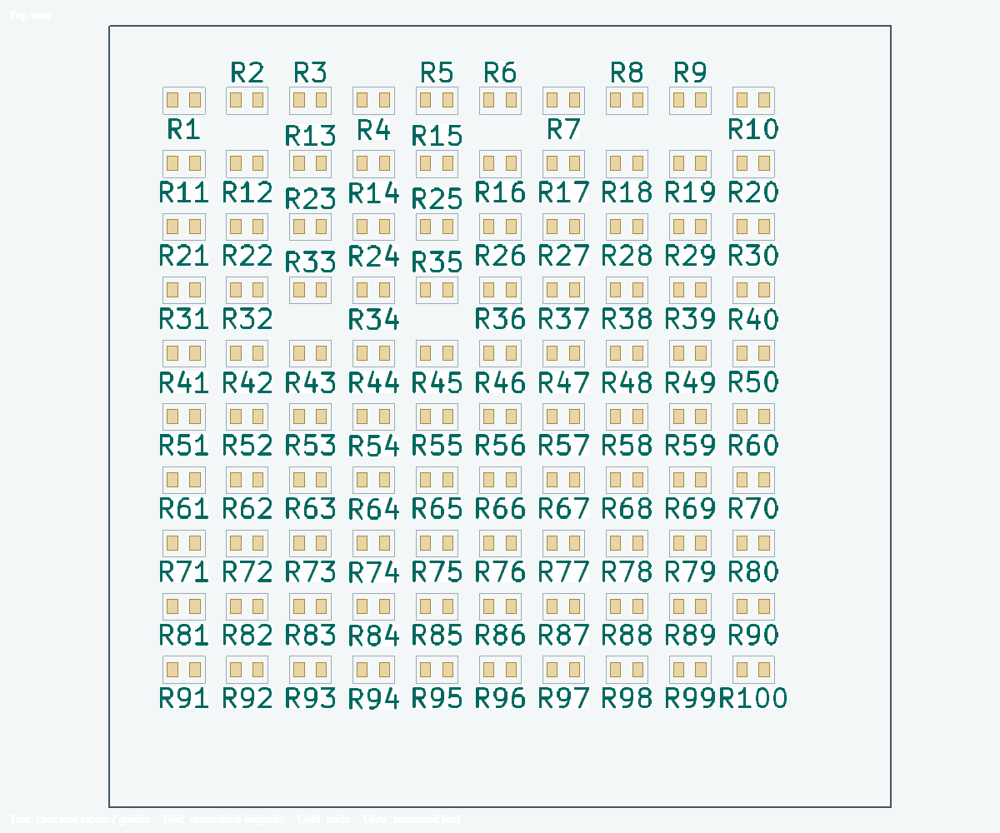

# WayriCAD Silkscreen Label Placer


| Start here | Link |
|---|---|
| Download and install | [Latest release](https://github.com/wayri/WayriCAD/releases/latest) · [Installation guide](../docs/INSTALLATION.md) |
| First use | [Getting started](#get-started) |
| Help | [Offline help](help.html) · [Compatibility](../docs/COMPATIBILITY.md) |
| Command line | `wayricad tools run silkscreen-label-placer -- --help` |

CLI scope: Read-only placement preview and reports; apply remains in the GUI. The unified command requires the [suite CLI installation](../docs/TOOL_CLI_CATALOGUE.md); installing this PCM plugin alone does not install the complete CLI suite.

Place readable references beside their own components on both sides of a KiCad
10 PCB. Preview first, review exceptions, then apply. Electrical values, BoM
metadata, component positions and routing stay unchanged.

## Get started

1. Open the PCB and launch **WayriCAD Silkscreen Label Placer**.
2. Choose all eligible labels, problem labels only, or the selected parts/text.
   Keep **References only (R1, C1…)** to leave values and manually authored text alone.
3. Click **Preview**. Acceptable existing references are preserved by default.
4. Inspect **Top view**, **Bottom view** and **Review details**. Wheel zooms,
   dragging pans and **Fit** restores the view. Unresolved originals remain red;
   they may still have existing violations and are not approved.
5. Click **Apply labels** for accepted changes. This window provides **Undo** and
   **Redo** while open. Changes elsewhere invalidate the preview/history instead
   of overwriting those edits.
6. Run native KiCad DRC and inspect component association before saving.

Apply can be a partial correction. A reference with no safe placement remains
unchanged and explicitly unresolved; it is never hidden or counted as resolved.



This retained preview raster comes from the actual drawing code on a disposable
100-part fixture, with native glyphs and explicit courtyards. It is not a desktop
screenshot or a demonstration of closure on an irregular dense board.

## How placement works

The default is reference-only, with acceptable existing placements preserved
and printed leaders **off**. The planner tries nearby edge slots along the
footprint axis, then its perpendicular, before other enabled orientations. A
**Common direction** option instead prefers horizontal then vertical text.
Allowed angles and the chosen reading direction remain binding.

| Priority | Behaviour |
|---|---|
| Preserve | Keep legal, readable existing labels close to the correct component |
| Stay local | Target the first 2 mm outside the courtyard; centre text on the projected edge corridor |
| Fit carefully | Try bounded size/width adjustment and staggered slots without violating fabrication floors |
| Repack locally | Try a small neighbourhood; retain the trial only if every affected label fits |
| Exceptional callout | If enabled, allow a short straight leader within the count and length budgets |
| Explain failure | Retain an unresolved original and report why it could not be approved |

Text wider than a short footprint edge can extend beyond its projected corner
lines if it remains centred and clear. **Projected-edge alignment margin** allows
0.5 mm of centre offset initially. This preference does not relax any clearance.
Farther candidates are ranked by distance across enabled angles. A label must
have an unobstructed straight association to its own part; neither its text nor
association may cross other component courtyards, text or accepted associations.
An invisible association can cross decorative silk; an actual printed leader
must clear that artwork too. Retained legacy-guide corridors block associations
even when their ownership is too uncertain for automatic removal.


Actual preview canvas on a synthetic 100-part board: all references placed with
no guides. This regular example does not establish dense-board completeness.

Every eligible reference is assessed, including failures caused by retained
originals. Unresolved labels receive a deeper retry and bounded neighbourhood
repacking automatically; selecting small groups is not necessary to invoke it.
Search remains finite and can miss feasible slots. Large boards can take several
minutes. Progress is cancellable without modifying the PCB.

## Placement controls

Open **Options** only when the defaults need adjustment. The dialog scrolls;
Review details has a draggable divider so the board retains useful space.

| Control | Initial setting / meaning |
|---|---|
| Preserve acceptable placements | On; problem-only mode also excludes these labels from repacking |
| Normal courtyard distance | 2 mm; target for an ordinary unambiguous reference |
| Search beyond footprint | 12 mm; a search bound, not a recommendation to move text that far |
| Preferred / minimum height | 1.0 / 0.8 mm; stricter native board limits take priority |
| Minimum width / width-height ratio | 0.6 mm / 0.75; bounded compression, never indefinite narrowing |
| Local repacking | Up to 6 neighbours, at most 2 mm displacement per neighbour; configurable up to 12 |
| Exceptional guide lines | Off; when enabled, at most 10 and no longer than 3 mm each initially |
| Guide shape | Straight only; no multi-bend callout networks |
| Pad / silk spacing | 0.2 mm, or the stricter native board limit |

Automatic sizing evaluates each label separately, down to its readable minimum.
It does not enlarge smaller existing text unless a fabrication floor requires
it. With automatic sizing disabled, existing larger text is retained. Up to 16
heights and 36 allowed angles are supported. Default fallback angles include
45-degree and finer 15-degree steps. Bottom/right, top/left and either reading
direction are viewed from the text's own board face. Apply disables native Keep
upright to preserve the reviewed direction; Undo restores it.


## Clearance and honest distance reporting

Accepted text stays outside all same-side courtyards, including its own.
Courtyard caches are rebuilt; incomplete courtyard artwork reserves its extent.
A conservative footprint hull protects parts without a valid courtyard. Same-side
fabrication graphics also protect body extents outside an undersized courtyard.
These are **2D proxies**, not verified physical package models.

Native filled glyphs, stroke and knockout backgrounds determine the checked
text envelope. Pads, mask openings, other silk, exposed holes and the closed
board outline with cutouts remain obstacles. Apply checks the actual rendered
envelope and rolls back if it exceeds the reviewed one. Conservative rectangles
can reject positions that might fit between individual glyph strokes.

CLI/report outcomes distinguish exact native glyph-to-courtyard distance
(`courtyard_gap_mm`) from conservative envelope gap (`envelope_gap_mm`) and
native 2D body-hull proxy distance (`body_hull_gap_mm`). Missing native courtyard
geometry produces an unknown courtyard distance, not a fabricated value.
Before/after metrics must not be mistaken for measured 3D body clearance.
Results identify candidates rejected by guide count or length limits; review
these settings rather than interpreting a bounded search failure as proof that
placement is physically impossible.

Via obstacles follow native per-face tenting. Exposed vias reserve their annulus
and mask expansion; blind/buried vias block only faces they reach. Tented faces
may carry silk if that tenting is manufactured intact. Enable **Keep text and
guides off drilled holes even under via tenting** for stricter protection.

## Generated objects and cleanup

New managed annotations persist ownership in board properties: footprint, text
and leader UUIDs, settings and generated-object identity. Moving/replacing them
updates their verified associated graphics in the same reversible operation.
Repeated runs reconcile that ownership rather than accumulating duplicate guides.

Use **Generated objects** to audit managed, orphaned, duplicate and uncertain
records. Explicit cleanup removes verified generated leaders while retaining
text. It is previewed, requires confirmation and supports this window's undo.
Auditing also detects verified guides detached from their current text or
owning footprint after manual edits. Uncertain legacy groups or manually authored artwork are reported for review,
not adopted or deleted based only on a name. Stale board state blocks cleanup.

Two different problems motivated this work: legacy guide strokes survived label
moves, and a separate custom callout-generation step produced excessive leaders.
The latter is not evidence that the released plugin itself generated callout
mazes. Conservative defaults, persistent ownership and visual review address
these distinct risks.

## Test-point net names and formatting

Enable **Use connected net names for test point labels** and check the default
`TP*` reference pattern. One unambiguous connected net is required. The plugin
creates a separate managed silkscreen annotation and suppresses only reference
visibility; the actual TP reference and BoM identity stay intact. Missing or
multiple distinct nets remain unchanged with an explanation.

Names are complete, including hierarchical paths; they are not truncated or
prefixed with redundant pin numbers. Long names must pass the same checks.
Automatic wrapping, per-pin multi-net connector annotations and repeated-circuit
pattern reuse are not currently implemented. A single-net connector can be
explicitly included through the reference pattern. Disable the option and
Preview/Apply to restore reference visibility and remove managed net annotations.


Formatting rules are optional. First match wins. Comma-separated wildcard
patterns match either entry; filled Reference, Value and Label text criteria
must all match. Presets require review, not automatic classification:

| Preset | Suggested pattern | Style |
|---|---|---|
| Test points | Reference `TP*` | Knockout |
| Programming headers | Value `*SWD*,*JTAG*,*ISP*,*ICSP*,*PROG*` | Bold |
| Input connectors | Value `*INPUT*,*POWER_IN*` | Italic |

Each style supports Keep existing, On or Off. Knockout's larger native envelope
is checked. Unresolved labels retain their original styles.


## Command line and reports

The CLI is read-only. It uses a native KiCad worker and checks saved PCB, project
and rule-file hashes before returning a result. It never saves or applies PCB
changes. Use separate **new** output paths:

```text
wayricad-silkscreen settings
wayricad-silkscreen preview C:/Projects/Example/board.kicad_pcb --references-only --problems-only --output labels.json --report labels.html
wayricad-silkscreen preview C:/Projects/Example/board.kicad_pcb --refs U1 TP1 --settings silk.json --output selection.json
wayricad-silkscreen audit-generated C:/Projects/Example/board.kicad_pcb
```

`--settings` accepts the same JSON setting names printed by `settings`.
`--references-only` overrides optional values/manual text categories. The worker
timeout defaults to 1,800 seconds; `--timeout` changes it. JSON reports coverage,
changes, every eligible outcome and unresolved reasons. HTML adds before/after
board-face previews and distance tables. Native DRC is marked **NOT RUN** in
these reports; run it separately. Numerical clearance is not proof of readable
association. Apply stays in PCB Editor with its active project context.

See the [all-tools CLI catalogue](../docs/TOOL_CLI_CATALOGUE.md).

## Optional MCP stdio server

The optional MCP adapter exposes the same planner settings, saved-board preview
and generated-object audit. It has no apply, save or cleanup operation. Install
the official MCP Python SDK in the Python environment used to launch it:

```text
python -m pip install "mcp>=2,<3"
python -m silkscreen_label_plugin.mcp_server --project-root C:/Projects/Example --timeout 1800
```

The required project root limits board access; the selected `.kicad_pcb` and
any `.kicad_pro` / `.kicad_dru` companions must resolve inside it. Preview
settings are passed as the same JSON object used by the CLI. KiCad's native
Python must be discoverable for preview and audit. The MCP SDK is optional and
does not affect the PCM plugin or CLI. SDK-backed MCP protocol testing has not
been verified yet; this adapter was validated with mocked worker and server
boundaries.

## Install and limits

Version 0.3.3 uses KiCad 10's native ActionPlugin runtime and works independently
of sibling plugins. Install its PCM ZIP using **KiCad Manager → Plugin and
Content Manager → Install from File**, restart PCB Editor, and use its toolbar
icon or plugin menu. Find published packages on the
[releases page](https://github.com/wayri/WayriCAD/releases).

For a source build, run `python build_pcm.py --output-dir candidate` from the
repository root. The archive is `candidate/WayriCAD-silkscreen-label-0.3.3-PCM.zip`.

Planning is read-only; Apply preserves electrical fields, footprints, pads,
copper, vias, zones and board outlines and checks that underlying geometry did
not change. Undo belongs to this window, not the PCB Editor's ordinary Undo;
closing the window discards its operation history. Persistent ownership remains
in the saved PCB for future auditing. Protected regions beyond existing native
obstacles and locked labels are not yet a separate user-defined control.

Windows KiCad 10 is the native tested target. Linux/macOS GUI and KiCad 11 are
not established. Native DRC, fabricator limits, fonts and physical assembly
legibility require board-specific review. The local search is not a global
optimality or all-label placement guarantee.

## Examples and references

Measurements of [Marble](https://github.com/BerkeleyLab/Marble),
[Forstén's VNA](https://github.com/Ttl/vna), [FMCW3](https://github.com/Ttl/fmcw3)
and [White Rabbit Switch](https://gitlab.com/ohwr/project/wr-switch-hw) support
nearby edge slots, orthogonal reading and bounded local size changes. Their
smaller lettering never overrides your board's fabrication floors. Some labels
are hidden and some courtyards are missing; these are examples, not golden DRC
templates. See the [study and immutable source revisions](../docs/audits/SILKSCREEN_REFERENCE_BOARD_STUDY.md),
[whole-board validation](../docs/audits/SILKSCREEN_WHOLE_BOARD_0.3.3.md) and
[KiCad silkscreen rules](https://docs.kicad.org/10.0/en/pcbnew/pcbnew.html).


<details><summary>Earlier window layout</summary>


Retained historical capture. New controls and defaults are described above;
this image does not show the current full Options dialog.

</details>

Open [offline help](help.html) for installed instructions and
[readable windows, panels and tables](../docs/UI_ACCESSIBILITY.md) for workspace controls.
