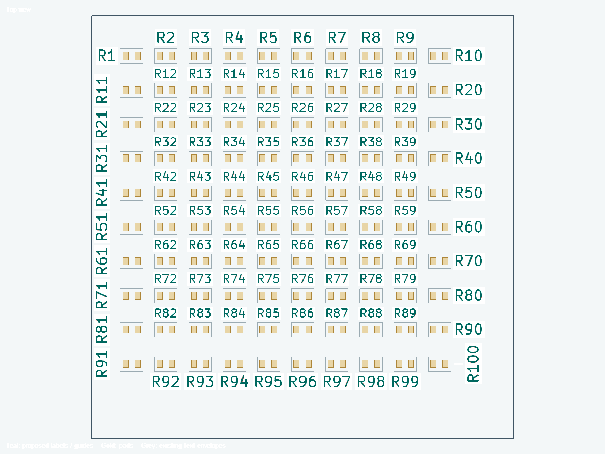
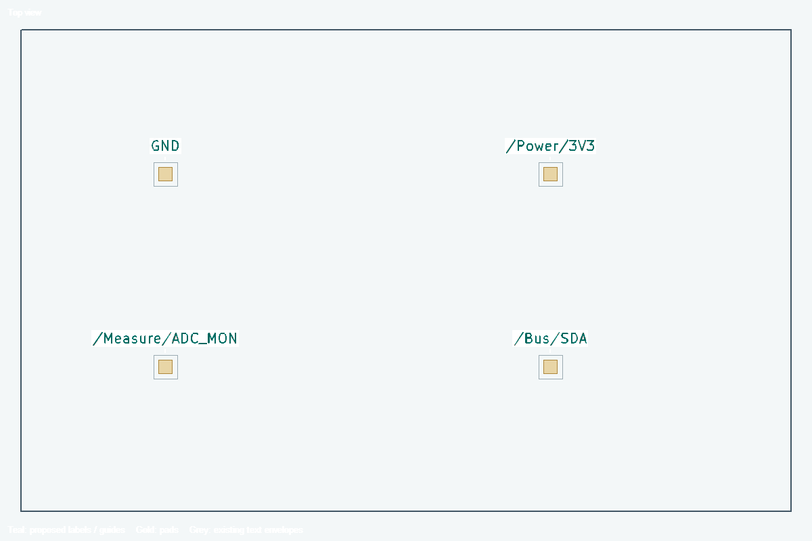
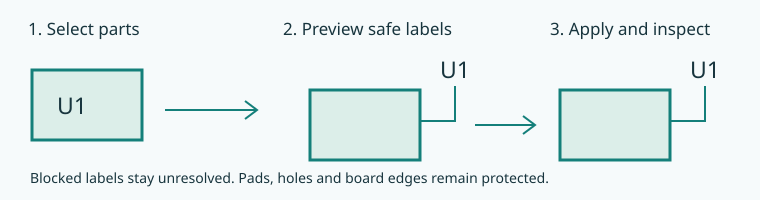

# WayriCAD Silkscreen Label Placer

Arrange visible reference labels on an open KiCad 10 PCB. Preview checked placements, then apply. Labels that cannot fit safely stay unresolved. This is a separate plugin from Bulk Label Editor, which renames text.

The preview above is rendered by the actual drawing code from a disposable
100-part board with explicit courtyards. Native glyph polygons use the reviewed
board scale, rotation and mirroring. Gold marks pads and grey marks body/text
envelopes. This is a preview raster, not a desktop screenshot.

Earlier window layout

This retained capture documents the window controls before 0.2.1. Its older
illustrative preview font is replaced by the board-scale rendering above.

## Use

1. Select parts or pads in PCB Editor, then open **WayriCAD Silkscreen Label Placer**. Choose **Selected parts / text** or **Whole board**.
2. Click **Preview**. The default arranges visible reference labels on their existing F.SilkS or B.SilkS side. It preserves hidden/locked labels and locked parts.
3. Inspect **Top view** and **Bottom view**. Wheel zooms, dragging pans and **Fit** restores the view. Open **Review details** for unresolved or preserved items.
4. Click **Apply labels**. Only accepted changes are applied. Use this window's **Undo** or **Redo** while it remains open. Changes elsewhere on the board invalidate the preview and undo state; preview again rather than overwriting those edits.
5. Run native DRC, inspect readable references and association lines, then save the board. The plugin does not rename references or update the schematic.

**Options** adds existing visible values or board text already on silkscreen, and adjusts minimum text height, stroke, spacing, search distance beyond the footprint envelope (12 mm initially) and the guide-line threshold. Dense placement is automatic: larger labels go first, alternate orientations and fine nearby slots are tested, and spatial indexes keep collision queries local. A progress window supports cancellation without modifying the PCB. **Automatically shrink text when needed** is enabled by default; it tries the preferred height down to your minimum in the chosen size steps. With automatic sizing off, existing larger text is preserved. The stricter native board text/stroke/clearance floor applies. Hidden fields are not made visible and fabrication-layer fields are not moved onto silkscreen.

### Automatic sizing and nearby labels

Each **Preview** recomputes sizes separately for every label using current free
space. Keep **Automatically shrink text when needed** enabled: the planner tries
the preferred size and smaller steps down to the minimum/native fabrication floor.
One board can therefore contain 1.0 mm labels where there is room and 0.8 mm labels
in tighter gaps. This is bounded sizing, not a single board-wide text-size change.

Keep **Guide lines for distant component labels** enabled. If a label cannot fit
locally, the planner searches within **Search beyond footprint** for another clear nearby
position and checks a straight or multi-bend guide back to its component. Adjust
**Guide line beyond distance** to control when that association line is required.
Text, the complete guide and its stroke must clear courtyards, pads and other
silkscreen. If no legal label/guide route exists, the original remains unresolved;
the tool does not violate clearances or shrink below the permitted minimum.

### Readable direction first, distant guides last

The planner first tries slots near each footprint in a common horizontal reading
direction, from preferred size down to minimum. It then tries nearby rotations:
45-degree increments before the other enabled angles. Only after those nearby
attempts does it search distant positions. Existing per-label rotations do not
outrank the common direction. If horizontal is disabled, the first enabled
orientation in that order becomes the preferred direction.

Footprint-edge slots are offset along each side, allowing staggered labels near
dense component groups. The first phase searches within 2 mm of the footprint
envelope (or your smaller search limit); distant search uses your full limit.
Large connectors are measured from their envelope rather than their centre.
Increase **Search beyond footprint** when an association line needs to reach a
remote clear area. Guides can have several mixed-angle segments around obstacles;
they never run through component courtyards to reach a part. Each label retains
its own component association; labels are not combined into an ambiguous group.

The search is bounded: up to 768 nearby or 4,096 distant candidates per size and
angle, 12,000 candidates per label, and 30 seconds for a plan. Each label also
receives a share of the time budget so difficult labels do not starve the board. Multi-bend routing uses at most 48 vertices and
2,048 segment checks per fallback. These limits and conservative rotated text
boxes can leave a feasible arrangement undiscovered; unresolved labels are
reported and preserved rather than forced.

### Test point net names

Open **Options → Placement** and enable **Use connected net names for test point
labels**. The default reference pattern is `TP*`; change it to match your design.
Then **Preview**, review the complete names and guide lines, and **Apply labels**.
For example, a part whose real reference is `TP12` on net `/Power/ADC_MON` can show
`/Power/ADC_MON` on silkscreen. Its actual reference stays `TP12`, preserving
component identity for the schematic and BoM.

The plugin manages a separate silkscreen annotation and suppresses only the
reference's display. It requires one unambiguous connected pad net. Missing or
multiple distinct nets are left unchanged with an explanation. Full hierarchical
names are used; long names must fit through the same sizing, clearance and guide
checks. They are not silently truncated. Locked/hidden items and the selected
scope remain respected. Undo/Redo includes the label and reference visibility.
Turn the option off and preview/apply again to restore the reference display and
remove the managed net annotation. Reopening the tool detects existing managed net labels and keeps that mode enabled
for their exact references; review the pattern to include new test points.
After changing connectivity, net names or component positions,
preview again to update the annotation and guide.

This native preview raster uses four synthetic test points. All four accepted
annotations and guides passed native KiCad DRC; actual TP references remain
unchanged. [Adaptive/net-label validation](../docs/audits/SILKSCREEN_NET_LABELS_0.2.2.md).

### Size, direction and formatting

Open **Options → Size & direction** to set preferred height, minimum automatic height and size step. For example, prefer 1.2 mm, allow a minimum of 0.8 mm and use 0.1 mm steps. Up to 16 heights are tried; stroke scales with automatic size while respecting the native stroke floor. The planner tries larger sizes first; native fabrication floors may raise the effective minimum. Choose horizontal, vertical and/or 45-degree orientations. The **Other fallback angles** field accepts any finite angle from 0 up to 180 degrees, with at most 36 total angles. Default fine fallbacks use 15-degree increments; enter another angle such as 17 degrees if needed. Choose bottom/right, top/left (adds 180 degrees), or either reading direction, viewed from the label's own board side. Applied fields have Keep upright disabled to retain the chosen direction; Undo restores it.

Open **Options → Formatting** and click **Add preset** or **Add**. Presets are suggestions to review, not automatic classification:

| Preset | Initial matching pattern | Style |
|---|---|---|
| Test points | Reference `TP*` | Knockout |
| Programming headers | Value `*SWD*,*JTAG*,*ISP*,*ICSP*,*PROG*` | Bold |
| Input connectors | Value `*INPUT*,*POWER_IN*` | Italic |

Edit patterns to match your board, for example references `J1,J4`. Patterns are case insensitive; comma-separated patterns match either entry, while filled Reference, Value and Label text criteria must all match. The first matching rule wins; move a rule **Up** to give it priority. Bold, Italic and Knockout each offer **Keep existing**, **On** and **Off**. Remove a rule to stop using it. Rules apply to the text categories included in the preview, without renaming any text. Styles are not applied when a label cannot be placed safely.

Knockout uses KiCad's native filled text background. Its larger native envelope is included in clearance checks, so fewer labels may fit than with ordinary text. Review planned size, angle and styles under **Review details** before applying.

Distant component labels get a checked straight or multi-bend guide path ending just outside the component body. Guides must clear pads, openings, other labels/graphics and board edges. If a distant label cannot get a safe guide, that candidate is rejected. Existing plugin-owned guides are managed as part of repeat placement and undo/redo; unrelated drawing lines are preserved. Disabling guide lines is an explicit option.

## Courtyard and silkscreen clearance

All accepted labels stay outside the complete same-side courtyard envelope,
including their own component's courtyard. Both board faces are checked. Native
courtyard caches are refreshed before planning; incomplete courtyard drawings
still reserve their full drawn extents. Parts without a courtyard use a
conservative body hull. Pads, mask openings, existing silk text/graphics and
other accepted labels/guides remain obstacles. Clearance is never relaxed to
force a fit. Native glyph geometry, including knockout backgrounds, contributes
to the checked envelope. Apply checks that the real native text still fits the
reviewed envelope and rolls back if it does not.

The preview no longer uses an enlarged screen font. Its native glyphs remain
inside their reviewed boxes at every zoom; the original boxes of moved labels
are hidden. Grey unchanged labels can still have pre-existing violations. An
unresolved label is retained and reported, not approved as clear and not hidden.

The current preview image at the top uses those checked native envelopes.

## Dense boards

Dense search is enabled automatically. It uses a clearance-scale grid and footprint-edge slots, tries common-direction labels before rotated alternatives, places larger labels first and checks straight or multi-bend guides. Spatial indexes keep checks local. Search has per-label candidate and overall time budgets; an exhausted search keeps the original label and reports it as unresolved.

The following measurements describe the earlier 0.2.0 release; see the
[0.2.1 clearance validation](../docs/audits/SILKSCREEN_CLEARANCE_0.2.1.md) for current checks.

| Native KiCad 10 check | Result |
|---|---|
| Synthetic 100-part grid at 3.4 mm pitch | 100/100 labels placed; zero native DRC violations after Apply, versus 199 before; 1 mm labels were not shrunk |
| Public Marble board, 1,006 footprints | 182 eligible references: 85 safely placed, 83 changes, 63 guide paths, 97 unresolved; approximately 14.3 seconds |
| Marble native DRC comparison | 481 findings before, 479 after; no new violation type/item combinations. Existing board issues remain |

These fixtures do not establish that every label fits every dense board. The unresolved count remains visible; change the allowed search distance or review those labels manually rather than reducing fabrication minimums. [Detailed validation](../docs/audits/SILKSCREEN_LABELS.md).

## Install

Version 0.3.1, uses KiCad 10's native ActionPlugin runtime. It does not require the IPC API or a sibling plugin. Install the independent PCM ZIP through **KiCad Manager → Plugin and Content Manager → Install from File**, restart PCB Editor, then use the plugin menu or toolbar icon.

Download the latest Silkscreen Label Placer from the [releases page](https://github.com/wayri/WayriCAD/releases), or find it in the WayriCAD Plugin Repository in PCM.

For a source build, run `python build_pcm.py --output-dir candidate` from the WayriCAD root. The installer is `candidate/WayriCAD-silkscreen-label-0.3.1-PCM.zip`.

## Checks and limits

- Native text envelopes, font/justification and stroke geometry are checked conservatively against same-side text/graphics, body envelopes, pads/mask expansions, mask graphics, exposed tracks, vias/holes and a closed native board outline including cutouts.
- Dense placement searches a bounded field of nearby positions and tries readable horizontal/vertical orientations, placing the most difficult labels first. It is a safe local placement attempt, not a globally optimal annotation layout. Crowded layouts can remain unresolved. Checked guide paths may use multiple orthogonal, 45-degree or other angled segments; blocked paths remain unresolved.
- Rectangular envelopes can reject a placement that would fit between actual glyph strokes. The viewport uses simplified component/pad geometry; it does not establish physical accuracy or assembly access.
- Planning is read-only. Board, text, settings and geometry changes require a fresh preview. Apply failures restore edited labels and plugin-owned guides; rollback failures must be inspected before retrying.
- Windows native KiCad 10 is the tested target. Linux/macOS GUI and KiCad 11 behavior are not established. Native silkscreen DRC is still required; fonts, fabrication tolerances and assembly legibility need board-specific review.
- This window owns its operation history. Closing it discards that history; save only after review. Do not assume the PCB Editor's ordinary Undo has captured these native Python changes.

KiCad documents [silkscreen setup and design rules](https://docs.kicad.org/10.0/en/pcbnew/pcbnew.html). The plugin follows the board's native silk minimums; it does not replace fabricator requirements.

## Resize the workspace and find help

Expand Review details when needed, then drag its divider to give the proposal table more height. The board preview keeps the remaining space, and the Options dialog scrolls its longer settings instead of requiring an oversized window.

Open [offline help](help.html) for the workflow and troubleshooting. See [readable windows, panels and tables](../docs/UI_ACCESSIBILITY.md) for resizing, complete-row reading and keyboard controls.

## Read-only command line preview

`wayricad-silkscreen settings` prints the settings schema. Use `wayricad-silkscreen preview board.kicad_pcb --refs U1 TP1 --output labels.json` for a saved-board preview, optionally adding `--settings silk.json` and `--timeout 180`. The CLI reports proposed text and guide coordinates plus unresolved items; it never saves or applies board changes. Source and rule-file hashes are checked before returning the preview. Apply remains in PCB Editor with its active project settings and native DRC. See the [all-tools CLI catalogue](../docs/TOOL_CLI_CATALOGUE.md).
