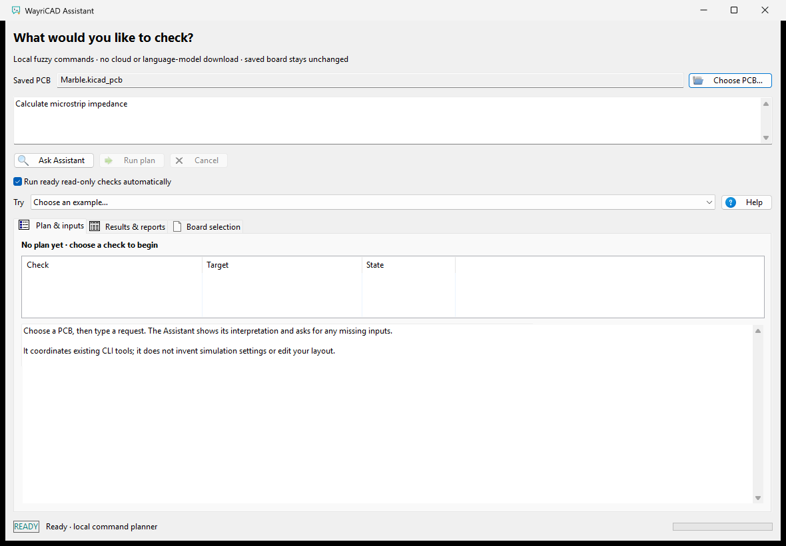
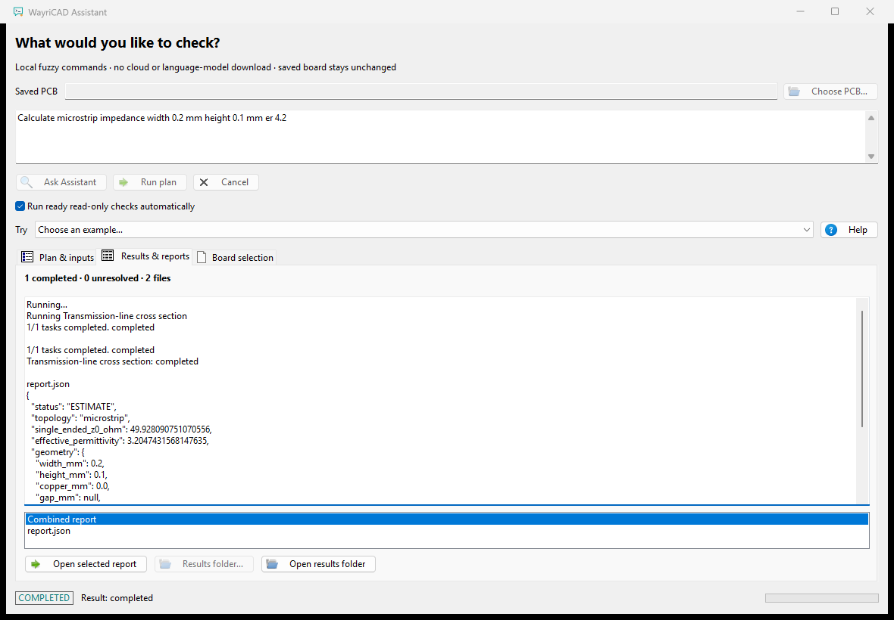

# WayriCAD Assistant


Describe a check in plain English, review its interpretation and get results from existing WayriCAD tools. The Assistant uses a small, local fuzzy intent engine. It is not a general chatbot and does not download a language model or send your board to a cloud service.



## Get started

1. Save your PCB, then open **WayriCAD Assistant** from the PCB Editor toolbar. You can also choose another saved PCB in the window.
2. Type a request or choose an example. Click **Ask Assistant**.
3. Fill in any missing inputs. The plan shows the chosen check, its parameters and declared assumptions. Invalid inputs show an explanation beside the field and retain the value for correction.
4. Ready read-only checks run automatically. Uncheck **Run ready read-only checks automatically** to review each plan first.
5. Open **Results & reports** to read the outcome and open generated reports. Results persist in your Documents folder under `WayriCAD/Assistant/results`. Use **Results folder…** to choose another location and **Open results folder** to find the actual files. Boolean questions accept `true` or `false`.

Native icons identify primary actions and tabs. **Plan & inputs** shows a compact check/target/state table; the status badge and pulsing gauge distinguish waiting, running and attention states without inventing a completion percentage. Results show completed tasks, unresolved tasks and generated-file counts.


Use **Board selection → Load board preview** to select a net visually. Enable **Add clicked nets to selection** for several nets. Exact matching saved pads, traces, vias and zone borders are highlighted while unrelated copper is dimmed. Zone borders remain borders, not an invented filled copper result. A request can use this selection when it does not name its own net. **Focus selected** fits the selection; **Fit board** restores the complete saved board extent. **Expand board** makes the viewport larger, and switching to another tab restores the query controls. The color legend and net/item counts explain the highlight. The preview is loaded once per chosen board, with wheel zoom and drag pan. It represents the saved file; save editor changes and reopen the board context to refresh it.


These are actual native-window screenshots on Windows with KiCad 10.0.6. The public Marble PCB was loaded read-only; its source hash was unchanged. The board selector is a simplified copper/pad/outline view, not a fabrication viewer. The first image shows a request before execution; it does not imply a simulation has run. No personal paths or private project data are visible, and no image redaction was needed.

**Show in PCB Editor** is an explicit navigation action. It selects the chosen nets only in the originating editor, checks the saved board hash and confirms the complete selection. A stale file or unavailable editor is reported. The status distinguishes a requested camera focus from unavailable focus. Matching the saved file does not validate unsaved live geometry. Selection does not edit the design. This IPC navigation was exercised through native UI mocks and the shared context/staleness/rollback tests; an installed live-toolbar session was not available for this validation.

## What it can do

The command catalogue exposes specific existing CLI actions, including electrical checks, mechanical review, board analytics and transmission-line calculations. Use the CLI `capabilities` command for the exact supported actions and required inputs in your installed version. Every plugin is not automatically controllable: actions must be explicitly registered with a parameter schema and an execution adapter.

| When this happens | What to do |
|---|---|
| More than one action matches | Choose the offered interpretation. |
| A net, source, material or numerical setting is missing | Fill in the requested inputs; the Assistant does not silently assume them. |
| No supported action matches | Rephrase around a specific check or open the relevant plugin directly. |
| A tool or dependency is unavailable | Follow the error and that plugin’s runtime setup instructions. |
| A run is taking too long | Click **Cancel**; cancellation is forwarded to the worker. |

The model limits of the underlying tool still apply. A generated report is evidence of the specified screening calculation, not a substitute for material, source/sink or mesh validation. The Assistant does not change components, annotations, tracks, zones or board geometry. Generated reports and run records are written to a separate results folder.

## Results in the window



This native run interpreted a 0.2 mm wide, 0.1 mm high microstrip with relative permittivity 4.2, called the existing RLC cross-section CLI and returned **49.928 Ω**. The worker identified the result as an estimate, used the declared zero-thickness approximation and retained its limitations in the JSON report. The screenshot contains actual computed output, not a mock result.

## CLI

From an installed Python source package:

```text
python -m suite_assistant_plugin capabilities
python -m suite_assistant_plugin plan "Calculate microstrip impedance width 0.2 mm height 0.1 mm er 4.2" --output C:/Projects/Example/microstrip-plan.json
python -m suite_assistant_plugin run C:/Projects/Example/microstrip-plan.json --output-root C:/Projects/Example/assistant-results
```

The first command saves a reviewable plan; the second executes that unchanged plan and saves the reports. This cross-section example needs no PCB. For board checks, add `--board C:/Projects/Example/board.kicad_pcb` to `plan`. Consult `python -m suite_assistant_plugin run --help` for its output and review options. Commands execute an allowlisted tool adapter with argument arrays, not an arbitrary shell string. GUI and CLI use the same planner.

For a standalone native window:

```text
python suite_assistant_plugin/desktop_entrypoint.py --board C:/Projects/Example/board.kicad_pcb
```

Use KiCad 10’s native Python or the managed WayriCAD runtime for board geometry. Each executed plugin retains its own scientific/native dependencies. See [offline help](help.html) for the workflow and error handling.

## Development checks

```text
python -m unittest discover -s suite_assistant_plugin/tests -v
```

Twenty-one focused window tests passed with KiCad 10.0.6 native Python on Windows. An actual GUI → planner → existing CLI run completed for the microstrip example and the tool catalogue. Window tests require native wxPython; an ordinary Python environment skips them. These standalone native checks do not imply an installed IPC-toolbar workflow has been tested.
