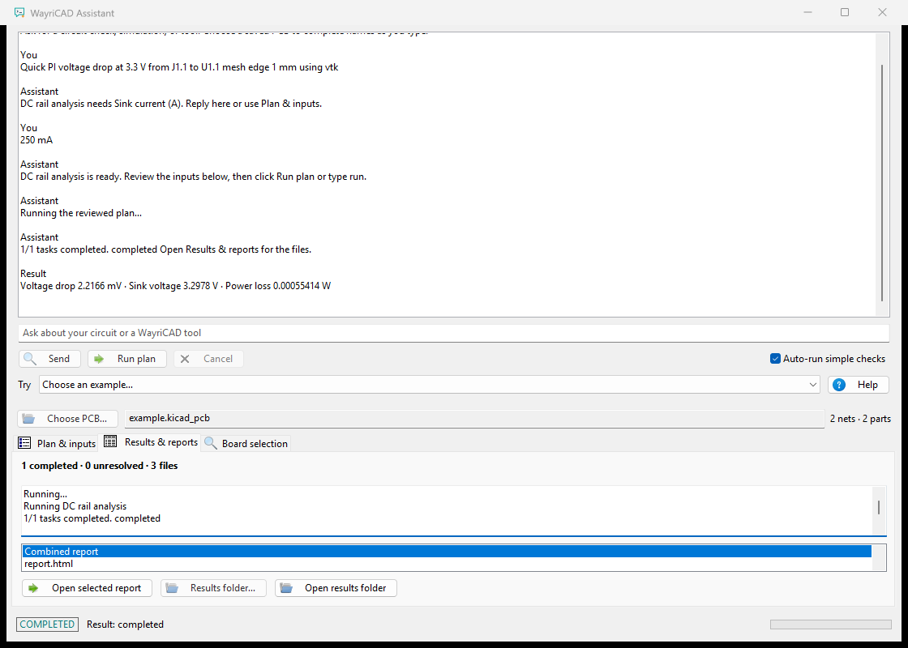
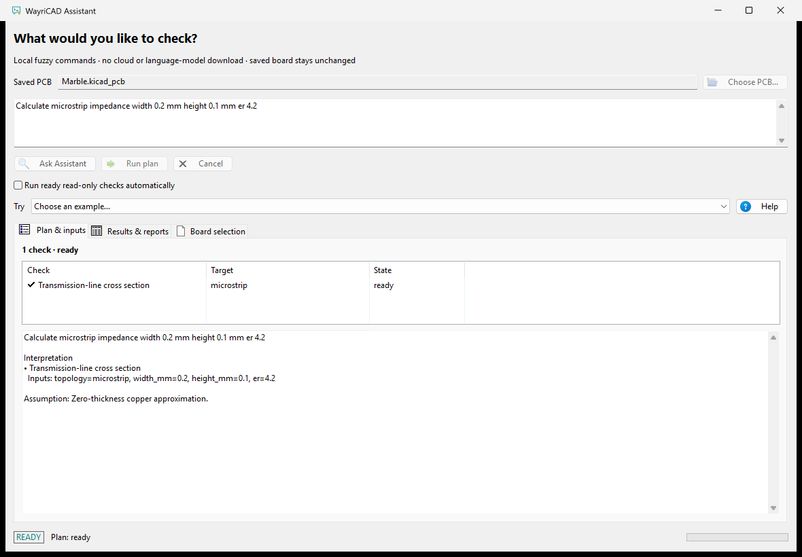
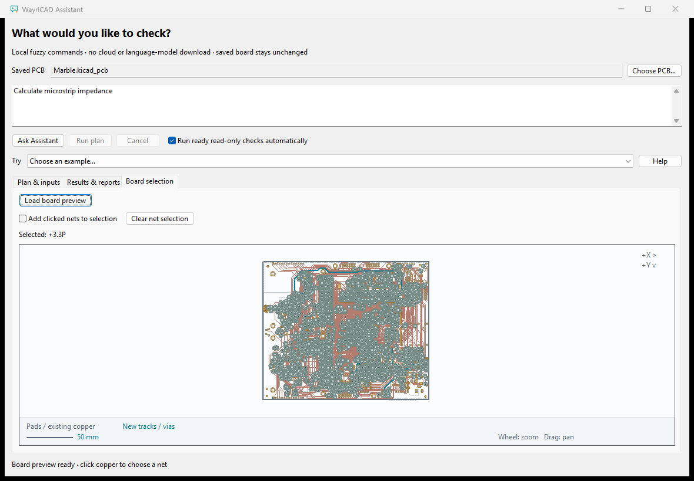
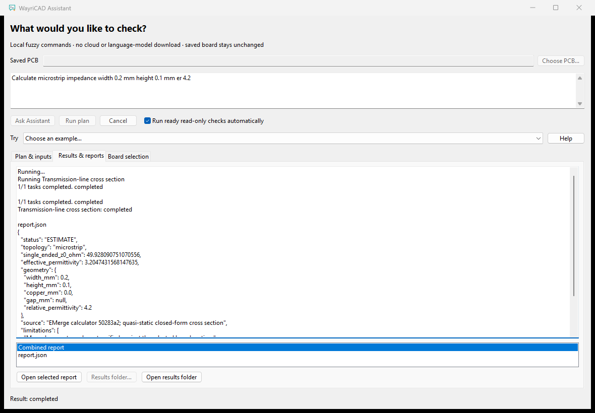

# WayriCAD Assistant


| Need | Open |
|---|---|
| Install or update | [Latest release](https://github.com/wayri/WayriCAD/releases/latest) · [Installation](../docs/INSTALLATION.md) |
| First request | [Get started](#get-started) |
| Supported actions and limits | [What it can do](#what-it-can-do) · [Implementation evidence](../docs/audits/assistant-local-orchestration.md) |
| Scripts and help | [CLI](#cli) · [Offline help](help.html) |

Describe a check in plain English, review its interpretation and get results from existing WayriCAD tools. Choose the deterministic **Local commands** engine or an optional **Ollama** language model running on your computer. No cloud provider, automatic model download or automatic layout edit is enabled.

## Ollama: ask, review, run, interpret

1. Install Ollama separately and start its local service. Install a model using
   Ollama's own interface or CLI; WayriCAD never downloads a model implicitly.
2. Choose **Ollama (review before Run)**, then **Find models**. Select an installed
   model. The default endpoint is `http://127.0.0.1:11434`; only loopback HTTP is
   accepted. Local commands remain available when Ollama is unavailable.
3. Ask for a check, for example: **Calculate microstrip impedance width 0.2 mm
   height 0.1 mm er 4.2**. Review the chosen actions and every proposed input.
   Edit proposed values or supply missing ones in **Plan & inputs**, then click
   **Use these inputs**. Clear an optional value to omit an invented assumption;
   select an unwanted task and click **Remove selected task**. Model-proposed values are not
   verified facts; do not accept invented physics or operating conditions.
4. Click **Run plan** explicitly. Ollama proposals never auto-run, even when
   automatic read-only execution is checked. The existing deterministic tool
   broker validates inputs, source hashes and the sealed plan before execution.
5. Click **Interpret results** for a separate AI explanation of the run's
   numerical JSON. It includes report hashes and evidence IDs, unknowns,
   limitations and suggested checks. It cannot alter the tool's result/status.

All plugins in the CLI registry are represented in the action catalogue. This
means **registered read-only checks, analysis, exports and geometry previews**,
not every GUI operation or autonomous Apply. Use `capabilities` for the exact
adapters and required parameters. Missing plugin dependencies still need that
plugin's normal runtime setup. The model cannot supply executable commands,
file paths, output destinations or unregistered switches; enter file inputs in
the host's clarification fields. Layout changes remain reviewed in their tool.

Only the task, selected net/reference names, action schemas and explicitly
requested numerical evidence are sent to local Ollama. Raw PCB bytes are not
uploaded by the planner. Numerical JSON may contain project metadata and paths:
use a trusted local service, and review reports before sharing them. Proxies and
redirects are bypassed; remote/cloud Ollama endpoints are deliberately unsupported.
No executable, service or model installation is performed by the plugin.
Ollama can proxy cloud models through its local API; remote-model metadata is
rejected before sending project inputs. Use a trusted Ollama installation and
[disable its cloud features](https://docs.ollama.com/cloud) for a local-only setup.

Requests have bounded response size and time, support Cancel, and fail closed
on malformed JSON, unknown actions, stale evidence or model mismatch. Evidence
larger than 96 KiB is rejected, not silently truncated. The configured inference
context is 16,384–32,768 tokens within the model's advertised capacity. A
conservative full-request byte/token ceiling also reserves space for the model
template, system text and output; it can reject evidence below 96 KiB. Use small
focused requests rather than relying on inference-side truncation.
An explanation is **AI interpretation, not engineering validation**. It cannot
prove compliance, replace convergence checks or upgrade missing evidence to PASS.

API references: [Ollama chat](https://docs.ollama.com/api/chat) and
[structured JSON outputs](https://docs.ollama.com/capabilities/structured-outputs).



**Included as a testing package in the current WayriCAD release.** Review interpreted commands and tool limitations before using their results.

## Get started

1. Save your PCB, then open **WayriCAD Assistant** from the PCB Editor toolbar. You can also choose another saved PCB in the window.
2. Type a request or choose an example. Click **Ask Assistant**.
3. Fill in any missing inputs. The plan shows the chosen check, its parameters and declared assumptions. Invalid inputs show an explanation beside the field and retain the value for correction.
4. Ready read-only checks run automatically. Uncheck **Run ready read-only checks automatically** to review each plan first.
5. Open **Results & reports** to read the outcome and open generated reports. Results persist in your Documents folder under `WayriCAD/Assistant/results`. Use **Results folder…** to choose another location and **Open results folder** to find the actual files. Boolean questions accept `true` or `false`.

Native icons identify primary actions and tabs. **Plan & inputs** shows a compact check/target/state table; the status badge and pulsing gauge distinguish waiting, running and attention states without inventing a completion percentage. Results show completed tasks, unresolved tasks and generated-file counts.



Use **Board selection → Load board preview** to select a net visually. Enable **Add clicked nets to selection** for several nets. Exact matching saved pads, traces, vias and zone borders are highlighted while unrelated copper is dimmed. Zone borders remain borders, not an invented filled copper result. A request can use this selection when it does not name its own net. **Focus selected** fits the selection; **Fit board** restores the complete saved board extent. **Expand board** makes the viewport larger, and switching to another tab restores the query controls. The color legend and net/item counts explain the highlight. The preview is loaded once per chosen board, with wheel zoom and drag pan. It represents the saved file; save editor changes and reopen the board context to refresh it.



These are actual native-window screenshots on Windows with KiCad 10.0.6. The public Marble PCB was loaded read-only; its source hash was unchanged. The board selector is a simplified copper/pad/outline view, not a fabrication viewer. The first image shows a request before execution; it does not imply a simulation has run. No personal paths or private project data are visible, and no image redaction was needed.

**Show in PCB Editor** is an explicit navigation action. It selects the chosen nets only in the originating editor, checks the saved board hash and confirms the complete selection. A stale file or unavailable editor is reported. The status distinguishes a requested camera focus from unavailable focus. Matching the saved file does not validate unsaved live geometry. Selection does not edit the design. This IPC navigation was exercised through native UI mocks and the shared context/staleness/rollback tests; an installed live-toolbar session was not available for this validation.

## What it can do

The command catalogue exposes specific existing CLI actions, including electrical checks, mechanical review, board analytics and transmission-line calculations. Use the CLI `capabilities` command for the exact supported actions and required inputs in your installed version. Every plugin is not automatically controllable: actions must be explicitly registered with a parameter schema and an execution adapter.

### Simulation and analytics requests

| Ask for | Supply or review |
|---|---|
| "Give me the number of 10u capacitors" | A saved project or root schematic. Defaults to the base variant. Counts fitted BOM references with the requested R/C/L prefix and normalized nominal value; unparseable values are listed, not counted as matches. Saved native inputs only; unsaved or Analytics Studio workspace overlays are not included. |
| "Give me layer wise total copper area" | A saved PCB. Shows union area in mm² and coverage by layer. Missing zone fill or unsupported geometry can make totals unknown; save filled zones in KiCad before measuring. |
| "Solve board heat map at 25 C with C1=0.5 W and C2=0.1 W" | Explicit dissipated watts. Steady thin-sheet screen with automatic mesh and declared still-air/material defaults; no junction estimate. Separate transient component RC and 3D solid actions use reviewed native study JSON. |
| PI two-port AC impedance, DC bundle or series-path solve | Supply the corresponding reviewed study JSON. Series also needs source voltage and load current. Draft power-tree and series-path discovery can run directly on the saved board; edit and save paths in Quick PI. |
| SI multi-net and crosstalk study | Supply the saved PCB and reviewed Quick SI study JSON. Single-route screening still accepts conversational inputs. |
| "List EMerge examples", then "Run EMerge research example" | Choose an exact built-in example ID and a saved PCB context; the example geometry is independent of that PCB. The qualified solver must already be prepared. Custom PCB-region and array setup remain in Quick EMerge. |

Ollama cannot choose file paths. Supply study files in the Assistant's input form.
The Assistant window uses its current Python environment. For EMerge or another
backend with a separate prepared environment, review the saved plan and use
`python -m suite_assistant_plugin run PLAN --output-root RESULTS --python SOLVER_PYTHON`.
The required dependencies must already be present in that interpreter (including
Shapely for saved copper measurements); this workflow does not install them.
Large spatial, sweep or field artifacts may exceed the interpretation budget;
open the original reports or the originating tool for full data and plots.
Use `capabilities` for the current catalogue. For guard stitching, selected signal
nets may supply the route scope, but the guard net is a separate required input.
For example: **“Guard signal net CLK with guard net GND, spacing 2 mm and offset
1 mm.”** The result is a preview plan; apply reviewed copper in Via Stitching.

| When this happens | What to do |
|---|---|
| More than one action matches | Choose the offered interpretation. |
| A net, source, material or numerical setting is missing | Fill in the requested inputs; the Assistant does not silently assume them. |
| No supported action matches | Rephrase around a specific check or open the relevant plugin directly. |
| A tool or dependency is unavailable | Follow the error and that plugin’s runtime setup instructions. |
| A run is taking too long | Click **Cancel**; cancellation is forwarded to the worker. |

The model limits of the underlying tool still apply. A generated report is evidence of the specified screening calculation, not a substitute for material, source/sink or mesh validation. The Assistant does not change components, annotations, tracks, zones or board geometry. Generated reports and run records are written to a separate results folder.

## Results in the window



This native run interpreted a 0.2 mm wide, 0.1 mm high microstrip with relative permittivity 4.2, called the existing RLC cross-section CLI and returned **49.928 Ω**. The worker identified the result as an estimate, used the declared zero-thickness approximation and retained its limitations in the JSON report. The screenshot contains actual computed output, not a mock result.

## CLI

From an installed Python source package:

```text
python -m suite_assistant_plugin capabilities
python -m suite_assistant_plugin plan "Calculate microstrip impedance width 0.2 mm height 0.1 mm er 4.2" --output C:/Projects/Example/microstrip-plan.json
python -m suite_assistant_plugin run C:/Projects/Example/microstrip-plan.json --output-root C:/Projects/Example/assistant-results
```

With an already installed local model (replace the example model name):

```text
python -m suite_assistant_plugin models
python -m suite_assistant_plugin plan "Calculate microstrip impedance width 0.2 mm height 0.1 mm er 4.2" --provider ollama --model qwen3.5:4b --output C:/Projects/Example/llm-plan.json
python -m suite_assistant_plugin run C:/Projects/Example/llm-plan.json --output-root C:/Projects/Example/assistant-results
python -m suite_assistant_plugin explain C:/Projects/Example/assistant-results/run-folder/result.json --model qwen3.5:4b --output C:/Projects/Example/explanation.json
```

Review the saved plan before `run`; the CLI never executes merely by asking for
a plan. `explain` reads the actual run record and its hash-verified JSON artifacts
inside that record's folder. It does not recompute a simulation. `--ollama-url`
on model/plan/explain commands selects another loopback port.

The first command saves a reviewable plan; the second executes that unchanged plan and saves the reports. This cross-section example needs no PCB. For board checks, add `--board C:/Projects/Example/board.kicad_pcb` to `plan`. Consult `python -m suite_assistant_plugin run --help` for its output and review options. Commands execute an allowlisted tool adapter with argument arrays, not an arbitrary shell string. GUI and CLI use the same planner.

For a standalone native window:

```text
python suite_assistant_plugin/desktop_entrypoint.py --board C:/Projects/Example/board.kicad_pcb
```

Use KiCad 10’s native Python or the managed WayriCAD runtime for board geometry. Each executed plugin retains its own scientific/native dependencies. See [offline help](help.html) for the workflow and error handling.

## Development checks

```text
python -m unittest discover -s suite_assistant_plugin/tests -v
python -m pytest tests/test_assistant_ollama.py tests/test_assistant_engine.py tests/test_assistant_actions.py tests/test_assistant_sources.py -q
```

Optional live acceptance against an **already installed** Ollama model:

```text
python tools/verify_assistant_ollama.py --model qwen3.5:4b --output-root C:/Projects/Example/assistant-smoke
```

This opt-in check requires the exact declared microstrip inputs before executing
the existing RLC adapter, then asks the model to interpret its actual numerical
JSON. It downloads nothing and does not use a PCB. Registry-wide tests exercise
every action's proposal/adapter contract, malformed responses and stale evidence;
they do not claim every scientific workflow has run on a real board with an LLM.

The local `qwen3.5:4b` trial proposed an extra copper thickness and help task;
the unreviewed acceptance attempt correctly refused execution. An explicitly
corrected fixture then ran the actual calculator, and the same local model
returned an evidence-linked explanation. This is evidence that the guarded
workflow works, **not** a claim of autonomous planning accuracy. See
[validation scope](../docs/audits/ASSISTANT_OLLAMA.md).

Twenty-five focused window tests passed with KiCad 10 native Python on Windows. An actual GUI → planner → existing CLI run completed for the original microstrip example and the tool catalogue. Window tests require native wxPython; an ordinary Python environment skips them. These standalone native checks do not imply an installed IPC-toolbar workflow has been tested.

## Implemented methods, execution boundary and evidence

| Method | Inputs and result | Implementation and limits |
|---|---|---|
| Local intent ranking | A request is tokenized into words and character n-grams, then compared with registered action phrases to produce a ranked typed action. | [`_words`, `_grams`, `_similarity`, `_rank`](../wayricad_runtime/assistant.py). This fuzzy matcher is deterministic local string scoring, not an LLM, semantic proof or unrestricted agent. Ambiguous top choices are returned for user selection. |
| Slot extraction and clarification | Explicit numeric/unit phrases, selected nets and safe saved-board context populate an action schema; missing or invalid required fields become questions. | [`_slots`, `_safe_context`, `propose`](../wayricad_runtime/assistant.py). Only declared schema fields are accepted; domain defaults and limitations come from the selected tool adapter. |
| Typed compilation and plan sealing | Each step compiles through an allowlisted action adapter into an argument array; canonical JSON is SHA-256 sealed. | [`_compile`, `_seal`, `validate_plan`](../wayricad_runtime/assistant.py). The seal detects plan modification between review and execution; it is not a digital signature or authorization credential. Arbitrary code/shell strings are not generated. |
| Source freshness | Relevant board/project/hierarchy inputs are discovered and hashed before execution; the worker revalidates the plan and sources. | [`_source_paths`, `_input_hashes`, `run_plan`](../wayricad_runtime/assistant.py). Unsaved editor state is outside this evidence boundary. |
| Isolated execution and report provenance | A non-daemon worker process executes registered tool CLIs, supports cancellation, captures bounded logs and records step/artifact hashes in a run report. | [`run_plan`](../wayricad_runtime/assistant.py). Scientific meaning and validation remain those of each invoked tool; orchestration does not upgrade an estimate to proof. |
| Safe result/UI boundary | Only supported report extensions inside the returned output root are opened; board selection invalidates old plans and editor navigation rechecks the saved-board hash. | [`report_path`, `_show_result`, `_show_in_editor`](gui.py) and [`analysis_selection.py`](../wayricad_runtime/analysis_selection.py). These contracts are covered by [`test_assistant_ui.py`](tests/test_assistant_ui.py); wx/native tests may skip outside KiCad. |

### Technical background

- The [KiCad IPC add-on documentation](https://dev-docs.kicad.org/en/apis-and-binding/ipc-api/for-addon-developers/) defines the running-editor integration used for navigation and selection. It does not validate tool results.
- Python's [`hashlib`](https://docs.python.org/3/library/hashlib.html) documents the SHA-256 primitive used for plan/source/artifact freshness. Intent ranking and clarification are project algorithms documented from source, not claims attributed to external AI research.
