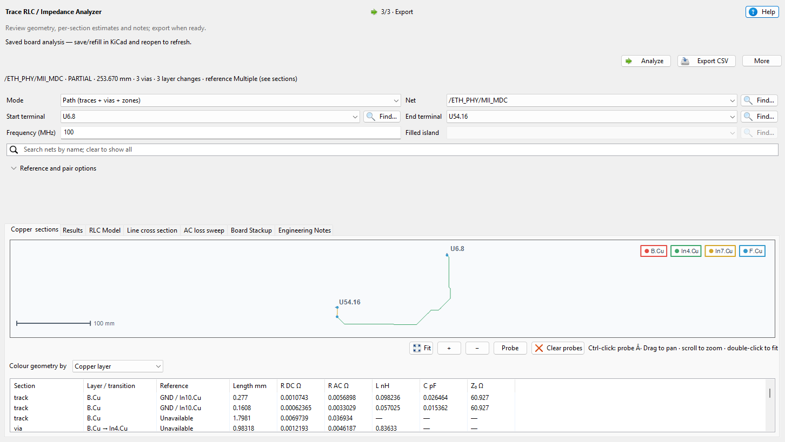
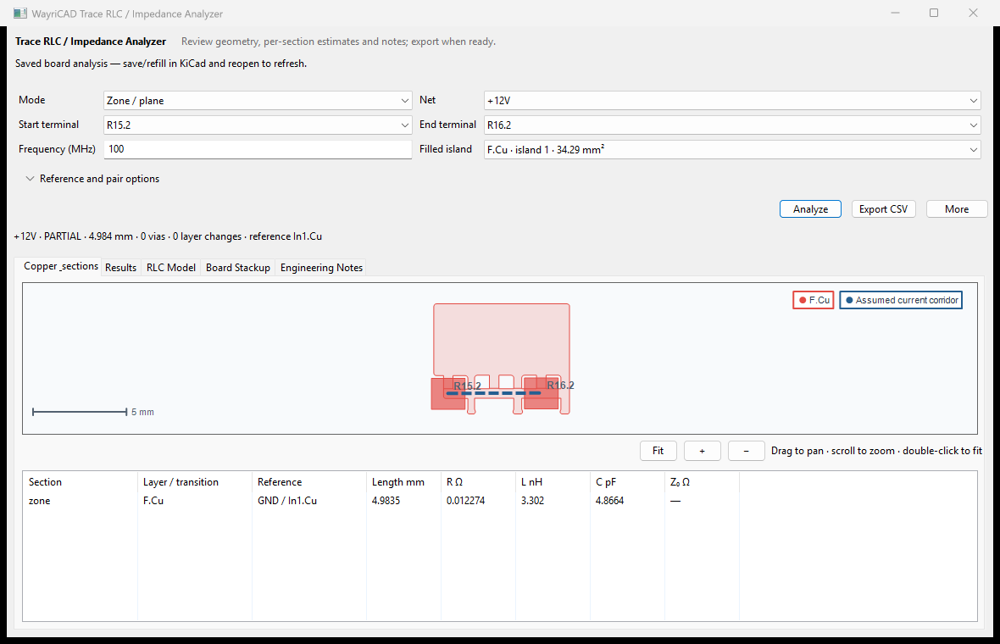
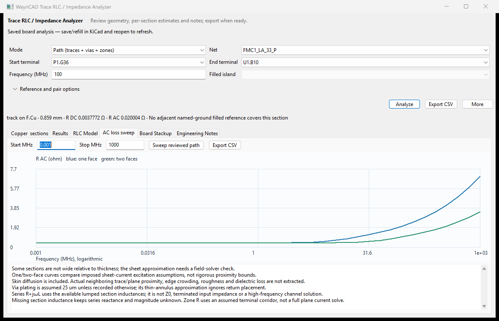

# WayriCAD Trace, Via and Plane RLC


| Start here | Link |
|---|---|
| Download and install | [Latest release](https://github.com/wayri/WayriCAD/releases/latest) · [Installation guide](../docs/INSTALLATION.md) |
| First use | [Getting started](#workflow) |
| Help | [Offline help](help.html) · [Compatibility](../docs/COMPATIBILITY.md) |
| Command line | `wayricad tools run trace-impedance -- --help` |

CLI scope: Read-only path, via and filled-zone estimates. The unified command requires the [suite CLI installation](../docs/TOOL_CLI_CATALOGUE.md); installing this PCM plugin alone does not install the complete CLI suite.

## Capabilities

- Inspect connected trace/via/zone paths or terminal-defined filled-zone/plane corridors, with actual copper previews.
- Identify candidate grounds and verify adjacent reference-copper coverage, or select a reference layer explicitly.
- Estimate section DC resistance, supported transmission-line L/C/Z0, isolated via terms and plane-overlap capacitance. The board microstrip and centered-stripline models now use the corrected EMerge cross-section equations.
- Open **Line cross section** to estimate manually entered CPW, grounded CPW or edge-coupled stripline impedance with a live diagram. This does not substitute for extracting the actual selected copper.
- Plot AC conductor-loss sweeps with skin-effect models, layer/section highlighting and CSV export.
- Export read-only CLI JSON with source hashes, units, modeled sections and unresolved terms.

## Limitations

- Zone R/L uses an assumed current corridor, not spreading resistance; full-island C and corridor R/L are not one extracted series circuit.
- Mixed routes do not have a single uniform Z0. Via capacitance remains unknown without antipad geometry; partial totals omit unresolved terms.
- Arbitrary proximity, roughness, dielectric loss, full return-current distribution and connector/package effects are not solved.
- Copper arcs retain their circular length, with small chords used for coverage checks. Complex current paths around zone obstacles can still remain unresolved.
- Analysis follows existing layer transitions and never reroutes copper. Saved stackup/reference data and native KiCad geometry support are required.
- Automatic characteristic impedance covers verified **single-ended microstrip or symmetric stripline** sections. Differential-pair board mode measures the two paths and skew, not coupled odd-mode or differential impedance. A separate manual cross-section calculator supports zero-thickness CPW, grounded CPW and edge-coupled symmetric stripline; it requires measured gaps and assumes continuous grounds. Automatic CPWG/CPW gap extraction, asymmetric/embedded stripline, broadside coupling and differential CPW remain unresolved. Nearby same-layer copper blocks a plain-microstrip Z0 instead of reporting a misleading value.

## Overview

Inspect an existing connected route or a filled zone between two terminals. The local preview shows actual pads, copper, vias and filled islands. The section table records each layer transition, reference layer/net and model.

## Current native workspace — 3.6.38




Actual native analysis of public Marble `/ETH_PHY/MII_MDC`, `U6.8` to `U54.16`,
without changing the board: **253.670 mm**, three vias and three layer changes.
The DC resistance estimate is **0.978676 Ω**. This is a **PARTIAL** result:
unresolved reference coverage and via antipad capacitance remain visible, and
the mixed route has no single uniform Z0. The displayed L/C totals contain
modeled sections only; they are not a complete return-loop equivalent circuit.
The analysis frequency is 100 MHz and default via plating is an assumed 25 µm.
[Capture provenance](../docs/audits/QUICK_TOOL_VISUALS_3.6.38.md).

Use **Copper sections** for geometry and linked rows, **Results** for totals and
unknowns, **Board Stackup** for saved material evidence, and **Engineering Notes**
for model blockers. **Line cross section** is a separate manually entered
calculator; **AC loss sweep** is a conductor-loss estimate. Neither tab silently
fills missing board geometry. Drag the horizontal divider to give the active
view more room; expanded **Reference and pair options** scroll within settings.
Earlier Marble and AC captures below remain available as historical examples.

## Native analysis views


Actual saved-board path inspection, including layer transitions. Per-segment estimates and unresolved reference coverage should be reviewed before interpreting a single global impedance.



Plane/zone estimates use the stated geometry and return assumptions; this is not a full-wave field solution. The installed [offline help](help.html) explains the available modes.

## Workflow

1. Save and refill the PCB in KiCad, then launch the plugin. The PCM action opens a saved-board snapshot; reopen it after saving further changes. Choose a net and two different pads. Native in-editor use can also synchronize from PCB selection.
2. Choose **Path** for existing trace/via/zone connections, or **Zone/plane** for a selected filled island and an assumed current-corridor width.
3. Leave the reference at **Auto**, or choose a copper layer explicitly.
4. Analyze, inspect the geometry and section status, then export the results.

For a large saved board, a small WayriCAD loading window appears while KiCad reads the PCB and prepares the analyzer. Closing that window cancels opening the analyzer after the current read finishes; it does not change the board.

In the native editor window, **More → Refresh stackup** rereads the saved stackup, retains the chosen reference layer when it still exists, and clears the previous result and AC sweep. Run Analyze again before exporting. The PCM saved-board window must be reopened after saving PCB changes.

Auto ground recognition uses names such as GND, AGND, DGND and VSS. A name alone does not establish a reference: the engine checks filled copper coverage on adjacent copper layers. Explicit reference selection still requires copper coverage. Unfilled zones must be filled in KiCad first.

Paths follow existing layer transitions through vias and plated pads. Analysis does not shift or reroute the board's copper. Crossings on different layers are not connections. Zone links require a finite-width corridor inside one filled island; holes and disconnected islands cannot be crossed by a shortcut. Circular arcs retain their exact length; coverage/contact checks use small chords. Large filled islands are no longer excluded by a fixed contact-count limit, although obstacle geometry can still leave a path unresolved. Use terminal-defined zone mode to review a specific island.

## What the numbers mean

| Geometry | Estimate |
|---|---|
| Trace | DC conductor resistance; skin-effect estimate; EMerge-derived quasi-static microstrip or centered-stripline L/C/Z0 where the reference geometry supports that model |
| Manual line cross section | Single-ended CPW/GCPW Z0 or edge-coupled centered-stripline differential Z0 from entered dimensions; not linked to a board section |
| Via | Barrel resistance with assumed 25 µm plating and isolated partial inductance; capacitance remains unknown without antipad geometry |
| Zone/plane | Terminal-corridor resistance and inductance; capacitance from filled-island/reference overlap and stackup separation |
| Trace + zone + via | Connected path and individual section models; unresolved terms remain identified |

Plane R/L depends on the selected terminals and assumed corridor width. It is not a spreading-resistance solution. Full-island capacitance and corridor R/L are different estimates and must not be interpreted as one series RLC circuit. Mixed routes have section impedances; they do not have a single uniform Z0. Partial totals contain modeled sections only. Disconnected endpoints produce an unresolved result instead of an aggregate-net fallback.

The stackup source, copper thickness, dielectric separation and permittivity are recorded. Automatic transmission-line estimates require saved dielectric thickness and Er; missing values remain structured blockers and are not replaced by generic FR-4 dimensions. A manufacturing document can disagree with embedded board data; resolve that discrepancy before using these estimates for design decisions. Models exclude copper roughness, etch shape, solder mask, dielectric loss, pad and thermal-spoke impedance, full return-current distribution, and connector/package effects. Critical high-speed work needs field simulation or measurement beyond this preliminary geometry analysis.

## Read-only CLI

Run with KiCad 10's Python, from this repository or with the wheel installed:

```powershell
& 'C:/Program Files/KiCad/10.0/bin/python.exe' -m trace_impedance_plugin.cli inspect board.kicad_pcb --net MDI0_P
& 'C:/Program Files/KiCad/10.0/bin/python.exe' -m trace_impedance_plugin.cli path board.kicad_pcb --net MDI0_P --start U1.1 --end J1.1 --output route.json
& 'C:/Program Files/KiCad/10.0/bin/python.exe' -m trace_impedance_plugin.cli zone board.kicad_pcb --net +3V3 --start C1.1 --end C2.1 --zone-id '<ID from inspect>' --corridor-width-mm 0.2 --output plane.json
& 'C:/Program Files/KiCad/10.0/bin/python.exe' -m trace_impedance_plugin.cli cross-section --topology grounded-cpw --width-mm 1.5 --gap-mm 0.3 --height-mm 1.53 --er 4.5 --output gcpw-estimate.json
```

Replace the example net/pad/zone identifiers with those returned by `inspect`. `wayricad-rlc` is the installed entrypoint. JSON contains numeric values, source-board SHA-256 and section status. Exit codes: 0 resolved, 1 input/runtime error, 2 disconnected (also argparse usage errors), 3 partial. Reports use a separate `.json` file and never save the source board.

`cross-section` needs no board and therefore has no board hash. Its `--height-mm` is trace-to-plane dielectric height for microstrip/grounded CPW and full plane-to-plane spacing for centered stripline. `--gap-mm` is the edge-to-ground slot for CPW/GCPW or trace-to-trace gap for edge-coupled stripline. The coplanar/coupled formulas require `--copper-mm 0`; finite-thickness versions need further validation. The normal PCB path still uses the saved stackup and actual filled-reference coverage.

See the [RLC/EMerge capability matrix](../docs/audits/RLC_EMERGE_CAPABILITY_MATRIX.md), [Marble smoke report](../docs/audits/MARBLE_SUITE_SMOKE.md) and [open-board impedance validation](../docs/audits/RLC_OPEN_BOARD_VALIDATION.md) for coverage and limitations. KiCad 10 is the native geometry target; KiCad 11 operation requires validation against its available native geometry API.

The scalar formulas are ported from [EMerge's calculator](https://github.com/wayri/EMerge/blob/50283a2/src/emerge/_emerge/geo/pcb_tools/calculator.py), revision `50283a2`, with no NumPy/SciPy runtime dependency. EMerge's [validation PR](https://github.com/wayri/EMerge/pull/1) corrects the source equations. The automatic board estimate is quasi-static; the entered analysis frequency affects AC resistance, not Z0 dispersion. Physical line and protocol compliance still require the actual dielectric and conductor profile, return geometry, transitions and often field/channel simulation or measurement.

Model references: [TI Analog Engineer's Pocket Reference](https://www.ti.com/seclit/eb/slyw038d/slyw038d.pdf) for the approximate via inductance relation; [Analog Devices PCB layout guidance](https://www.analog.com/en/resources/analog-dialogue/articles/high-speed-printed-circuit-board-layout.html) for plane-overlap capacitance. These references do not validate this implementation against measurements.

## Visual AC loss review

The copper preview can colour the actual route by layer, DC resistance
contribution, AC resistance contribution or model coverage. Select a section
row to highlight its copper; click a route/via marker to inspect the section.
Changing path inputs clears the reviewed geometry and frequency results.


The **AC loss sweep** tab plots 41 frequency points with editable start/stop
frequencies and CSV export. It includes trace, corridor and plated-via copper.
Move the pointer over the plot to inspect frequency, resistance and skin depth.
One-face and two-face curves compare assumed through-thickness excitation:
`R/Rdc = Re(q coth(q))`, `q=(1+j)t/(faces*skin_depth)`. This gives a continuous
DC-to-skin transition. It does not extract arbitrary neighboring-conductor
proximity, edge crowding, roughness or return-plane loss. These curves are not
rigorous upper/lower bounds on your real board. Narrow traces need field review.



The fixture is a selected signal path, not a power-rail voltage-drop claim.
Via plating defaults to 25 um; the thin annulus is treated as a sheet. Series
R+jωL uses the available lumped section contributions, and is not characteristic
impedance or terminated input impedance. Missing L remains unknown.

CLI: add `--sweep-mhz 0.001 1000` to a `path` or `zone` command to include the
same model, assumptions and points in JSON. Ordinary AC result totals now
include via resistance, which earlier versions omitted.


Trace measurement and AC-sweep CSV exports start in the originating board’s project folder with board-specific filenames. Export refuses a non-CSV destination for measurements.


## Jobsets and automatic reports

Use this tool’s existing CLI in a shared WayriCAD report sequence. The runner adds ordered steps, failure propagation, per-run logs and an HTML/JSON report index, and can insert the sequence into a native KiCad jobset. See [setup, presets and examples](../wayricad_runtime/JOBSETS.md). The CLI keeps the same input requirements and engineering limitations as interactive use.


## Solver methods

| Quantity or workflow | Method used | References and limits |
|---|---|---|
| Trace resistance and conductor loss | DC resistance from resistivity, length and cross-sectional area; skin-depth/slab approximations for frequency sweeps. | [Implemented equations](rlc_model.py). Proximity effect, roughness and a complete frequency-dependent return path are not solved. |
| Board-section Z0, L and C | EMerge-derived quasi-static microstrip or centered-stripline equations, including supported copper-thickness corrections; telegrapher relations convert impedance and velocity to distributed L/C. | [Pinned EMerge source](https://github.com/wayri/EMerge/blob/50283a2/src/emerge/_emerge/geo/pcb_tools/calculator.py), [local port](emerge_lines.py), [Qucs microstrip equations](https://qucs.github.io/tech/node75.html). Actual saved reference coverage and supported stackup geometry are required. |
| Manual CPW/GCPW and coupled stripline | Conformal-mapping/elliptic-integral cross-section formulas evaluated from user-entered dimensions. | [Qucs CPW method](https://qucs.github.io/tech/node86.html), [local implementation](emerge_lines.py). These manual models use zero-thickness conductors and ideal continuous grounds; they do not extract actual board gaps or add automatic differential-pair impedance. |
| Vias | Plated-barrel DC resistance and isolated partial-inductance approximation. | [TI Analog Engineer's Pocket Reference](https://www.ti.com/seclit/eb/slyw038d/slyw038d.pdf), [implementation](rlc_model.py). Antipad capacitance and return-loop inductance need additional geometry and remain unknown. |
| Filled zones and planes | An assumed terminal-to-terminal current corridor for R/L, with parallel-plate capacitance from saved plane overlap and dielectric separation. | [Model and result meanings](#what-the-numbers-mean), [plane-capacitance background](https://www.analog.com/en/resources/analog-dialogue/articles/high-speed-printed-circuit-board-layout.html). Corridor R/L and whole-island C are different estimates, not one extracted circuit. |

This tool combines geometry extraction and analytical approximations; it does
not run a whole-board FEM or full-wave electromagnetic solver. Mixed routes
retain section results and unresolved terms. The
[capability matrix](../docs/audits/RLC_EMERGE_CAPABILITY_MATRIX.md) and
[open-board checks](../docs/audits/RLC_OPEN_BOARD_VALIDATION.md) record what was
tested separately from the literature's broader formula coverage.

### Equation and verification map

[rlc_model.py](rlc_model.py) evaluates `Rdc = ρℓ/(wt)` with default copper
resistivity `1.724 × 10⁻⁸ Ω·m`. For a supported uniform line,
`v = c/√εeff`, `L′ = Z0/v`, `C′ = 1/(Z0 v)` and `delay = ℓ/v`;
section totals retain their separate geometry and assumptions. Skin depth is
`δ = √[ρ/(πfμ0)]`; the slab correction assumes explicitly selected one- or
two-face excitation rather than solving return/proximity fields. Via R uses
the annular plating area and via partial L uses
`μ0ℓ/(2π)[ln(4ℓ/d) + 1]` only in its supported aspect range. A partial
inductance is not a closed-loop inductance, and missing via C remains unknown.

[Scalar-model regressions](../tests/test_rlc_emerge_models.py) check the supported
cross sections and units; [CLI regressions](../tests/test_rlc_cli.py) check route
and report contracts. The [capability matrix](../docs/audits/RLC_EMERGE_CAPABILITY_MATRIX.md)
and [open-board evidence](../docs/audits/RLC_OPEN_BOARD_VALIDATION.md) describe
recorded coverage separately from these formulas. Neither a literature accuracy
bound nor a successful fixture is automatically transferred to an arbitrary PCB.

## References and research

### Implemented methods and research basis

The read-only route engine is implemented in [copper_path.py](copper_path.py), [rlc_model.py](rlc_model.py), [emerge_lines.py](emerge_lines.py), and [frequency_ui.py](frequency_ui.py). It measures saved KiCad geometry in mm; reports R in ohm, L in nH, C in pF and Z0 in ohm; uses copper cross-section/resistivity for DC R, supported EMerge quasi-static microstrip/centered-stripline sections, and a slab skin-depth AC approximation. [Scalar-model tests](../tests/test_rlc_emerge_models.py), [CLI tests](../tests/test_rlc_cli.py) and the recorded open-board checks cover supported equations, geometry and blockers, not measured-board accuracy. Roughness, proximity, arbitrary return current, via antipads and full-wave fields remain unsupported. Manual coupled-stripline formulas have the restrictions listed above; they do not supply automatic board differential-pair extraction. The references below are theoretical background, not evidence that every cited model is implemented.

| Source | How it relates to Trace RLC / Impedance |
|---|---|
| [EMerge calculator, pinned revision 50283a2](https://github.com/wayri/EMerge/blob/50283a2/src/emerge/_emerge/geo/pcb_tools/calculator.py) | Recorded source of the scalar microstrip/stripline and supported manual cross-section port in `emerge_lines.py`. |
| [Hammerstad & Jensen, *Accurate Models for Microstrip Computer-Aided Design*, 1980](https://doi.org/10.1109/MWSYM.1980.1124303) | Related microstrip/thickness-correction literature. This is not a claim that WayriCAD implements every equation or accuracy bound from the paper. |
| [Qucs microstrip equations](https://qucs.github.io/tech/node75.html) and [CPW conformal mappings](https://qucs.github.io/tech/node86.html) | Independent equation background, including elliptic-integral and grounded-CPW formulations. The manual calculator keeps its zero-thickness restrictions. |
| [TI Analog Engineer's Pocket Reference](https://www.ti.com/seclit/eb/slyw038d/slyw038d.pdf) | Approximate via-inductance relation already cited in the model documentation. |
| [Analog Devices PCB layout guide](https://www.analog.com/en/resources/analog-dialogue/articles/high-speed-printed-circuit-board-layout.html) | Plane-overlap capacitance and layout context. |
| [RFsim pinned validation sources](https://github.com/NBalciunas/kicad-rfsim/tree/efa0ea9bd34b13f7819c6f2d4c02e78d34b116c3/validation) | Independent geometry/formula fixtures used in the recorded open-board checks; not measured-board qualification. |

[Implemented capability matrix](../docs/audits/RLC_EMERGE_CAPABILITY_MATRIX.md) ·
[Open-board checks](../docs/audits/RLC_OPEN_BOARD_VALIDATION.md).
The implementation is quasi-static with declared geometry limits; the bibliography
does not add dispersion, arbitrary coupled fields or automatic differential CPW extraction.

## Search long net and terminal names

Use **Find…** beside net, start/end terminal, saved filled-island, reference-layer and differential-mate selectors. Search matches any literal part of a name, case-insensitively, and displays the full selected name below the results. Choose an item and **OK**, or **Cancel** without changing the route. These fields remain single selections. **Ctrl+F** and the dropdown context menu open the same picker.


## Resizing the workspace

Drag the horizontal divider under the path settings to give reference/pair options more room or enlarge the analysis views. The settings scroll independently when expanded. Help is available beside the workflow header.

## HTML and PDF reports

Use [the common report workflow](../wayricad_runtime/REPORTS.md) to save HTML as PDF, or render this tool's saved JSON as readable HTML/PDF tables. The direct PDF exporter retains text, tables and embedded PNG/JPEG figures; interactive-only views are listed explicitly and remain available in HTML. Install the optional `reports` extra only in the interpreter performing PDF export.
