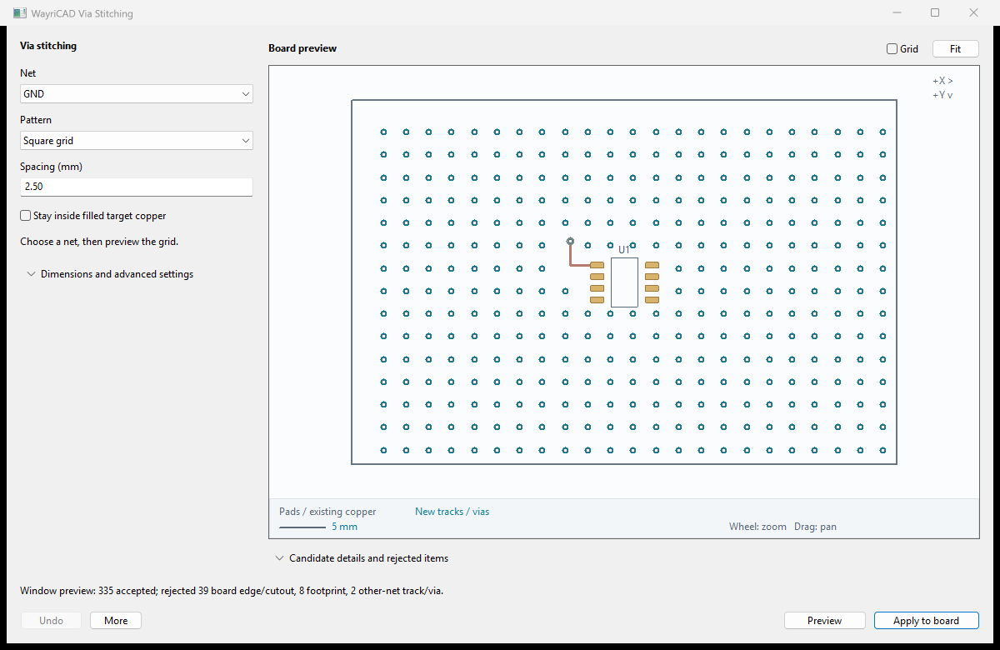

# WayriCAD Via Stitching


## Capabilities

- Preview square/staggered via grids on a chosen net with configurable spacing, diameter, drill and clearance.
- Add guard vias along exact signal nets or captured PCB tracks, on one or both sides, with adjustable pitch and centre-to-centre offset.
- Use uniform/density profiles, rectangular or selected-item bounds and footprint exclusions.
- Check filled target-net copper, other-net obstacles, keepouts and board outline/cutouts before placement.
- Review contextual geometry and rejection reasons, then apply recoverable groups with stale-preview checks.
- Use CLI plan/apply to export JSON/SVG and write a separately reviewed board copy.
- Keep the window responsive while a cancellable native process plans against an owned board snapshot.

## Limitations

- Filled target-net zones are required by default; missing or unfilled zones fail explicitly.
- Conservative obstacle envelopes can reject valid placements; arc previews are approximate and native DRC is still required.
- Grids are bounded to 50,000 candidates; the tool does not establish RF shielding, return-path quality or manufacturing suitability.
- IPC geometry coverage depends on the host API. Native KiCad 11 behavior remains unverified.

## Overview

A fully local routing tool for PCB Editor. No hosted UI or remote preview assets are required.

## Native interface



Synthetic GND-board preview illustrating candidate via placement. Preview candidates are reviewed before copper is modified.

### Guard a signal route


Synthetic two-layer board: the selected signal is dark teal; the 22 proposed GND through-vias are light cyan. Filled top and bottom GND planes and an existing plated ground connection provide the target copper. This is an actual plugin window, not a mockup; no private board or machine paths appear in the capture.

1. Select **Guard selected routes**. Keep **Via net** on the intended ground/guard net; it must differ from the signal nets.
2. Check one or more exact **Signal nets**, or select tracks in PCB Editor and click **Use selected PCB tracks**. Checked nets and captured track IDs are combined. **Ctrl+F** opens the full-name wildcard/fuzzy search with multiple selection.
3. Choose **Both**, **Left**, or **Right**, then set the via pitch and track-centre-to-via-centre offset. Left/right follow each stored track's start-to-end direction in the top board view; reversing a segment swaps its sides. Both is useful when a route contains mixed segment directions.
4. Preview. The selected routes are highlighted before placement; proposed vias and rejection reasons appear when the worker finishes. **Cancel planning** discards the entire pending result.
5. Apply only after checking the preview. All vias are through-vias on the explicitly selected guard net. No signal trace is rerouted or assigned a different net.

Straight tracks are supported. Arc and via targets are counted as unsupported/non-straight targets; they are never replaced by straight chords. A scope containing only unsupported targets fails explicitly. The offset does not override required copper clearance: a too-close candidate is rejected rather than pushed through another net.

The default preview reads a private copy of the **saved board**. Save working edits first, or explicitly enable **Include unsaved PCB edits (slower snapshot)** under advanced settings. Planning, board-context extraction and process termination occur outside the UI loop. Apply still checks the working board, source identity, saved project/rule files and current settings, and refuses a stale result. Unattached preview objects are never written into the PCB.

The installed package includes [offline help](help.html) with its workflow and limitations.

## Workflow

1. Configure geometry and pad scope or target net.
2. Click **Preview**. The canvas and result table show accepted candidates and rejection reasons. Preview creates no PCB copper.
3. Inspect the result, then **Apply to board**. A named WayriCAD group contains the committed geometry. Run KiCad DRC before saving or manufacturing.

The optional **More → Review placement again** command rechecks the board snapshot and prepares the same geometry; it is not required before Apply. **More → Clear preview** discards unattached candidates. Settings changes invalidate the preview. Board changes require a new preview. Plugin Undo/Redo preserves a recoverable group; reopen the tool to find its existing named groups.

## Controls and checks

Choose a PCB net and square or staggered grid. Configure grid spacing, via diameter/drill, copper clearance, edge inset, and uniform or density profiles. Expand Area and exclusion settings to limit the rectangle, use selected-item bounds, or exclude footprints by reference.

By default candidates must fit completely inside filled target-net copper. Missing/unfilled target zones fail explicitly. Other-net copper and via keepouts are always excluded; same-net tracks and footprint envelopes have optional exclusions. The complete via radius plus clearance is checked against conservative obstacle envelopes, and vias remain inside the closed board outline, including cutouts. Too-dense grids and more than 50,000 candidates fail before modifying the board.

Guard mode additionally separates proposed vias from each other and rejects missing track IDs, empty scopes, invalid native-resolution dimensions and a guard net equal to a signal net. A spatial index narrows obstacle checks; native polygon containment and closed-chain edge distances preserve filled-copper holes. Saved netclass clearance floors are not weakened. Conditional/custom rules still require native KiCad DRC; a preview is not an RF shielding, signal-integrity or fabrication qualification.

The target-fill check requires full via-annulus coverage on **at least one** target-copper layer. It does not prove a connection on two layers, continuity to the intended ground port, or RF effectiveness. A native single-plane test produced `via_dangling` warnings even though every candidate cleared other copper. Provide the intended additional ground connections and run DRC; the planner does not silently add ground traces or waive these findings.

Guard candidate count is bounded by **50,000** and its default planning time budget is **15 seconds**. Both can be reduced; the time limit can be explicitly raised to at most 120 seconds. Exceeding either limit returns no partial placement. The result table shows at most its first 1,000 accepted candidates to keep large plans readable; the complete accepted set remains in the canvas and reviewed plan.

## Local preview

Primary choices remain visible; detailed dimensions and rejection tables are collapsed until needed. The clean, neutral canvas shows footprint outlines and references, real native pad polygons/rotation, existing copper, and generated geometry. A visible legend, millimetre scale, and coordinate orientation support review; the grid is optional and off by default. The resizable canvas supports wheel zoom at the cursor, drag to pan, double-click to fit, and via picking for coordinates. Pads, existing tracks/vias, zone outlines, and board edges provide context. Candidate copper and drill sizes use board units. Arc tracks currently appear as conservative bounding envelopes; native pads use their effective polygons; the IPC fallback uses supported padstack shapes. The canvas is a review aid, not a replacement for PCB Editor or DRC.

## Command line

Use KiCad 10's bundled Python so `pcbnew` is available. List JSON option names and actual project choices with `python -m wayricad_runtime.cli fanout settings --board source.kicad_pcb` (or `stitching settings`). Settings are a JSON object, for example:

```json
{"net_choice":"GND","pattern":"Staggered grid","spacing":2.5,"diameter":0.6,"drill":0.3,"clearance":0.2,"require_target_zone":true}
```

For a signal-guard plan, use the same commands with settings such as:

```json
{"mode":"Guard selected routes","net_choice":"GND","guard_nets":["/ADC/CLK_P","/ADC/CLK_N"],"guard_tracks":[],"guard_side":"Both","guard_offset":1.0,"spacing":2.5,"diameter":0.6,"drill":0.3,"clearance":0.2,"require_target_zone":true,"guard_budget":50000,"guard_timeout":15}
```

`guard_nets` contains exact signal-net names, not patterns. `guard_tracks` optionally contains exact saved track UUIDs; both scopes are combined. `net_choice` alone determines the generated via net. Dimensions are millimetres; `guard_offset` is centre-to-centre and `spacing` is pitch along each source segment. Near bends/endpoints, duplicate or too-close proposals are rejected. Arc targets and all other exclusions are recorded in `rejected`. The CLI's source/rule fingerprint and reviewed-candidate checks apply to this mode as well.

On public Marble, a dense FMC clock-pair check returned **zero legal sites** at the tested offsets with filled-copper, pad and trace guards enabled. That is an explicit placement limitation, not successful guard coverage. The synthetic filled-plane example above demonstrates the positive case; every real design still needs its own native DRC and return-path review.

```text
python -m wayricad_runtime.cli stitching plan --board source.kicad_pcb --settings settings.json --output plan.json --svg preview.svg
python -m wayricad_runtime.cli stitching apply --board source.kicad_pcb --plan plan.json --output routed.kicad_pcb
```

Plan is read-only and produces reviewable JSON plus an optional standalone local SVG. Apply recomputes and checks the reviewed geometry and board fingerprint, then writes a **new** `.kicad_pcb` file. It refuses source overwrites, existing destinations, empty plans, and stale or altered candidate geometry. The source remains unchanged.

## Compatibility

Native in-memory board tests, file round-trips, and hidden wx frame smoke checks run against KiCad 10. The suite also packages an IPC entry point for forward compatibility; supported geometry depends on the live IPC API. Unsupported capabilities fail explicitly. Live KiCad 11 behavior must be validated against its released runtime.


## Resize the workspace and find help

Drag the settings/board-preview divider to make room for net, grid and area/exclusion controls. Expanded settings scroll independently; inspect the accepted/rejected candidates before Apply.

Open [offline help](help.html) for the workflow and troubleshooting. See [readable windows, panels and tables](../docs/UI_ACCESSIBILITY.md) for resizing, complete-row reading and keyboard controls.
