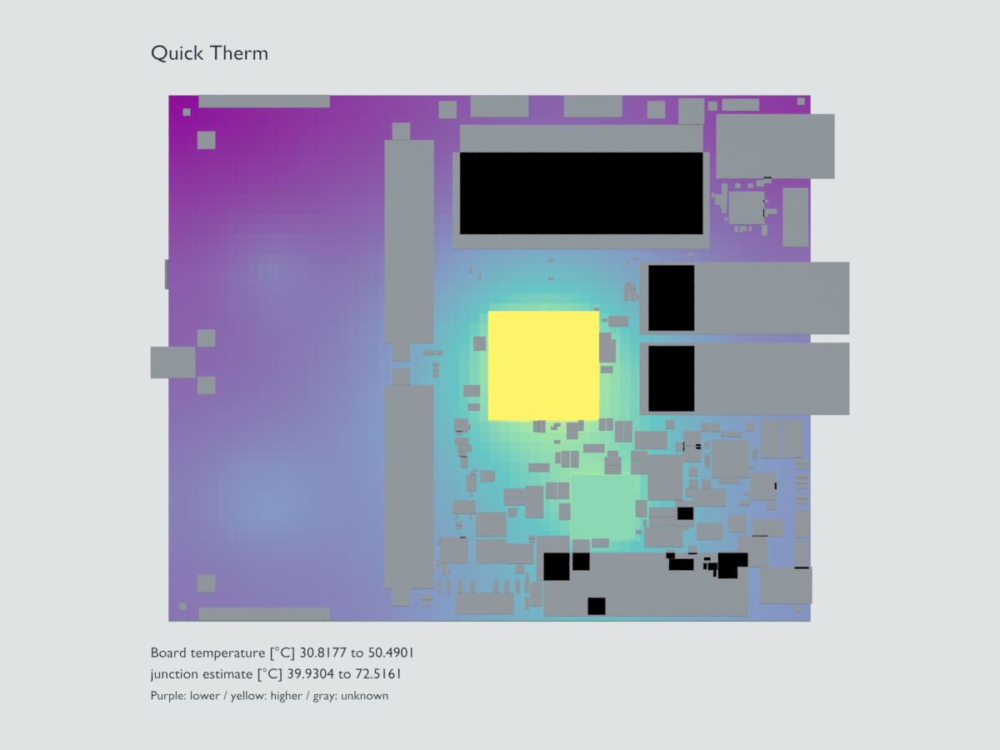

# Blender visualization and animation

This guide describes the updated source workflow. Previously published installers
gain it only after a new package containing these changes is installed.

Export a completed Quick PI, Quick SI or QuickTherm result into Blender to inspect
its geometry and result fields, compose a presentation scene or render an
animation. Blender is a visualization destination: this workflow does not rerun
the solver or improve the numerical accuracy of its results.

## Before exporting



This is an actual Blender 5.2 render of an existing illustrative saved Marble
study: four assumed heat sources (5 W, 2 W, 0.5 W and 0.8 W), 25 °C ambient,
declared materials and cooling. Gray component envelopes have illustrative
heights. It demonstrates data transfer, not measured temperatures or a new solver
validation. [Validation scope and inputs](../docs/audits/BLENDER_VISUALIZATION_2026-10-28.md).

1. Complete the study in the appropriate tool. Review missing fields, incomplete
   geometry, convergence and model limits first.
2. Keep the saved board and project at the analyzed revision. If the source
   changed, reload and rerun. Unsaved editor changes are outside a saved-board
   study.
3. Install Blender separately if you want to open or render the scene. Creating
   the export bundle does not need Blender and does not install it.
4. Choose a new output directory. Existing bundles and production PCB files are
   never overwritten by this export.

## Export from a plugin

After a result is available, click **Blender…**:

| Tool | Where | Default evidence |
|---|---|---|
| Quick PI | Main workspace actions beside Export | Solved planar copper field; selected default metric |
| Quick SI | Main path workspace below Export local HTML report | Current route or multi-route study evidence |
| QuickTherm | Board + results actions beside Export | Board temperatures, component estimates and available computed frames |

Choose a parent directory, a new folder name and the **Result field**, then click **Export**. Preparing
geometry and frames runs in the tool's worker so the native window can continue
to repaint. Large exports still need memory and time; the exporter enforces
explicit size limits rather than truncating a model invisibly.

PI offers potential, voltage drop, current density and cell power. SI offers
section delay, impedance and resistance. Thermal exports temperatures. The
selected field must exist in the saved result; a missing value stays unknown.

Leave **Open Blender after export** off to move the bundle to another workstation
or inspect its contents first. Turn it on to launch an already installed Blender
after the export succeeds. The optional executable picker overrides automatic
discovery. A missing executable leaves the exported bundle available and reports
the launch error; it does not discard results.

This is an explicit action. Finishing a simulation does not automatically open
another application or send files to a remote service.

## Export a saved result from the command line

Run the command in a prepared WayriCAD environment:

```text
python -m wayricad_runtime.tool_cli blender pi.json --tool pi --output C:/Projects/Example/pi-blender
python -m wayricad_runtime.tool_cli blender si.json --tool si --output C:/Projects/Example/si-blender
python -m wayricad_runtime.tool_cli blender thermal.json --tool therm --output C:/Projects/Example/thermal-blender
```

`--tool auto` is the default. Use an explicit tool if a saved result is ambiguous.
The source is a complete saved JSON result, not an HTML report or screenshot.
Lightweight child-case descriptors do not contain the full numerical data; use
the complete result rather than expecting the exporter to fetch linked files.

For a different supported PI field:

```text
python -m wayricad_runtime.tool_cli blender pi.json --tool pi --metric density --output C:/Projects/Example/pi-current-density
```

Supported field names depend on the result adapter. PI planar fields include
`voltage`, `drop`, `density` and `loss`; SI route fields include `impedance`,
`delay` and `resistance`; thermal uses `temperature`. Unknown or unsupported
choices report an error instead of substituting another quantity. Use the
command's `--help` for installed-version options.

To prepare a `.blend` file without opening the interactive window, use an
explicit Blender executable and background mode:

```text
python -m wayricad_runtime.tool_cli blender thermal.json --output C:/Projects/Example/thermal-render --blender "C:/Program Files/Blender Foundation/Blender 5.2/blender.exe" --background
```

The Blender version and path above are an example; select your installed
executable. Launch/import errors are separate from solver status. An export can
be numerically complete while its renderer is unavailable.

## Bundle contents and opening later

The export includes a normalized `scene.json`, the bundled `blender_import.py`
importer, a manifest and instructions. Keep these files together. The scene
retains numerical quantities, units, notes and source identity; it is not a new
KiCad project and cannot be applied as a PCB edit.

The bundled importer can be run explicitly:

```text
blender --background --python blender_import.py -- --scene scene.json --output visualization.blend
```

Run that command from the bundle directory. Open the resulting `.blend` in
Blender, use the Outliner to select objects, orbit/pan/zoom and inspect object
properties for identity and quantity information. Field colors use a fixed
range across each exported animation so a constant temperature or voltage does
not change color merely because the displayed frame changes.

Source PCB positions are in millimetres with KiCad's downward Y direction. The
importer converts them to metres and reflects Y for Blender. This is a coordinate
conversion, not a change to the original board. Keep the scale intact when
combining the scene with other models.

Full saved-board context needs native KiCad Python and the declared source PCB
at its recorded revision. Without that runtime or source, the export retains
available result geometry and records the missing context. A live-editor SI
result does not silently substitute an older saved board for unsaved geometry.

## What the visuals mean

| Evidence | Meaning and limits |
|---|---|
| PI field mesh | Actual supported sheet triangles or tetrahedral boundary faces and scalar data, retaining gaps and unknowns. A DC field is static; it does not become an AC or transient solution by animating the camera. |
| SI route | Supported straight saved route sections with actual width and available section estimates. Vias, arcs and zones omitted by the adapter are counted in notes; they are not replaced by invented connections. Delay or impedance color is a scalar route display, not a simulated propagating electromagnetic wave. |
| Thermal field | Stored computed board temperatures where available. A thin-sheet model remains a single midplane approximation, even when presented in 3D. |
| Component geometry | Simplified envelopes from available board context. These are not vendor STEP package solids or mechanically qualified assemblies. |
| Component junction estimates | Separate from board-surface temperatures; a component estimate must not be painted as a resolved internal package gradient. |
| Transient frames | Stored solver states, using the recorded time labels. Playback does not compute intermediate physics or improve time resolution. |
| Lumped waveform | A chart of a quantity against computed time. Without spatial data it is not painted onto invented board coordinates. |
| Unknown data | Retained as unavailable or omitted with a note, not converted to zero. |

Not every result type has a spatial adapter. Unsupported volume formats,
cross-section studies or result schemas are rejected explicitly. Keep the
original report for details not represented by the Blender scene. The export
does not infer STEP models, copper connectivity, missing returns, capacitor
positions, temperature paths or SI propagation waveforms.

## Animate and render

Objects sharing a field name and unit use the same color range across objects
and all stored frames. This keeps, for example, two component temperatures
comparable instead of giving both constant-temperature parts the same color.
Unknown samples use gray. Select an object to inspect its local extrema and the
shared color-scale extrema in Custom Properties.

When the result contains supported time-series fields, the importer prepares an
animation from those computed samples. Use Blender's timeline and frame markers
to inspect the associated physical times, then set the desired rendering camera,
resolution, codec and frame range through Blender's normal controls.

Treat playback speed as presentation. Check physical-time labels when comparing
two studies with different stored times. Keep generated texture/frame assets
beside the saved scene when transferring it. A static result can still be used
for an orbit or camera animation, but label that as a presentation animation.

In the Outliner, use **Simulation fields**, **Board context — saved geometry**
and **Components — saved meshes and envelopes** to control visibility. PI/SI
footprint envelopes start as wireframe and are hidden from renders so they do
not obscure the analyzed route. To render them, enable **Show in Renders**;
choose a solid **Display As** mode for a filled viewport. Thermal component
temperature objects remain visible by default. Envelopes use illustrative
heights and must not be used as mechanical solids.

## Troubleshooting

| Problem | Action |
|---|---|
| Blender action disabled | Complete a supported current study and wait for pending calculations. Changing inputs invalidates old results. |
| Saved board changed | Save the intended revision, reload and rerun; do not bypass source checks. |
| Folder already exists | Choose a new folder name. Existing files are retained. |
| Blender not found | Select its executable or import the bundle on a workstation with Blender installed. |
| Empty or incomplete overlay | Inspect unknowns, unsupported sections and scene notes. The exporter cannot recover numerical data absent from the result. |
| Export exceeds a budget | Reduce the selected study or frame count through a reviewed simulation setup. The exporter does not silently discard solved faces or frames. |
| Animation does not represent expected time | Read stored times and timeline markers; distinguish computed-state playback from wall-clock render speed. |
| Need certified geometry or temperatures | Retain native source, full numerical report and independent verification; a Blender rendering is presentation evidence. |

See the [Quick PI guide](../quick_pi_plugin/USER_GUIDE.md),
[Quick SI guide](../signal_integrity_advisor_plugin/USER_GUIDE.md),
[QuickTherm guide](../quick_therm_plugin/QUICK_THERM_USER_GUIDE.md) and
[HTML/PDF reporting guide](REPORTS.md) for simulation setup and model boundaries.
